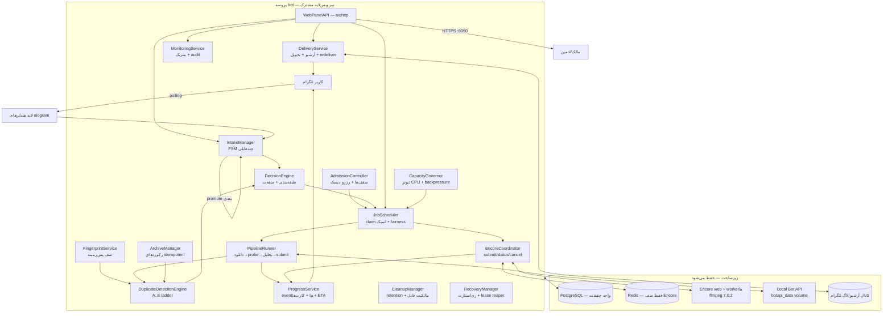
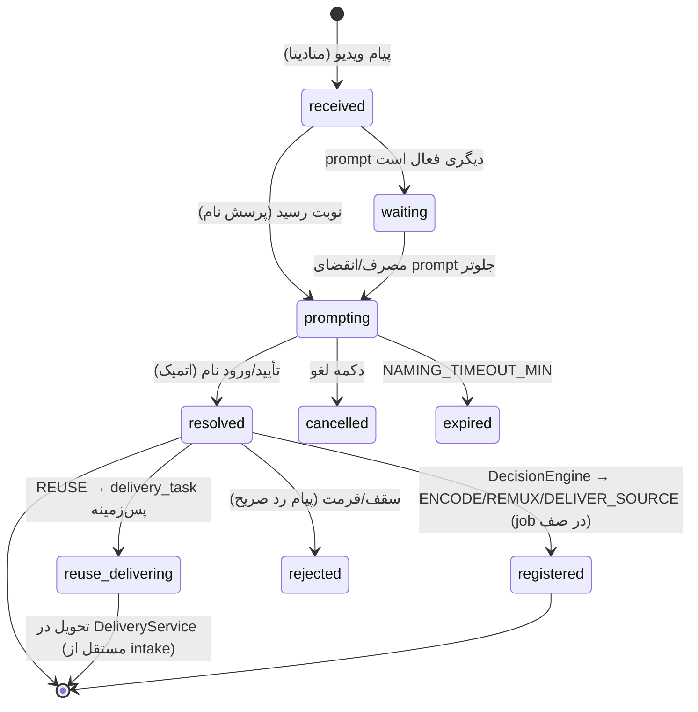
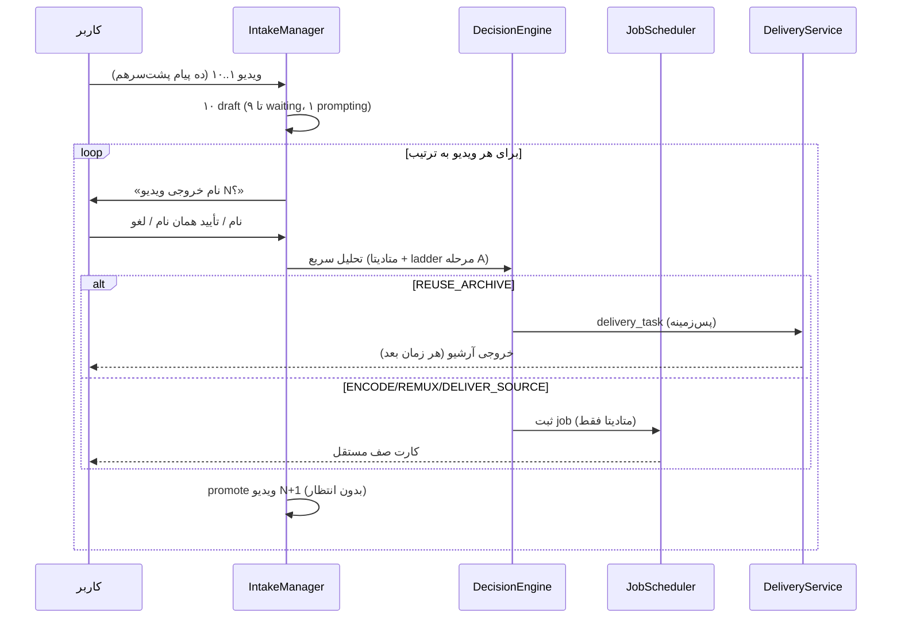
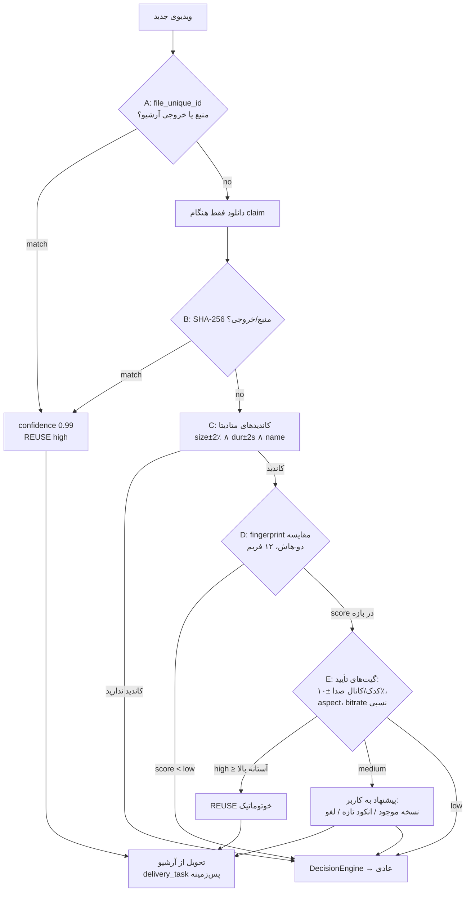
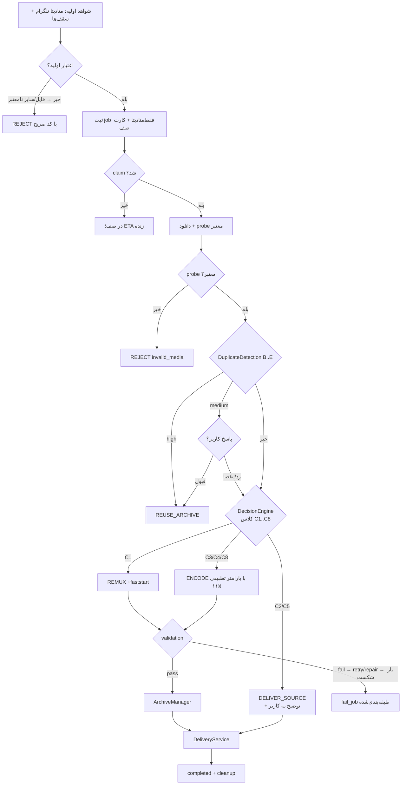
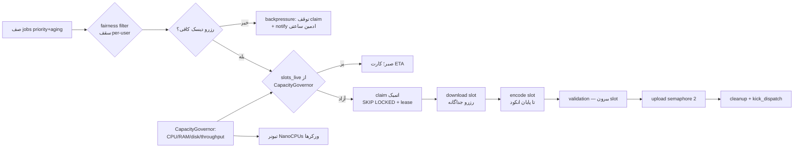
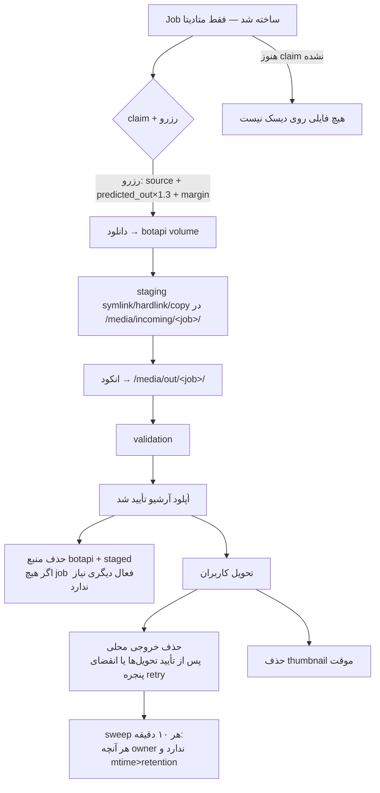
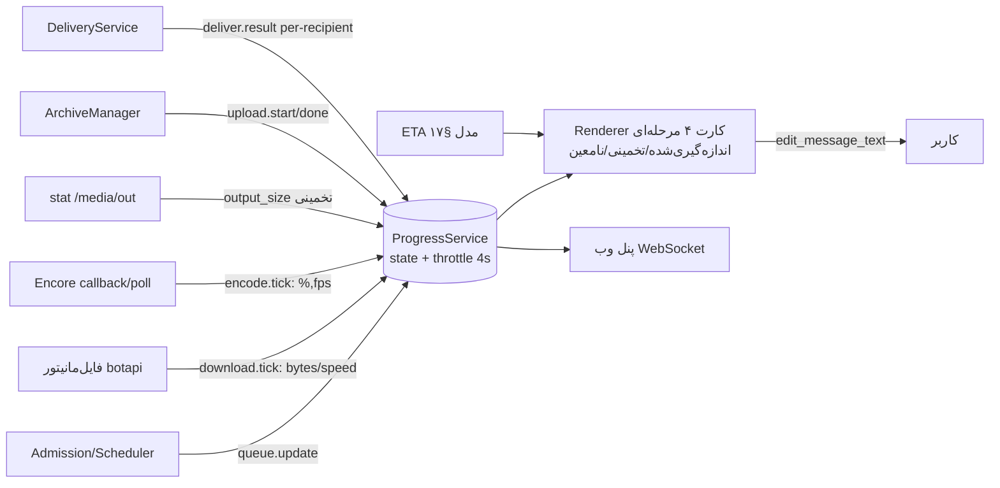
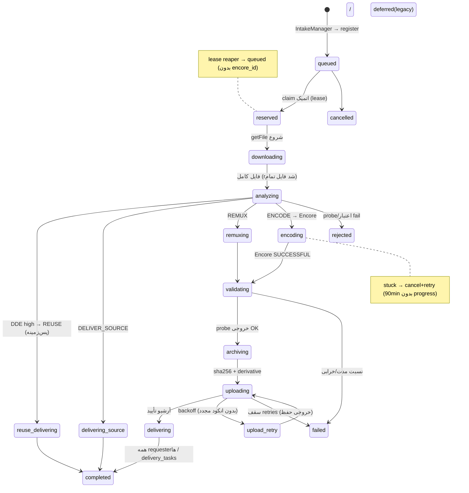
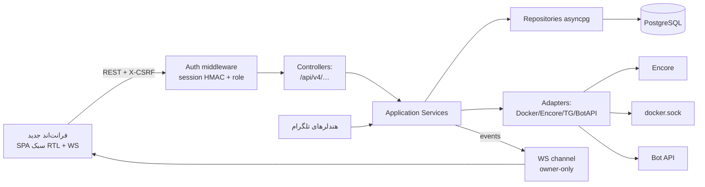

# پروپوزال معماری هدف و الگوریتم هوشمند پردازش ویدیو — Oxmit

> **سند:** MEGA PROMPT 01 — فاز ۱ از ۳ (تحلیل مهندسی عمیق + طراحی معماری هدف + پروپوزال فنی)
> **وضعیت:** فقط طراحی — **هیچ پیاده‌سازی انجام نشده و بدون تأیید مالک انجام نخواهد شد**
> **نسخه مبنا:** شاخه `main`، کامیت `1699d98` (2026-11-13) — تطبیق‌سنجی‌شده هم روی کلون محلی و هم روی سرور `/opt/oxmit` (بخش ۲٫۱)
> **مستند مبنا:** `PROJECT_REVERSE_ENGINEERING_REPORT_FA.md` (بازبینی‌شده و در صورت لزوم اصلاح نسبت به کد فعلی)
> **زبان:** فارسی؛ نام‌های فنی، توابع، فیلدها و مسیرها به شکل اصلی

---

## ۱. خلاصه مدیریتی

Oxmit امروز یک چرخه کاری «تک‌پروفایلی و اکثراً صحیح» دارد: کاربر ویدیو می‌فرستد، فقط متادیتا ثبت می‌شود، نام خروجی پرسیده می‌شود، job در PostgreSQL صف می‌شود، SVT Encore آن را با پروفایل ثابت EDU480 فشرده می‌کند و نتیجه از کانال آرشیو تحویل می‌شود. ستون فقرات این معماری (صف PostgreSQL، Encore، Local Bot API، کانال آرشیو) **سالم است و نگه داشته می‌شود**.

اما شش مشکل ریشه‌ای، تجربه کاربری و مقیاس‌پذیری را محدود می‌کند:

1. **تحویل نتیجه کش‌شده، حلقه نام‌گذاری چندفایلی را مسدود می‌کند** — مسیر reuse درون `register_job` به‌صورت هم‌زمان تحویل تلگرام را انجام می‌دهد و برای یک خروجی ۲ گیگابایتی می‌تواند پرسش نامِ ویدیوی بعدی را چند دقیقه نگه دارد.
2. **هیچ موتور تصمیم واقعی وجود ندارد** — تصمیم فقط باینری `remux/encode` با `edu480.decide` است؛ سه ماژول تصمیم‌گیر (`decision_engine.py`، بخش بزرگی از `dedup.py`، `estimate.py`) کد مرده‌اند؛ «تشخیص ویدیوی از قبل فشرده‌شده» عملاً به یک آستانه ساده no-gain بعد از انکود خلاصه شده است — یعنی هزینه انکود پرداخت می‌شود تا بفهمیم نباید انکود می‌شد.
3. **dedup ادراکی نیمه‌وصل است** — fingerprint محاسبه و ذخیره می‌شود ولی هیچ کوئری مصرفی ندارد؛ نسخه ۸ فریم × ۸×۸ ahash برای تشخیص نسخه‌های transcode‌شده کافی نیست.
4. **پیشرفت و ETA دقیق نیست** — دانلود فاقد هرگونه اندازه‌گیری است، آپلود «فیک» نشده ولی همیشه نامعین نشان داده می‌شود بدون طراحی، و ETA صف بر یک مدل throughput یک‌بعدی تکیه دارد.
5. **مدت ویدیو گاهی `00:00:00` نمایش داده می‌شود** — چون ورودی‌های document و مسیرهای reuse روی ردیف‌های فقط‌متادیتا، `duration_s = NULL` دارند و رشته خلاصه نهایی `or 0` می‌کند (بخش ۱۸).
6. **پنل وب چهار نسل API و چند عملیات بدون اثر واقعی دارد** و منطق تجاری را از ربات جدا پیاده می‌کند.

این سند معماری هدف را با **۱۳ کامپوننت با مسئولیت جدا**، **موتور تشخیص تکراری پنج‌مرحله‌ای با نردبان اطمینان**، **موتور تصمیم چهارحالته (REUSE/DELIVER-SOURCE/REMUX/ENCODE) با شواهد ثبت‌شده**، **صف intake چندفایلی FIFO ماندگار و مستقل از پردازش**، **سیستم Progress بدون هیچ درصد جعلی** و **مدل ظرفیت صادقانه برای ۲ تا ۵ هزار کاربر** طراحی می‌کند و نقشه راه شش‌فازی (A–F) پیشنهاد می‌دهد.

**تمام تصمیم‌های نیازمند تأیید مالک در بخش ۳۱ فهرست شده‌اند؛ تا تأیید، هیچ کدی تغییر نمی‌کند.**

---

## ۲. وضعیت واقعی معماری فعلی

### ۲٫۱ تطبیق‌سنجی مخزن (انجام‌شده در این فاز)

| بررسی | نتیجه |
|---|---|
| برنچ محلی | `main` |
| آخرین کامیت محلی | `1699d98` — 2026-11-13 15:54 UTC |
| وضعیت working tree محلی | تمیز؛ تنها فایل untracked گزارش فاز قبل است |
| سرور `/opt/oxmit` | همان کامیت `1699d98`، working tree تمیز |
| نتیجه | گزارش `PROJECT_REVERSE_ENGINEERING_REPORT_FA.md` **دقیقاً به نسخه در حال اجرا تعلق دارد**؛ ناسازگاری گزارش/کد یافت نشد |

بازبینی مجدد نقطه‌ای در همین فاز، سه واقعیت کلیدی طراحی را به‌روزرسانی/تأیید کرد:

- `intake_drafts` هنوز همان ساختار مهاجرت 015 است (ترتیب فقط با `created_at`، یک prompt فعال per-user با ایندکس یکتای جزئی `uq_draft_active_prompt`).
- مسیر reuse زودهنگام در `register_job` (`jobqueue.py:184-192`) `_reuse_archive` را **درون حلقه ثبت** فراخوانی می‌کند و تحویل تلگرام هم‌زمان انجام می‌شود (`engine.py:998-1089`).
- Local Bot API فایل‌های دانلودی را زیر `/var/lib/telegram-bot-api/<token-dir>/` (شامل `videos/` و `temp/`) می‌نویسد؛ این درخت از طریق volume `botapi_data` داخل کانتینر bot هم mount شده است — یعنی **رصد رشد فایل هنگام دانلود، از پروسه bot امکان‌پذیر است** (مبنای بخش ۱۶٫۲).

### ۲٫۲ آنچه سالم است و حفظ می‌شود

| مؤلفه | دلیل حفظ |
|---|---|
| صف `jobs` در PostgreSQL + claim اتمیک `FOR UPDATE SKIP LOCKED` | واحد حقیقت، چندپروسه‌ای‌پذیر، بدون وابستگی جدید |
| الگوی metadata-first (JIT) | قانون سخت §۸ دستور کار — جلوی تکرار فاجعه دیسک را می‌گیرد |
| SVT Encore به‌عنوان اکسیکیوتر | جداسازی کامل انکود از bot؛ جایگزینی با worker pool سفارشی صرفاً پیچیدگی است |
| Local Bot API | پیش‌نیاز فایل ۲GB و مسیر محلی؛ غیرقابل‌جایگزین |
| کانال آرشیو + زنجیره copy→file_id→upload | storage بادوام رایگان؛ رفتار idempotent فعلی خوب است |
| lease/heartbeat/recovery و claim fencing | الگوی درست برای کرش/ری‌استارت |
| تیونر CPU زنده (WorkerCpuTuner) | هسته «ظرفیت تطبیقی» است؛ فقط توسعه می‌یابد |
| شمارنده‌ها، audit_log، مودریشن، پنل تلگرامی ادمین/مالک | کار می‌کنند؛ فقط به سرویس‌لایه مشترک منتقل می‌شوند |

### ۲٫۳ آنچه باید بازطراحی/اتصال شود

- هندلر `intake.py` → مدیریت intake ماندگار چندفایلی (بخش ۷).
- `edu480.decide` + `decision_engine.py` + `estimate.py` → یک DecisionEngine واقعی (بخش ۱۰).
- `dedup.py` + `find_reusable_*` + `Fingerprinter` → DuplicateDetectionEngine یکپارچه (بخش ۸).
- کارت‌های progress پخش‌شده در engine/jobqueue → ProgressService متمرکز (بخش ۱۶–۱۷).
- منطق تحویل/آرشیو پخش‌شده در engine → DeliveryService/ArchiveManager (بخش ۱۹).
- پنل وب → یک سرویس‌لایه مشترک با ربات (بخش ۲۳–۲۵).

---

## ۳. مشکلات اصلی و علت ریشه‌ای آن‌ها

| # | مشکل ظاهری | علت ریشه‌ای در کد | اثر |
|---|---|---|---|
| P1 | با ارسال چند ویدیو، پس از یک ویدیوی تکراری، prompt بعدی با تأخیر طولانی می‌آید | `_reuse_archive` (تحویل تلگرام، شاید چند پارت ۲GB) درون `register_job` و درون حلقه `_submit_draft → _promote_next` اجرای هم‌زمان دارد | قفل‌شدن UX نام‌گذاری تا چند دقیقه؛ نقض مستقیم الزام §۲٫۳ |
| P2 | انکود بیهوده روی منابع از قبل فشرده | تصمیم تنها بعد از دانلود+probe و فقط `remux/encode` است؛ تشخیص «بی‌فایده بودن انکود» فقط بعد از پرداخت هزینه (no-gain پس از encode) رخ می‌دهد | اتلاف CPU و صف؛ تجربه «ربات چیزی نفهمید» |
| P3 | ویدیوی مشابه قبلی دوباره انکود می‌شود | لایه‌های fuzzy/similarity نوشته شده ولی مصرف‌کننده ندارند؛ fingerprint ۸×۸×۸ از کیفیت کافی برای transcode برخوردار نیست | اتلاف ظرفیت؛ عدم کشف نسخه‌های re-encoded |
| P4 | نمایش `00:00:00` برای مدت | `duration_s` برای document و ردیف‌های reuse فقط‌متادیتا NULL است؛ `_summary_text` با `or 0` رندر می‌کند؛ هیچ چرخه عمر متادیتا تعریف نشده | اعتماد کاربر؛ قضاوت درباره ویدیو |
| P5 | progress دانلود/آپلود مبهم و ETA صف تقریبی-یک‌بعدی | getFile هماست (progress سرور-side پنهان)؛ aiogram progress callback برای آپلود ندارد؛ ETA فقط از مدل throughput کلی | ابهام کاربر؛ بی‌اعتمادی به زمان‌ها |
| P6 | پنل وب ناسازگار با رفتار ربات (دو تعریف بن، دو broadcast، پارامترهای FFmpeg بی‌اثر، ترمینال خام) | چهار نسل API بدون سرویس‌لایه مشترک؛ فرانت‌اند به عملیات بدون backend وصل است | ریسک امنیتی و عملیاتی |
| P7 | «کد مرده» و فلگ‌های بی‌مصرف فضای تصمیم‌گیری را گمراه می‌کند | نسل‌های قبلی حذف نشده‌اند | هزینه نگهداشت؛ باگ‌های دوباره‌کشف‌شونده |
| P8 | ظرفیت واقعی ۲ vCPU/۳٫۷GB برای «۵۰۰۰ کاربر هم‌زمان» کافی نیست | محدودیت سخت‌افزار، نه نرم‌افزار؛ نرم‌افزار باید درست throttling/backpressure کند | باید در طراحی صادقانه مدل شود (بخش ۲۷) |

---

## ۴. معماری هدف پیشنهادی

### ۴٫۱ تصمیم‌های بنیادین (با گزینه‌های رد‌شده)

| تصمیم | گزینه‌های بررسی‌شده | انتخاب و دلیل |
|---|---|---|
| صف job | PostgreSQL (فعلی) / Redis+RQ / RabbitMQ+Celery / Temporal | **PostgreSQL حفظ می‌شود** — claim اتمیک اثبات‌شده، تراکنش با dedup/admission در یک واحد کاری، بدون سرویس جدید روی سرور ۲ هسته‌ای |
| اکسیکیوتر انکود | Encore (فعلی) / worker pool پایتونی با subprocess FFmpeg | **Encore حفظ می‌شود** — جداسازی کرش، صف داخلی، پروفایل SpEL؛ هزینه مهاجرت بی‌مصداقیت |
| دانلود فایل | getFile فعلی + volume مشترک / HTTP streaming از endpoint فایل botapi | **getFile + volume** حفظ؛ برای progress فقط مانیتور رشد فایل (بخش ۱۶٫۲) — بدون I/O اضافه |
| توزیع پردازه‌ها | همه‌چیز در پروسه bot (فعلی) / جداسازی scheduler به پروسه دوم | **فاز ۱–۴ تک‌پروسه با سرویس‌لایه**؛ جداسازی پروسه scheduler فقط در فاز F و تنها اگر متریک‌ها نشان داد (ساده‌بودن = Principle 11) |
| مد FSM intake | جدول موجود `intake_drafts` توسعه / جدول جدید `intake_queue` | **توسعه `intake_drafts`** با ستون‌های ترتیب/وضعیت — مهاجرت کوچک‌تر، داده فعلی حفظ |

### ۴٫۲ نمودار A — معماری هدف سیستم



### ۴٫۳ تقسیم «داخل پروسه bot» و «مستقل»

- **درون پروسه bot:** همه سرویس‌های فوق. چون پنل وب باید همان منطق را صدا بزند (Principle 9) و سرور فعلی ۲ vCPU است.
- **مستقل (کانتینرهای فعلی — دست‌نخورده):** Encore web/workers، PostgreSQL، Redis، Local Bot API.
- **آینده (فاز F، فقط با شواهد):** اگر dispatch latency یا رقابت pool DB در متریک‌ها دیده شد، `JobScheduler+PipelineRunner` به پروسه دوم «scheduler» منتقل می‌شود — کد از ابتدا فقط با DB صحبت می‌کند، پس این جداسازی ارزان است.

---

## ۵. مسئولیت هر کامپوننت

۱۳ کامپوننت (ترکیب ۱۹ مورد درخواستی؛ بدون میکروسرویس اضافی):

| # | کامپوننت | مسئولیت (ورودی→خروجی) | state ماندگار | وابستگی | رفتار شکست |
|---|---|---|---|---|---|
| ۱ | **IntakeManager** (rewritten `intake.py`) | پیام ویدیو → draft؛ متن → نام نرمال؛ FSM per-user FIFO؛ promotion سریع | `intake_drafts` (توسعه: seq، state گسترده، decided_action) | DecisionEngine، AdmissionController | prompt منقضی → expired؛ ری‌استارت → promote قدیمی‌ترین waiting |
| ۲ | **MediaMetadataExtractor** (بخشی از PipelineRunner + پیش‌دانلود از تلگرام) | متادیتا تلگرام + ffprobe پس از دانلود → probe استاندارد سه‌حالتی | ستون‌های `media_assets` | ffprobe | probe fail → REJECT طبقه‌بندی‌شده |
| ۳ | **FingerprintService** (`media.fingerprint` + `Fingerprinter`) | ۱۲ فریم زمان‌بندی‌شده → بردار dhash 64bit + ahash کمکی؛ ذخیره versioned | `media_assets.phash {v:2, frames:[...]}` | ffmpeg | fail → fingerprinted=false؛ هرگز مسیر اصلی را بلاک نمی‌کند |
| ۴ | **DuplicateDetectionEngine** (ادغام `dedup.py`+`find_reusable_*`) | نردبان A→E (بخش ۸) → match با confidence یا None | `archive_records`, `media_assets.sha256/phash` | DB فقط؛ بدون I/O سنگین در مرحله A/C | هر مرحله مستقل fail-safe به مرحله بعد |
| ۵ | **DecisionEngine** (جدید؛ جانشین `edu480.decide`، بازیافت `estimate.py`+ایده‌های `decision_engine.py`) | شواهد → action ∈ {REUSE_ARCHIVE, DELIVER_SOURCE, REMUX, ENCODE} + پارامتر انکود + تخمین‌ها | `jobs.decision` (JSONB) | DuplicateDetection، probe، کالیبراسیون تاریخی | همیشه تصمیم معتبر دارد؛ ناآگاهی → ENCODE محافظه‌کار |
| ۶ | **AdmissionController** (`check_admission` + رزرو) | درخواست + متادیتا → accept/defer/reject + `reserved_bytes` دقیق | `jobs.reserved_bytes`، `app_config.limits` | DB، دیسک | رد صریح با کد؛ هرگز silent |
| ۷ | **JobScheduler** (`QueueMixin.dispatch` + fairness) | صف → claim با انصاف وزنی + aging + adaptive slots | `jobs.status/stage/lease` | DB، CapacityGovernor | claim نشد → صبر؛ backpressure |
| ۸ | **PipelineRunner** (`_run_pipeline` refactor) | claim → دانلود → probe → تحلیل → تصمیم → remux/submit → validation | stage/timestamps | همه بالا + Encore | هر مرحله retry/fail طبقه‌بندی‌شده (بخش ۲۲) |
| ۹ | **EncoreCoordinator** (`encore_client` + reconcile) | submit/status/cancel؛ نگاشت progress واقعی | `jobs.encore_job_id/progress` | Encore REST | EncoreNotFound → retry/fail |
| ۱۰ | **ProgressService** (جدید؛ متمرکزکننده کارت‌ها) | eventها → کارت ۴ مرحله‌ای + ETA + multi-job dashboard | `jobs` ستون‌های progress + (اختیاری) `job_progress` | Telegram edit API | throttle/dedup edit؛ شکست edit → drop بی‌صدا |
| ۱۱ | **ArchiveManager + DeliveryService** (`archive.py` + بخش تحویل engine) | آپلود idempotent آرشیو؛ تحویل per-recipient **شامل تحویل‌های پس‌زمینه reuse** | `archive_records`, `deliveries`, `delivery_tasks` | Telegram API | زنجیره fallback فعلی؛ retry آپلود بدون انکود |
| ۱۲ | **CleanupManager** (`cleanup_sweep` + retention) | مالکیت فایل per-job؛ sweep idempotent؛ حذف منبع فقط پس از تأیید آرشیو | مسیرهای `/media/*` | DB + FS | خطا → log؛ sweep بعدی |
| ۱۳ | **CapacityGovernor + RecoveryManager + MonitoringService** (`resources.py` + `recover_*` + متریک) | ظرفیت زنده (CPU/RAM/disk/throughput) → سقف slots؛ ری‌استارت → بازیابی کامل؛ متریک‌های §۲۸ | `app_config`، متریک‌ها | docker.sock، psutil | tuner disable → سقف static compose |

**قرارداد ارتباطی:** سرویس‌ها فقط از طریق DB و فراخوانی مستقیم متد همدیگر صحبت می‌کنند (بدون bus/event جدید). ProgressService تنها «خواننده مجاز» stageها برای رندر کارت است.

## ۶. چرخه کامل پردازش ویدیو (هدف)

چرخه با حفظ ساختار فعلی، در نقاط تصمیم‌گیر بازنویسی می‌شود:

```text
۱. دریافت متادیتا (بدون دانلود) → intake draft → پرسش نام → ثبت/پیش‌تحلیل
۲. AdmissionController: سقف‌ها + رزرو دیسک دقیق (منبع + خروجی تخمینی + tmp)
۳. JobScheduler: claim اتمیک (fairness + aging) + lease
۴. PipelineRunner:
   ۴a. دانلود (فقط اینجا فایل به دیسک می‌آید؛ progress واقعی از رشد فایل)
   ۴b. probe معتبر (ffprobe) → بروزرسانی متادیتا + کارت
   ۴c. DuplicateDetection مراحل B..E (sha256 → candidates → perceptual → confidence)
   ۴d. DecisionEngine → action + پارامتر + تخمین‌ها → ثبت در jobs.decision
   ۴e. اجرا: REUSE→DeliveryService(پس‌زمینه) | DELIVER_SOURCE→تحویل منبع | REMUX→ffmpeg کپی | ENCODE→Encore
۵. Output Validation (probe خروجی + نسبت مدت + کنترل رزولوشن هدف)
۶. ArchiveManager: آپلود idempotent آرشیو (اولویت file:// وقتی فعال)
۷. DeliveryService: تحویل به همه requesterها + برندینگ per-recipient
۸. CleanupManager: حذف منبع/خروجی طبق سیاست §۱۵ + kick_dispatch
```

تفاوت‌های کلیدی نسبت به وضع موجود: **تصمیم قبل از انکود و ثبت‌شده**، **dedup کامل متصل**، **تحویل reuse پس‌زمینه‌ای**، **progress سرویس‌محور**، **رزرو دیسک مبتنی بر تخمین واقعی خروجی**.

---

## ۷. سیستم دریافت چندفایلی و نام‌گذاری ترتیبی (FIFO)

### ۷٫۱ مسئله فعلی (تأییدشده)

- `_submit_draft` (`intake.py:145-212`) فقط بعد از بازگشت `register_job` پرسش بعدی را می‌فرستد؛ و `register_job` در مسیر reuse، تحویل تلگرام را **هم‌زمان** انجام می‌دهد → قفل UX (P1).
- ترتیب فقط `created_at` است؛ پاسخ اشتباه به prompt قدیمی با فیلتر reply/تک‌prompt فعال مدیریت می‌شود ولی «کاربر به prompt قدیمی جواب بدهد وقتی prompt جدید باز است» → متن دور ریخته می‌شود (رفتار فعلی: اگر reply به prompt/source قدیمی باشد همان draft مصرف می‌شود حتی اگر غیر فعال باشد — رفتار قابل قبول ولی باید در FSM رسمی شود).

### ۷٫۲ ماشین حالت draft



**قواعد قطعی:**

1. یک کاربر حداکثر یک `prompting` فعال (ایندکس یکتای جزئی فعلی حفظ).
2. مصرف اتمیک: `UPDATE … WHERE state='prompting' RETURNING id` (الگوی فعلی `_submit_draft` حفظ).
3. **بلافاصله پس از resolved** — فارغ از نتیجه (register/reuse/reject) — `_promote_next` اجرا می‌شود؛ تحویل reuse هرگز درون این مسیر sync نیست.
4. ترتیب: `user_seq` صریح (int) به‌جای اتکای صرف به `created_at` (تایم‌ستمپ هم‌ثانیه‌ای).
5. پاسخ متنی کاربر فقط به `prompting` فعال یا reply صریح به prompt/source همان کاربر (رفتار فعلی حفظ، در FSM مستند).
6. انقضا: `prompting` پس از NAMING_TIMEOUT_MIN → expired؛ `waiting` پس از ۴×N → expired؛ sweep فعلی حفظ.
7. ری‌استارت: چون drafts در PostgreSQL است، `RecoveryManager` برای هر کاربر با waiting ولی بدون prompting فعال، promotion می‌کند (رفتار فعلی sweep، رسمی‌شده در boot).
8. idempotency update تلگرام: `(chat_id, source_message_id)` unique فعلی حفظ؛ دکمه‌ها با throttle 0.6s فعلی حفظ.
9. سقف: حداکثر `MAX_PENDING_PER_USER` draft باز per user؛ فراتر → رد صریح با کد `user_pending` (نه نگه‌داشتن نامحدود).
10. **تحویل reuse پس‌زمینه‌ای:** به‌جای تحویل sync، رکورد در `delivery_tasks (جدول جدید — مفهومی)` ثبت می‌شود و DeliveryService (لوپ مستقل) آن را با همان زنجیره copy/file_id/upload اجرا می‌کند؛ کارت draft به «✅ نسخه موجود پیدا شد — در حال ارسال…» تغییر می‌کند و حلقه ادامه می‌یابد.

### ۷٫۳ نمودار B — intake چندفایلی



**ضمانت مستقل‌بودن:** پردازش (انکود ویدیو ۱) و تحویل‌های reuse هرگز پرسش نام ویدیو N+1 را بلاک نمی‌کنند — تنها exception قانونی: رد‌شدن prompt فعلی (مثلاً سقف کاربر) که آن هم فوری است.

---

## ۸. موتور تشخیص ویدیوهای تکراری (Problem A)

### ۸٫۱ نردبان پنج‌مرحله‌ای

| مرحله | ورودی | هزینه | چه چیزی پیدا می‌کند | محدودیت صادقانه |
|---|---|---|---|---|
| **A — شناسه تلگرام** | `file_unique_id` منبع و خروجی‌های آرشیو | صفر (یک کوئری) | همان فایل تلگرامی، و فایل‌هایی که خروجی خودمان هستند | تغییر کانتینر/re-encode توسط کاربر id را عوض می‌کند؛ تلگرام unique id را بین «همان بایت‌ها» تضمین می‌کند نه «همان ویدیو» |
| **B — هش محتوایی** | SHA-256 پس از دانلود (اولین خوانش، هنگام probe) | یک پاس I/O | byte-identical (منبع یا خروجی آرشیو) | فقط برای فایل دانلودشده؛ re-upload از تلگرام تقریباً همیشه bytes را تغییر می‌دهد |
| **C — کشف کاندید متادیتا** | size ±2٪، duration ±2s، name_norm، (به‌عنوان فیلتر pre-index شده) | یک کوئری ایندکس‌دار | کاندیدهای «احتمالاً همان» | **متادیتا هرگز اثبات یکسانی نیست** — فقط candidate generation؛ خروجی این مرحله مستقیماً تحویل نمی‌شود |
| **D — fingerprint ادراکی** | ۱۲ فریم زمان‌بندی‌شده (t = (i+0.5)/12×dur)؛ **dhash 16×16 (64bit)** + ahash 8×8 کمکی؛ هم‌ترازی زمانی با پروب مدت کاندید | چند فریم ffmpeg (پس‌زمینه‌ای) | نسخه‌های transcode/rescale/watermark خورده | فریم‌های خیلی تیره/ساکن (اسلاید ثابت) می‌توانند دو ویدیوی متفاوت را نزدیک کنند → مرحله E |
| **E — تأیید و اطمینان** | امتیاز ترکیبی + گیت‌های ثانویه | DB + مقایسه | تصمیم reuse با سطح اطمینان | آستانه‌ها کالیبره می‌شوند (§۸٫۴) |

**پیشنهاد فنی fingerprint (بهبود نسبت به ۸×۸×۸ فعلی):**
- ۱۲ فریم به‌جای ۸ (نمونه‌گیری بهتر ویدیوهای بلند)، گرید ۱۶×۱۶ dhash (گرادیانی، مقاوم به brightening) + ahash فعلی به‌عنوان امتیاز دوم؛ هر دو روی grayscale بعد از `scale=16:16`؛ ذخیره `{v:2, dhash:[12×64bit], ahash:[12×64bit], fps_meta}` — نسخه‌بندی اجباری چون آستانه‌های قدیمی/جدید هم‌زمان در DB خواهند بود.
- امتیاز: `mean_hamming` روی جفت‌فریم‌های هم‌تراز + `max_hamming`؛ نرمال‌سازی به 0..1. fingerprint برای **منبع‌ها و خروجی‌ها** هر دو محاسبه می‌شود (امروز فقط منبع) تا «خروجی آرشیو شبیه منبع جدید» قابل مقایسه باشد.
- **اثر انگشت صوتی:** فاز B+ اختیاری (chromaprint/ffmpeg `afp`)؛ توصیه v1: نه — وابستگی و هزینه CPU در برابر سود حاشیه‌ای؛ به‌جای آن در مرحله E «تطابق audio codec/channels/bitrate ±۱۰٪» به‌عنوان گیت ضدمثبت‌کاشف استفاده می‌شود (الگوی فعلی `find_similar_archive` حفظ).

### ۸٫۲ نمودار C — تشخیص تکراری



### ۸٫۳ نردبان اطمینان (Confidence)

| سطح | شرط (اولیه — کالیبره‌شدنی) | رفتار |
|---|---|---|
| High | مرحله A/B match، یا D+E با score ≥ 0.9 و گیت‌های صوتی/ابعاد پاس | reuse خودکار بدون پرسش |
| Medium | score ∈ [0.75, 0.9) | **پیشنهاد تعاملی به کاربر** (مسیر cache-offer که در کد موجود قطع است — زنده می‌شود: `cache_offer_title/question/expired` در texts.py از قبل آماده‌اند)؛ پیش‌فرض پس از انقضای پیشنهاد: انکود تازه |
| Low | score ∈ [0.55, 0.75) یا گیت صوتی نامشخص | انکود عادی؛ match فقط در `jobs.decision.evidence` ثبت می‌شود |
| منفی | score < 0.55 | بدون اثر |

**قانون ایمنی (Principle 8/2):** هیچ reuse در سطح medium/high وقتی رکورد آرشیو `status != 'active'` است یا خروجی‌اش `tg_file_id`/message معتبر ندارد؛ درreuse، پیش از تحویل، اعتبار پیام آرشیو دوباره چک می‌شود (رفتار فعلی `_reuse_archive` حفظ).

### ۸٫۴ کالیبراسیون آستانه‌ها

- فاز شروع: آستانه‌های بالا (محافظه‌کار)؛ فالس-پوزیتیو = «ویدیوی غلط تحویل شد» — بسیار گران‌تر از فالس-نگتیو (انکود اضافی).
- کالیبراسیون: یک دیتاست کنترل‌شده (۵۰ جفت مشابه واقعی + ۵۰ جفت متفاوت) روی سرور تست، + گزارش هفتگی از `jobs.decision.evidence` برای دیدن توزیع scoreها؛ تنظیم دستی آستانه‌ها با دو سنجه: reuse precision ≥ 99.5٪ و unnecessary-encode rate.
- بدون ML/learned-model؛ فقط آستانه‌های قابل توضیح (Principle 11).

---

## ۹. سیستم تشخیص ویدیوهای از قبل فشرده‌شده (Problem B)

این مسئله از Problem A جداست: منبع ممکن است هیچ رکوردی در آرشیو نداشته باشد ولی «انکود مجدد ارزشش را ندارد».

### ۹٫۱ شواهد (Evidence) که سیستم جمع می‌کند

| شاهد | منبع | نقش |
|---|---|---|
| `video_kbps` واقعی (کل − صوت) | probe | هسته ارزیابی |
| bpp لحظه‌ای = bitrate/(W×H×fps) | probe | سنجش «تراکم کدینگ» — ضدهِرست «حجم کم = فشرده» |
| codec + pix_fmt | probe | نسل کدک (h264 yuv420p از قبل بهینه ویرایش‌شده؟ hevc؟) |
| رزولوشن نسبت به هدف 480p | probe | فضای کاهش ابعاد |
| مدت | probe | اندازه منفعت مطلق |
| کلاس محتوا (screen_text/general) | کلمات کلیدی نام + bpp پایین (ایده بازیافتی از `decision_engine.detect_content_category`) | محافظت از متن؛ جلوگیری از فشرده‌سازی تهاجمی |
| تخمین خروجی برای استراتژی‌های کاندید | مدل bpp (`estimate.py` بازیافتی و کالیبره‌شده) | منفعت مورد انتظار |
| سابقه تاریخی jobها | `jobs` (predicted vs actual) | کالیبراسیون مداوم مدل |

### ۹٫۲ کلاس‌بندی هشت‌گانه (الزام §۴٫۲)

| کلاس | شرط‌های اصلی | اقدام |
|---|---|---|
| C1 — سازگار با هدف | EDU480-compliant (`edu480.decide` فعلی) | REMUX |
| C2 — به‌شدت فشرده، پتانسیل کم | bpp < bpp_floor (پیش‌فرض ~0.035 با کالیبراسیون) ∧ vcodec از نسل مدرن ∧ کاهش پیش‌بینی‌شده < حداقل منفعت | DELIVER_SOURCE (با توضیح به کاربر) |
| C3 — بیت‌ریت بالا، پتانسیل بالا | video_kbps > compliant ∧ predicted_gain ≥ حداقل منفعت | ENCODE استاندارد |
| C4 — رزولوشن بالا قابل کاهش | short > 480 ∧ predicted_gain ≥ حداقل منفعت | ENCODE با scale به 480 |
| C5 — کیفیت پایین؛ ممنوع تهاجم | bpp بسیار پایین ∧ res ≤ 480p ∧ (screen_text یا blockiness معیارهای proxy) | DELIVER_SOURCE یا ENCODE نرم (CRF+، بدون downscale) — سیاست پیش‌فرض: DELIVER_SOURCE |
| C6 — خروجی آرشیو موجود | مرحله A/B/D مطلبیتی بالا | REUSE_ARCHIVE |
| C7 — تکراری با اطمینان متوسط | match از مرحله E | پیشنهاد کاربر |
| C8 — نامشخص/پشتیبانی‌نشده | probe partial، کدک ناشناخته، ابعاد عجیب | ENCODE محافظه‌کار با preset امن (پیش‌فرض فعلی) یا REJECT اگر بی‌اعتبار |

### ۹٫۳ «حداقل منفعت مفید» — بدون عدد جعلی

- تعریف: `expected_saving_pct ≥ P_pct (پیش‌فرض 20٪)` **و** `expected_saving_bytes ≥ P_bytes (پیش‌فرض 50MB)`؛ هر دو از env با مستندسازی.
- کالیبراسیون اجباری قبل از نهایی‌شدن: از تاریخچه `jobs` (source_size/output_size برای same-profile) توزیع نسبت خروجی/منبع استخراج و P_pct تنظیم می‌شود؛ مدل bpp با مقایسه `predicted_output_bytes` و `output_size` واقعی هفته‌ای یک‌بار خطا می‌گیرد (اگر خطای میانگین > ۲۵٪، ضریب‌ها اصلاح می‌شوند — خودکار ولی clamp‌دار؛ نه ML آزاد).
- **قانون:** هیچ job با action=ENCODE بدون ثبت `jobs.decision` (شامل evidence و تخمین‌ها) شروع نمی‌شود — قابلیت پاسخ‌گویی و یادگیری.

---

## ۱۰. الگوریتم تصمیم‌گیری Encode / Remux / Reuse / Skip

### ۱۰٫۱ مدل خروجی تصمیم

```python
{
  "action": "REUSE_ARCHIVE | DELIVER_SOURCE | REMUX | ENCODE | REJECT",
  "reason": "human-readable",
  "confidence": 0.0,                     # برای reuseها از ladder §۸٫۳؛ برای بقیه 1.0 یا تخمینی
  "selected_profile": "edu480-adaptive", # پارامترهای داخلی، نه انتخاب کاربر
  "encode_params": {"crf": 25, "preset": "veryfast", "vf": "...", "fpsf": "...", ...},
  "estimated_output_size": None,         # bytes — همیشه با برچسب «تخمینی» در UI
  "estimated_savings_percent": None,
  "expected_processing_time_s": None,
  "quality_risk": "none|low|medium",
  "content_class": "C1..C8",
  "evidence": {"bpp": ..., "video_kbps": ..., "match_stage": "...", "match_score": ..., ...},
}
```

(اسکیمای §۴٫۴ دستور کار با افزودن `encode_params/content_class/evidence` — ثبت در `jobs.decision` JSONB.)

### ۱۰٫۲ درخت تصمیم کامل



**قانون سراسری:** بعد از ورود job به صف، «باید encode شود» از پیش تعیین‌شده نیست؛ تصمیم فقط پس از شواهد دانلودشده نهایی و ثبت می‌شود (Principle 1). مسیرهای فقط-متادیتا (REUSE پیش از دانلود از مرحله A) استثنای ثبت‌شده‌اند.

---

## ۱۱. استراتژی فشرده‌سازی تطبیقی (داخلی، بدون انتخاب کاربر)

پروفایل «edu480-adaptive» = پایه EDU480 (CRF25/veryfast/480p/fps30/AAC64k) + تنظیم‌های شرطی:

| شرط ورودی | تنظیم | دلیل |
|---|---|---|
| کلاس C2 (bpp پایین) ∧ short ≤ 720 | بدون downscale؛ CRF +2؛ preset حفظ | حفظ کیفیت در منابع از قبل کم‌بیت |
| content_class = screen_text ∧ bpp < 0.05 | بدون downscale حتی تا 1080p؛ CRF +1 | متن/اسلاید باید خوانا بماند (الزام کیفیت §۲ مگاپرومپت) |
| fps منبع ≤ 30 | بدون فیلتر fps (فعلی حفظ) | کار بیهوده نکن |
| صدا: AAC ∧ ≤ 96k ∧ channels ≤ 2 | `-c:a copy` | صرفه زمان/کیفیت؛ audio_bitrate فقط وقتی re-encode |
| bitrate منبع ≥ 4× compliant ∧ short ≥ 720 | پایه EDU480 | بیشترین صرفه |
| مدت ≥ 2h ∧ predicted_gain ≥ 30٪ ∧ صف کم‌بار | گزینه HEVC داخلی (x265 superfast، CRF پایه+3) به‌عنوان pass دوم فقط در نبود منفعت x264 | سود حاشیه‌ای، با سقف زمان |
| منبع codec = hevc ∧ bpp پایین | DELIVER_SOURCE/REMUX (نه x264-upconvert) | بزرگ‌تر شدن ممنوع |

**ماتریس تصمیم خروجی (نسخه واقعی ما):**

| ویژگی ورودی | تصمیم | دلیل |
|---|---|---|
| نتیجه آرشیو با اطمینان بالا | REUSE_ARCHIVE | صفر کردن CPU/زمان |
| منبع EDU480-compliant | REMUX | بدون افت کیفیت؛ چند ثانیه |
| 1080p با bitrate بالا | ENCODE پایه | بیشترین صرفه |
| منبع کم‌بیت (bpp پایین) | DELIVER_SOURCE یا ENCODE نرم | جلوگیری از تخریب و انکود بیهوده |
| اسلاید/ضبط صفحه کم‌حرکت | ENCODE بدون downscale، CRF+ | حفظ متن |
| HEVC ورودی کم‌بیت | DELIVER_SOURCE | x264 هم‌کیفیتِ کوچک‌تر نمی‌دهد |
| فایل نامعتبر/بدون stream ویدیو | REJECT | محافظت از pipeline |
| اطمینان تکراری متوسط | پرسش کاربر | ایمنی reuse |

**Codec:** H.264 پایه (سازگاری، سرعت، تلگرام)؛ H.265 فقط به‌عنوان escalation مشروط؛ دو-pass فقط برای هدف‌گذاری حجم دقیق که در UX فعلی وجود ندارد و در معماری هدف هم به‌صورت پیش‌فرض خاموش می‌ماند (CRF-first).

## ۱۲. الگوریتم صف و زمان‌بندی

### ۱۲٫۱ حفظ هسته + سه ارتقا

هسته فعلی (claim اتمیک `FOR UPDATE SKIP LOCKED`، priority، lease، reaper) حفظ می‌شود. ارتقاها:

1. **Aging ضد قحطی:** priority مؤثر = `base_priority + aging` که aging = `min(cap, hours_waited × K)` (پیش‌فرض K=5/ساعت، cap=15). VIP باز هم جلوتر می‌رود ولی job عادیِ قدیمی هرگز بی‌نهایت عقب نمی‌ماند (رفع «VIP starving normal»).
2. **انصاف وزنی با سقف هم‌زمانی per-user:** قانون `EXISTS(active job same user)` فعلی حفظ؛ علاوه بر آن سقف per-user در slotها = 1 (عادی) / 2 (VIP/ادمین) تا یک کاربر پرکار حداکثر همان سهم را بگیرد.
3. **slots تطبیقی:** `encode_slots` دیگر ثابت نیست — `CapacityGovernor` (§۱۳) سقف زنده می‌دهد: اگر CPU زنده > 85٪ به مدت پنجره tuner یا RAM > 80٪ → slot جدید claim نشود؛ اگر صف > N و CPU < 60٪ → تا سقف سخت (تعداد workerها) اجازه claim بیشتر.

### ۱۲٫۲ backpressure قواعد قطعی

- claim جدید فقط اگر: `disk_free − Σreserved ≥ need(job)` **و** `busy < slots_live` **و** `queue < MAX_QUEUED_JOBS`.
- دانلود موازی: دانلود job بعدی فقط وقتی یک slot «prefetch» آزاد باشد (پیش‌فرض 1) و رزرو دیسک آن جداگانه گرفته شده باشد — هم‌پوشانی دانلود/انکود بدون رشد بی‌کران.
- آپلود: semaphore فعلی `MAX_CONCURRENT_UPLOADS=2` حفظ؛ تحویل‌های پس‌زمینه reuse هم از همان semaphore استفاده می‌کنند تا هم‌زمانی تلگرام کنترل شود.
- هیچ صف موازی‌سازی نامحدود: همه‌ی حلقه‌های پس‌زمینه (fingerprinter، delivery_tasks، sweep) جمعاً bounded و در MonitoringService ثبت می‌شوند.

### ۱۲٫۳ نمودار F — زمان‌بندی آگاه از منابع



---

## ۱۳. مدیریت CPU، RAM و Workerها

- **CPU:** تیونر فعلی (1 فعال→7، 2→3.2، بیشتر→کف) حفظ؛ دو اصلاح: (الف) مبنا بر «فعال واقعی» از `SLOT_STAGES` با progress زنده (همان منطق فعلی poller)، (ب) سقف عددی با `nproc` واقعی host منطقی‌سازی می‌شود تا متریک گمراه‌کننده نباشد (روی سرور فعلی 2 vCPU).
- **RAM:** سقف کانتینری فعلی (worker 2500M، botapi 1G، postgres 512M، redis 768M) حفظ؛ AdmissionController چک `psutil.virtual_memory` را به قواعد backpressure اضافه می‌کند (هیچ claim جدید با RAM > 85٪).
- **Workerها:** الگوی drain-and-exit فعلی Encore حفظ (restart loop طبیعی است) ولی در MonitoringService «restart rate + آخرین exit» گزارش می‌شود تا از «کرش واقعی» تفکیک شود.
- **throughput واقعی:** MonitoringService per-job `encode_fps` (از progress Encore: فریم پردازش‌شده/زمان) را جمع می‌کند → ورودی ETA و capacity (§۱۷).

---

## ۱۴. دانلود و Just-in-Time Processing

- قانون metadata-first فعلی **دقیقاً حفظ** می‌شود: ثبت job = متادیتا؛ دانلود فقط بعد از claim+رزرو.
- دانلود: `bot.get_file` روی Local Bot API → مسیر محلی از volume مشترک (فعلی حفظ). دو بهبود:
  1. **Cancellation ایمن فعلی** (`asyncio.shield` + پاک‌سازی به‌هنگام) حفظ.
  2. **Progress واقعی:** چون botapi فایل را در volume مشترک می‌نویسد، PipelineRunner یک task مانیتور دارد که درخت `videos/` (و در صورت لزوم temp) را برای فایلِ درحال‌رشد با size هدف مطابقت می‌دهد و هر ۲ ثانیه `{downloaded, total, speed}` به ProgressService می‌دهد (بخش ۱۶٫۲). این روش هیچ تغییر زیرساختی نمی‌خواهد و در همان فایل نهایی (نه کپی) می‌خواند.
- حذف منبع: قبل از حذف، گارد اشتراک فعلی (`_delete_botapi_source`) حفظ؛ زمان حذف به سیاست §۱۵ تغییر می‌کند.
- retry دانلود: transient فعلی حفظ + سقف retries فعلی.

---

## ۱۵. مدیریت فضای دیسک و پاک‌سازی

### ۱۵٫۱ چرخه عمر storage (نمودار H)



### ۱۵٫۲ رزرو دیسک دقیق (جایگزین ضریب ثابت 2.2)

```
need(job) = source_size
          + predicted_output_bytes (مدل bpp، کلاس‌آگاه)
          × tmp_factor (پیش‌فرض 1.3 — پارت‌های split/probe/thumb/merge overhead)
          + safety_margin (پیش‌فرض همان ADMISSION_FLOOR_GB=5GiB، ثابت مطلق)
```

- **چرا این فرم و نه 2.2×:** ضریب ثابت روی منابع بزرگ بیش‌رزرو و روی منابع کوچک کم‌رزرو است؛ tmp_factor بر پایه واقعیت split (پارت‌ها = خروجی + ~10٪) و merge دوباره‌گذاری می‌شود. ضریب پیش‌فرض 1.3 با داده تاریخی نسبت خروجی/منبع EDU480 (کمی‌بیشتر از 0.35 در بدترین حالت) سازگار است و در فاز C با `jobs` واقعی بازبینی می‌شود (عدد نهایی نیازمند تأیید مالک — بخش ۳۱).
- کمبود دیسک: توقف claim (فعلی حفظ) + حذف jobهای expired از صف + notify ادمین ساعتی؛ **هرگز** حذف فایل job فعال.
- ترتیب حذف منبع: **بعد از تأیید آرشیو** نه قبل (Principle 7). استثنای منطقی: no-gain/deliver-source که منبع خودِ قابل‌تحویل است → منبع تا اتمام تحویل نگه داشته می‌شود (رفتار فعلی keep_source حفظ و رسمی).
- output محلی تا اتمام همه تحویل‌ها یا انقضای پنجره retry آپلود (رفتار فعلی `keep_output` تعمیم می‌یابد)؛ سپس حذف؛ **recovery مسیر همیشه از آرشیو تلگرام** است نه از دیسک.
- cleanup idempotent فعلی (مالکیت per-job، محافظت job فعال، retention) حفظ؛ فقط مالکیت فایل‌های staging botapi هم صریحاً به CleanupManager منتقل می‌شود.

---

## ۱۶. سیستم Progress و نوار پیشرفت (بدون درصد جعلی)

### ۱۶٫۱ معماری

- **ProgressService** تنها تولیدکننده متن کارت‌ها؛ همه اجزا event می‌دهند: `queue.update | download.tick | encode.tick | upload.start/done | deliver.result | stage.change` (فراخوانی متد، بدون bus).
- eventها → state در DB (ستون‌های موجود + `jobs.decision`) → renderer با throttle فعلی (4s + dedup متن) → edit کارت همه requesterها.
- نگاشت stateهای داخلی به ۴ مرحله کاربر‌رو (الزام §۹٫۵):

| مرحله کاربر | stateهای داخلی |
|---|---|
| ۱. ورود به صف | received/prompting/queued/deferred |
| ۲. دانلود | reserved/downloading (+probing/checking به‌صورت «آماده‌سازی») |
| ۳. فشرده‌سازی | encoding (+validating به‌عنوان پایان مرحله) |
| ۴. ارسال خروجی | uploading/delivering (+reuse-delivering) |

- **نمایش صادقانه:** هر مقدار یا «اندازه‌گیری‌شده» است یا «تخمینی» با برچسب، یا «نامعین» (نقطه‌چین + زمان سپری‌شده) — هیچ حالت 0→100 ساختگی وجود ندارد.

### ۱۶٫۲ دانلود — واقعیت API و راه‌حل

- **واقعیت:** `getFile` پاسخ را فقط پس از اتمام دانلود سمت سرور می‌دهد؛ تلگرام هیچ progress callback به bot نمی‌دهد.
- **راه‌حل امکان‌سنجی‌شده (تأیید در §۲٫۱):** فایل هدف در volume مشترک `botapi_data` به‌صورت درحال‌رشد نوشته می‌شود؛ مانیتور داخل bot با اسکن درخت زیرمجموعه (اولویت `videos/` + temp) فایل با size هدف را می‌یابد و هر ۲ ثانیه بایت‌های دانلودشده/سرعت را گزارش می‌کند.
- **قید صادقانه:** تا یافتن فایل (چند ثانیه اول) وضعیت «در حال دریافت…» نامعین است؛ اگر مانیتور فایل را نیافت (دیر/مسیر متفاوت) → نامعین با elapsed — هرگز درصد دروغ.
- جایگزین رد‌شده: دانلود HTTP از endpoint فایل botapi با progress — نیاز به path دارد که فقط بعد از getFile می‌آید؛ و کپی دوباره multi-GB می‌سازد.

### ۱۶٫۳ فشرده‌سازی — تفکیک دو عدد متفاوت

| عدد | منبع | نمایش |
|---|---|---|
| درصد پیشرفت انکود | progress واقعی Encore (callback+poll، `GREATEST` فعلی) | نوار درصد + درصد |
| سرعت | fps واقعی Encore (× real-time) | `2.3x` |
| ETA انکود | `(فریم باقی‌مانده)/(fps فعلی)` با EMA smoothing | بازه |
| حجم خروجی فعلی/نهایی | stat فایل `/media/out/<job>` هر tick + برچسب «تخمینی» | فقط برچسب‌دار |
| **صرفه فشرده‌سازی** | **فقط پس از validation واقعی** (output_size واقعی) | در پیام خلاصه؛ هرگز حین انکود به‌عنوان قطعی |

### ۱۶٫۴ آپلود و تحویل

- آپلود آرشیو با `file://`/multipart: aiogram 3 progress callback ندارد → وضعیت نامعین (`☁️ در حال ارسال… ⏱ elapsed`) + پیام موفقیت/شکست قطعی. copy_message کاملاً سمت سرور تلگرام است → درصد بی‌معنا؛ فقط «در حال ارسال».
- تحویل per-recipient: event `deliver.result` برای هر requester؛ در شکست، دکمه redeliver فعلی.
- Multi-part: پارت i/total صریح (الزام صادق بودن، نه درصد جعلی روی کل).

### ۱۶٫۵ نمودار G — جریان داده Progress



---

## ۱۷. مدل محاسبه ETA و زمان تحویل

- **واحد تخمین per-job:** نمونه‌های تاریخی از همان جدول `jobs` (timestampهای مرحله‌ای موجود): `cost ≈ encode_done_at − reserved_at` به‌ازای `(duration, pixels-bucket, preset, threads, slots-zaman)`. مدل: median + IQR بر bucketهای `{dur≤30m, 30–90m, >90m} × {pixels≤480p, >480p}` — حداقل ۲۰ نمونه per bucket وگرنه fallback مدل bpp (بازیافت `estimate.estimate_encode_seconds`).
- **ETA صف برای job i:** `Σ(باقی‌مانده jobهای فعال) + Σ cost(jobهای جلوترِ i)` تقسیم بر slots_live؛ بازه نمایش [×0.8, ×1.3] فعلی حفظ ولی با cost واقعی‌تر.
- **بازمحاسبه (الزام §۹٫۱):** روی هر event از نوع: job جدید، اتمام/شکست/لغو، ورود VIP (تغییر ordering)، تغییر slots_live، تغییر throughput زنده → فقط کارت‌های صفِ impacted (budget فعلی ۱۵/tick حفظ).
- **داشبورد چندفایلی کاربر:** برای همه jobهای بازِ کاربر: position هرکدام، شروع تخمینی، تحویل تخمینی، و «تا پایان همه» = max(تحویل تخمینی‌ها) — همه از مدل بالا، بدون عدد بدون منبع.
- **ممنوعیت‌ها:** ETA تک‌ضربی ثابت؛ تبدیل unknown به 0؛ ارائه بازه به‌عنوان قطعی.

---

## ۱۸. سیستم اصلاح مدت و متادیتای ویدیو

**چرخه عمر متادیتا (سه‌حالتی):**

| حالت | معنا | نمایش UI |
|---|---|---|
| `not_extracted` | فقط متادیتا تلگرام؛ probe نشده | کارت صف: «⏱ در حال تشخیص…» |
| `unknown` | probe/تلگرام مقدار نداد | «⏱ نامشخص» |
| `known(x)` | مقدار معتبر | مقدار واقعی |

- تلگرام برای `Message.video` معمولاً duration دارد؛ برای `Message.document` تقریباً هیچ‌وقت — فعلاً `extract_media` None می‌گذارد (تأیید: `intake.py:73-91`).
- **قانون ۱:** هیچ UI مقدار NULL را با 0 رندر نمی‌کند؛ حذف الگوی `or 0` از `_summary_text` (`engine.py:2301`) که عامل نمایش `00:00:00` در خلاصه پایانی است (کارت‌های صف فعلاً با `?` گارد دارند — یکسان‌سازی روی قرارداد بالا).
- **قانون ۲:** probe پس از دانلود «مرجع» است و همه UIها پس از آن با مقدار مرجع refresh می‌شوند (stage card فعلی این کار را با `m_duration` می‌کند — تعمیم به خلاصه).
- **قانون ۳ (باگ reuse):** در تحویل از آرشیو، summary باید duration را از probe خروجی/منبع آرشیو بگیرد، نه از ردیف فقط‌متادیتای جدید (فعلاً `effective_probe` به ردیف بدون probe می‌خورد → 0:00).
- **قانون ۴:** مقادیر معتبر صفر (ویدیوی ۱ ثانیه‌ای) از unknown تفکیک می‌شوند (`duration_s = 0.5` معتبر؛ `NULL` unknown؛ probe fail → invalid).

---

## ۱۹. آرشیو تلگرام و تحویل فایل

- حفظ: آپلود idempotent (`ON CONFLICT … DO NOTHING` جزئی per-part)، رکورد missing detection، زنجیره copy→file_id→upload با `flood_safe`، redeliver، multi-requester.
- ارتقاها:
  1. **delivery_tasks:** تحویل‌های reuse (و هر تحویل سنگین دیگر) async — رکورد `{archive_ids, requester, state: pending|done|failed|cancelled, attempts}`؛ لوپ مستقل با semaphore مشترک آپلود؛ restart-safe.
  2. **پنجره نگهداشت خروجی محلی:** پس از تأیید آرشیو، خروجی فقط تا اتمام تحویل‌ها/انقضای window (پیش‌فرض ۲۴h با TMP_RETENTION هم‌تراز) نگه داشته می‌شود؛ redeliver پس از آن **فقط از آرشیو** (copy/file_id) — همیشه مسیر بازیابی durable موجود است.
  3. **سلامت رکورد قبل از reuse:** چک `status='active'` + وجود message/file_id (فعلی حفظ، رسمی‌شده).
  4. برندینگ per-recipient فعلی (snapshot submitter + settings شخصی joiner) عیناً حفظ — مکانیزم درست است.
- «شکست تحویل هرگز باعث انکود دوباره نمی‌شود» (الزام §۱۱) — در طراحی: redeliver فقط از `archive_records`/`media_assets.tg_file_id` می‌خواند؛ انکود مجدد فقط اگر رکورد آرشیو هم `missing/blocked` شده باشد و آن هم فقط با تصمیم صریح کاربر (دکمه retry فعلی).

---

## ۲۰. ساختار دیتابیس هدف (مفهومی — بدون migration)

جدول‌های حفظ‌شونده بدون تغییر ساختار: `users`, `profiles`, `deliveries`, `counters`, `app_config`, `audit_log`, `admin_settings`, `admin_permissions`, `support_messages`, `moderation_actions`.

**تغییرات پیشنهادی (مفهومی):**

| جدول | تغییر | چرا ضروری است | نویسنده | خواننده | مشکل پیشگیری‌شده |
|---|---|---|---|---|---|
| `intake_drafts` | +`user_seq INT`، +`state` گسترده‌تر، +`decided_action TEXT`، +`delivery_task_id UUID`، ایندکس `(tg_id, user_seq)` | FIFO صریح + FSM رسمی + پیوست تحویل async | IntakeManager | IntakeManager، RecoveryManager | P1؛ ترتیب هم‌ثانیه |
| `jobs` | +`decision JSONB`، +`predicted_output_bytes BIGINT`، +`predicted_savings_pct REAL`، +`content_class TEXT`، +`phash_version INT` | ثبت تصمیم و تخمین برای پاسخ‌گویی + یادگیری کالیبراسیون | DecisionEngine | MonitoringService، پنل | P2؛ «چرا encode شد؟» |
| `media_assets` | +`duration_state TEXT (not_extracted|unknown|known|invalid)`، نسخه‌بندی `phash {v:2}` | چرخه عمر متادیتا §۱۸ + ارتقای fingerprint | probe/FingerprintService | همه UIها، DDE | P4 |
| `delivery_tasks` (جدول جدید) | `id, kind(reuse|redeliver), archive_ids[], requester(tg,chat), state, attempts, last_error, created/done_at` | تحویل async reuse بدون قفل intake | DeliveryService | خودش + IntakeManager + پنل | P1 |
| `archive_records` | بدون تغییر ساختار؛ فقط استفاده از `status='missing'` فعلی | — | — | — | — |
| `jobs` (ایندکس) | +`idx_jobs_eta_sample ON (profile, status, completed_at DESC) WHERE completed_at IS NOT NULL` | نمونه‌های ETA سریع | — | ETA مدل | ETA دقیق |
| `job_progress` (اختیاری، فاز D) | event log سبک per-job برای نمودارهای پنل و دیباگ | observability | ProgressService | پنل/MS | شفافیت |

**idempotency در سطح DB:** uniqueهای فعلی (draft source، archive per-part، moderation per action) حفظ؛ به‌علاوه unique `(kind, requester, source_archive_set)` روی delivery_tasks تا تحویل دوباره‌ای ساخته نشود.

---

## ۲۱. مدل وضعیت Job و Intake

### ۲۱٫۱ FSM کامل job (نمودار E)



هر گذار: timestamp اختصاصی فعلی (ستون‌های `*_at`) + event به ProgressService + در صورت گذار ناهنجار، audit/لاگ.

### ۲۱٫۲ درvariants نگهداری‌شونده

- هر job در هر لحظه حداکثر یک مالک (`worker_id+lease`) یا در صف.
- `reserved_bytes` فقط بین claim و پایان انکود > 0.
- خروجی محلی بدون رکورد آرشیو معتبر وجود ندارد مگر در پنجره retry.
- تصمیم JSONB برای هر jobِ رسیده به analyzing ثبت شده است.

---

## ۲۲. مدیریت خطا، Retry و Recovery

### ۲۲٫۱ طبقه‌بندی و سیاست

| دسته | نمونه‌ها | سیاست | سقف | اثر جانبی مجاز |
|---|---|---|---|---|
| transient-نیتیو | getFile fail، httpx timeout به Encore، Redis بد | requeue همان stage | job_retries (2) فعلی | — |
| invalid-media | probe fail، بدون stream، >24h | fail فوری، پیام رد مشخص | — | cleanup |
| encode-fail | FFmpeg nonzero، mux-error | ترمیم دو مرحله‌ای فعلی (genpts → aresample) سپس fail | +2 | staged حفظ تا تصمیم |
| validation-fail | خروجی خراب/مدت غلط | fail؛ خروجی حذف | — | — |
| archive-upload-fail | Telegram error | **فقط آپلود retry**، backoff 15→600s، سقف 5 (فعلی حفظ) | 5 | خروجی/پارت‌ها حفظ |
| delivery-fail | کاربر بلاک، پیام آرشیو missing | redeliver از آرشیو؛ رکورد missing + notify | unlimited با دست کاربر | — |
| db-outage | asyncpg errors | هیچ retry درون‌حافظه‌ای نامحدود؛ taskهای درون‌پروسه‌ای bounded (سقف N فعال)؛ در boot: reconcile | — | jobها در DB می‌مانند |
| worker-crash / restart | exit worker، ری‌استارت bot | lease reaper + recover_on_startup فعلی (pre-encode→queued، post-encode→resume upload) | — | منابع حفظ |
| disk-exhaustion | نیاز>آزاد | توقف claim + notify؛ هرگز حذف فایل فعال | — | صف می‌ماند |
| rate-limit | TelegramRetryAfter | sleep+retry فعلی در همه مسیرهای تلگرام حفظ | per-call | — |
| cancellation-race | cancel هم‌زمان با complete | fencing فعلی (`_completing`, claim شرطی، `_touch_completion_lease`) حفظ و مستند | — | — |
| cleanup-fail | OSError | log + sweep بعدی؛ idempotent | — | — |

### ۲۲٫۲ جداسازی scopeهای retry (الزام §۱۳)

دانلود / تحلیل / انکود / آپلود آرشیو / تحویل کاربر — پنج scope مستقل با state و سقف خودشان؛ هیچ scope بالادستی به‌خاطر شکست scope پایین‌دستی دوباره اجرا نمی‌شود (مثلاً شکست آپلود → فقط upload_retry، نه انکود).

### ۲۲٫۳ ماتریس resume بعد از اختلال

| اختلال | پس از رفع چه می‌شود |
|---|---|
| ری‌استارت bot | pre-encode→queued (منبع حفظ)؛ post-encode با خروجی→resume upload؛ delivery_tasks→pending؛ merge نیمه‌کاره→failed (فعلی حفظ) |
| ری‌استارت worker Encore | job در Encore queue؛ poll ادامه می‌یابد؛ EncoreNotFound→retry |
| قطعی تلگرام | retryAfter/backoffها؛ هیچ state تغییر نمی‌کند تا موفق |
| قطعی PG موقت | exception → bounded task retries؛ پس از رفع، sweep/reconcile وضعیت را می‌بندد |
| پاک‌سازی نیمه‌کاره | sweep بعدی از نو (idempotent by design) |
| آپلود نیمه‌کاره | Telegram اتمیک است؛ تلاش مجدد از صفر با همان خروجی محلی |

## ۲۳. معماری هدف پنل وب

### ۲۳٫۱ یک Backend واحد (الزام §۱۴٫۱)

لایه‌بندی هدف (بدون تغییر فریم‌ورک — aiohttp حفظ):

```text
HTTP Controllers (aiohttp handlers — فقط parse/auth/respond)
   ↓
Application Services (JobService, UserService, SystemService, QueueService, ArchiveService)
   ↓ (همان آبجکت‌هایی که هندلرهای تلگرام هم صدا می‌زنند)
Business Logic (DecisionEngine, AdmissionController, JobScheduler, DeliveryService, ...)
   ↓
Repositories (asyncpg — فقط اینجا SQL)
   ↓
Infrastructure Adapters (DockerAdapter, EncoreClient, TelegramGateway, BotApiFileMonitor)
```

**قانون:** هر عملیاتی که تلگرام و وب هر دو انجام می‌دهند (cancel/retry/ban/VIP/perm/pause/access_mode/cleanup/broadcast/priority) فقط یک پیاده‌سازی در Application Services دارد؛ کنترلرهای وب آن را با `actor="web:{session}"` صدا می‌زنند و هندلرهای تلگرام با `actor="admin:{id}"`/`"owner:{id}"` — audit از actor استفاده می‌کند.

### ۲۳٫۲ نمودار I — اتصال Frontend/Backend



### ۲۳٫۳ حذف‌های مشخص از وضع موجود (پیشنهاد — نیازمند تأیید)

- ادغام ۴ نسل API در یک `/api/v4/*` منسجم؛ v1/v3/Milestone ها deprecated سپس حذف.
- حذف `POST /panel/api/super/terminal` (shell خام) — جایگزین: فهرست عملیات allowlist (container restart/logs، cleanup، pg_dump، service status). در صورت اصرار مالک به ترمینال، فقط در «حالت نگهداری» با تأیید دومرحله‌ای و audit ویژه.
- حذف ویرایشگر خام `.env` با نمایش raw (افشای BOT_TOKEN/پسورد DB) — جایگزین: ویرایشگر فیلد-به‌فیلد با ماسک + فقط کلیدهای مجاز.
- حذف/اصلاح FFmpeg customizer بی‌اثر — یا وصل‌کردن واقعی به `app_config` و مصرف در DecisionEngine، یا حذف UI.
- حذف هاردکد `OWNER_TELEGRAM_ID=829999317` از `panel/security.py` → فقط env/DB.
- دو broadcast → یکی در Application Services.

---

## ۲۴. معماری API و اتصال Frontend/Backend

فهرست endpoint هدف (نسل واحد):

| گروه | endpointها | سرویس پشت | role |
|---|---|---|---|
| Auth | `POST /api/v4/auth/login`, `POST /auth/logout`, `GET /auth/me`, `POST /auth/one_time` | فعلی حفظ با اصلاحات §۲۵ | owner/admin |
| Overview | `GET /overview`, `GET /overview/trend` | MonitoringService | owner |
| Live | `GET /jobs/active`, `WS /ws` (progress/status/events) | ProgressService | owner |
| Jobs | `GET /jobs`, `GET /jobs/{id}`, `POST /jobs/{id}/{cancel,retry,redeliver,priority}`, `POST /jobs/batch/priority` | JobService→scheduler/engine | owner (retry هم admin؟ — تصمیم §۳۱) |
| Users | `GET /users`, `POST /users/{id}/{ban,vip,limits,message}`, `GET/POST /users/{id}/perms` | UserService | owner (ban هم برای ادمین با perm — تصمیم §۳۱) |
| Intake | `GET /intake/queues` (نمای FSM همه کاربران) | IntakeManager | owner |
| Workers | `GET /workers`, `POST /workers/{name}/restart`, `GET /workers/{name}/logs` | DockerAdapter+EncoreCoordinator | owner |
| Server | `GET /server/metrics`, `GET /server/containers`, `GET/POST healthz-actions` | MonitoringService | owner |
| Archive | `GET /archive?source=`, `POST /archive/{id}/validate`, `GET /archive/stats` | ArchiveManager | owner |
| Config | `GET/POST /config/{limits,edu480-adaptive,features}` — فیلد‌های مجاز، بدون secret | SystemService | owner |
| Audit | `GET /audit`, `GET /sessions`, `POST /sessions/revoke` | audit_mod فعلی | owner |
| Broadcast | `POST /broadcast`, `GET /broadcast/{id}`, `POST /broadcast/{id}/stop` | سرویس یکپارچه | owner |

هر پاسخ خطا با کد ماشینی + پیام فارسی redact‌شده؛ هیچ مسیر فایل/توکن در پاسخ (ادامه‌ی `media.redact`).

---

## ۲۵. مدل امنیت و دسترسی Owner/Admin

| محور | وضعیت فعلی | هدف |
|---|---|---|
| شناسایی مالک | ۳ منبع ناسازگار (env، first-admin، هاردکد 829999317) | **تک‌منبع:** `OWNER_TELEGRAM_ID` در env (+ رکورد `app_config.owner_tg_id` ست‌شده bootstrap فعلی حفظ)؛ fallback حذف |
| Auth وب | توکن+لینک یک‌بارمصرف+cookie HMAC+CSRF | حفظ + session store در DB (بقا پس از restart) + rotation sid + تمرین expiry |
| CSRF | double-submit فعلی | حفظ (روی همه متدهای mutating، شامل v4) |
| Terminal خام | shell آزاد با ۴ pattern بلاک | حذف؛ عملیات allowlist با audit |
| SQL console | هر query | فقط SELECT پیش‌فرض؛ write با تأیید دومرحله‌ای UI + audit |
| .env | read/save خام با نمایش raw | فیلد‌به‌فیلد، ماسک، لیست مجاز |
| Secretها در FE | env raw به مرورگر می‌رفت | صفر secret در پاسخ API |
| Docker socket | docker-py در bot | حفظ؛ فقط عملیات allowlist (restart/logs/status) |
| نرخ‌ها | فقط login | + throttle روی mutating APIها |
| Audit | append-only فعلی | حفظ + پوشش کامل عملیات جدید |
| least privilege | ادمین وب عملاً هیچ دسترسی API نداشت | نقش `admin` وب با پرام‌های `admin_permissions` (نمای read-only جاب‌ها/کاربران) — تصمیم §۳۱ |

---

## ۲۶. طراحی رابط کاربری پنل وب

- **پلتفرم:** SPA سبک (بدون فریم‌ورک سنگین — همان رویکرد تک‌فایل فعلی با ساختار ماژولار، یا Vite+Preact در فاز E اگر مالک بخواهد)؛ RTL کامل، فونت Vazirmatn، Design Tokens (رنگ/فاصله/تیپوگرافی) با Dark/Light.
- **بخش‌ها (از ۱۳ مورد §۱۴٫۴، فقط موارد با داده واقعی):** Overview (KPIهای واقعی از counters/psutil)، Live Processing (WS)، Job Queue (فیلترها + جزئیات timeline)، Workers، Server Monitoring، Users، Admin Permissions، Archive، Compression Config، Broadcast، Logs/Audit، Security/Sessions، System Settings.
- برای هر صفحه: منبع داده + endpoint §۲۴ + perm + actionها + mechanism زنده (WS یا polling) — جدول کامل در فاز E نوشته می‌شود؛ در این فاز IA و قراردادها ثابت است.
- حالت‌های الزامی هر view: loading/empty/error/disconnected — بدون گراف تزئینی بی‌داده (الزام صریح).

---

## ۲۷. تحلیل ظرفیت ۲ تا ۵ هزار کاربر

### ۲۷٫۱ منابع واقعی تأییدشده (سرور جاری)

| منبع | مقدار واقعی | سقف compose |
|---|---|---|
| vCPU | **۲** | worker 1.8 + بقیه سرویس‌ها |
| RAM | **3.7GB** | worker 2500M، botapi 1G، pg 512M، redis 768M، bot ~200M |
| دیسک | **77GB (62GB آزاد)** | retention فعلی 24h |
| worker replica | **۱** (WORKER_REPLICAS=1 — تأیید `compose config`) | — |

### ۲۷٫۲ تفکیک مقیاس‌ها (الزام §۲٫۱)

- ۲–۵ هزار **registered** users: برای PostgreSQL هیچ؛ جدول users چند هزار ردیف است — DB گلوگاه نیست.
- متغیر واقعی: **هم‌زمانی دانلود/انکود/تحویل**. با یک worker و ~۱٫۶ هسته مؤثر برای x264 veryfast در خروجی 480p، throughput عملی تقریبی: هر «ساعت محتوای 1080p» ≈ ۲۵–۵۰ دقیقه انکود (fps≈35–70 بسته به محتوا) ⇒ **~1.5–2.5 job ساعت‌لنگ‌ها در ساعت** برای محتوای بلند.
- سناریو با فرض‌های صریح (هیچ عددی «تضمین» نیست — نیاز به benchmark فاز F):

| سناریو | فرض DAU | فرض ارسال/روز/کاربر فعال | jobs/day | بار انکود | وضعیت با ۱ worker |
|---|---|---|---|---|---|
| ۲k کاربر، عادی | 400 (۲۰٪) | 0.5 | ~200 | اگر ۵۰٪ encode بلند → ~۷–۱۲ ساعت انکود خالص/day | ✅ با صف شبانه قابل جذب |
| ۳k، فعال | 900 (۳۰٪) | 1 | ~900 | ~۳۰–۴۵ ساعت انکود/day | ⚠️ صف روزانه؛ نیاز به ۲–۳ worker |
| ۵k، رشد | 1500 (۳۰٪) | 1.2 | ~1800 | ~۶۰–۹۰ ساعت انکود/day | ❌ روی این host؛ نیاز به مقیاس‌دهی سخت‌افزاری |
| burst هم‌زمانی | — | — | — | — | صف + backpressure + پیام ETA صادقانه؛ فروپاشی نمی‌کند چون metadata-first است |

### ۲۷٫۳ گلوگاه‌ها و راه‌حل

| گلوگاه | نرم‌افزاری حل می‌شود؟ | اقدام |
|---|---|---|
| CPU انکود | ❌ سخت‌افزاری |WORKER_REPLICAS ↑ و host بزرگ‌تر (فاز F)؛ تا آن زمان dedup + skip انکود بیهوده = بزرگ‌ترین صرفه واقعی |
| RAM | تا حدی | سقف backpressure؛ postgres/redis limits فعلی کافی تا ۵k registered |
| Disk I/O/ظرفیت | تا حدی | رزرو دقیق + retention؛ botapi volume سریع لازم |
| pool DB | بله | pool فعلی 10 برای این مقیاس کافی؛ متریک و افزایش در صورت نیاز |
| سقف‌های API تلگرام | تا حدی | semaphore آپلود، pacing تحویل، copy به‌جای re-upload (فعلی حفظ) |
| پهنای باند | ❌ | محدودیت فیزیکی host؛ سنجش در فاز F |

**جمع‌بندی ظرفیت:** معماری هدف تا ~۳k registered با ۱ worker و صف مدیریت‌شده کار می‌کند؛ هدف ۵k نیازمند worker دوم/سوم و host ۴–۸ vCPU است — نرم‌افزار از حالا multi-worker-ready است (claim اتمیک + slots env-محور)، فقط عدد‌ها عوض می‌شوند.

---

## ۲۸. مدل مانیتورینگ و گزارش‌گیری

- حفظ JSON logging فعلی + شمارنده‌های counters؛ افزودن:
- **متریک‌های job:** throughput (jobs/h)، failure rate per category، میانگین wait صف، سرعت دانلود، encode fps، زمان پردازش، تأخیر تحویل، صرفه بایت، reuse rate (دقیق/پیشنهادی)، پوشش fingerprint.
- **متریک‌های سیستم:** CPU/RAM/disk/I-O، worker availability + restart-rate، خطاهای Telegram API (per category)، latency DB، شکست cleanup.
- خروجی: endpoint `GET /api/v4/metrics` (پنل) + گزارش روزانه به کانال لاگ + داده خام برای کالیبراسیون ETA/benefit (§۹٫۳/§۱۷).
- هدف مصرف: scheduling تطبیقی (slots_live)، هشدار ادمین (disk/paused/worker down)، و تصمیم مقیاس‌دهی فاز F.

---

## ۲۹. برنامه تست و اعتبارسنجی

| لایه | پوشش الزامی | ابزار/روش |
|---|---|---|
| Unit | DecisionEngine (هر کلاس C1..C8)، DDE (score/thresholds)، ETA، admission/reserve، FSM intake، cleanup ownership، permission enforcement | pytest + FakeDB فعلی + فایل‌های مدیا fixture کوچک |
| Integration | register→claim→pipeline با PG واقعی (testcontainers یا DB تست)، Encore submit با سرور تست، delivery_tasks، recovery روی kill -9 | pytest + docker compose test profile |
| E2E (۱۵ سناریو §۱۶ مگاپرومپت) | با Local Bot API تستی و حساب/گروه تست (بدون کاربران واقعی) | شبیه‌ساز updateهای aiogram + چک پیام‌ها |
| Load | سناریوهای synthetic ایمن (test API فعلی به‌عنوان هسته)، روی infra ایزوله — هرگز روی تولید | scripts/loadtest.py توسعه |
| Regression | رفتارهای فعلی سالم (claim fairness، split، no-gain، moderation) | مجموعه فعلی ۲۱۵ تست حفظ و توسعه |

**معیار پذیرش کل:** هیچ تراکنش تلگرام واقعی به کاربران حین تست؛ ۱۵ سناریوی E2E سبز؛ خطای صفر در ۴۸h soak روی سرور تست.

---

## ۳۰. نقشه راه پیاده‌سازی (فقط طراحی)

| فاز | محتوا | ماژول‌های موجود درگیر | ماژول‌های جدید | تغییر DB | ریسک اصلی | تست‌ها | معیار پذیرش |
|---|---|---|---|---|---|---|---|
| **A — هسته معماری** | سرویس‌لایه‌سازی؛ FSM intake با user_seq و promotion مستقل؛ delivery_tasks async | intake.py، jobqueue.register_job، engine._reuse_archive | services/ (IntakeManager, DeliveryService) | intake_drafts +، delivery_tasks | رگرسیون جریان نام‌گذاری | integration intake چندفایلی + restart | ۱۰ ویدیوی پشت‌سرهم بدون هیچ تأخیر prompt |
| **B — تحلیل هوشمند** | Fingerprint v2، DDE با ladder، کلاس‌بندی C1..C8، مدل bpp کالیبره | media.py، dedup.py، Fingerprinter، بازیافت estimate.py | decision/ (engine, dde, classifier) | jobs.decision، media_assets.phash v2، duration_state | فالس-پوزیتیو reuse | unit گسترده + دیتاست کنترل‌شده | precision reuse ≥ 99.5٪ روی دیتاست |
| **C — pipeline** | Admission دقیق، slots تطبیقی، سیاست حذف منبع/خروجی، cleanup مالکیت‌دار | engine/jobqueue، resources.py، cleanup_sweep | — | reserved/predicted ستون‌ها | حذف اشتباه فایل | regression + disk-chaos test | صفر orphan در chaos test؛ دیسک هرگز < آستانه بحرانی |
| **D — progress/ETA** | ProgressService، دانلود‌مانیتور، کارت ۴ مرحله‌ای، multi-job dashboard، ETA bucket‌دار | engine._progress_text، stage cards، poller | progress/ | (اختیاری) job_progress | spam edits تلگرام | unit + throttle test + e2e بصری | صفر درصد بدون منبع؛ ETA خطای میانه < ۳۰٪ بعد از ۲۰۰ job |
| **E — پنل وب v4** | سرویس‌لایه مشترک، API v4، امنیت §۲۵، FE جدید | webpanel/dashboard/panel/* | api/v4، spa | sessionها در DB | مهاجرت هم‌زمان با فعالیت | panel security تست فعلی + جدید | همه اکشن UI = عمل واقعی؛ صفر secret در پاسخ |
| **F — اطمینان و مقیاس** | recovery drill، load test ایزوله، capacity validation، (اختیاری) پروسه scheduler جدا | همه | — | — | — | ۱۵ سناریو E2E + soak 48h | نتایج load مستند؛ تصمیم مقیاس با داده |

**ترتیب اجباری:** A قبل از D (progress به FSM نیاز دارد)، B می‌تواند هم‌زمان با A، C پس از B (رزرو به تخمین نیاز دارد)، E بعد از A تا C تا سرویس‌لایه وجود داشته باشد.

---

## ۳۱. ریسک‌ها و تصمیم‌های نیازمند تأیید مالک

**ریسک‌های اصلی پروژه:**

| ریسک | اثر | کاهش |
|---|---|---|
| reuse اشتباه (فالس-پوزیتیو) | تحویل ویدیوی غلط — اعتماد | آستانه محافظه‌کار + پیشنهاد کاربری در سطح medium + کالیبراسیون |
| تغییر رفتار reuse از silent به پیشنهادی | UX جدید | تصمیم مالک (R1)؛ پیش‌فرض پیشنهاد فقط در اطمینان متوسط |
| رشد پیچیدگی | نگهداشت | سقف ۱۳ کامپوننت؛ ممنوعیت bus/ML آزاد |
| مهاجرت DB حین فعالیت | downtime | همه migrationها additive، zero-downtime (expand/contract) |
| intake FSM جدید | از دست رفتن draftهای موجود | migration دوطرفه و سازگاری با رکوردهای فعلی |
| حذف ترمینال وب | محدودیت عملیاتی مالک | allowlist جامع + مسیر نگهداری (تصمیم R5) |

**تصمیم‌های دروازه تأیید:**

| # | تصمیم | گزینه‌ها | توصیه |
|---|---|---|---|
| R1 | رفتار reuse: silent (فعلی) vs پیشنهاد کاربر در اطمینان متوسط | silent / always-offer / offer-medium-only | offer-medium-only |
| R2 | حداقل منفعت انکود P_pct/P_bytes و bpp_floor | اعداد اولیه §۹٫۳ / مقادیر دیگر | ابتدا اعداد اولیه، سپس کالیبراسیون داده‌محور |
| R3 | HEVC escalation مشروط (§۱۱) | فعال / غیرفعال در v1 | فعال فقط برای ≥2h و gain≥30٪ |
| R4 | حذف کدهای مرده (decision_engine.py، بخش dedup/estimate ادغام‌شده) | حذف / نگهداری | حذف پس از انتقال کارکرد |
| R5 | ترمینال وب خام | حذف / حالت نگهداری | حذف؛ allowlist |
| R6 | ویرایشگر .env | فیلد-به‌فیلد ماسک‌دار / حذف کامل | فیلد-به‌فیلد |
| R7 | نقش ادمین وب (read-only داشبورد؟) | owner-only (فعلی) / admin read-only | admin read-only با پرام‌ها |
| R8 | ضریب رزرو دیسک (1.3 مدل‌محور جای 2.2 ثابت) | مدل‌محور / ثابت فعلی | مدل‌محور با کالیبراسیون فاز C |
| R9 | سقف priority aging و سقف per-user slot | اعداد §۱۲٫۱ | همان پیش‌فرض‌ها |
| R10 | خروجی محلی: پنجره نگهداشت ۲۴h | 24h / کمتر/بیشتر | 24h هم‌تراز TMP_RETENTION |
| R11 | مجوز retry وب برای ادمین‌ها | owner-only / admin | owner-only در v1 |
| R12 | session store در DB (خروج از RAM) | DB / RAM فعلی | DB |

---

## ۳۲. جمع‌بندی و پیشنهاد نهایی

**حفظ:** PostgreSQL-queue، Encore، Local Bot API، کانال آرشیو، lease/recovery، تیونر CPU، زنجیره delivery، برندینگ per-recipient، مودریشن و پنل‌های تلگرامی.

**تغییر:** intake چندفایلی FIFO با تحویل async، موتور تصمیم چهارحالته ثبت‌شده، نردبان dedup پنج‌مرحله‌ای با fingerprint v2، رزرو دیسک مدل‌محور، Progress صادقانه + ETA bucket‌دار، متادیتای سه‌حالتی، پنل وب v4 روی سرویس‌لایه واحد با امنیت اصلاح‌شده.

**حذف (با تأیید):** ترمینال خام، env-raw، FFmpeg customizer بی‌اثر، هاردکد مالک، چهار نسل API موازی، کد مرده.

**مسیر مقیاس:** نرم‌افزار از حالا multi-worker-ready؛ گذار به ۵k کاربر با workerهای بیشتر و host بزرگ‌تر، نه با تغییر معماری.

این سند هیچ پیاده‌سازی‌ای انجام نمی‌دهد؛ اجرای هر بخش پس از تأیید صریح مالک روی تصمیم‌های R1–R12 و نقشه راه آغاز خواهد شد.


