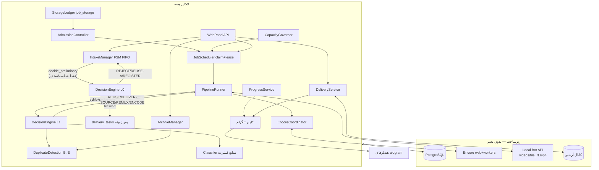
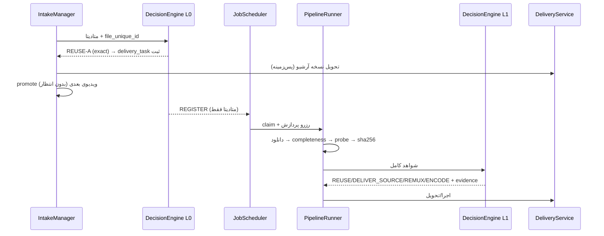
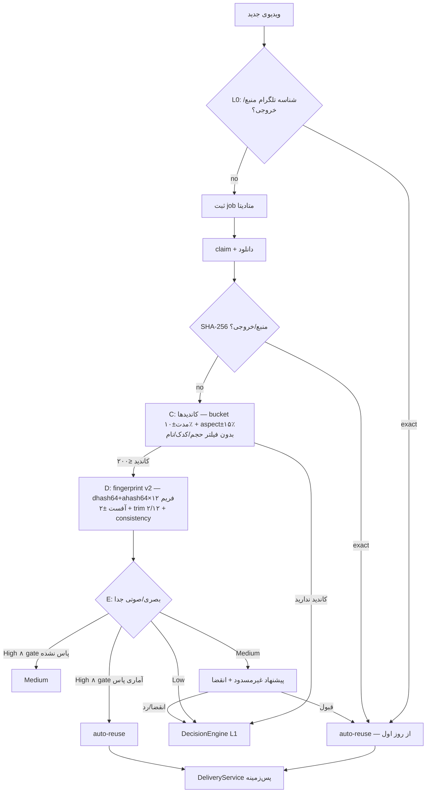
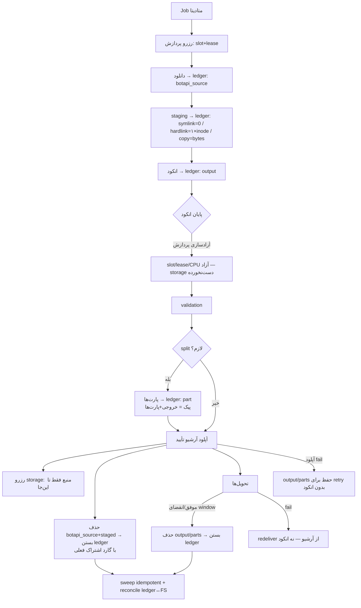
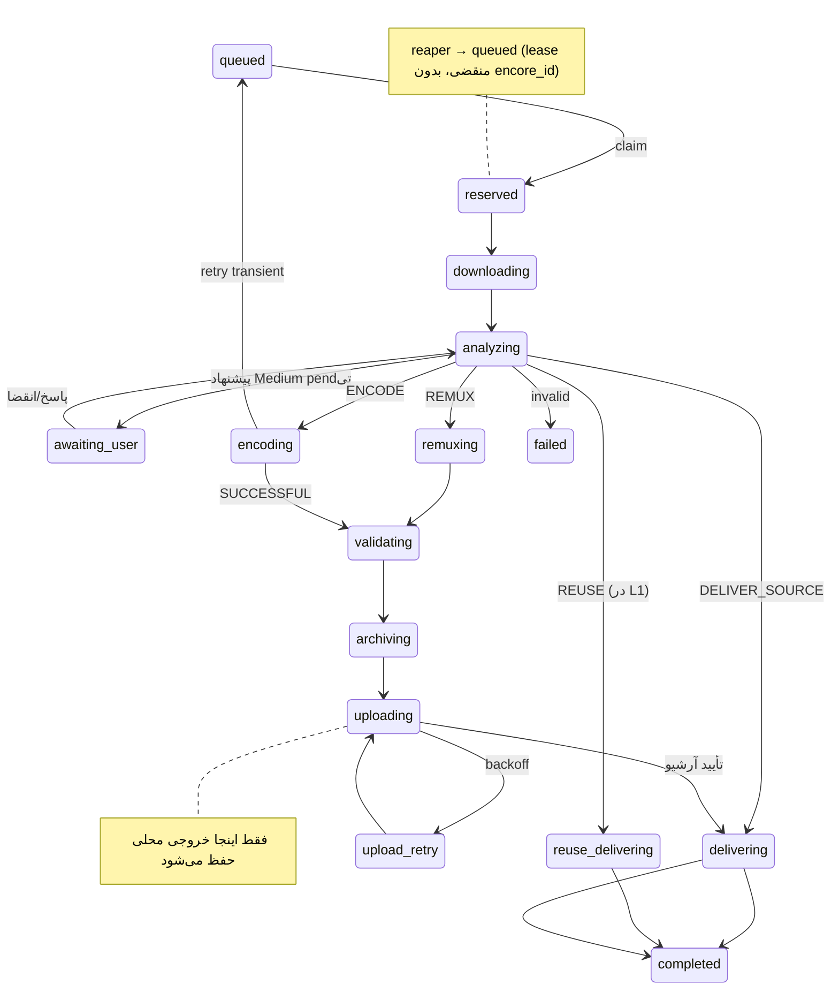

# پروپوزال معماری هدف و الگوریتم هوشمند Oxmit — نسخه ۲ (اصلاح‌شده)

> **سند:** MEGA TASK 01B — بازبینی فنی عمیق، اعتبارسنجی الگوریتم‌ها و اصلاح پروپوزال
> **وضعیت:** فقط طراحی و بازرسی — **هیچ پیاده‌سازی/تغییری انجام نشده است**
> **مبنای کد:** شاخه `main`، کامیت `1699d98` (2026-11-13) — تطبیق‌سنجی‌شده در همین فاز روی کلون محلی و سرور `/opt/oxmit` (هر دو تمیز)
> **رابطه با نسخه قبل:** سند V1 (`OXMIT_TARGET_ARCHITECTURE_AND_ALGORITHM_PROPOSAL_FA.md`) **دست‌نخورده باقی مانده**؛ این سند نسخه کامل، اصلاح‌شده و سازگارِ درونیِ کل معماری است، نه الحاقی به آن.
> **برچسب‌گذاری صداقت:** در کل سند: **[تأییدشده]** = مستند به کد/سرور؛ **[فرض]** = فرض طراحی نیازمند benchmark؛ **[تأییدنشده]** = تنها با آزمایش ایزوله قابل اثبات.

---

## ۱. خلاصه تغییرات نسبت به نسخه اول

هفت اصلاح اساسی + یک خطای محاسباتی، همه پذیرفته و بازطراحی شده‌اند (جزئیات در بخش ۳):

| # | موضوع V1 | وضعیت | اصلاح V2 |
|---|---|---|---|
| C1 | کاندید‌یابی dedup با «حجم ±2٪ ∧ مدت ±2s ∧ نام» | **غلط — رد می‌کرد دقیقاً همان حالت هدف** (1GB → 150MB HEVC) | کاندید‌یابی انعطاف‌پذیر: bucket مدت ±۱۰٪ + aspect ±۱۵٪؛ هیچ فیلتر حجم/کدک/نام به‌عنوان gate سخت |
| C2 | «dhash 16×16 (64bit)» | **تعریف مبهم/نادرست** (گرید 16×16 = ۲۵۶ بیت) | مشخصات ریاضی دقیق: dHash کلاسیک ۹×۸ → ۶۴ بیت + aHash ۸×۸؛ فرمول بیت‌سازی، Hamming، نرمال‌سازی، نسخه‌بندی |
| C3 | امضای صوتی (کدک/کانال/بیت‌ریت) به‌عنوان gate تأیید | **خطر veto روی match بصری قوی** | اطمینان بصری/صوتی/کلی جدا؛ تناقض صوتی فقط یک سطح پایین می‌آورد، هرگز رد نمی‌کند |
| C4 | نمونه‌گیری ثابت ۱۲ فریم بدون هم‌ترازی | ضعیف در برابر trim/crop | هم‌ترازی آفست ±۲ فریم + حذف پرت ۲ از ۱۲ + پیش‌حذف letterbox |
| C5 | ادعای precision 99.5٪ با دیتاست ۵۰+۵۰ | **از نظر آماری بی‌دفاع** | قاعده «سه‌تایی»: صفر FP روی ≥۶۰۰ negative سخت برای FPR ≤ ۰٫۵٪ با اطمینان ۹۵٪؛ تا عبور از gate، reuse ادراکی فقط «پیشنهاد» است |
| C6 | مدل ETA «Σ بقیه ÷ slots» | برای jobهای ناهمگن و مرحله‌های هم‌پوشان نادرست | مدل per-stage با P50/P90 و EWMA + شبیه‌سازی ترتیب صف با fairness/aging + محاسبه fps واقعی از progress |
| C7 | «۷–۱۲ ساعت انکود در روز برای ۱۰۰ ویدیوی بلند» | **خطای محاسبه** — صحیح: ۱۰۰×(۲۵–۵۰min)=۴۱٫۷–۸۳٫۳ ساعت | کل مدل ظرفیت بازنویسی با فرمول صریح و مثال‌های عددی درست (بخش ۲۴–۲۵) |
| C8 | رزرو دیسک = «تا پایان انکود» و آزادسازی بر اساس status | **دو چرخه عمر متفاوت خلط شده** | تفکیک Processing Reservation از Storage Reservation با ledger فیزیکی `job_storage`، آگاه از hardlink/symlink و پیک split |

علاوه بر هفت مورد، سه اصلاح سازگاری: (۱) تصمیم‌گیری **دو مرحله‌ای** صریح (پیش‌دانلود/پس‌دانلود — رفع ابهام نمودار A در V1)، (۲) چالش «compliant → همیشه remux» → مسیر DELIVER_SOURCE بدون I/O برای MP4 سازگار، (۳) escalation دومین pass HEVC به policy مشروط با تحلیل هزینه/سود (پیش‌فرض: خاموش).

---

## ۲. ارزیابی مجدد معماری فعلی

### ۲٫۱ تأیید اجباری وضعیت مخزن [تأییدشده]

- برنچ: `main`؛ کامیت: `1699d98` (2026-11-13 15:54 UTC) — یکسان روی کلون محلی و سرور؛ working tree هر دو تمیز (تنها فایل‌های مستندات untracked).
- هیچ فایل پروژه‌ای نسبت به فازهای قبل تغییر نکرده؛ هر دو سند قبلی به همین نسخه تعلق دارند.

### ۲٫۲ بازبینی انتقادی مؤلفه‌ها نسبت به V1

| مؤلفه | V1 می‌گفت | بازبینی V2 |
|---|---|---|
| صف PostgreSQL + claim اتمیک | حفظ | حفظ — تأیید مجدد؛ بدون تغییر |
| Encore/Local Bot API/کانال آرشیو | حفظ | حفظ |
| `intake_drafts` | توسعه با `user_seq` | حفظ + اصلاح: مسیر reuse باید **قبل** از رسیدن به register از intake جدا شود (بخش ۵) |
| `edu480.decide` | جانشین DecisionEngine | حفظ به‌عنوان شاخصه C1؛ موتور تصمیم دور آن ساخته می‌شود |
| fingerprint فعلی (۸ فریم × ۸×۸ ahash) | «ناکافی» | تأیید؛ علاوه بر کیفیت پایین، مصرف‌کننده‌ای هم ندارد [تأییدشده] |
| progress دانلود با رصد volume | «امکان‌پذیر» | **اصلاح:** نام فایل‌ها `file_<N>.mp4` ترتیبی است و نگاشت قطعی به job در حین getFile وجود ندارد؛ فقط association اکتشافی مشروط معتبر است (بخش ۱۴) |
| رزرو دیسک `source+pred×1.3+margin` | ناکافی | بازنویسی: پیک split باید `source + 2×output` را ببیند + ledger فیزیکی (بخش ۱۶) |

### ۲٫۳ واقعیت‌های سرویس تازه‌تأییدشده در این فاز [تأییدشده]

- فایل‌های دانلودی Local Bot API: زیرمجموعه `videos/` با نام‌های `file_<N>.mp4` (ترتیبی، مستقل از file_id کاربر)؛ هنگام بی‌کاری، temp خالی است.
- سقف CPU واقعی هر ورکر: `cpus: "1.8"` در compose (`nano_cpus=1800000000` از docker inspect) روی host دو هسته‌ای؛ مقدار `WORKER_CPU_SINGLE=7` فقط «درخواست» است و عملاً به همین سقف بریده می‌شود — یعنی روی این host، تیونر CPU اثر واقعی ندارد (فقط روی hostهای بزرگ‌تر meaningful می‌شود).

---

## ۳. هفت اصلاح اصلی و ریشه آن‌ها

| اصلاح | ریشه خطا در V1 | پیامد اگر رفع نمی‌شد | محل رفع در V2 |
|---|---|---|---|
| C1 کاندید‌یابی | برداشت غلط از اینکه dedup «دقیق» است؛ transcode حجم را تا ۱۰× کم می‌کند | از دست رفتن بزرگ‌ترین صرفه CPU | §۶٫۲ |
| C2 fingerprint | خلط گرید resize با تعداد بیت مقایسه | پیاده‌سازی ناممکن/متفاوت از طرح | §۷ |
| C3 صدا به‌عنوان gate | خلط هویت محتوا با هویت کانتینر/کدینک صدا | رد کردن match درست (AAC→Opus طبیعی است) | §۶٫۴ |
| C4 هم‌ترازی زمانی | فرض ساده‌لوحانه «همان timestamp = همان فریم» | فالس-نگتیو برای trim/intro | §۶٫۳، §۷٫۴ |
| C5 آمار اعتبارسنجی | ادعای precision بدون توان آماری | راه‌اندازی reuse ادراکی خطرناک | §۶٫۶ |
| C6/C7 ETA و ظرفیت | فرمول ساده‌ساز + **خطای محاسبه (۷–۱۲h به‌جای ۴۲–۸۳h)** | قول ظرفیت غلط؛ صف رو به رشد بی‌پایان | §۱۳، §۲۴، §۲۵ |
| C8 رزروها | چرخه عمر پردازش و storage یکی گرفته شد | نشتی/گرفتگی دیسک با وجود «رزرو درست» | §۱۶، §۱۷ |

---

## ۴. معماری هدف نهایی

هسته V1 (۱۳ کامپوننت، PostgreSQL-queue، Encore، Local Bot API، کانال آرشیو) حفظ می‌شود با سه اصلاح ساختاری:

1. **DecisionEngine دو ورودی دارد:** `decide_preliminary` (فقط متادیتا، در intake) و `decide_final` (بعد از دانلود+probe، در pipeline) — بخش ۵.
2. **DuplicateDetectionEngine صرفاً پس‌زمینه‌ای:** هیچ I/O سنگینی (sha256/ffprobe/fingerprint/تحویل) در مسیر intake نیست؛ intake فقط مرحله A (شناسه) را با یک کوئری DB اجرا می‌کند.
3. **دو ledger منبع:** پردازش (slots/lease/CPU) و storage (`job_storage` فیزیکی) — بخش ۱۶.



---

## ۵. معماری دو مرحله‌ای تصمیم‌گیری

### ۵٫۱ مرحله L0 — تصمیم مقدماتی (در intake، قبل از هر دانلود)

ورودی مجاز: فقط چیزهایی که بدون دسترسی به فایل موجودند:
- `file_unique_id` + جستجوی دوگانه در `archive_records` (خروجی شناخته‌شده `known_output` / منبع قبلی `unique_id`) — **[تأییدشده]** این جستجو یک کوئری DB است (`jobqueue.py:128-147`).
- سقف‌ها (tier/pending/ساعتی/روزانه)، بن، pause، private-mode.
- متادیتا اعلامی تلگرام (size/duration اعلامی — فقط برای reject های فاحش مثل size > سقف tier).

خروجی‌های مجاز L0: `REJECT` | `REUSE_ARCHIVE` (فقط match دقیق شناسه‌ای) | `REGISTER_JOB`.

**ممنوع در L0:** ffprobe، SHA-256، fingerprint، تحویل تلگرام، هر I/O فایل. دلیل: §۸٫۳ مگاپرومپت (intake سبک) + تجربه P1 (قفل شدن intake).

توجه: با این تفکیک، «انجام دانلود فقط برای کشف تکراری که در intake قابل کشف بود» از بین می‌رود — چون تنها معیار پیش‌دانلودیِ معتبر، شناسه‌ی دقیق تلگرامی است که همان‌جا چک می‌شود.

### ۵٫۲ مرحله L1 — تحلیل نهایی (بعد از claim + دانلود + probe)

ترتیب اجباری (بعد از اطمینان از completeness فایل: size واقعی = size اعلامی):

```text
probe → sha256 → L1 candidate discovery (B/C) → perceptual compare (D/E فقط اگر کاندید هست)
→ برآورد منفعت → decide_final → ثبت evidence → اجرا
```

| تصمیم | حداقل شواهد | مصرف منبع | پیامد کیفیت |
|---|---|---|---|
| `REUSE_ARCHIVE` | match شناسه‌ای/SHA (exact) یا ادراکی High پس از gate آماری §۶٫۶ | فقط تحویل | بدون تغییر (خروجی قبلاً validated) |
| `DELIVER_SOURCE` | کلاس «از قبل مناسب/فشرده + MP4 سازگار» (§۸) یا no-gain پیش‌بینی‌شده | صفر پردازش؛ یک آپلود در صورت نیاز | بدون تغییر |
| `REMUX` | compliant ولی کانتینر ≠ MP4 | ~ثانیه‌ها، کپی استریم | بدون re-encode |
| `ENCODE` | پتانسیل صرفه ≥ حداقل منفعت (§۸٫۴) | کامل (دانلود انجام شده؛ CPU انکود) | کنترل‌شده با استراتژی §۱۰ |
| `REJECT` | فایل ناقص/بدون stream ویدیو/مدت > 24h/ابعاد نامعتبر | صفر | — |

هر تصمیم با `evidence` ساختاریافته در `jobs.decision` ثبت می‌شود؛ **هیچ ENCODE بدون ثبت تصمیم مجاز نیست**.



---

## ۶. الگوریتم کامل تشخیص تکراری

### ۶٫۱ جداسازی پنج نگرانی (الزام §۲ مگاپرومپت 01B)

1. **Candidate Retrieval** — ارزان، ایندکس‌محور، فقط «شاید»
2. **Visual Similarity Scoring** — امتیاز ویدیویی خالص
3. **Temporal Alignment** — مقاوم به trim/fps/crop
4. **Confidence Estimation** — بصری/صوتی/کلی، جدا
5. **Reuse Authorization** — gate سیاست + آمار

### ۶٫۲ Candidate Retrieval انعطاف‌پذیر (اصلاح C1)

کاندید = هر `media_assets` fingerprinted که رکورد آرشیو `active` دارد. فیلترهای «نرم» فقط برای کارایی ایندکس‌اند و **هیچ‌کدام gate تطبیق نیستند**:

| فیلتر نرم | مقدار | چرا نرم است |
|---|---|---|
| |Δduration| ≤ max(2s، **۱۰٪ مدت**) با bucket index `ceil(dur/300)` و همسایه‌های ±۱ | trim تا ~۸٪ + درفش یک‌ساعته‌ها؛ transcode مدت را تقریباً حفظ می‌کند |
| aspect ratio (بعد از حذف letterbox) در ±۱۵٪ | bucket `round(ar×10)/10` | crop شدید را فالس-نگتیو نکند (فقط confidence را سقف می‌زند) |
| — | — | **بدون فیلتر حجم/بیت‌ریت/کدک/نام** — مثال الزامی: 1GB H.264 → 150MB HEVC باید کاندید شود (مدت و aspect یکسان می‌ماند) |

`name_norm` حذف از شرط کاندید و فقط به‌عنوان **تقویت‌کننده اطمینان** (+0.03 در score نهایی اگر یکسان) استفاده می‌شود. سقف کاندید: ۲۰۰ نزدیک‌ترین بر |Δdur|؛ امتیازدهی در پایتون (عملیات بیت سریع).

پشتیبانی چندنسخه‌ای: مقایسه فقط بین fingerprintهای هم‌نسخه (`phash.v2`).

### ۶٫۳ Temporal Matching (اصلاح C4)

- **نمونه‌گیری:** ۱۲ فریم در `t_i = (i+0.5)/12 × duration` از هر دو ویدیو (نسبی — مستقل از fps).
- **پیش‌نرمال‌سازی فریم:** حذف letterbox (ردیف/ستون‌هایی با میانگین luma < 10/255 قبل از hash) — ارزان و قطعی.
- **امتیاز پایه (fixed):** جفت‌سازی i↔i، بردار فاصله Hamming `d_i`؛ حذف ۲ بدترین (trim 17% — تحمل intro/outro حذف‌شده تا ~۸٪ و فریم‌های overlay)؛ `score_fixed = mean(۱۰ باقی‌مانده)`.
- **جستجوی آفست (فقط اگر score_fixed در مرز است):** آفست‌های o ∈ {−2,−1,0,+1,+2} فریم روی کاندید (هر واحد ≈ ±۸٫۳٪ مدت) — پوشش trim/تغییر تایم‌لاین؛ `score = min_o(trimmed_mean)`؛ هزینه: حداکثر ۵× محاسبه بردار → فقط با کش از پیش محاسبه‌شده، ارزان.
- **سازگاری زمانی (ضد فالس-پوزیتیو):** `temporal_consistency = s(d_i ≤ T_single)/12` با `T_single=26/64`؛ شرط: ≥ 0.7 — دو ویدیوی نامرتبط با چند اسلاید ثابت مشابه، این‌جا رد می‌شوند (الزام صریح §۲٫۳).
- **crop:** اگر aspect بعد از نرمال‌سازی > ۱۵٪ اختلاف دارد → match حداکثر Medium (هرگز High)؛ crop واقعی هویت بصری را تغییر می‌دهد و اتوماتیک‌سازی آن غیرقابل‌قبول است.

### ۶٫۴ اطمینان سه‌لایه — بصری/صوتی/کلی (اصلاح C3)

- `visual_conf`: فقط از score بصری (§۷٫۵) — صدای هیچ نقشی ندارد.
- `audio_conf`: پروکسی ارزان غیر هاشی: codec-family (aac-family vs opus vs mp3…)، channels، bitrate نسبی؛ سه حالت: `agree / neutral / contradict` (contradict = تفاوت هم‌زمان خانواده کدک + کانال + نسبت بیت‌ریت بیرون [0.25, 4]).
- **قانون:** `contradict` صوتی فقط High→Medium پایین می‌آورد؛ هیچ‌وقت match را رد یا بالا نمی‌برد. دلایل واقعی تناقض: نسخه Opus/AAC، mono/stereo، بیت‌ریت متفاوت — همه روی همان ویدیو ممکن‌اند.
- `overall_conf`: طبق جدول §۶٫۵.
- **امضای صوتی واقعی (chromaprint/فیت‌گرام):** فقط سیگنال اختیاری آینده؛ وابستگی + هزینه CPU دارد؛ در فاز B به‌عنوان یک تجربه ایزوله سنجیده می‌شود، شرط reuse نیست (الزام §۲٫۴).

### ۶٫۵ نگاشت اطمینان → رفتار

| سطح | شرط اولیه (قابل کالیبره §۶٫۶) | رفتار |
|---|---|---|
| High | visual ≥ 0.90 ∧ consistency ≥ 0.85 ∧ |Δdur| ≤ max(2s, 3%) | **auto-reuse فقط پس از gate آماری**؛ تا آن زمان مثل Medium رفتار می‌شود |
| Medium | visual ∈ [0.80, 0.90) یا High با تناقض صوتی/مدت >3% | **پیشنهاد غیرمسدودکننده** — کارت با سه دکمه (تحویل نسخه موجود / انکود جدید / لغو)؛ intake بلافاصله ادامه می‌یابد؛ انقضا (پیش‌فرض ۱۰ دقیقه) → ادامه پردازش عادی |
| Low | visual ∈ [0.70, 0.80) | هیچ اثر UX؛ فقط در evidence ثبت |
| No match | < 0.70 | — |

**مقایسه سه گزینه UX برای Medium (الزام §۲٫۵):** ① مسدود کردن تا انتخاب کاربر — رد (نقض Principle 3)؛ ② نادیده گرفتن — رد (سود dedup از بین می‌رود)؛ ③ **پیشنهاد غیرمسدودکننده با انقضا** — انتخاب توصیه‌شده: امن (هرگز تحویل خودکار نامطمئن)، بدون قفل intake، و سودآور.

### ۶٫۶ اعتبارسنجی آماری (اصلاح C5) — بدون ادعای بی‌مبنا

V1 با ۵۰+۵۰ جفت ادعای ۹۹٫۵٪ داشت؛ صحیح: با صفر FP روی n نمونه منفی، کران بالای FPR با اطمینان ۹۵٪ ≈ `3/n` (قاعده سه‌تایی). پس:

| هدف | حداقل داده |
|---|---|
| FPR ≤ 0.5٪ (اثبات با صفر FP) | **≥ ۶۰۰ negative سخت** در holdout |
| FPR ≤ 0.5٪ با ۱ FP | ~۱۰۰۰ negative |
| Recall ≥ ۹۵٪ با اطمینان ۹۵٪ | ≥ ۱۰۰ positive با ≥ ۹۵ match درست |

**دیتاست الزامی (ساخت روی infra ایزوله):**
- positives (~۳۰۰ برای calibration): نسخه‌های ساخته‌شده از یک منبع: transcode H.264→H.265، rescale، trim ±۱۰s، تغییر fps، واترمارک/overlay، آپلود مجدد از تلگرام، crop جزئی.
- hard negatives (≥۶۰۰ holdout): ویدیوهای نامرتبط با اسلاید/صحنه ثابت مشابه، سری‌های آموزشی هم‌ظاهر، لوگوهای مشترک.
- easy negatives (۳۰۰): محتواهای کاملاً متفاوت.
- **جداسازی سخت:** calibration هرگز در محاسبه نتیجه holdout استفاده نمی‌شود.
- متریک‌ها: FPR/FNR/precision/recall + فاصله اطمینان Clopper–Pearson؛ فرایند تنظیم آستانه: فقط روی calibration؛ holdout یک‌بار قضاوت.
- **گate فعال‌سازی reuse ادراکی خودکار در تولید:** عبور holdout از جدول بالا. تا پیش از آن: identifier/SHA (exact) از روز اول فعال‌اند (ریاضی دقیق، بدون آمار)؛ ادراکی فقط «پیشنهاد».

### ۶٫۷ نمودار C اصلاح‌شده



---

## ۷. مشخصات دقیق Fingerprint (اصلاح C2)

### ۷٫۱ تعریف ریاضی dHash-64

برای هر فریم:
1. استخراج فریم و تبدیل grayscale با luma BT.601: `Y = 0.299R + 0.587G + 0.114B`.
2. حذف letterbox (§۶٫۳).
3. resize به **۹×۸** پیکسل (interpolation=area/box).
4. گرادیان افقی مجاور: برای هر `(x, y)` با `x∈[0,8), y∈[0,8)`: `bit(x,y) = 1 iff P(x,y) < P(x+1,y)` — دقیقاً **۸×۸ = ۶۴ مقایسه = ۶۴ بیت** (سایز گرید مقایسه ۸×۸ است، نه گرید resize؛ resize ۹×۸ است).
5. بسته‌بندی row-major در یک عدد صحیح ۶۴-بیتی (unsigned, little-endian word).

### ۷٫۲ aHash-64 مکمل

resize به ۸×۸ grayscale؛ بیت = پیکسل > میانگین کل؛ ۶۴ بیت؛ همین بسته‌بندی.

### ۷٫۳ چرا dHash + aHash و نه pHash؟

- dHash (گرادیان): مقاوم به تغییر روشنایی سراسری و فشرده‌سازی؛ ارزان‌ترین محاسبه دقیق (بدون DCT).
- aHash: سیگنال فرکانس-پایین مکمل؛ ارزان.
- pHash (DCT 32×32 → ۶۴ بیت پایین‌فرکانس): قدرت تمایز بالاتر ولی هزینه محاسبه/وابستگی بیشتر؛ **تصمیم:** v2 با dHash+aHash شروع (هر دو در ffmpeg/Pillow بدون وابستگی جدید)؛ pHash فقط اگر holdout نشان داد FPR بالای هدف است — به‌عنوان v3 با همان چارچوب نسخه‌بندی.

### ۷٫۴ نمونه‌برداری و ذخیره

- ۱۲ فریم در `(i+0.5)/12 × duration` — قبل از ذخیره، letterbox حذف می‌شود؛ هش روی محتوای واقعی.
- **نمایش ذخیره:** `media_assets.phash = {"v": 2, "frames": 12, "dhash": [12 × uint64-decimal], "ahash": [12 × uint64], "dur_bucket": int}` — JSONB؛ نسخه‌بندی اجباری؛ مقایسه فقط هم‌نسخه.
- محاسبه: پس‌زمینه‌ای (FingerprintService موجود)، هرگز روی مسیر intake/claim؛ فایل‌های > 4h هم مجاز (۱۲ فریم ثابت — هزینه ثابت).

### ۷٫۵ امتیازدهی

```text
sim_hash(h1, h2) = 1 − hamming(h1, h2)/64
d_sim = trimmed_mean(sim_dhash[i], drop worst 2 of 12)
a_sim = trimmed_mean(sim_ahash[i], drop worst 2 of 12)
visual_score = 0.65·d_sim + 0.35·a_sim            (وزن‌های اولیه — کالیبره‌شدنی)
temporal_consistency = share(i: hamming_dhash(i) ≤ 26)
name_bonus = +0.03 اگر name_norm یکسان (فقط تقویت، هرگز gate)
```

نکته صادقانه: این امتیاز یک **پروکسی** است؛ هیچ ترکیب خطی جایگزین اعتبارسنجی آماری §۶٫۶ نمی‌شود.

---

## ۸. الگوریتم شناسایی ویدیوهای از قبل فشرده‌شده (اصلاح بخش ۹ V1)

### ۸٫۱ چهار شرطی که نباید خلط شوند (الزام §۳٫۲)

| شرط | معنا | شاخص |
|---|---|---|
| in-archive | نسخه فشرده همین محتوا موجود است | DDE (بخش ۶) |
| already-suitable | همین الان هم «خروجی مطلوب» است | کلاس C1 (EDU480-compliant فعلی) |
| already-compressed | هوشمندانه کدگذاری شده؛ فضای کم | bpp + codec + کیفیت proxy |
| not-worth | فنی ممکن ولی اقتصادی نمی‌ارزد | مدل منفعت §۸٫۴ |

### ۸٫۲ ویژگی‌های ورودی طبقه‌بند (بدون اتکا به نام فایل)

`duration, size, total_kbps, video_kbps, audio_kbps, W×H, pix_fmt, fps, codec+profile, bpp = video_kbps×1000/(W·H·fps), aspect, streams_count, encoder_tag (از ffprobe tags اگر هست — سیگنال ضعیف), تاریخی (توزیع خروجی/منبع باکت‌شده)`

- **نام فایل فقط سیگنال ضعیف اختیاری** (±0.02 در content_score) — الزام صریح §۳٫۱.
- content_score (پروکسی پیچیدگی محتوا) از bpp + نوع حرکت تخمینی (فقط برای «سخت‌گیری کمتر»، نه سخت‌تر — مقاوم به خطا).

### ۸٫۳ جدول رد شواهد → کلاس (اصلاح‌شده)

| شرط‌های اصلی [تأییدشده کد در صورت لزوم] | کلاس | اقدام کاندید |
|---|---|---|
| EDU480-compliant فعلی ∧ container == mp4 | C1-suitable | **DELIVER_SOURCE** (نه remux — ببینید §۸٫۵) |
| compliant ∧ container ≠ mp4 (mkv/avi/ts…) | C1-remux | REMUX |
| video_kbps > compliant ∧ predicted_savings ≥ حداقل منفعت | C3 | ENCODE پایه |
| short > 480 ∧ predicted_savings ≥ حداقل منفعت | C4 | ENCODE با downscale 480 |
| bpp < bpp_class(calibrated per-resolution) ∧ codec مدرن ∧ predicted_savings < حداقل منفعت | C2 | DELIVER_SOURCE |
| bpp بسیار پایین ∧ short ≤ 480 ∧ risk_quality بالا | C5 | DELIVER_SOURCE (محافظت از کیفیت) |
| probe partial / کدک ناشناخته | C8 | ENCODE محافظه‌کار یا REJECT |
| (کلاس‌های C6/C7 = حالت‌های در-archive که DDE پیش‌تر تصیم گرفته) | — | — |

- **bpp_floor دیگر عدد ثابت جهانی نیست:** به‌صورت منحنی `bpp_floor(W·H, fps)` از توزیع تاریخی jobهای واقعی کالیبره می‌شود (بخش ۲۴ داده پایه فعلی نداریم → با benchmark فاز B ساخته می‌شود؛ تا آن زمان مقدار محافظه‌کار V1 فقط به‌عنوان seed با برچسب provisional).

### ۸٫۴ مدل منفعت (اصلاح §۳٫۴)

```text
predicted_output_bytes = bpp_model(pixels, fps, dur, codec_target, crf_target)   [بازیافت estimate.py + کالیبراسیون]
predicted_savings_pct  = 1 − predicted/src_size
predicted_savings_bytes = src − predicted
P_bigger = P(output ≥ source | bucket)      ← از تاریخی؛ برای C2/C5 حساس
expected_encode_seconds = frames / fps_pred(bucket)   [فرض fps بسته به vCPU — §۱۳]
```

- آستانه‌های V1 (`20٪ ∧ 50MB`) **مقادیر شروع provisional** می‌مانند و کالیبره می‌شوند: MAPE مدل per-bucket محاسبه؛ اگر MAPE > ۲۵٪ → ضرایب اصلاح (clamp‌دار؛ بدون ML آزاد).
- هر پیش‌بینی تا validation خروجی فقط «تخمین» است و در UI با برچسب می‌آید (الزام §۳٫۴).

### ۸٫۵ چالش «compliant → همیشه remux» (الزام §۳٫۳) — اصلاح رفتار فعلی

- اگر منبع **هم MP4 است و streams سازگار**: remux تقریباً هیچ ارزشی ندارد (container درست، مدت/کدک همان) → **DELIVER_SOURCE**: صفر I/O و صفر زمان. تنها هزینه احتمالی: اگر moov آخر فایل باشد، استریم تلگرام بافر بیشتری می‌خواهد؛ سنجش moov با ffprobe ساده نیست و ارزشش هزینه نمی‌ارزد — پذیرش صریح این trade-off.
- remux فقط وقتی کانتینر غیر-MP4 است (mkv/avi/ts…) یا streams نیاز به normalize دارند.
- این یک **تغییر رفتار** نسبت به کد فعلی (`edu480.decide` همیشه remux می‌کند) است → تصمیم مالک (D3، بخش ۲۸).

### ۸٫۶ حفاظت کیفیت محتوا (الزام §۳٫۵)

| دسته | خطر تنظیم اشتباه | سیاست V2 |
|---|---|---|
| اسلاید/ضبط صفحه | downscale متن را می‌شکند | بدون downscale تا 720p وقتی bpp پایین؛ CRF+ |
| فیلم پرحرکت | CRF بالا → بلوک | پایه EDU480 |
| talking-head | معمولاً امن | پایه |
| انیمیشن | رنگ‌های تخت → banding با CRF بالا | CRF سقف 26 |
| کم‌نور | نویز → CRF پایین‌تر لازم | conservative |
| فیلم/سریال | اخلاق/حفظ جزئیات | پایه؛ بدون تهاجم |

- **VMAF per-job رد می‌شود:** هزینه ≈ نصف تا یک‌بارِ خود انکود → ناقض هدف throughput؛ فقط در benchmark ایزوله (فاز B) برای کالیبراسیون آستانه‌ها استفاده می‌شود.
- پروکسی ارزان درون‌خطی (اختیاری، پیش‌فرض خاموش — تصمیم مالک D5): SSIM نمونه‌ای روی ≤۸ فریم خروجی/منبع (~چند ثانیه) برای نظارت، نه gate سخت. متئک‌های ادراکی = دید انسانی نیستند — فقط سیگنال.

---

## ۹. الگوریتم تصمیم‌گیری نهایی (درخت اصلاح‌شده)

```mermaid
flowchart TD
    S[شواهد: probe+sha+کاندیدها+مدل منفعت] --> V{کامل/معتبر؟}
    V -- خیر --> REJ[REJECT + evidence]
    V -- بله --> D2{DDE نتیجه؟}
    D2 -- exact/high+gate --> REUSE[REUSE_ARCHIVE]
    D2 -- medium --> OFF{پاسخ کاربر؟}
    OFF -- قبول --> REUSE
    OFF -- رد/انقضا --> CL
    D2 -- low/no --> CL{Classifier + منفعت}
    CL -- C1-suitable ∧ mp4 --> DS[DELIVER_SOURCE]
    CL -- C1-remux --> RM[REMUX]
    CL -- C2/C5 --> DS
    CL -- C3/C4 ∧ منفعت≥حداقل ∧ P_bigger پایین --> EN[ENCODE استراتژی §۱۰]
    CL -- C8 --> EN Conservative یا REJ
    EN --> VAL[validation] --> ARC[Archive] --> DLV[Delivery]
    RM & DS & REUSE --> DLV
    VAL -- fail → repair → fail --> F[fail_job طبقه‌بندی‌شده]
```

هر پنج اقدام با فیلدهای الزامی §۳٫۶ مستند شده‌اند (جدول §۵٫۲ + متن §۸)؛ مصرف منابع: REUSE≈صفر CPU، DELIVER_SOURCE≈صفر پردازش، REMUX≈ثانیه‌ها، ENCODE=کامل.

---

## ۱۰. استراتژی فشرده‌سازی (اصلاح §۹٫۱ مگاپرومپت 01B)

پایه: EDU480 (x264 CRF25 veryfast 480p/fps30/AAC64k) — حفظ. تنظیم‌های شرطی از V1 حفظ، با دو اصلاح:

**۱) audio copy مشروط دقیق‌تر:** `-c:a copy` فقط اگر AAC ∧ ≤96k ∧ channels ≤2 ∧ نبودِ مشکل sync شناخته‌شده؛ در غیر این صورت AAC 64k re-encode (رفتار فعلی حفظ در حالت پیش‌فرض).

**۲) HEVC escalation — سیاست عقلایی (الزام §۹٫۱):**
- واقعیت: pass دوم CPU همان job را تا ~۲٫۵× می‌کند (x265 کُندتر) و تأخیر صف همان کاربر و بقیه را می‌اندازد.
- ریاضی نمونه [فرض تا benchmark]: منبع ۱۰۸۰p ساعت‌لنگ، x264 → 480p خروجی ۳۵۰MB؛ x265 همان کیفیت در ~۳۰۰MB → صرفه ۵۰MB در برابر ~۸۰ دقیقه CPU اضافی. با throughput محدود host فعلی، این معامله معمولاً بازنده است.
- **سیاست توصیه‌شده:** escalation **پیش‌فرض خاموش**؛ فقط اگر مالک فعالش کند (D4)، مشروط: منفعت اضافی پیش‌بینی‌شده ≥ ۲۵٪ خروجی x264 **و** خروجی نهایی ≥ 500MB **و** فشار صف < آستانه. مسیر no-gain فعلی (تحویل منبع) بدون تغییر می‌ماند.

ماتریس تصمیم‌ها همان §۱۰/§۱۱ V1 با این اصلاحات معتبر است؛ انتخاب کدک داخلی می‌ماند و هیچ انتخابی به کاربر نشان داده نمی‌شود.

## ۱۱. سیستم دریافت چندفایلی FIFO

نسخه V1 (FSM intake_drafts با user_seq، یک prompt فعال، مصرف اتمیک، promote فوری، expiry، recovery) **معتبر است و حفظ می‌شود** با سه اصلاح ناشی از معماری دو مرحله‌ای:

1. مسیر REUSE در intake فقط L0 (شناسه exact) است و تحویلش **قطعاً پس‌زمینه‌ای** (delivery_tasks) — هیچ تحویلی درون `_submit_draft → _promote_next` نیست.
2. کاندید‌های ادراکی Medium هم intake را قفل نمی‌کنند: پیشنهاد به‌صورت کارت مستقل جدا از prompt نام‌گذاری ارسال می‌شود.
3. با ثبت `decided_action` روی draft، بعد از restart هم مشخص است کدام draftها تحویل پس‌زمینه معلق دارند.

نمودار B در V1 معتبر می‌ماند؛ تنها تفاوت: جعبه «DecisionEngine» در آن مسیر باید «DecisionEngine L0» خوانده شود.

---

## ۱۲. الگوریتم صف و Scheduler

هسته V1 حفظ (claim اتمیک، aging، fairness per-user، slots تطبیقی، backpressure) با دو اصلاح دقت:

1. **slots_live از CapacityGovernor:** به‌جای فرمول ثابت، سقف زنده = min(WORKER_REPLICAS, floor(CPU_free_effective / per_job_cpu), MAX_SLOTS)؛ با شواهد زنده psutil/تیونر — و سقف سخت compose.
2. **بای‌پس‌ها در مدل صف:** jobهای REUSE/DELIVER_SOURCE/REMUX هرگز وارد صف انکود نمی‌شوند (REUSE/DELIVER قبل از claim تصمیم گرفته می‌شوند یا در L1 مستقیماً به DeliveryService می‌روند) — یعنی فرمول ETA اصلاً نباید آن‌ها را در «کارهای جلوتر» بشمارد؛ فقط ENCODE-ها شمرده می‌شوند (الزام §۴٫۲ مگاپرومپت 01B).

---

## ۱۳. مدل ETA دقیق و محدودیت‌های آن (اصلاح C6)

### ۱۳٫۱ مدل هزینه per-stage

از timestampهای مرحله‌ای موجود در `jobs` [تأییدشده ستون‌ها در مهاجرت 015]:

```text
download_s  = download_done_at − download_started_at      → مدل: bytes / bw_median (MB/s اندازه‌گیری‌شده)
analyze_s   = encode_started_at − download_done_at        → مدل: P50 باکت طول+ابعاد (پروب+هش+کاندید)
encode_s    = encode_done_at − encode_started_at          → مدل: frames / fps_pred
validate_archive_s = upload_started_at − encode_done_at   → P50 باکت خروجی
deliver_s   = delivered_at − upload_started_at            → P50 per-recipient + parts
```

- `frames = duration_s × fps`؛ `fps_pred = EWMA(fps واقعی)` که **از خود progress Encore** محاسبه می‌شود: در هر tick، `Δframes = Δprogress × frames_total/100`؛ `fps = Δframes/Δt` (نیازی به فیلد speed Encore نیست؛ [فرض] progress Encore متناسب با فریم است — در آزمایش ایزوله فاز B راستی‌آزمایی می‌شود).
- fps_pred بر باکت `{pixels≤480p, >480p} × {x264,x265}` و بر «تخصیص CPU زنده» (از CapacityGovernor) تنظیم می‌شود — چون تیونر cores را عوض می‌کند، fps هم می‌لغزد؛ EWMA با نیم‌عمر ~۵۰ job این را دنبال می‌کند.

### ۱۳٫۲ روش پیش‌بینی بدون آستانه دلخواه «۲۰ نمونه» (اصلاح V1)

عدد ۲۰ در V1 بی‌دلیل بود. قاعده درست: **عرض بازه تابع n است.**

| n نمونه در باکت | تخمین نقطه‌ای | بازه نمایشی |
|---|---|---|
| n < 5 | median والد (باکت درشت‌تر) | ×[0.5, 2.0] — صادقانه پهن |
| 5 ≤ n < 20 | median همین باکت | ×[0.7, 1.5] |
| n ≥ 20 | median | ×[P10, P90] واقعی باکت |

همیشه بازه؛ هرگز عدد نقطه‌ای با ظاهر قطعی. دلیل آماری: با n<5، IQR خودش بی‌ثبات است؛ عرض بازه باید بی‌اطمینانی را صادقانه منعکس کند نه اینکه دقت جعلی بسازد.

### ۱۳٫۳ ETA صف با شبیه‌سازی ترتیب (جای «Σ÷slots»)

الگوریتم: رویداد‌محور، شبیه‌ساز سبک (~ms):

1. صف ENCODE-ها را با ترتیب واقعی scheduler مرتب کن: `(fairness-flag, priority+aging, enqueued_at)`.
2. وضعیت اولیه: برای هر job فعال، `remaining = (1−progress)×frames/fps_live`؛ برای دانلودهای فعال، `remaining_dl` از مانیتور واقعی.
3. حلقه رویداد: کوچک‌ترین پایان فعال → آزاد شدن slot → اولین job مجاز صف (با احترام به سقف per-user و fairness) شروع می‌شود با `download_s + analyze_s` پیش از encode.
4. ETA_job_k = زمانی که encode_k تمام می‌شود + `validate_archive_s + deliver_s`.
5. بازه = اجرای شبیه‌سازی با P50 و با P90 هر هزینه.

### ۱۳٫۴ مثال عددی کامل (اعداد [فرض] از مدل بالا)

سناریو: slots=2 (دو ورکر؟ نه — slots=2 یعنی ۲ encode هم‌زمان؛ روی host فعلی WORKER_REPLICAS=1 → slots=1؛ برای مثال از پیکربندی هدف ۲ worker استفاده می‌کنیم و هر دو حالت را می‌گویم).

**حالت slots=2:** فعال A (۳h 1080p، progress=60٪، fps زنده 45) → فریم کل 324k؛ باقی 129.6k → `48min`. صف: B (۳۰min 1080p؛ 54k فریم)، C (۳۰min 480p؛ 54k فریم ولی fps_pred≈60) → B encode≈20min، C≈15min.
- t0: A تا t0+48. B: download_s≈3 (2GB/12MBps→؟) — مثال: 2GB با bw median 25MB/s → 80s≈1.3min؛ analyze≈1min؛ پس B encode از t0+2.3 تا t0+22.3؛ تا t0+48 آزاد.
- C: download 0.5GB→20s؛ encode از t0+1 تا t0+16 (slot دوم) → تمام t0+16؛ اما slot دوم از قبل با C پر بوده؟ نه — فقط ۲ slot: A و B. پس C باید تا اولین آزادشدن صبر کند: min(A.end=t0+48, B.end=t0+22.3) → C encode از t0+23.3 تا t0+38.3؛ **ETA_C = t0+38.3+~2min(deliver) ≈ t0+40min**، بازه [t0+28، t0+60] با P90ها.
- **حالت slots=1 (سرور فعلی):** C encode از t0+48 شروع، تمام t0+63.3 → ETA_C ≈ t0+65، بازه [t0+45، t0+95].
- **بچ ۱۰ ویدیویی کاربر:** ETA_complete = ETA دهمین job در شبیه‌سازی + deliver؛ به‌ازای هر job ردیف position/شروع/تحویل جدا ارائه می‌شود.

نکته صادقانه: همه اعداد بالا [فرض] هستند تا benchmark فاز B؛ ساختار فرمول‌ها قطعی است.

### ۱۳٫۵ الزامات نمایش (§۴٫۴)

position، jobs-ahead (فقط ENCODEها)، شروع/اتمام/تحویل تخمینی هر job، بچ-کامل، بازه اطمینان؛ تمایز بصری «اندازه‌گیری‌شده (زنده)» vs «پیش‌بینی». بازمحاسبه روی eventهای V1 §۱۷٫۶ حفظ.

---

## ۱۴. Progress دانلود و امکان‌سنجی واقعی آن (اصلاح C4/§۵ مگاپرومپت 01B)

### ۱۴٫۱ رفتار واقعی Local Bot API [تأییدشده]

- `bot.get_file` هنگام فراخوانی، دانلود از سرورهای تلگرام را **هم‌زمان و تا اتمام** انجام می‌دهد و بعد مسیر محلی را برمی‌گرداند؛ در طول فراخوانی فایل در `botapi_data` رشد می‌کند.
- نام فایل نهایی الگوی `videos/file_<N>.mp4` دارد (ترتیبی) — **هیچ نگاشت قطعیِ از قبل‌دانستنی به job وجود ندارد.**
- ساختار سنجیده‌شده: `<botapi_data>/<token-dir>/{videos/, temp/, td.binlog,…}`؛ temp در حالت idle خالی است.

### ۱۴٫۲ چرا «فقط size/mtime» کافی نیست — جدول حالت‌های الزامی

| حالت | رفتار رصد volume | نتیجه association |
|---|---|---|
| ۲ دانلود هم‌زمان با سایز متفاوت | دو فایل درحال‌رشد؛ نزدیک‌ترین سایز هدف قابل انتساب | اکتشافیِ قابل‌قبول |
| ۲ دانلود هم‌زمان با سایز یکسان | دو کاندید مبهم | **غیرقابل انتساب → نامعین برای هر دو** |
| فایل از قبل در cache | getFile فوری برمی‌گردد؛ فایل رشد نمی‌کند | progress = اندازه‌گیری‌نشده (کوتاه) → نامعین لحظه‌ای |
| دانلود قطع | فایل رشد می‌کند و می‌ایستد؛ getFile fail | انتساب تلف می‌شود؛ نامعین تا خطا |
| rename (temp→final) | ردیابی با پیوستگی سایز در دو دیرکتوری | ادامه با همان فرض ambiguity |
| چند هندلر همان مدیا | یک فایل، دو getFile | همان ambiguity |

نتیجه الزام §۵٫۲ («association قطعی») با Option A **تأمین نمی‌شود** مگر در شرایط بدون ابهام.

### ۱۴٫۳ مقایسه گزینه‌ها (الزام §۵٫۳)

| گزینه | دقت progress | I/O اضافه | پیچیدگی | 2GB | نتیجه |
|---|---|---|---|---|---|
| A. رصد volume فعلی | خوب فقط در ambiguity صفر | صفر | کم | ✅ | ناکافی به‌تنهایی |
| B. مسیر استریم progress-دار | — | — | — | — | **غیرممکن برای getFile**: دانلود داخل فراخوانی botapi رخ می‌دهد؛ پس از بازگشت، همه‌چیز تمام است |
| C. دانلود HTTP از endpoint فایل | همان B | کپی دوباره multi-GB | متوسط | ⚠️ نیازمند همان botapi | رد — بهبودی نمی‌دهد |
| D. معماری جایگزین حفظ 2GB | — | — | بالا | ✅ | رد — ریسک/هزینه برای یک درصد UI |

### ۱۴٫۴ تصمیم V2 (صادقانه، الزام §۵٫۴)

**پیش‌فرض: وضعیت نامعین صادقانه** — «در حال دریافت… ⏱ elapsed | 📦 حجم مورد انتظار X» (بدون درصد).

**حالت اندازه‌گیری‌شده شرطی** فقط وقتی هر سه برقرار است:
1. تعداد getFileهای in-flight = 1 **یا** سایزهای هدف in-flight از هم متمایزند (اختلاف > ۵٪)؛
2. دقیقاً یک فایل درحال‌رشد با `st_size ≤ target` و mtime تازه و شیب رشد > 0 یافت شود؛
3. ambiguity check هیچ کاندید دومِ هم‌پتانسیل نبیند.

در آن حالت `{downloaded/total, speed}` واقعی نمایش داده می‌شود؛ با بروز ابهام فوری به نامعین برمی‌گردیم. **هیچ درصد جعلی هرگز.**

**پیش‌نیاز فعال‌سازی حالت اندازه‌گیری‌شده:** آزمایش ایزوله (bot تستی + ۲ دانلود هم‌زمان، سیکل قطع/ادامه، rename) — [تأییدنشده] تا انجام نشود، فقط نامعین.

---

## ۱۵. Progress فشرده‌سازی و آپلود

- **انکود:** درصد واقعی Encore (callback+poll، GREATEST فعلی)؛ fps زنده از Δprogress (§۱۳٫۱)؛ «حجم خروجی فعلی» از stat فایل out — همیشه با برچسب «تخمینی؛ مقدار نهایی پس از validation»؛ **درصد صرفه فقط پس از validation** (جداسازی الزامی §۹٫۵: encode% ≠ compression%).
- **آپلود آرشیو:** `file://`/multipart — aiogram 3 hook پیشرفت آپلود ندارد [ادعای کتابخانه‌ای — قابل راستی‌آزمایی در آزمایش ایزوله؛ aiogram 2 hook داشت، v3 حذفش کرده] → نامعین صادقانه + elapsed. `copy_message` کاملاً سمت سرور تلگرام است → درصد بی‌معنا؛ فقط «در حال ارسال». پارت‌ها: i/n صریح.
- **تحویل:** event per-recipient فعلی حفظ.
- نگه‌داری جدایی همه مقادیر در ProgressService با نوع صریح: `measured | estimate | indeterminate`.

---

## ۱۶. تفکیک Processing Reservation و Storage Reservation (اصلاح C8)

### ۱۶٫۱ دو چرخه عمر مستقل

| | Processing Reservation | Storage Reservation |
|---|---|---|
| کنترل | download/encode slots، lease ورکر، CPU | بایت‌های فیزیکی: منبع، staged، خروجی، پارت‌ها، thumb، tmp، retention |
| ثبـت | `jobs.stage/worker_id/lease_expires_at` (فعلی حفظ) | **جدول جدید `job_storage`** (ledger) |
| آزادسازی | لحظه خروج stage از SLOT_STAGES (پایان انکود) — همان رفتار فعلی `reserved_bytes→0`، رسمی‌شده | **فقط وقتی فایل واقعاً unlink شد** — هرگز بر اساس status job |

### ۱۶٫۲ حسابداری فیزیکی (`job_storage`)

```text
job_storage(job_id, path, kind, bytes, inode_id, volume, created_at, deleted_at)
kind ∈ {botapi_source, staged_symlink, staged_hardlink, staged_copy, output, part, thumb, tmp, merge_in}
```

- **symlink = ۰ بایت**؛ **hardlink = یک‌بار به‌ازای inode** (شمارش مرجع با `inode_id`) — فایل hardlink‌شده دوباره حساب نمی‌شود [رفع نقص صریح §۷٫۲].
- `storage_reserved = Σ bytes ردیف‌های زنده با inode متمایز` — نویسنده: PipelineRunner/CleanupManager؛ خواننده: AdmissionController، پنل.
- **شبکه ایمنی قطعی:** تصمیم claim همیشه با `shutil.disk_usage(mount هر volume).free` چک می‌شود — ledger تخمین است، free-space حقیقت (چند-volume امن).
- sweep هر ۱۰ دقیقه: ledger ↔ فایل‌سیستم reconcile (ردیف بدون فایل → بستن؛ فایل بدون ledger → طبق سیاست مالکیت).

### ۱۶٫۳ پیک مصرف دیسک per-job (اصلاح فرمول V1)

```text
base_peak    = source_bytes + predicted_output_bytes
split_peak   = source_bytes + 2 × predicted_output_bytes      ← split: خروجی کامل + پارت‌ها هم‌زمان روی دیسک‌اند [تأییدشده: split_by_size خروجی را می‌خواند و پارت‌ها جدا می‌نویسد — media.py:98-135]
merge_peak   = Σinputs + predicted_output
need(job)    = (split_likely ? split_peak : base_peak) × tmp_overhead(1.15) + safety_margin(5GiB)
```

- `tmp_overhead=1.15` (probe/thumb/tmp واقعی ~۵–۱۰٪) جای 1.3 محافظه‌کارانه V1؛ safety_margin همان 5GiB فعلی. همه اعداد provisional تا کالیبراسیون فاز C با ledger واقعی (تصمیم مالک D8).
- کمبود دیسک: توقف claim + notify ساعتی (فعلی حفظ)؛ **هرگز** حذف فایل job فعال.

---

## ۱۷. چرخه عمر فایل‌ها و Cleanup (نمودار H اصلاح‌شده — تفکیک آزادسازی‌ها)



قواعد حذف صریح (الزام §۷٫۴): منبع هرگز قبل از تأیید آرشیو حذف نمی‌شود (استثنا محافظت‌شده: no-gain/deliver-source که منبع خودِ قابل‌تحویل است → تا پایان تحویل)؛ خروجی تا اتمام تحویل‌ها/پنجره retry (پیش‌فرض ۲۴h — تصمیم D8)؛ cleanup idempotent و restart-safe (ledger مبنا).

---

## ۱۸. ساختار دیتابیس پیشنهادی (مفهومی — بدون migration)

نسبت به V1، با این تغییرات:

| جدول | تغییر نسبت به V1 | دلیل |
|---|---|---|
| `intake_drafts` | همان + `delivery_task_id` | اتصال reuse پس‌زمینه |
| `jobs` | همان + `content_class`, `predicted_*` | طبقه‌بند §۸ |
| `media_assets` | `phash {v:2, dhash[12], ahash[12]}` + `duration_state` | fingerprint دقیق §۷ |
| `delivery_tasks` | **تکمیل‌شده §۲۰** | idempotency کامل |
| `job_storage` (**جدید نسبت به V1**) | ledger فیزیکی §۱۶٫۲ | تفکیک storage از پردازش |
| `jobs` (ایندکس) | `idx_jobs_eta_sample (profile,status) WHERE completed_at IS NOT NULL` + `idx_media_fingerprint_bucket (duration_bucket) WHERE fingerprinted` | ETA + کاندید‌یابی |

حفظ بدون تغییر: users، profiles، deliveries، counters، app_config، audit_log، admin_settings، admin_permissions، support_messages، moderation_actions، archive_records، merge_*.

---

## ۱۹. State Machine کامل (اصلاح §۹٫۴ — دامنه‌های جدا، بدون overloading)

چهار FSM جدا — یک فیلد وضعیت هرگز چند مفهوم را حمل نمی‌کند:

**۱) `jobs.status` (درشت):** `queued → processing → completed|failed|cancelled`
**۲) `jobs.stage` (ریز پردازش):**



**۳) `delivery_tasks.state`:** `pending → claimed(lease) → delivering → done|failed|cancelled` (بخش ۲۰)
**۴) `intake_drafts.state`:** `received|waiting|prompting|resolved|cancelled|expired` (V1 حفظ)
**۵) رزروها:** پردازش = ستون‌های lease؛ storage = ردیف‌های `job_storage` — نه status.

گذارهای الزامی مستند: **لغو** (هر مرحله → cancelled + توقف همه لایه‌ها + ledger cleanup)؛ **شکست تحویل** (status=completed می‌ماند؛ delivery_task=failed + redeliver ممکن)؛ **retry آپلود** (upload_retry فقط برای archive-upload؛ هرگز انکود)؛ **بازیابی** (pre-encode→queued؛ post-encode→uploading اگر خروجی هست)؛ **reuse** (در L0: job اصلاً ساخته نمی‌شود — فقط delivery_task؛ در L1: job کوتاه به reuse_delivering می‌رود).

---

## ۲۰. Delivery Task و Idempotency (تکمیل الزام §۹٫۳)

```text
delivery_tasks(
  id UUID PK,
  kind TEXT CHECK (kind IN ('reuse','redeliver','source_deliver')),
  idem_key TEXT UNIQUE WHERE state NOT IN ('done','cancelled'),   -- کانانیکال: kind|archive_set|chat_id|tg_id
  archive_ids UUID[] ,                                            -- نسخه آرشیو مرتبط (پارت‌ها با ترتیب)
  tg_id BIGINT, chat_id BIGINT,
  state TEXT,                                                     -- pending|claimed|delivering|done|failed|cancelled
  claimed_by TEXT, lease_expires_at TIMESTAMPTZ,                  -- worker lease (الگوی jobs)
  attempts INT DEFAULT 0, next_retry_at TIMESTAMPTZ, last_error TEXT,
  delivered_message_ids BIGINT[],                                  -- idempotency پیام
  created_at/updated_at
)
```

قواعد:
- **idempotency:** `idem_key` یکتا روی حالت‌های فعال؛ پیش از هر ارسال، چک `deliveries` برای موفقیت قبلی همان (job/archive/requester)؛ اگر قبلاً ok → skip.
- **مالکیت/lease:** worker با `UPDATE … SET claimed_by, lease_expires_at WHERE state='pending' AND (lease is null or expired) RETURNING` — همان الگوی claim اتمی؛ reaper تسک‌های claimed مفقود.
- **retry:** backoff مشابه upload (15→600s، سقف 5)؛ سپس failed با دکمه دستی.
- **multi-part:** ارسال ترتیبی per archive_ids؛ هر پارت موفق در `delivered_message_ids` ثبت؛ retry از نقطه توقف (پارت‌های done skip).
- **restart:** pending/claimed-منقضی → دوباره claimed؛ هیچ تسک دوبله به‌خاطر callback تکراری ممکن نیست (unique + چک deliveries).
- **per-requester status:** همان `job_requesters.delivered` فعلی هم‌زمان با done آپدیت می‌شود.

## ۲۱. مدیریت خطا و Recovery

ماتریس V1 (بخش ۲۲) معتبر و حفظ می‌شود؛ دو الحاق ناشی از اصلاحات این نسخه:

| سناریوی جدید | سیاست |
|---|---|
| ledger ↔ filesystem mismatch | sweep reconcile؛ ردیف بدون فایل → بستن؛ فایل بدون ledger و خارج از مالکیت job فعال → طبق retention |
| delivery_task منقضی‌lease / worker مرده | reaper → pending مجدد؛ unique+i deliveries چک جلوی ارسال دوبله |
| ambiguity دانلود (دو فایل هم‌سایز) | progress نامعین — هیچ decision ای بر اساس progress دانلود گرفته نمی‌شود |
| gating آماری reuse در production | تا عبور gate، ادراکی فقط پیشنهاد؛ اگر gate شکست خورد → آستانه‌ها سخت‌تر و بازآزمون |

idempotency همه عملیات ریکاوری: claim اتمی، ledger reconcile، delivery dedup — تکرار امن است.

---

## ۲۲. معماری یکپارچه پنل وب

معماری V1 (بخش ۲۳) حفظ و تأیید: یک API نسخه v4 روی سرویس‌لایه واحد (Controllers→Services→Repositories→Adapters)، حذف چهار نسل موازی، هر عملیات مشترک فقط یک پیاده‌سازی بین تلگرام و وب با `actor` متفاوت برای audit. الحاق این نسخه:

- پنل به ledger جدید هم دسترسی دارد (`GET /api/v4/storage` — نمای رزروها/حسابداری فیزیکی/پیش‌بینی پیک).
- نمودار I در V1 معتبر می‌ماند.

## ۲۳. امنیت و سطح دسترسی‌ها

V1 (بخش ۲۵) حفظ: حذف هاردکد `829999317`، حذف ترمینال خام و env-raw (جایگزین allowlist/فیلد‌به‌فیلد ماسک‌دار)، CSRF روی همه mutating، session در DB، least-privilege برای ادمین وب. بدون تغییر نسبت به V1 — صرفاً برای انسجام سند تکرار نمی‌شود؛ فهرست کامل در V1 §۲۵ معتبر است.

---

## ۲۴. مدل محاسبه ظرفیت واقعی سرور

### ۲۴٫۱ حقایق اندازه‌گیری‌شده [تأییدشده]

| منبع | مقدار واقعی | ملاحظه |
|---|---|---|
| vCPU فیزیکی/منطقی | **۲ / ۲** | — |
| RAM | 3.7GB | — |
| دیسک | 77GB (62GB آزاد) | — |
| worker replicas | **۱** | `compose config` |
| cap CPU هر worker | **1.8 vCPU** (`nano_cpus=1.8e9`) | سقف سخت؛ tuner مقدار 7 را نمی‌تواند عبور دهد |
| سهم واقعی worker از host | ~1.4–1.6 vCPU (بقیه: pg/redis/botapi/bot) | **[فرض — قابل اندازه‌گیری با benchmark] |
| fps انکود 480p veryfast per vCPU | ~30–45 fps | **[فرض]** تا benchmark؛ منبع: رفتار متعارف x264، نه اندازه‌گیری Oxmit |

### ۲۴٫۲ فرمول‌های مدل (همه نشان داده می‌شوند — الزام §۶)

```text
frames/hour-content   = 3600s × fps_source (فرض 30)  = 108k فریم
encode_time/job       = frames / fps_worker
fps_worker            = per_vCPU_fps × vcpu_effective   [فرض؛ benchmark فاز B]
E (encode_hours/day)  = encode_jobs/day × encode_time/job
C (capacity/day/worker) = 24h × U؛  U = 0.60 (حاشیه امن: retry/نگهداشت/سرویس‌های دیگر)
W_required            = E / C            (مرتبه اول؛ η≈0.85 برای هر worker اضافه روی host مشترک)
W_required_scaled     = E / (C × η^(W−1))
پایداری صف: W_available ≥ W_required  ← در غیر این صورت backlog هر روز رشد می‌کند
backlog_recovery_days = backlog_hours / (W_available×C − E)
```

مثال درست‌شده (اصلاح خطای V1): **۱۰۰ ویدیوی یک‌ساعته با ۲۵–۵۰ دقیقه انکود = ۱۰۰×۲۵ تا ۱۰۰×۵۰ دقیقه = ۴۱٫۷ تا ۸۳٫۳ ساعت انکود** (نه ۷–۱۲ ساعت)؛ با C=۱۴٫۴h/worker: نیازمند **۲٫۹ تا ۵٫۸ worker**.

### ۲۴٫۳ «vCPU خواسته ≠ CPU واقعی» (الزام §۶٫۳)

`WORKER_CPU_SINGLE=7` فقط سقف مجاز CFS است؛ روی host دو هسته‌ای عملاً بی‌اثر (سقف compose 1.8 + رقابت host). اثر عملی: روی این host تیونر CPU **no-op** است؛ این در متریک پنل باید صادقانه «host-limited» نشان داده شود نه «7 cores allocated».

---

## ۲۵. سناریوهای ظرفیت ۲ تا ۵ هزار کاربر (محاسبات کامل و درست)

### ۲۵٫۱ فرض‌های صریح

| پارامتر | مقدار پایه | برچسب |
|---|---|---|
| DAU | ۲۰٪ (عادی) / ۳۰٪ (رشد) | فرض محصول |
| jobs/active/day | 0.5 (عادی) / 1.0 (فعال) | فرض محصول |
| share بدون انکود (reuse+deliver-source+remux) | ۴۰٪ پایه / ۶۰٪ با dedup بالغ | [فرض] — همین پارامتر بیشترین اهرم است |
| مدت میانگین محتوای encode | ۴۵min → 81k فریم → encode ≈ 27–45min در 1.5 vCPU (30–50fps) | [فرض تا benchmark] |
| U | 0.60؛ η=0.85/worker اضافه | فرض مهندسی |

### ۲۵٫۲ جدول سناریو (فرمول: jobs → encode_jobs → E → W_required)

| سناریو | jobs/day | share encode | encode_jobs | E (h/day) | W_required | وضعیت host فعلی (۱ worker، C=14.4) |
|---|---|---|---|---|---|---|
| 2k، DAU20٪، 0.5، share40٪ | 200 | 40٪ | 80 | 80×0.6=**48** | **3.3** | ❌ backlog رشد ~34h/day |
| 2k، DAU20٪، 0.5، share60٪ (dedup بالغ) | 200 | 60٪→encode=40٪?? — **share_encode=40٪** یعنی بالا؛ با dedup به 25٪ | 50 | **30** | **2.1** | ❌ حتی با dedup خوب |
| 2k، DAU**10٪**، 0.5، share encode 40٪ | 100 | 40٪ | 40 | **24** | **1.7** | ⚠️ مرزی؛ 2 worker لازم |
| 3k، DAU30٪، 0.75، share encode 35٪ | 675 | 35٪ | 236 | **142** | **9.8** | ❌ — نیازمند host بزرگ‌تر |
| 5k، DAU30٪، 1.0، share encode 30٪ | 1500 | 30٪ | 450 | **270** | **18.8** | ❌ روی این host-class غیرممکن؛ نیاز چند worker روی host ۸–۱۶ vCPU یا چند host |

**نتیجه صادقانه (اصلاح قضاوت‌های V1):**
- host فعلی (۱ worker) فقط تا **~۲۴ encode-job/day** پایدار است (E≈14.4h).
- حتی سناریوی ۲k با فرض‌های پایه، با ۱ worker پایدار نیست — V1 این را «✅» زده بود که با اعداد صحیح رد می‌شود.
- سه اهرم نرم‌افزاری: (۱) dedup/بای‌پس (کاهش share encode — بزرگ‌ترین اهرم)، (۲) صف با پیام ETA صادقانه + محدودیت پذیرش روزانه per-user، (۳) سقف پذیرش به‌جای صف بی‌پایان (backpressure صریح وقتی W_available < W_required پیش‌بینی‌شده).
- مسیر سخت‌افزاری برای 3k–5k: worker دوم/سوم + host ۴–۸ vCPU (W≈6–10)؛ 5k → چند host با پروسه scheduler جدا (فاز F) — معماری multi-worker-ready است.

### ۲۵٫۳ تحمل burst

صف burstها را جذب می‌کند (metadata-first هیچ دیسکی مصرف نمی‌کند) ولی **ظرفیت روزانه تغییر نمی‌کند** — فقط تأخیر. قواعد: سقف pending per-user، پیام ETA بازه‌دار، هشدار ادمین وقتی `queue > K×C`.

---

## ۲۶. استراتژی تست و اعتبارسنجی

V1 §۲۹ حفظ + الحاقات الزامی این فاز:

| تست جدید | چرا |
|---|---|
| **گیت آماری fingerprint** (calibration 300 جفت + holdout ≥۶۰۰ hard-negative/۱۰۰ positive روی infra ایزوله) | پیش‌نیاز فعال‌سازی reuse ادراکی خودکار |
| **آزمایش association دانلود** (bot تستی: ۲ دانلود هم‌زمان، هم‌سایز، قطع، rename، cache-hit) | پیش‌نیاز روشن‌کردن progress اندازه‌گیری‌شده |
| **benchmark fps واقعی** روی worker (سه کلاس محتوا × CRF/preset) | جایگزینی همه [فرض]های ظرفیت/ETA با عدد اندازه‌گیری‌شده |
| **chaos دیسک** (ledger reconcile پس از kill وسط split/merge) | صحت C8 |
| **delivery_task double-callback** | صحت idempotency §۲۰ |
| VMAF فقط در benchmark ایزوله | کالیبراسیون آستانه کیفیت؛ هرگز در تولید |

معیار پذیرش هر فاز در §۲۷ آمده؛ هیچ ادعای «اعتبارسنجی‌شده» بدون اجرای واقعی این تست‌ها تکرار نمی‌شود.

---

## ۲۷. نقشه راه پیاده‌سازی اصلاح‌شده

| فاز | محتوا (تفاوت با V1 پررنگ) | خروجی قابل قبول |
|---|---|---|
| **A** | هسته: سرویس‌لایه + FSM intake + **جداکردن تحویل reuse از intake (delivery_tasks)** + **L0/L1 دو مرحله‌ای** | ۱۰ ویدیوی پشت‌سرهم بدون هیچ تأخیر prompt؛ لاگ L0/L1 کامل |
| **B** | **fingerprint v2 دقیق §۷ + harness آماری §۶٫۶ + benchmark fps + آزمایش association دانلود** | holdout گذار یا آستانه سخت‌تر؛ fps واقعی مستند؛ تصمیم progress اندازه‌گیری‌شده |
| **C** | Classifier §۸ + مدل منفعت کالیبره + **ledger storage + رزرو دوگانه §۱۶** + سیاست‌های cleanup §۱۷ | صفر orphan در chaos؛ دیسک هرگز زیر آستانه |
| **D** | ProgressService صادقانه + ETA شبیه‌ساز §۱۳ + داشبورد بچ | صفر درصد بی‌منبع؛ خطای میانه ETA < ۳۰٪ بعد از ≥۲۰۰ job واقعی |
| **E** | پنل وب v4 (V1 §۲۳–۲۶) | همه اکشن‌ها واقعی؛ صفر secret |
| **F** | drill ریکاوری + load ایزوله + اعتبارسنجی ظرفیت + (شرطی) پروسه scheduler جدا + **گیت فعال‌سازی auto-reuse** | نتایج load مستند؛ gate آماری رسمی |

وابستگی‌ها: B→C→D؛ A مستقل از B؛ E پس از A. هم‌سو با V1 با اصلاحات بالا.

---

## ۲۸. تصمیم‌های موردنیاز مالک (الزام §۱۲ — با رفتار فعلی/پیشنهادی/مزایا/معایب/جایگزین/توصیه)

| # | تصمیم | رفتار فعلی | پیشنهادی V2 | مزایا | معایب | جایگزین | توصیه | تأیید لازم |
|---|---|---|---|---|---|---|---|---|
| D1 | reuse اطمینان متوسط | تحویل silent فقط match دقیق | پیشنهاد غیرمسدودکننده با انقضا ۱۰min | بدون قفل intake؛ کنترل کاربر | پیام اضافه | مسدودکننده / silent | پیشنهاد غیرمسدودکننده | ✅ |
| D2 | حداقل منفعت انکود | no-gain پس از encode (98٪) | 20٪ ∧ 50MB (provisional) + کالیبراسیون | حذف انکود بیهوده | ریسک از دست دادن صرفه‌های حاشیه‌ای | مقادیر دیگر | شروع با provisional | ✅ |
| D3 | منبع MP4 سازگار | همیشه remux | DELIVER_SOURCE بدون remux | صفر I/O | بافر احتمالی بیشتر اگر moov آخر | حفظ remux | DELIVER_SOURCE | ✅ |
| D4 | escalation HEVC | مسیر legacy خاموش | پیش‌فرض خاموش؛ در صورت فعال‌سازی مشروط (≥25٪ صرفه اضافی ∧ ≥500MB ∧ صف سبک) | throughput محفوظ | حجم‌های کمی بزرگ‌تر | فعال همیشگی | خاموش | ✅ |
| D5 | روش fingerprint و آستانه‌ها | — | dHash64+aHash64×۱۲ با آستانه §۶٫۵ و gate آماری | تعریف قطعی + ایمن | اگر FPR بالا شد نیاز به pHash v3 | pHash از ابتدا | dHash+aHash + gate | ✅ |
| D6 | قالب ETA قابل قبول | بازه ×[0.8,1.3] ساده | بازه‌های وابسته به n (§۱۳٫۲) + تمایز measured/forecast | صادقانه | بازه‌های پهن در ابتدا | نقطه‌ای قطعی | بازه وابسته به n | ✅ |
| D7 | progress دانلود | بدون progress | نامعین پیش‌فرض + اندازه‌گیری‌شده فقط با association بی‌ابهام پس از آزمایش ایزوله | هرگز فیک نه | بدون درصد در اکثر حالت‌ها | Option A بی‌قید | مشروط | ✅ |
| D8 | retention خروجی محلی + tmp_overhead/safety | 24h فعلی + ضریب فعلی | 24h + 1.15 + 5GiB (کالیبره با ledger) | حساب درست پیک split | — | مقادیر دیگر | همان | ✅ |
| D9 | تعداد worker و limits | ۱ worker / 1.8 vCPU | بر اساس benchmark؛ برای 2k: حداقل 2 worker روی host بزرگ‌تر | پایداری صف | هزینه | — | پس از benchmark فاز B | ✅ |
| D10 | دسترسی read-only ادمین به بخش‌های منتخب وب | وب = owner-only عملی | admin read-only داشبورد/jobs/users با پرام‌های موجود | رفع دست ادمین‌ها | سطح حمله بیشتر | owner-only | read-only محدود | ✅ |
| D11 | قابلیت‌های server-management وب | ترمینال خام + env raw + SQL آزاد | allowlist عملیات + env فیلد‌به‌فیلد + SQL فقط-SELECT پیش‌فرض | امنیت واقعی | چند عملیات کمتر | وضع فعلی | allowlist | ✅ |

---

## ۲۹. جمع‌بندی نهایی

- **هفت اصلاح پذیرفته و بازطراحی شد:** کاندید‌یابی انعطاف‌پذیر، fingerprint با تعریف ریاضی قطعی (dHash ۹×۸→۶۴بیت)، صوت مستقل، هم‌ترازی زمانی، گیت آماری واقع‌بینانه، ETA per-stage با شبیه‌سازی صف، خطای محاسبه ظرفیت اصلاح شد (۱۰۰ ویدیوی بلند = ۴۲–۸۳ ساعت، نه ۷–۱۲)، و تفکیک رزرو پردازش/ذخیره‌سازی با ledger فیزیکی.
- **چیزهایی که صادقانه هنوز اثبات نشده‌اند:** fps واقعی worker (benchmark لازم)، معناداری progress داخل getFile برای association (آزمایش ایزوله لازم)، معنای progress Encore (فرض frame-proportional)، آستانه‌های dedup و منفعت (holdout لازم)، و همه فرض‌های DAU/رفتار کاربران.
- تا زمانی که این آزمایش‌ها انجام نشوند، طراحی «باز در حالت ایمن» کار می‌کند: نامعین به‌جای فیک، پیشنهاد به‌جای auto-reuse ادراکی، بازه پهن به‌جای ETA دقیق جعلی.

**هیچ کد تولیدی، کانفیگ، دیتابیس، داده تلگرام یا سرویس سروری در این بازبینی تغییر نکرد.**

