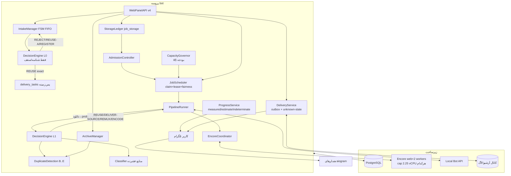

# مشخصات نهایی معماری و الگوریتم Oxmit — نسخه ۳ (V3، آماده پیاده‌سازی)

> **سند:** MEGA TASK 03 — اعتبارسنجی نهایی معماری، بازارزیابی ظرفیت و مشخصات V3
> **مبنا:** بازبینی V2 + بازرسی مستقیم کد (کامیت `1699d98`، شاخه `main`، آخرین بازرسی 2026-11-14) + مشخصات مالک برای سرور اصلی
> **مخاطب سند:** عامل کدنویس فاز بعدی — این سند باید بدون حدس زدن قواعد کسب‌وکار، ساختار داده، گذار وضعیت و رفتار سیستم قابل پیاده‌سازی باشد.
> **برچسب‌های شواهد:** `[SOURCE-VERIFIED]` (در کد تأیید) · `[OWNER-PROVIDED]` (از مالک) · `[MEASURED]` (اندازه‌گیری واقعی) · `[INFERRED]` (استنباط فنی از شواهد) · `[PROPOSED]` (طرح هدف) · `[PROVISIONAL]` (موقتی تا کالیبراسیون) · `[UNVERIFIED]` (فعلاً قابل اثبات نیست)
> **سند خودبسنده است؛ هیچ بخشی به «V1 را ببینید» ارجاع نمی‌دهد.**

---

## ۱. خلاصه مدیریتی (Executive Summary)

V3 نسخه نهایی و سازگارِ درونیِ معماری هدف است. نسبت به V2، پنج موضوع اصلی حل/اصلاح شده است:

1. **تفکیک دو سرور:** سروری که تا امروز بازرسی می‌شد (۲ vCPU / 3.7GB / 77GB) **سرور اصلی تولیدی نیست**؛ پایگاه برنامه‌ریزی، سرور اصلی با **۸ هسته / 16GB / ~۶۰۰GB** است `[OWNER-PROVIDED]`. کل مدل ظرفیت برای سرور اصلی بازسازی شد (§۶) و سرور فعلی فقط «محیط عملیات/تست جاری» با داده مرجع است.
2. **مدل ظرفیت از صفر بازسازی شد:** بودجه CPU/RAM برای ۸ هسته تعریف شد، هم‌زمانی امن ورکر با قاعده `min(CPU, RAM, Disk-I/O, Network, App)` = **۲ انکود هم‌زمان [PROPOSED]**، و سقف واقعی throughput با فرمول فریم‌محور محاسبه شد (~۱۳۷ ویدیوی «یک‌ساعته» در روز به‌عنوان کف [PROVISIONAL]). ناسازگاری برچسب/فرمول سناریوی ۲k در V2 شناسایی و اصلاح شد (§۶٫۴).
3. **تشخیص تکراری نهایی شد:** تفکیک شش‌بعدی (هویت فایل / منشأ پردازش / شباهت محتوا / موجودی آرشیو / مناسب بودن / واجد شرایط تحویل)، حذف letterbox ایمن (معیار واریانس+سازگاری چندفریمی، نه فقط تاریکی)، منطق low-entropy (اسلاید ثابت هرگز auto-reuse نمی‌شود)، coarse-to-fine، و سه دیتاست آماری با Clopper–Pearson (§۱۱–۱۳).
4. **صداقت تحویل تلگرام:** تراکنش PostgreSQL + ارسال تلگرام اتمیک نیست؛ وضعیت `delivery_unknown` و مدل at-least-once-with-duplicate-risk برای retry پس از نتیجه نامعلوم مستند شد؛ هیچ ادعای exactly-once وجود ندارد (§۲۰).
5. **مدل storage با ۶۰۰GB واقعی:** قابل‌استفاده رسانه‌ای ~۴۵۰GB پس از رزرو سیستم/DB/بکاپ، آستانه‌های high/low-water، و ledger `job_storage` با هویت فیزیکی `(st_dev, st_ino)` (§۱۹، §۶٫۵).

حفظ شده‌ها: صف PostgreSQL، Encore، Local Bot API، کانال آرشیو، EDU480 به‌عنوان پروفایل پایه `[SOURCE-VERIFIED]`، الگوی metadata-first، FSM intake چندفایلی، تصمیم دو مرحله‌ای L0/L1، ledger رزروها، و سرویس‌لایه واحد برای ربات/پنل وب.

**وضعیت آمادگی:** سند به‌عنوان مشخصات پیاده‌سازی آماده است؛ موارد وابسته به اندازه‌گیری (benchmark fps، آزمایش association دانلود، holdout آماری) با «رفتار ایمن پیش‌فرض» تعریف شده‌اند تا پیاده‌سازی بدون آن‌ها هم شروع شود و بعد از اندازه‌گیری، مقادیر کالیبره شوند (§۳۱، §۳۲).

---

## ۲. روش و مبانی شواهد

- **منبع حقیقت:** کد فعلی مخزن (کامیت `1699d98`)؛ مستندات قبلی فقط برای بازیابی جزئیات.
- **بازرسی این فاز:** تطبیق مجدد وضعیت git (محلی و سرور، هر دو تمیز روی `1699d98`)؛ بازرسی مجدد محیط فعلی (§۴)؛ تأیید مقادیر EDU480 در `bot/oxmit/config.py:164-170`؛ تأیید محل استفاده `min_video_kbps` (فقط در `profiles.compute_target_params` — مسیر legacy custom-target، نه تصمیم EDU480) `[SOURCE-VERIFIED]`.
- هر ادعای مهم با برچسب شواهد + مسیر فایل/تابع/جدول آمده است؛ شماره خط‌ها از آخرین بازرسی‌اند و ممکن است با تغییر کد جابه‌جا شوند.
- هیچ آزمایش مخرب، migration، یا load روی تولید اجرا نشده؛ آزمایش‌های لازم روی infra ایزوله در §۲۶ و §۲۸ تعریف شده‌اند.

---

## ۳. معماری فعلی و وضعیت راستی‌آزمایی‌شده پیاده‌سازی

جدول زیر وضعیت واقعی هر جزء را با برچسب می‌دهد (مبنا: بازرسی کد؛ «disconnected» یعنی کد هست ولی در مسیر اجرای تولید صدا زده نمی‌شود):

| جزء | وضعیت فعلی | شواهد |
|---|---|---|
| ربات aiogram 3 + polling | Fully implemented، فعال | `bot.py:82-216` [SOURCE-VERIFIED] |
| صف PostgreSQL (jobs/stage/lease) | Fully implemented، فعال | `jobqueue.py`، مهاجرت 015 [SOURCE-VERIFIED] |
| Local Bot API + volume مشترک | Fully implemented، فعال | docker-compose، `engine.resolve_local_path` [SOURCE-VERIFIED] |
| Encore (web+worker) انکود EDU480 | Fully implemented، فعال | `encore_client.py`، `deploy/encore/profiles/edu480.yml` [SOURCE-VERIFIED] |
| کانال آرشیو + زنجیره copy→file_id→upload | Fully implemented | `archive.py:88-160` [SOURCE-VERIFIED] |
| intake چندفایلی (drafts + یک prompt فعال) | Fully implemented؛ نقطه ضعف: تحویل reuse sync درون حلقه | `intake.py:145-212`، `jobqueue.py:184-192` [SOURCE-VERIFIED] |
| dedup exact (unique_id/sha) | Fully implemented، فعال | `jobqueue.py:128-159` [SOURCE-VERIFIED] |
| dedup fuzzy/similarity | **Disconnected** (کد هست، مصرف‌کننده ندارد) | `dedup.py` (بدون caller تولیدی) [SOURCE-VERIFIED] |
| fingerprint (۸×۸×۸ ahash) | Implemented ولی بی‌مصرف | `media.py:240-285`، `Fingerprinter` [SOURCE-VERIFIED] |
| `decision_engine.py` | **Inactive/disconnected** | بدون import تولیدی [SOURCE-VERIFIED] |
| `estimate.py` | Implemented، فقط توسط مسیر مرده `_estimate_text` | `engine.py:906-948` بدون caller [SOURCE-VERIFIED] |
| cache-offer تعاملی | **Disconnected** (متادیتا/متن آماده، مسیر قطع) | `engine.deliver_cached_offer` بدون caller [SOURCE-VERIFIED] |
| مسیر legacy custom/level/target | Present-but-bypassed (به EDU480 نگاشت می‌شود) | `engine.handle_submission:877-904` [SOURCE-VERIFIED] |
| `job_artifacts`، `force_sub_channels` | Implemented tables، بدون مصرف‌کننده | مهاجرت 013/014 [SOURCE-VERIFIED] |
| پنل تلگرامی ادمین/مالک، مودریشن، support | Fully implemented | `adminpanel.py`, `owner.py`, `moderation.py`, `support.py` [SOURCE-VERIFIED] |
| پنل وب (۴ نسل API) | Fully implemented ولی مشکل‌دار (§۲۴) | `webpanel.py`, `dashboard.py`, `panel/*` [SOURCE-VERIFIED] |
| duration «00:00:00» | باگ فعال در مسیرهای reuse/document | `engine._summary_text` با `or 0` [SOURCE-VERIFIED] |
| EDU480: short→480 Lanczos، fps≤30، x264 CRF25 veryfast، AAC64k، mp4 faststart | Fully implemented، تنها پروفایل فعال | `config.py:164-170`، `edu480.py`، `edu480.yml` [SOURCE-VERIFIED] |

---

## ۴. سرور فعلی در برابر سرور اصلی

### ۴٫۱ سرور فعلی (محیط عملیات/تست جاری) — آخرین بازرسی 2026-11-14 `[MEASURED]`

| منبع | مقدار |
|---|---|
| vCPU | ۲ |
| RAM | 3.7GB (≈2.7GB available) |
| دیسک | 77GB (≈65GB آزاد) |
| worker replicas | ۱ |
| cap CPU هر worker | 1.8 (`nano_cpus=1800000000`) |
| کانتینرها | bot/web/postgres/redis/botapi سالم؛ worker-1 در چرخه drain-restart طبیعی |

این اعداد فقط مشخصات **همین محیط** هستند و **نباید** به‌عنوان سخت‌افزار سرور اصلی گزارش شوند. داده‌های مرجع قابل استناد از این محیط: الگوی نام فایل‌های Bot API (`videos/file_<N>.mp4`)، رفتار drain-and-restart ورکرها، و واقعیت capهای compose.

### ۴٫۲ سرور اصلی تولیدی — پایگاه برنامه‌ریزی `[OWNER-PROVIDED]`

| منبع | مقدار | منبع |
|---|---|---|
| CPU | ۸ هسته | `[OWNER-PROVIDED]` |
| RAM | 16 GB | `[OWNER-PROVIDED]` |
| Storage | ~600 GB | `[OWNER-PROVIDED]` |

### ۴٫۳ مشخصات ناشناخته سرور اصلی که قبل از deployment باید اندازه‌گیری شود `[UNVERIFIED]`

- نوع CPU و تفکیک physical/logical (hyperthreading؟) → روی fps تأثیر مستقیم دارد.
- نوع دیسک (SSD؟ NVMe؟ شبکه‌ای؟) و throughput واقعی خواندن/نوشتن → گلوگاه I/O انکود و دانلود.
- فضای واقعی قابل‌استفاده پس از پارتیشن‌بندی/فایل‌سیستم.
- پهنای باند خروجی/ورودی (محدودیت آپلود تلگرام/botapi).
- نسخه OS، cgroup نسخه، تنظیمات docker.

این موارد در «چک‌لیست benchmark اولیه» §۲۸ فاز 0 آمده‌اند. هیچ عدد عملکردی از سرور فعلی به‌عنوان اندازه‌گیری سرور اصلی گزارش نمی‌شود؛ فقط به‌عنوان مرجع با محدودیت صریح.

---

## ۵. فرض‌های زیرساختی نهایی

### ۵٫۱ بودجه CPU سرور اصلی (۸ هسته) `[PROPOSED]`

| مصرف‌کننده | بودجه (cores) | دلیل |
|---|---|---|
| OS و سرویس‌های سیستم | 0.5 | — |
| PostgreSQL | 0.5 | در این مقیاس عمدتاً idle؛ limit compose به 1.0 |
| Redis | 0.2 | صف Encore؛ سبک |
| پروسه bot (polling/edits/panel) | 0.5 | — |
| Local Bot API (botapi) | 0.8 | انتقال فایل‌های بزرگ؛ در پیک دانلود/آپلود بالا |
| Encore-web (JVM) | 0.5 | coordination |
| حاشیه/headroom | 0.5 | جذب پیک |
| **استخر انکود (workers)** | **4.5** | «همه ۸ هسته به FFmpeg داده نمی‌شود» (الزام §۴٫۱) |
| **جمع** | **8.0** | — |

### ۵٫۲ بودجه RAM سرور اصلی (16GB) `[PROPOSED]`

| مصرف‌کننده | limit |
|---|---|
| OS/buffers | ~1.5 |
| PostgreSQL | 1.0 (ارتقا از 512M فعلی) |
| Redis | 0.77 |
| bot | 0.3 |
| botapi | 2.0 (بافر انتقال فایل‌های تا 2GB) |
| encore-web | 1.0 |
| 2×worker (هرکدام شامل ffmpeg) | 2×2.5 = 5.0 |
| headroom نگهداشت/بکاپ | ~1.0 |
| **جمع تخصیص** | **≈12.6 → مارجین ≈3.4GB** |

### ۵٫۳ معماری Worker و هم‌زمانی امن `[PROPOSED]`

- **۲ replica** ورکر با cap هرکدام **2.25 vCPU** (جمع 4.5 = استخر انکود)؛ `WORKER_REPLICAS=2`، `slots=2`، تیونر: `single=4.5` (وقتی فقط یک encode فعال: هر دو cap به یک ورکر قابل انتقال نیست — تیونر فقط بین دو cap تقسیم می‌کند؛ عملی: single=2.25 روی هر دو و جمع 4.5 ثابت؛ سود تیونر در این توپولوژی محدود به موارد ۳+ slot است).
- قاعده الزامی: `Safe Concurrency = min(CPU: 2, RAM: ~5, Disk-I/O: [UNVERIFIED], Network: [UNVERIFIED], App: slots=2)` → **۲ انکود هم‌زمان**؛ سناریوی 3×1.5 فقط پس از benchmark (§۲۸) و در صورت اثبات سود aggregate.
- فرض throughput `[INFERRED/PROVISIONAL]`: x264 veryfast 480p30 ≈ **۳۰–۴۵ fps به‌ازای هر vCPU** (رفتار متعارف x264؛ برای این workload اندازه‌گیری نشده). ⇒ هر ورکر @2.25 cores ≈ ۶۸–۱۰۱ fps؛ ویدیوی یک‌ساعته 30fps (108k فریم) ≈ **۱۸–۲۶ دقیقه** per-job.

---

## ۶. مدل ظرفیت بازمحاسبه‌شده (سرور اصلی)

### ۶٫۱ فرمول‌های رسمی (الزام §۴٫۴)

```text
DailyJobs            = RegisteredUsers × DAU_ratio × JobsPerActiveUser
DailyEncodeJobs      = DailyJobs × share_encode        ← share_encode صریح (درصد encode)
FramesPerJob         = duration_s × min(fps_src, 30)
EncodeWallSeconds    = FramesPerJob / fps_worker_effective
DailyEncodeWallHours = DailyEncodeJobs × EncodeWallSeconds / 3600
PoolCapacityPerDay   = 24 × Workers × U        (U = 0.60 [PROPOSED]: idle/maintenance/retry margin)
MaxEncodeJobsPerDay  = encode_cores × 86400 × U × fps_per_core / FramesPerAvgJob
PeakHourDemand       = DailyEncodeWallHours × peak_factor / 24   (peak_factor = 2.5 [ASSUMPTION])
BacklogDrainHours    = BacklogWallHours / (PoolCapacityPerHour − DemandWallHoursPerHour)
```

### ۶٫۲ سقف مطلق throughput سرور اصلی `[INFERRED/PROVISIONAL — تا benchmark]`

```text
encode_cores = 4.5؛ fps_per_core = 30..45؛ U = 0.60
CoreSecondsPerDay  = 4.5 × 86400 × 0.60 = 233,280
FramesCapacity/day = 233,280 × (30..45) = 7.0M .. 10.5M فریم
```

- ویدیوی یک‌ساعته (108k فریم): **~۶۵ تا ۹۷ job/day** (کف محافظه‌کارانه ~۶۵).
- با mix واقعی‌تر (میانگین ۳۳ دقیقه → 59.4k فریم/job): **~۱۱۸ تا ۱۷۷ job/day**؛ عدد رسمی برنامه‌ریزی: **~۱۳۷ job/day** `[PROVISIONAL]`.

### ۶٫۳ سناریوهای کاربر (الزام §۴٫۴) — همه `[SCENARIO ESTIMATE]`

فرض‌های صریح: DAU/jobs-per-active/share_encode/مدت از فرض محصول؛ mix: P50=20min، P95=120min، mean=33min؛ avg encode wall ≈ 0.195h با fps_worker≈85 @2.25 cores.

| سناریو | jobs/day | share_encode (صریح) | encode jobs | DailyEncodeWallHours | ظرفیت pool (2×worker) | حکم |
|---|---|---|---|---|---|---|
| S1: 2k، DAU20٪، 0.5 | 200 | **40%** | 80 | 80×0.195=**15.6** | 28.8 h/day | ✅ پایدار (54% utilization)؛ پیک ×2.5 → overflow کوتاه صف که تخلیه می‌شود |
| S2: 3k، DAU30٪، 0.75 | 675 | **35%** | 236 | 236×0.195=**46.0** | 28.8 | ❌ با این share_encode؛ فقط با share≤25% (dedup بالغ → ~168 job، ~33h — هنوز مرزی) یا host دوم |
| S2′: 3k با share_encode 20% | 675 | **20%** | 135 | **26.3** | 28.8 | ✅ مرزی-پایدار؛ نیازمند dedup مؤثر + monitor |
| S3: 5k، DAU30٪، 1.0 | 1500 | **30%** | 450 | **87.8** | 28.8 | ❌ نیاز به ~۳× ظرفیت → host دوم/سوم + پروسه scheduler جدا (معماری multi-host-ready است) |

**اصلاح ناسازگاری V2 (الزام §۴٫۵):** در V2 ردی با برچسب «share 60%» با share_encode=25% محاسبه شده بود. در V3 همه ردیف‌ها `share_encode` را صریح می‌گویند و هر عدد از فرمول همان ردیف درآمده است. همچنین: worker-equivalent فقط به‌صورت «ظرفیت معادل» معنا دارد، نه تعداد ورکر deployed؛ CPU-cap ≠ slots؛ ظرفیت روزانه ≠ هم‌زمانی پیک؛ ظرفیت storage ≠ ظرفیت پردازش.

### ۶٫۴ پیک، صف و تخلیه

- پیک عصرگاهی ×2.5 `[ASSUMPTION]`: در S1، تقاضای ساعت پیک ≈ 1.63 wall-h در برابر ظرفیت ساعتی 1.2 → صف کوتاه؛ drain = overflow/(1.2−0.65) ≈ چند ده دقیقه.
- قواعد backpressure همان §۱۲ حفظ؛ صف فقط تأخیر می‌سازد، فاجعه نه (metadata-first).
- **قانون پایداری (الزام §۶٫۲):** سیستم فقط وقتی پایدار است که `DailyEncodeWallHours ≤ PoolCapacityPerDay`؛ در غیر این صورت پذیرش باید با سقف per-user/روزانه محدود شود، نه صف بی‌نهایت.

### ۶٫۵ ظرفیت storage سرور اصلی (~600GB) — الزام §۴٫۶

| بند | رزرو `[PROPOSED]` |
|---|---|
| OS + docker images/layers | 30 GB |
| PostgreSQL (متادیتا/probe/phash؛ رشد کند) | 20 GB |
| Redis + logs (با capهای compose) | 15 GB |
| بکاپ/نگهداشت عملیاتی | 50 GB |
| متفرقه/tmp سیستم | 20 GB |
| **جمع رزرو** | **135 GB** |
| **قابل‌استفاده رسانه‌ای** | **~465 GB → عدد برنامه‌ریزی: 450 GB** |

- churn رسانه با retention 24h: پیک زنده ≈ (jobهای در pipeline + پنجره retention) × میانگین footprint؛ مثال S1: ~۲۵ job هم‌زمان/retained × ~۳GB (منبع+خروجی/پارت‌ها در پیک) ≈ 75GB — خیلی زیر سقف.
- **آستانه‌ها `[PROPOSED]`:** high-water = 80% usable (≈360GB مصرف رسانه‌ای) → توقف پذیرش jobهای سنگین جدید؛ low-water = 70% (≈315GB) → ازسرگیری؛ critical = free<40GB → auto-pause کل intake (هم‌راستا با رفتار فعلی `DISK_MIN_FREE_GB`).
- قانون admission: هیچ jobای شروع نمی‌شود اگر `need(job) > free − Σreservations` (فرمول پیک §۱۹٫۳).

## ۷. معماری هدف نهایی

ساختار ۱۳ کامپوننتی حفظ می‌شود؛ تفاوت‌های نهایی نسبت به V2:

1. **DecisionEngine با دو ورودی L0/L1** + خروجی ساختاریافته با evidence (§۱۵).
2. **DuplicateDetectionEngine** با شش‌بعد جداشده و گیت آماری (§۱۱–۱۴).
3. **دو ledger مستقل:** پردازش (slots/lease) و `job_storage` فیزیکی با `(st_dev, st_ino)` (§۱۹).
4. **DeliveryService با مدل consistency صادقانه:** `delivery_unknown` + outbox attempt-record (§۲۰).
5. **CapacityGovernor** با بودجه‌های §۵ و backpressure (§۱۰).
6. **ProgressService** با نوع‌های صریح `measured|estimate|indeterminate` (§۱۸).
7. سرویس‌لایه واحد برای ربات و پنل وب (§۲۴).



## ۸. مسئولیت هر کامپوننت

جدول کامل مسئولیت/ورودی/خروجی/state/وابستگی/رفتار شکست همان ۱۳ کامپوننت V2 §۵ است و معتبر می‌ماند؛ با این سه اصلاح نهایی:

| کامپوننت | اصلاح V3 |
|---|---|
| IntakeManager | مصرف L0 فقط برای match دقیق شناسه؛ هیچ ffprobe/sha/fingerprint/تحویل sync |
| DeliveryService | مدل وضعیت کامل §۲۰ با `unknown`؛ lease-per-task؛ outbox |
| CapacityGovernor | بودجه §۵ را اعمال می‌کند (slots_live از min(CPU,RAM,IO,Net,App))؛ متریک «host-limited» صادقانه وقتی tuner value > cap واقعی |

## ۹. ماشین حالت intake چندفایلی

الزام §۱۳ مگاپرومپت: ارسال N ویدیو → prompt نام‌ها به ترتیب → هر resolution فوراً prompt بعدی؛ پردازش/تحویل هرگز intake را بلاک نمی‌کند؛ JIT download حفظ (دانلود فقط هنگام claim + prefetch محدود ≤1).

FSM drafts: `received → waiting → prompting → resolved(registered | reuse_pending_delivery | delivered | rejected) | cancelled | expired` — قواعد: یک prompt فعال per-user (unique جزئی)، مصرف اتمیک، `user_seq` صریح، expiry (prompt: NAMING_TIMEOUT_MIN؛ waiting: ×4)، promote فوری بعد از هر resolution، restart-recovery (promote قدیمی‌ترین waiting بدون prompt فعال)، idempotency update (unique `(chat_id, source_message_id)`) و throttle دکمه 0.6s.

تعامل با منابع: `reuse_pending_delivery` فقط delivery_task می‌سازد (بدون slot/lease انکود)؛ jobهای registered فقط متادیتا؛ prefetch دانلود با رزرو جداگانه؛ هیچ delivery_task ای slot انکود مصرف نمی‌کند (الزام §۱۳).

## ۱۰. صف و زمان‌بندی

هسته حفظ: claim اتمیک `FOR UPDATE SKIP LOCKED`، priority، aging (min(cap, hours×K), K=5/h, cap=15)، fairness per-user (سقف slot: 1 عادی / 2 VIP-ادمین)، lease+heartbeat+reaper.

**استخرهای منبع جدا (الزام §۷٫۱):** دانلود (prefetch ≤1 + رزرو)، تحلیل (thread pool؛ سبک)، fingerprint (صف پس‌زمینه bounded=200)، انکود (slots=2)، آپلود آرشیو (semaphore=2)، تحویل (delivery_tasks workers ≤2). ETA روی این استخرها شبیه‌سازی می‌شود؛ مراحل هم‌پوشان جمع ترتیبی نمی‌شوند.

بای‌پس‌ها: jobهای REUSE/DELIVER_SOURCE/REMUX وارد صف انکود نمی‌شوند و در ETA شمرده نمی‌شوند (فقط ENCODEها).

backpressure: claim فقط اگر `disk_free−Σstorage_res ≥ need ∧ busy<slots_live ∧ queue<MAX_QUEUED ∧ RAM<85%`؛ دیسک/توقف با notify ادمین ساعتی.

## ۱۱. معماری تشخیص تکراری

### ۱۱٫۱ شش‌بعد جداشده (الزام §۵٫۱)

| بُعد | تعریف | مکانیزم |
|---|---|---|
| File identity | «همین فایل بایت‌به‌بایت قبلاً بوده» | `file_unique_id` و SHA-256 |
| **Processing provenance** | «این فایل خروجی Oxmit بوده» | lineage DB: خروجیِ match با `archive_records.output_media_id` / `tg_file_unique_id` خروجی → `known_output` |
| Content similarity | «محتوای بصری همان است» | fingerprint ادراکی (§۱۲) |
| Archive availability | «نسخه آرشیو معتبر موجود است» | `archive_records.status='active'` + پیام/file_id سالم |
| Archive suitability | «نسخه از نظر پروفایل/کیفیت قابل تحویل است» | version/short-side check |
| Delivery eligibility | «تحویل در حال حاضر ممکن است» | file_id معتبر، پیام آرشیو موجود، کاربر unblocked |

**قانون:** transcode شخص ثالث که با خروجی آرشیو Oxmit match می‌شود → content-similar است ولی provenance آن «Oxmit-produced» نیست؛ این تمایز در evidence ثبت و در UI متناسب رندر می‌شود (پیام «نسخه مشابه موجود است» نه «این خروجی خودِ ماست»).

### ۱۱٫۲ کاندید‌یابی نهایی (بازبینی §۵٫۲)

- فیلترهای سخت حجم/کدک/نام: **ممنوع** (فقط سیگنال رتبه‌بندی/تقویت).
- پنجره مدت: `|Δdur| ≤ max(2s, 15%)` با bucket index `ceil(dur/300)` ±۱ همسایه — پوشش trim/intro تا ~۱۵٪؛ **مصالحه recall/هزینه مستند:** پنجره بزرگ‌تر = کاندید بیشتر (هزینه scoring خطی در تعداد کاندید، cap ۲۰۰).
- aspect ±۱۵٪ (پس از نرمال‌سازی letterbox) — فقط bucket، نه gate مطلق؛ کاندید خارج پنجره aspect هم امتیاز می‌گیرد ولی confidence سقف Medium دارد.
- کاندید صفر → بدون مرحله perceptual (هزینه صفر).

### ۱۱٫۳ coarse-to-fine (الزام §۵٫۴)

1. fingerprint پایه (۱۲ فریم) — همیشه، پس‌زمینه‌ای.
2. retrieval کاندیدها.
3. مقایسه ۱۲-فریمی + consistency.
4. اگر score در ناحیه مرزی (Low–High) یا محتوا low-entropy → **افزودن ۱۲ فریم دوم** (۲۴ فریم) فقط برای همان کاندیدها (≤۵ کاندید) → alignment دقیق‌تر.
5. confidence نهایی کالیبره‌شده. هیچ تحلیل گران‌ای برای هر فایل ورودی انجام نمی‌شود.

### ۱۱٫۴ handling low-entropy (الزام §۵٫۶)

- تشخیص: شباهت درون‌ویدیویی — اگر میانگین فاصله فریم‌های خودِ ویدیو (۱۲ جفت مجاور) < آستانه (کد ثابت/slides)، ویدیو low-entropy است.
- سیاست: low-entropy ∧ match → **حداکثر Medium** (پیشنهاد کاربر، هرگز auto-reuse)؛ +۱۲ فریم دوم؛ **امضای گذار زمانی** (تعداد/موقعیت scene-changeها از `ffmpeg select='gt(scene,0.4)'` — ارزان و موجود) به‌عنوان tiebreaker؛ audio signal فقط در صورت وجود به‌عنوان سیگنال (امضای صوتی chromaprint پیاده نشده و ادعا نمی‌شود `[SOURCE-VERIFIED: وجود ندارد]`).
- fallback همیشه: پردازش عادی.

### ۱۱٫۵ هم‌ترازی زمانی و consistency (الزام §۵٫۵)

- fps-change/زمان‌بندی: هش‌ها روی timestamp نسبی نمونه‌گیری می‌شوند → مستقل از fps.
- trim/intro/outro: جستجوی آفست ±۲ فریم (هر واحد ≈ ±۸٫۳٪)؛ اگر `|Δdur| > 5%` → آفست ±۳ (پوشش ~۱۲٫۵٪)؛ تغییر speed واقعی (تغییر fps پخش با مدت تقریباً ثابت) خارج پوشش است → score پایین‌تر → Medium/Low؛ این محدودیت صادقانه مستند است.
- all-to-all ممنوع (هزینه)؛ فقط آفست خطی روی توالی ۱۲/۲۴تایی.
- `temporal_consistency = s(d_i ≤ T_single)/N` با `T_single=26/64`؛ شرط گذر ≥0.7 برای هر match؛ وزن در score نهایی: شرطی (gate) نه جمع‌شونده.

### ۱۱٫۶ نردبان رفتار (حفظ اصل FP>>FN از V2)

| سطح | شرط | رفتار |
|---|---|---|
| exact (identity/provenance) | شناسه/SHA | **auto-reuse فوری** (ریاضی دقیق؛ بدون نیاز به آمار) |
| perceptual High | score≥0.90 ∧ consistency≥0.85 ∧ |Δdur|≤max(2s,3%) ∧ نه-low-entropy | auto-reuse **فقط پس از gate آماری §۱۳** |
| Medium | score∈[0.80,0.90) یا High با تناقض صوتی/low-entropy/Δdur>3% | پیشنهاد غیرمسدودکننده (کارت مستقل، انقضا ۱۰min → ادامه عادی) |
| Low | [0.70,0.80) | فقط evidence |
| No match | <0.70 | — |

هزینه FP (تحویل ویدیوی غلط) ≫ FN (انکود اضافی) → آستانه‌ها محافظه‌کار؛ تا gate آماری، perceptual High هم مثل Medium رفتار می‌کند.

## ۱۲. الگوریتم‌های Fingerprint (مشخصات قطعی)

- **dHash-64:** grayscale BT.601 → حذف letterbox ایمن (§۱۲٫۱) → resize **۹×۸** (area) → گرادیان افقی مجاور: `bit=1 iff P(x,y)<P(x+1,y)` روی گرید **۸×۸ = ۶۴ بیت** → pack row-major uint64.
- **aHash-64:** resize ۸×۸ → آستانه میانگین → ۶۴ بیت.
- **نمونه‌گیری:** ۱۲ فریم در `(i+0.5)/12×dur`؛ coarse-to-fine تا ۲۴.
- **ذخیره:** `phash JSONB {"v":2,"frames":12,"dhash":[12 uint64],"ahash":[12 uint64],"low_entropy":bool,"dur_bucket":int}`؛ مقایسه فقط هم‌نسخه.
- **score:** `sim=1−hamming/64`؛ `d_sim=trimmed_mean(sim_dhash, drop 2/12)`؛ `a_sim=مشابه`؛ `visual_score=0.65·d_sim+0.35·a_sim [PROVISIONAL]`.

### ۱۲٫۱ حذف letterbox ایمن (اصلاح نقطه ضعف V2 — الزام §۵٫۳)

تشخیص مرز فقط وقتی **همه** شرایط برقرار است:
1. نوار مرزی در **≥۳ فریم نمونه** یکسان‌geometry باشد (پایداری مکانی-زمانی)؛
2. واریانس پیکسلی نوار **≈ صفر** (std ≤ 2/255) — نه فقط تاریکی؛ صحنه تاریک واقعی واریانس غیرصفر دارد؛
3. اختلاف کنتراست نوار با ناحیه محتوا معنادار باشد (mean_content − mean_border ≥ 20/255)؛
4. حذف هر ضلع حداکثر **۲۰٪ بعد مربوطه**؛
5. اگر کل فریم variance پایین باشد (صحنه یکنواخت تاریک) → هیچ cropی؛ هش روی فریم کامل.

حالت‌های پوشش‌داده‌شده: screen-recording با نوار مشکی ثابت، letterbox واقعی، محتوای تاریک سالم (crop نمی‌شود)، aspect متغیر بین صحنه‌ها (crop فقط وقتی geometry در ≥۳ فریم ثابت است).

## ۱۳. برنامه اعتبارسنجی آماری (الزام §۵٫۷)

- **سه دیتاست با جداسازی در سطح محتوا:** Calibration (~۳۰۰ جفت positive ساخته‌شده: transcode/rescale/crop/trim/fps-change/watermark/re-upload + ۳۰۰ easy-negative) → Validation (tuning نهایی) → **Final Holdout** (≥۶۰۰ hard-negative + ≥۱۰۰ positive؛ هرگز در tuning). محتوای زیربنایی بین دیتاست‌ها نشت نمی‌کند: encodeهای مختلف همان فیلم همه در یک partition.
- **متریک‌ها با بازه Clopper–Pearson ۹۵٪:** TP/FP/TN/FN، Precision، Recall، FPR=F.P/TN+F.P، FNR؛ n هر سلول گزارش می‌شود.
- **gates فعال‌سازی:**
  - auto-reuse ادراکی: کران بالای FPR ≤ 0.5٪ با اطمینان ۹۵٪ (صفر FP ⇒ n≥600؛ یک FP ⇒ n≥1000) **و** کران پایین Recall ≥ 90٪.
  - تا عبور gate: perceptual فقط «پیشنهاد».
- **قانون گزارش:** هیچ recall/precision‌ای بدون n و CI اعلام نمی‌شود؛ نقطه‌estimate به‌تنهایی «اثبات آماری» نیست (الزام صریح).

## ۱۴. تفکیک منشأ و شباهت محتوا (الزام §۵٫۱ مگاپرومپت)

در خروجی DDE هر match یک آبجکت شش‌فیلدی است:

```python
{"file_identity": "exact|none", "provenance": "oxmit_output|oxmit_source|third_party|unknown",
 "content_similarity": score, "archive_available": bool, "archive_suitable": bool,
 "delivery_eligible": bool}
```

Policy mapping: provenance=oxmit_output (فایل ورودی، خروجی خودمان است) → تحویل مستقیم همان فایل (بدون پردازش، بدون تحویل دوباره از آرشیو) + ثبت counter؛ content-similar ∧ archive_available ∧ suitable ∧ eligible → مسیر reuse (exact یا offer بسته به confidence)؛ content-similar ولی archive missing/blocked → پردازش عادی با evidence.

## ۱۵. موتور تصمیم‌گیری فشرده‌سازی (نهایی)

### ۱۵٫۱ هفت تفکیک الزامی (§۶٫۲) → پنج اقدام

| سؤال | مکانیزم |
|---|---|
| ۱. محتوا در آرشیو هست؟ | DDE |
| ۲. منبع همین الان suitable است؟ | کلاس C1: EDU480-compliant `[SOURCE-VERIFIED: edu480.py:201-234]` |
| ۳. منبع artifact Oxmit است؟ | provenance (§۱۴) |
| ۴. encode صرفه معنادار دارد؟ | مدل منفعت §۱۶ |
| ۵. افت کیفیت قابل قبول است؟ | کلاس محتوا + قواعد حفاظت §۱۶٫۴ |
| ۶. remux لازم است؟ | container ≠ mp4 ∧ streams سازگار |
| ۷. خروجی بزرگ‌تر می‌شود؟ | P_bigger §۱۶٫۲ |

اقدام‌ها: `REUSE_ARCHIVE | DELIVER_SOURCE | REMUX | ENCODE | REJECT` — هر اقدام با evidence کامل ثبت (`jobs.decision`)؛ **هیچ encode بدون ثبت تصمیم**.

درخت نهایی (خلاصه اجرایی): invalid→REJECT؛ provenance=own-output→DELIVER_SOURCE(همان فایل)؛ exact/perceptual-gated→REUSE؛ C1-suitable∧mp4→DELIVER_SOURCE؛ C1∧container≠mp4→REMUX؛ benefit≥threshold∧P_bigger≤max→ENCODE(استراتژی §۱۷)؛ در غیر این صورت→DELIVER_SOURCE (محافظه‌کار).

### ۱۵٫۲ مستند per-action (الزام §۶٫۲)

| اقدام | شواهد لازم | مصرف منبع | پیامد کیفیت | شکست | پیام کاربر |
|---|---|---|---|---|---|
| REUSE_ARCHIVE | exact یا perceptual-gated + archive_available+suitable+eligible | تحویل صفر-پردازش (post-دانلود: هیچ؛ pre-دانلود: هیچ) | همان نسخه validated قبلی | delivery_task retry/unknown §۲۰ | «نسخه فشرده‌شده موجود بود — ارسال شد» |
| DELIVER_SOURCE | C1-suitable∧mp4 یا C2/C5 یا no-benefit | آپلود منبع (در صورت نیاز؛ نه در intake) | بدون تغییر | زنجیره delivery فعلی | «ویدیو بهینه بود؛ بدون تغییر ارسال شد» |
| REMUX | C1 ∧ container≠mp4 | ثانیه‌ها، stream-copy | بدون re-encode | MediaError→fail | «به فرمت استاندارد تبدیل شد» |
| ENCODE | benefit gate | کامل (دانلود+انکود+آپلود) | کنترل‌شده §۱۷ | ترمیم دو مرحله‌ای mux→fail | کارت ۴ مرحله‌ای |
| REJECT | invalid/ناقص | صفر | — | — | پیام رد با دلیل |

## ۱۶. پیش‌بینی حجم خروجی و کیفیت (الزام §۶٫۳–۶٫۵)

### ۱۶٫۱ مدل

```text
predicted_output = bpp_model(pixels, fps, dur, codec_target, crf_target)   [بازیافت estimate.py]
predicted_interval = [low, high] (ضرایب 0.7–1.4 فعلی؛ پس از کالیبراسیون: quantileهای باکت)
savings_pct = 1 − predicted/src؛  savings_bytes = src − predicted
P_bigger = توزیع تجربی (output ≥ source) در باکت تاریخی هم‌جنس
```

### ۱۶٫۲ آستانه تصمیم (الزام صریح)

```text
ENCODE فقط اگر:
  savings_pct ≥ P_pct (20٪ [PROVISIONAL])  AND  savings_bytes ≥ P_bytes (50MB [PROVISIONAL])
  AND  P_bigger ≤ 20%  [PROVISIONAL]  AND  quality_risk ∈ {none, low}
در غیر این صورت → DELIVER_SOURCE (یا REMUX اگر container نیاز دارد)
```

توجیه نگهداری 20٪/50MB به‌عنوان شروع: هر دو در «دو بُعد» الزامی (درصد و مطلق) هستند و می‌توانند با داده تاریخی کالیبره شوند؛ تا آن زمان `[PROVISIONAL]`.

### ۱۶٫۳ برآورد P_bigger و کالیبراسیون

- P_bigger از فراوانی تجربی `jobs` تاریخی (per bucket: pixels-bundle × content-class × codec) محاسبه می‌شود؛ uncertainty = عرض CI باینومی باکت.
- داده ناکافی (n<10 در باکت): P_bigger = prior محافظه‌کار 25% (یعنی ENCODE سخت‌گیرتر) + ثبت «cold-start» در evidence.
- **cold-start (الزام §۶٫۵):** تا رسیدن هر باکت به n≥10، رفتار = کلاس‌بندی C1/C8 فقط (سازگار/غیرسازگار) + encode برای بقیه با آستانه سخت‌تر (P_pct=30%)؛ نمونه‌ها به‌مرور باکت را فعال می‌کنند؛ مدل نسخه‌دار (`app_config: decision_model_version`) و هر prediction با نسخه مدل ثبت می‌شود تا کالیبراسیون آینده قابل audit باشد.
- متریک خطا: MAPE per-bucket هفتگی؛ MAPE>25% → بازتنظیم ضرایب (clamp‌دار، بدون ML آزاد).

### ۱۶٫۴ حفاظت کیفیت (الزام §۶٫۴)

- منبع با کیفیت بصری پایین ولی bitrate بالا → فقط با gate کیفیت encode می‌شود؛ سیاست: کلاس low-quality (bpp پایین + artifacts proxy) → DELIVER_SOURCE.
- stream-copy کافی است وقتی: C1-suitable ∧ container سازگار (mp4) ∧ faststart مطلوب‌تر از هزینه re-wrap → DELIVER_SOURCE.
- remux هرگز stream را re-encode نمی‌کند (`-c copy`) `[SOURCE-VERIFIED: media.remux_to_mp4]`.
- VMAF/SSIM: **در pipeline تولید نیستند**؛ SSIM نمونه‌ای اختیاری فقط offline/benchmark؛ VMAF فقط در benchmark ایزوله برای کالیبراسیون آستانه‌ها. هیچ ادعای «اندازه‌گیری کیفیت زنده» وجود ندارد.

## ۱۷. pipeline کامل پردازش ویدیو (منبع→خروجی)

```text
Intake(متادیتا+L0) → Register(jobs متادیتا) → Queue → Claim(lease+رزرو پردازش)
→ Download(JIT؛ progress §۱۸) → Completeness(size==declared) → ffprobe(معتبر؟)
→ SHA-256 → L1: کاندید→perceptual→provenance→classifier→benefit→decision+evidence
→ اجرا: REUSE→delivery_task | DELIVER_SOURCE→delivery_task(منبع) | REMUX→ffmpeg copy | ENCODE→Encore
→ Validation(probe خروجی + نسبت مدت 0.85..1.15 + رزولوشن target) → Archive(idempotent)
→ Delivery(همه requesterها + برندینگ per-recipient) → Cleanup(ledger-close) 
```

قواعد حفاظت ساختاری که حفظ می‌شوند `[SOURCE-VERIFIED]`: نسبت مدت خروجی/منبع 0.85–1.15؛ حذف نگاشت streamهای غیر ویدیو/صدا در remux؛ هیچ پارامتر x265 به x264 داده نمی‌شود (جداسازی profileها — قاعده مستند در `decision_engine.HEVC_PROFILES` و پروفایل‌های deploy جدا)؛ low-bitrate guard فعلی (`MIN_VIDEO_KBPS=200`) متعلق به مسیر legacy custom است و در تصمیم EDU480 نقشی ندارد — در V3 نقطه‌guard واقعی، `edu480_compliant_kbps=700` است و همان حفظ می‌شود.

## ۱۸. Progress و ETA (نهایی)

- **چهار مرحله کاربر‌رو:** ورود به صف / دانلود / فشرده‌سازی / ارسال خروجی؛ stateهای داخلی → نگاشت ثابت.
- **سه نوع مقدار:** `measured` (منبع اندازه‌گیری واقعی)، `estimate` (برچسب تخمینی)، `indeterminate` (نقطه‌چین+elapsed). هیچ faked percentage.
- **دانلود:** پیش‌فرض indeterminate؛ measured فقط با association بی‌ابهام (§‌رفتار V2 §۱۴ حفظ به‌صورت کامل: فایل‌ها `videos/file_<N>.mp4` `[MEASURED]`، association قطعی ممکن نیست مگر یک download in-flight یا سایزهای متمایز + unique growing-candidate؛ فعال‌سازی فقط پس از آزمایش ایزوله).
- **انکود:** progress% واقعی Encore + fps زنده از Δprogress (`Δframes=Δpct×frames_total/100`؛ [فرض frame-proportional — آزمایش ایزوله])؛ output-size زنده = estimate برچسب‌دار؛ **صرفه فقط پس از validation**.
- **آپلود/تحویل (الزام §۷٫۴):** سه عملیات متفاوت و جدا: ① upload آرشیو (multipart از ما: aiogram 3 progress-hook ندارد → indeterminate) ② `copy_message` (سمت‌سرور تلگرام؛ درصد بی‌معنا → indeterminate) ③ تحویل به کاربر نهایی (event per-recipient). این‌ها هرگز یکی نمایش داده نمی‌شوند.
- **ETA (استخرهای §۱۰):** شبیه‌سازی رویدادمحور روی همه استخرها؛ per-stage مدل‌های P50/P90 از timestampها؛ نردبان نمونه: n<5→والد+×[0.5,2.0]؛ 5≤n<30→median باکت+×[0.7,1.5]؛ n≥30→[P10,P90] تجربی — **P90 زیر n=30 گزارش نمی‌شود** (الزام §۷٫۵: عدم اتکا به P90 با نمونه کم)؛ بازمحاسبه روی eventها (ورود/پایان/شکست/VIP/slots/سرعت)؛ قبل از L1 بازه پهن با برچسب «پس از تحلیل دقیق‌تر می‌شود»؛ پس از L1 آپدیت با action واقعی.
- **تأیید Medium-confidence (الزام §۷٫۳):** job به stage `awaiting_user` می‌رود و **slot/lease رزرو پردازش آزاد می‌شود**؛ رزرو storage برای منبع دانلودشده باقی می‌ماند (تا انتظار حداکثر ۱۰min)؛ accept→claim مجدد (منبع اگر هنوز هست استفاده می‌شود، وگرنه دانلود مجدد)؛ reject/timeout→ادامه ENCODE؛ duplicate pending→فقط یک offer فعال per (user, job)؛ intake در همه حالات آزاد است.

## ۱۹. رزرو Storage و Cleanup (نهایی)

### ۱۹٫۱ هویت فیزیکی (الزام §۸٫۱)

- کلید ledger: `(st_dev, st_ino)` برای فایل‌های واقعی؛ symlink=۰ بایت؛ hardlink=یک‌بار per-inode (ref-count)؛ copy=بایت کامل؛ rename=همان inode (ledger آپدیت path)؛ temp=فقط وقتی قابل انتساب؛ cross-volume=per-volume ledger.
- مسیر هرگز هویت فیزیکی نیست.

### ۱۹٫۲ فرمول پیک (بازبینی §۸٫۲)

```text
base_peak  = source_bytes + predicted_output
split_peak = source_bytes + 2×predicted_output            [SOURCE-VERIFIED: split خروجی کامل + پارت‌ها هم‌زمان]
merge_peak = Σinputs + predicted_output
peak(job)  = (split_likely ? split_peak : base_peak) × tmp_overhead(1.15 [PROVISIONAL]) 
```

شامل: partial output (خروجی ffmpeg تدریجی رشد می‌کند — پیک = خروجی نهایی)، validation artifacts (thumb)، retry retention، concurrent jobs (Σ با ledger).

### ۱۹٫۳ اتمیک بودن و reconcile (الزام §۸٫۳)

- ایجاد: هنگام claim (پردازش) و هنگام archive-confirm (نگهداشت خروجی)؛ افزایش: هنگام ظهور فایل جدید؛ آزادسازی: **فقط در unlink واقعی**.
- کرش job → sweep ردیف‌های یتیم را با FS می‌بندد؛ mismatch ledger↔FS → FS authority؛ stale reservation → sweep هر ۱۰min؛ overcommit هم‌زمانی: چک در claim با حاشیه safety_margin(5GB)؛ پذیرش ریسک residual با margin مستند.
- چکلیست حذف منبع (الزام §۸٫۴): archive_records معتبر (message/file_id) ∧ همه deliveryها done/unknown-resolved ∧ بازه retry منقضی → unlink + ledger close. شکست آپلود → خروجی حفظ. cleanup idempotent و restart-safe.

## ۲۰. Consistency تحویل تلگرام و Recovery (الزام بخش ۹ مگاپرومپت)

### ۲۰٫۱ واقعیت توزیع‌شده

تراکنش PG + ارسال تلگرام اتمیک نیست: ارسال موفق + گم‌شدن پاسخ/کرش → PG نمی‌داند. **هیچ تضمین exactly-once برای ارسال بیرونی ادعا نمی‌شود**؛ تلگرام مکانیزم idempotency-key برای sendVideo/copyMessage ارائه نمی‌دهد `[SOURCE-VERIFIED: در کلاینت فعلی (aiogram 3) وجود ندارد]`.

### ۲۰٫۲ مدل وضعیت (الزام §۹٫۱)

```text
delivery_attempt(id, task_id, state: sending|sent_unknown|ok|failed, message_id?, error?, ts)
delivery_tasks.state: pending → claimed → delivering → done | failed | cancelled | needs_reconciliation
```

- رکورد attempt **قبل از** ارسال با `state=sending` ثبت می‌شود (outbox)؛ پس از پاسخ: ok+message_id (ذخیره فوری message_id) یا failed.
- کرش بین ارسال و commit → attempt در `sent_unknown` می‌ماند → task=`needs_reconciliation`.

### ۲۰٫۳ نتیجه نامعلوم — سیاست (الزام §۹٫۲)

| شواهد موجود | اقدام |
|---|---|
| پیام بعدی همان کاربر روی همان video/message pattern | (در عمل غیرقابل اتکا — تلگرام query تاریخی arbitrary ندارد) — استفاده نمی‌شود |
| هیچ | retry **فوری ممنوع**؛ پس از پنجره reconcile (۱۰min) → انتخاب سیاست: ① برای `kind=reuse` و `redeliver`: retry با **ریسک دوبلی documented** (کاربر دو کپی می‌گیرد — آزاردهنده نه مخرب) ② برای broadcast: بدون retry خودکار؛ notify ادمین ③ گزینه تصمیم دستی ادمین از پنل (دکمه «تلاش مجدد — ریسک دوبله») |
| شواهد کاربر (پیام delivered رسید؟) | فقط انسانی؛ UI پنل نمایش attemptهای unknown |

### ۲۰٫۴ idempotency سمت DB (الزام §۹٫۳)

unique `idem_key` (kind|archive_set|chat_id|tg_id) روی taskهای فعال؛ چک `deliveries` قبل از ارسال؛ message_id فوراً persist؛ multi-part: هر پارت attempt خودش؛ retry از پارت بعدی؛ concurrent workers با lease؛ recovery: pending/claimed-expired→claimed مجدد؛ **معناشناسی صادقانه نهایی: effectively-once در عملیات عادی، at-least-once با ریسک دوبله فقط در retry پس از unknown، و uncertainty/reconciliation برای حالت‌های مبهم.**

## ۲۱. چرخه عمر متادیتای مدت ویدیو (الزام بخش ۱۰)

- **چهار حالت صریح** (`duration_state`): `not_extracted` | `unknown` | `known` | `invalid` — صفر معتبر از unknown جدا؛ **الگوی `or 0` در مسیر نمایش ممنوع** (باگ فعلی `_summary_text` که 00:00:00 می‌ساخت `[SOURCE-VERIFIED]`).
- **چرخه:** intake(تلگرام: video معمولاً دارد، document ندارد) → register(telegraf metadata به‌عنوان provisional) → download → **ffprobe = مرجع نهایی** → persistence(media_assets+duration_state=known/invalid) → همه UIها پس از probe refresh.
- **مصرف‌کننده‌ها (الزام §۱۰٫۳) و رفتار:** کارت صف/پردازش (قبل probe: «در حال تشخیص…»؛ بعد: مقدار)، خلاصه نهایی (از probe منبع/خروجی آرشیو — رفع باگ reuse)، مانیتور ادمین، پنل وب، ETA (unknown→fallback DEFAULT_MEDIA_DURATION_S=1800 با برچسب)، dedup (unknown→فقط exact)، تصمیم encode (probe اجباری)، رکورد آرشیو (از probe)، تحویل (از probe خروجی).
- **migrating/back-compat:** ستون جدید additive؛ backfill: `duration_s IS NOT NULL → known`، NULL→`not_extracted/unknown` بر اساس وجود probe؛ رفتار فعلی (NULL) برای کدهای قدیمی سازگار می‌ماند.

## ۲۲. پیشنهاد نهایی Schema دیتابیس (الزام §۱۲٫۱ — بدون migration)

**وضعیت فعلی `[SOURCE-VERIFIED]`:** جداول موجود: users, media_assets, profiles, jobs, job_requesters, archive_records, deliveries, app_config, counters, audit_log, admin_settings, admin_permissions, merge_sessions/items, job_artifacts(بی‌مصرف), force_sub_channels(بی‌مصرف), intake_drafts, support_messages, moderation_actions — مهاجرت‌های 001..015.

**تغییرات V3 (همه additive؛ ترتیب migration به‌صورت شماره‌گذاری شده):**

| # | تغییر | ستون‌ها/جدول | نویسنده | خواننده | مشکلی که جلوگیری می‌کند | backfill |
|---|---|---|---|---|---|---|
| M1 | `media_assets` + | `duration_state TEXT CHECK(...)` default 'not_extracted' | PipelineRunner | همه UIها | duration=fake-zero (§۲۱) | `duration_s NOT NULL→'known'`؛ NULL→`'not_extracted'` |
| M2 | `media_assets.phash` | فرمت v2 (`dhash[12],ahash[12],low_entropy`) | FingerprintService | DDE | fingerprint مبهم | خالی؛ v1 قدیمی با v:1 علامت می‌خورد و compare نمی‌شود |
| M3 | `jobs` + | `decision JSONB, predicted_output_bytes BIGINT, predicted_savings_pct REAL, content_class TEXT, decision_model_version INT` | DecisionEngine L1 | پنل/کالیبراسیون | encode بی‌evidence | NULL برای قدیمی‌ها |
| M4 | `intake_drafts` + | `user_seq INT, decided_action TEXT, delivery_task_id UUID` + idx `(tg_id,user_seq)` | IntakeManager | خودش+Recovery | FIFO هم‌ثانیه | user_seq از created_at rank |
| M5 | جدول `delivery_tasks` + `delivery_attempts` | §۲۰٫۲ کامل | DeliveryService | DS+پنل | قفل intake؛ دوبله تحویل | — |
| M6 | جدول `job_storage` | `(job_id, path, kind, bytes, st_dev, st_ino, volume, created_at, deleted_at)` + idx live | PipelineRunner/Cleanup | Admission/پنل | خلط رزرو پردازش/storage؛ دوباره‌شماری hardlink | — |
| M7 | idx `jobs_eta_sample (profile, status) WHERE completed_at IS NOT NULL` | — | — | ETA | کندی باکت‌ها | — |
| M8 | idx `media_fingerprint_bucket (duration_bucket) WHERE fingerprinted AND phash->>'v'='2'` | — | — | DDE candidate | retrieval کند | — |

قیدهای یکتا: delivery_tasks.idem_key (partial on active states)، intake_drafts (موجود)، archive per-part (موجود). FKها مطابق فعلی. retention: `job_storage.deleted_at` نه null → پاک‌سازی دوره‌ای؛ `delivery_attempts` → 90 روز.

## ۲۳. FSMهای نهایی (الزام §۱۲ — دامنه‌های جدا)

**دامنه‌های جدا (هیچ فیلد status چند مفهوم حمل نمی‌کند):** `jobs.status` (درشت) / `jobs.stage` (ریز پردازش) / `delivery_tasks.state` + `delivery_attempts.state` (تحویل) / `intake_drafts.state` (intake) / رزروها (lease ستون‌ها + job_storage).

**jobs.stage** (مالک هر گذار پرانتز): queued(Admission) → reserved(JobScheduler claim) → downloading(PipelineRunner) → analyzing(PR) → awaiting_user(ProgressService offer) → analyzing(PR: accept/timeout) → remuxing|encoding(PR/EncoreCoordinator) → validating(PR) → archiving(AM) → uploading(AM) → upload_retry(AM backoff) → delivering(DS) → completed(DS)؛ failed از هر مرحله (مالک: مولد خطا)؛ cancelled از هر مرحله (مالک: cancel_job). قواعد: lease فقط در reserved..encoding؛ awaiting_user بدون slot؛ upload_retry خروجی حفظ؛ recovery: pre-encode→queued، post-encode+output→uploading.

**delivery_tasks:** pending(ایجاد idempotent) → claimed(lease) → delivering → done | failed(سقف retry) | cancelled | needs_reconciliation(unknown) → (باز)delivering. **intake_drafts:** §۹. **cleanup:** lifecycle ledger (created→live→deleted_at) — independent از job status.

مالک هر گذار، مرز تراکنش (status+stage در یک UPDATE شرطی؛ attempt record جدا از send)، idempotency و retry هر FSM در §۱۲/§۲۰/§۹ تعریف شده است.

## ۲۴. معماری پنل وب (خودبسنده — الزام §۱۱)

### ۲۴٫۱ طبقه‌بندی وضعیت فعلی `[SOURCE-VERIFIED]`

| قابلیت فعلی | طبقه | شواهد |
|---|---|---|
| لاگین توکن + لینک یک‌بارمصرف + cookie HMAC + CSRF | Fully implemented | `webpanel.py:476-575`, `panel/security.py` |
| summary/trend/active/users/jobs/audit/services API | Fully implemented | `webpanel.py:593-941` |
| job cancel/retry/redeliver؛ user ban/vip/admin/message/limits؛ system pause/cleanup/reconcile/access_mode/cancel_all | Fully implemented | `webpanel.py:703-941` |
| WebSocket زنده (owner-only) | Fully implemented | `ws_handler` |
| server metrics/containers/restart/logs/health | Fully implemented (docker-py + mock fallback) | `panel/docker_manager.py` |
| broadcast وب (BroadcastManager) | Fully implemented — **دوپیاده با تلگرام** | `panel/bot_manager.py` vs `adminpanel._broadcast_run` |
| **super terminal** (shell خام) | **Unsafe** | `panel/superadmin.run_terminal_command` — فقط ۴ pattern بلاک |
| **SQL console خام** | **Unsafe (نسبی)** | `superadmin.execute_sql` — هر query؛ write آزاد |
| **env read/save با نمایش raw** | **Unsafe** (BOT_TOKEN/پسورد به مرورگر) | `superadmin.read_env_file` |
| **FFmpeg customizer** | **UI-only** (`_ffmpeg_params` حافظه‌ای؛ مصرف‌کننده صفر) | `superadmin.update_ffmpeg_params` |
| هاردکد `OWNER_TELEGRAM_ID=829999317` | **Unsafe/نقض سیاست** | `panel/security.py:15` |
| fallback «اولین ادمین = مالک» | **ناسازگار** | `engine.is_owner:226-231` |
| sessionها/لینک‌ها در RAM | Partially (restart → خروج همه) | `webpanel.py:101` |
| دو نسل داشبورد v1/v3 + Milestone APIها | Duplicate implementation | route table `webpanel.py:1226-1345` |

### ۲۴٫۲ معماری هدف (خودبسنده)

```text
HTTP Controllers (aiohttp) → Application Services (JobService/UserService/SystemService/
QueueService/StorageService/DeliveryService/BroadcastService) → Repositories (asyncpg SQL)
→ Infrastructure Adapters (DockerAdapter/EncoreClient/TelegramGateway/BotApiMonitor)
```

ربات و پنل از همان Services صدا می‌زنند؛ actor در audit: `telegram:{id}` / `web:{sid}`.

**API v4 واحد (جایگزین ۴ نسل):**

| گروه | endpointها | پشت | role |
|---|---|---|---|
| auth | `POST /api/v4/auth/login|logout`, `GET me`, `POST auth/one_time` | فعلی اصلاح‌شده §۲۵ | owner/admin |
| overview/live | `GET /overview`, `GET /overview/trend`, `WS /ws` | Monitoring+Progress | owner (admin: read §۲۵) |
| jobs | `GET /jobs`, `GET /jobs/{id}`, `POST /jobs/{id}/{cancel,retry,redeliver,priority}` | JobService | owner |
| users | `GET /users`, `POST /users/{id}/{ban,vip,limits,message}`, `GET/POST perms` | UserService | owner (ban برای admin با perm — تصمیم D10) |
| queue/intake | `GET /queue`, `GET /intake/queues` | Scheduler/Intake | owner |
| workers/server | `GET /workers|/server/metrics|/containers`, `POST /workers/{n}/restart|logs` | DockerAdapter | owner |
| storage | `GET /storage` (ledger/reservations/high-water) | StorageService | owner |
| delivery | `GET /deliveries?state=needs_reconciliation`, `POST /deliveries/{id}/{retry,reconcile}` | DeliveryService | owner |
| config | `GET/POST /config/{limits,decision-model,features}` (فیلد-محور، بدون secret) | SystemService | owner |
| audit/sessions | `GET /audit`, `GET /sessions`, `POST /sessions/revoke` | audit | owner |
| broadcast | `POST /broadcast`, `GET /{id}`, `POST /{id}/stop` | BroadcastService واحد | owner |

Deprecated: همه routeهای v1/v3/milestone با wrapper سازگاری ۳۰ روز سپس حذف؛ unsafeها (terminal/env-raw/SQL-raw/FFmpeg-customizer-بی‌اثر) **حذف مستقیم**.

## ۲۵. امنیت و مدل دسترسی (الزام §۱۱٫۳)

| مورد | وضعیت فعلی | هدف V3 `[PROPOSED]` |
|---|---|---|
| Owner identity | ۳ منبع ناسازگار (env / first-admin fallback / هاردکد 829999317) | **تک‌منبع:** `OWNER_TELEGRAM_ID` env (+ `app_config.owner_tg_id` bootstrap فعلی)؛ fallback و هاردکد حذف |
| ترمینال shell | آزاد با ۴ pattern | حذف؛ allowlist عملیات: container restart/logs، cleanup، pg_dump، service status — هر عمل با audit و تأیید دومرحله‌ای UI |
| SQL خام | هر query | فقط-SELECT پیش‌فرض؛ write فقط با تأیید صریح دومرحله‌ای + audit |
| .env | read/save raw | ویرایشگر فیلد-به-فیلد با ماسک + لیست کلیدهای مجاز |
| Secretها در API | env raw به مرورگر | صفر secret در هر پاسخ |
| session | RAM، TTL 12h | store در DB (بقا پس از restart)، rotation sid، revoke |
| CSRF/rate-limit | CSRF کامل؛ rate فقط login | حفظ CSRF + throttle روی mutating APIها |
| audit | append-only کامل فعلی | حفظ + پوشش همه عملیات جدید |
| Admin وب | عملاً 403 همه‌جا | read-only منتخب (overview/jobs/users) با `admin_permissions` — تصمیم D10 |

## ۲۶. Observability و مانیتورینگ

- JSON logging فعلی `[SOURCE-VERIFIED]` + counters حفظ؛ الحاقات: per-stage durationها، fps واقعی، fingerprint coverage، dedup hit-rate (exact/perceptual/offer-accept)، `decision_model_version` هر job، delivery attempt outcomes (ok/unknown/failed)، storage ledger snapshot، worker restart-rate، TG API error classes، DB latency، MAPE مدل.
- مصرف: capacity governor، هشدارها (disk high-water، worker down، backlog)، کالیبراسیون ETA/benefit، گزارش هفتگی آستانه‌ها.
- هیچ گراف تزئینی بدون داده؛ هر متریک تولیدکننده/مسیر ذخیره مشخص.

## ۲۷. مدیریت خطا و Recovery (نهایی)

ماتریس کامل V2 §۲۱ حفظ؛ الحاقات نهایی: delivery_unknown (§۲۰)، ledger reconcile، awaiting_user timeout→ENCODE، fingerprint fail→بدون اثر مسیر اصلی، ambiguity دانلود→indeterminate، cold-start model→آستانه سخت‌تر. Idempotency همه مسیرها: claim اتمی، attempt-record، ledger reconcile، dedup-key تحویل.

## ۲۸. نقشه راه پیاده‌سازی (وابسته به وابستگی — الزام §۱۵)

| فاز | scope | وابستگی | تغییر DB | ریسک اصلی | تست‌ها | معیار پذیرش | rollback |
|---|---|---|---|---|---|---|---|
| **0 — Baseline و ایمنی** | چک‌لیست benchmark سرور اصلی (نوع CPU/دیسک/IO/باند §۴٫۳)؛ ثبت رفتار فعلی؛ تست‌های رگرسیون ۲۱۵تایی سبز؛ observability پایه | — | — | — | رگرسیون | 100% سبز؛ مستند baseline | n/a |
| **1 — صحت داده** | چرخه duration (M1)؛ جداکردن status/stage/delivery (M5/M6 schema)؛ idempotency؛ ledger storage؛ recovery semantics | 0 | M1,M5,M6 | backfill duration | unit+integration | صفر `or 0` در نمایش؛ ledger↔FS reconcile سبز | migration additive معکوس‌پذیر |
| **2 — Intake و تحویل async** | FSM intake با user_seq؛ delivery_tasks/outbox؛ L0/L1 تفکیک؛ retry/unknown | 1 | M4 | رگرسیون جریان نام‌گذاری | integration: ۱۰ ویدیو + restart + double-callback | prompt بعدی بدون هیچ انتظار؛ صفر تحویل دوبله در callback تکراری | feature-flagged |
| **3 — تشخیص تکراری** | fingerprint v2 (M2/M8)؛ candidate انعطاف‌پذیر؛ coarse-to-fine؛ letterbox ایمن؛ low-entropy؛ **سه دیتاست آماری + gate** | 0 (دیتاست ایزوله) | M2,M8 | FP اگر gate نادیده | unit + holdout آماری | gate §۱۳ سبز یا perceptual=offer-only | خاموش‌کردن با config |
| **4 — موتور تصمیم** | classifier؛ مدل منفعت + P_bigger + cold-start (M3)؛ remux-vs-deliver؛ حفاظت کیفیت | 1 | M3 | پیش‌بینی بد در cold-start | unit هر کلاس + بازبینی evidence واقعی | هیچ encode بدون evidence؛ رفتار cold-start مستند | مدل versioning |
| **5 — pipeline و progress** | دانلود instrumentation (آزمایش ایزوله association)؛ progress سه‌نوع؛ ETA استخرها؛ awaiting_user بدون slot | 2,4 | — | spam edit تلگرام | e2e + throttle + شبیه‌سازی ETA | صفر درصد بی‌منبع؛ خطای میانه ETA<30% پس از ≥۲۰۰ job | feature-flagged |
| **6 — ظرفیت و storage governor** | بودجه §۵ در compose هدف؛ slots تطبیقی؛ high/low-water؛ backpressure | 1,5 | — | under/over-provision | chaos disk/RAM + load ایزوله | دیسک هرگز زیر critical؛ پایداری صف §۶٫۳ | compose قابل revert |
| **7 — پنل وب و امنیت** | سرویس‌لایه؛ API v4؛ RBAC؛ حذف unsafeها؛ session DB | 2 | session store | مهاجرت هم‌زمان فعالیت | panel security فعلی+جدید | همه اکشن واقعی؛ صفر secret؛ حذف هاردکد مالک | wrapperهای deprecated |
| **8 — load و readiness** | load ایزوله (۵ سناریو §۲۵)؛ fault-injection؛ Telegram integration؛ **benchmark سرور اصلی**؛ rollout تدریجی | همه | — | — | ماتریس §۲۹ | عبور معیارهای عددی benchmark مستند | rollout مرحله‌ای |

ترتیب به‌دلیل وابستگی واقعی: داده صحیح (1) قبل از intake async (2)؛ decision (4) به ledger/ETA (1,5) نیاز دارد؛ پنل (7) بعد از سرویس‌لایه.

## ۲۹. ماتریس تست پذیرش نهایی (الزام §۱۶)

قالب: `شرط → نتیجه مورد انتظار`. هر جا آستانه عددی نیازمند benchmark است علامت [B] خورده (عدد از benchmark می‌آید نه از هوا).

| دسته | تست‌ها → انتظار |
|---|---|
| **Intake** | ۱ ویدیو → prompt+register<2s؛ ۱۰ ویدیو پشت‌سرهم → promptهای ترتیبی بدون انتظار پردازش؛ update تکراری → idempotent (unique)؛ ارسال حین تحویل → prompt فوری؛ reuse حین prompt فعال → delivery_task، prompt ادامه؛ رهاکردن prompt → expiry NAMING_TIMEOUT → expired+promote؛ timeout؛ کاربران هم‌زمان → isolation کامل |
| **Dedup** | فایل exact → REUSE فوری؛ metadata متفاوت same content → SHA/perceptual match؛ encoder متفاوت → perceptual؛ transcode شخص ثالث (1GB→150MB) → کاندید می‌شود (بدون فیلتر حجم)؛ trim±8% → آفست match؛ fps متفاوت → timestamp نسبی؛ رزولوشن متفاوت → resize-independent؛ aspect تغییر → سقف Medium؛ intro/outro → آفست/trim؛ اسلاید ثابت → low-entropy → حداکثر Medium؛ screen recording → consistency gate؛ دو ویدیو نامرتبط مشابه → رد با consistency؛ black intervals → trim-frames؛ low-entropy → هیچ auto-reuse. FP/FN: گزارش با CI روی holdout |
| **تصمیم انکود** | suitable-mp4 → DELIVER_SOURCE؛ بزرگ‌ولم‌کیفیت → DELIVER_SOURCE؛ کوچک‌ول‌کیفیت → ENCODE محافظه‌کار [B]؛ bitrate بالا → ENCODE؛ bitrate پایین → guard؛ container ناسازگار → REMUX؛ صدا سازگار → copy؛ ناسازگار → AAC64k؛ predicted>source → DELIVER_SOURCE؛ داده تاریخی ناکافی → cold-start سخت‌گیرتر |
| **Progress/ETA** | صف → position+بازه؛ دانلود ambiguous → indeterminate؛ دانلود unambiguous+آزمایش‌شده → measured؛ انکود → measured%/fps؛ copy_message → indeterminate؛ آپلود مستقیم → indeterminate؛ مراحل هم‌پوشان → شبیه‌سازی نه جمع خطی؛ n کم → بازه پهن والد؛ recalc پس از L1 |
| **Storage/ری‌کاوری** | job عادی → ledger بسته کامل؛ partial download → cleanup کامل؛ partial encode → cleanup+retry؛ آپلود شکست → خروجی حفظ+retry بدون انکود؛ نزدیک high-water → توقف پذیرش سنگین؛ conflict رزرو → claim متوقف؛ hardlink → یک‌بار count؛ worker crash → lease reaper؛ lease منقضی → requeue؛ stale reservation → sweep reconcile؛ retry cleanup → idempotent؛ **منبع حذف فقط پس از archive confirm** |
| **تحویل** | موفق → done+message_id؛ شکست → failed+redeliver؛ timeout تلگرام → attempt failed؛ **ارسال موفق+کرش پیش از commit → sent_unknown → needs_reconciliation → پنجره reconcile → retry با ریسک دوبله documented یا دستی**؛ چند گیرنده → per-recipient؛ multi-part → ترتیبی+resume؛ task تکراری → unique جلوی دوبله |
| **زیرساخت** | CPU saturation → backpressure؛ RAM → توقف claim؛ disk pressure → high-water behavior؛ network → صف؛ worker restart → drain-robust؛ backlog → drain §۶٫۴؛ DB قطعی → bounded retries+reconcile؛ Redis/Encore → jobها صف می‌مانند؛ restart کل → recover_on_startup کامل |

## ۳۰. رجیستری ریسک

| ریسک | اثر | احتمال | کاهش |
|---|---|---|---|
| FP ادراکی → تحویل ویدیوی غلط | بحران اعتماد | کم (با gate) | gate آماری + offer-only تا عبور + low-entropy cap |
| fps واقعی پایین‌تر از فرض | ظرفیت واقعی < سناریوها | متوسط | benchmark فاز 0/8 پیش از وعده ظرفیت؛ U=0.6 حاشیه |
| تلگرام rate-limit در تحویل انبوه | تأخیر تحویل | متوسط | semaphore + pacing + retryAfter فعلی |
| دیسک نوع کند روی سرور اصلی | I/O گلوگاه | نامعلوم [UNVERIFIED] | benchmark §۴٫۳ پیش از rollout؛ ستون‌بندی prefetch |
| مهاجرت هم‌زمان با فعالیت | downtime | کم | migrationهای additive + feature flags + rollback |
| حذف terminal وب → محدودیت عملیاتی مالک | آزار عملیاتی | قطعی | allowlist جامع + مسیر نگهداری مستند |
| رشد پیچیدگی ۱۳ کامپوننت | نگهداشت | متوسط | سقف معماری؛ ممنوعیت bus/ML آزاد |

## ۳۱. رجیستری تصمیمات مالک (الزام §۲۰)

| ID | پرسش | گزینه‌ها | پیش‌فرض توصیه‌شده | دلیل | اثر انتخاب | بدون تصمیم می‌سازیم؟ |
|---|---|---|---|---|---|---|
| D1 | reuse اطمینان متوسط | مسدودکننده / silent / **پیشنهاد غیرمسدود** | پیشنهاد غیرمسدود (انقضا ۱۰min) | بدون قفل intake؛ امن | پیام اضافه برای کاربر | بله — پیش‌فرض |
| D2 | حداقل منفعت انکود | 20%/50MB / سخت‌تر / نرم‌تر | 20%∧50MB [PROVISIONAL] | دو بُعد الزامی؛ کالیبره‌شدنی | CPU/حجم trade-off | بله |
| D3 | منبع MP4 سازگار | remux همیشه (فعلی) / **deliver مستقیم** | deliver مستقیم | حذف I/O بی‌فایده | بافر احتمالی اگر moov آخر | بله |
| D4 | HEVC escalation | خاموش / مشروط / فعال | **خاموش** (فعال‌سازی فقط پس از benchmark+کیفیت) | throughput اولویت مالک | حجم کمی بیشتر | بله |
| D5 | fingerprint | dHash+aHash (V3) / pHash از ابتدا | dHash+aHash + gate | ارزان/قطعی/قابل ارتقا | اگر FPR بالا → v3 pHash | بله |
| D6 | قالب ETA | بازه وابسته به n / نقطه‌ای | بازه وابسته به n | صداقت | پهن‌تر در ابتدا | بله |
| D7 | progress دانلود | indeterminate همیشه / measured مشروط پس از آزمایش | measured مشروط | صداقت+سود UI در حالت امن | نیاز آزمایش ایزوله | بله |
| D8 | retention خروجی + آستانه‌های storage | 24h+80/70% / دیگر | 24h؛ HW=80% usable؛ LW=70% | هم‌راستا با 600GB و رفتار فعلی | فضای retry | بله |
| D9 | worker/slots سرور اصلی | 2×2.25 / 3×1.5 | **2×2.25** + benchmark 3×1.5 | min-concurrency rule | throughput/latency | خیر — benchmark قبل از نهایی |
| D10 | دسترسی read-only ادمین وب | owner-only / read-only منتخب | read-only منتخب با perms | کارایی ادمین‌ها | سطح حمله + | خیر — پیش‌فرض owner-only تا تصمیم |
| D11 | قابلیت‌های server-management وب | allowlist / وضع فعلی | allowlist (terminal/env-raw حذف) | امنیت | عملیات کمتر | خیر — حذف unsafeها بدون تصمیم انجام می‌شود (توصیه امنیتی) |
| D12 | سقف پذیرش وقتی demand>capacity | صف آزاد / سقف per-user سخت‌گیر | سقف per-user + پیام صادقانه | پایداری §۶٫۳ | تجربه کاربر | بله |

## ۳۲. Audit نهایی سازگاری (الزام §۱۷)

**تناقض‌های حل‌شده در V3:**
1. job در انتظار تأیید کاربر دیگر slot انکود اشغال نمی‌کند (§۱۸).
2. منبع قبل از تأیید آرشیو حذف نمی‌شود (§۱۹٫۳).
3. تحویل unknown هرگز failed برچسب نمی‌خورد (§۲۰).
4. duration قبل از probe هرگز صفر نمایش داده نمی‌شود (§۲۱).
5. match ادراکی هیچ‌وقت «proof of Oxmit provenance» نیست (§۱۴).
6. hardlink دوبار شمرده نمی‌شود (§۱۹٫۱).
7. ETA مراحل هم‌پوشان را ترتیبی جمع نمی‌کند (§۱۸، §۱۰).
8. Worker count از بودجه CPU/RAM §۵ تجاوز نمی‌کند.
9. همه جداول سناریو برچسب‌همسان با فرمول (§۶٫۳ — رفع اشکال V2).
10. هر اکشن پنل وب backend دارد (§۲۴٫۲)؛ هر config مصرف‌کننده دارد (حذف موارد بی‌مصرف در فازها)؛ هر فیلد DB مالک/چرخه دارد (§۲۲)؛ retry تحویل بدون ریسک دوبله کنترل‌نشده نیست (§۲۰)؛ مشخصات سرور فعلی هرگز به‌جای سرور اصلی گزارش نمی‌شود (§۴).

**موارد هنوز حل‌نشده (مستند، نه مخفی):** throughput واقعی fps روی سرور اصلی [بenchmark]؛ نوع/سرعت دیسک و باند [UNVERIFIED]؛ association دانلود [آزمایش ایزوله]؛ frame-proportional بودن progress Encore [آزمایش ایزوله]؛ آستانه‌های نهایی dedup/benefit [holdout]؛ DAU/رفتار کاربران واقعی [داده عملیاتی].

## ۳۳. ارزیابی نهایی آمادگی پیاده‌سازی

- **آماده برای پیاده‌سازی:** ساختار کامپوننت‌ها، FSMها، schema (M1–M8)، قواعد تصمیم با مقادیر provisional، مدل تحویل صادقانه، roadmap فاز 0–8، ماتریس پذیرش.
- **مشروط به اندازه‌گیری:** مقادیر ظرفیت وعده‌شده به مالک (فقط پس از benchmark فاز 8)، فعال‌سازی auto-reuse ادراکی (gate §۱۳)، progress measured دانلود (آزمایش)، 3×1.5 worker (benchmark).
- **موقعیت صادقانه:** هیچ‌چیز از این معماری هنوز پیاده، benchmark یا deploy نشده است؛ رفتارهای پیش‌فرض طوری طراحی شده‌اند که در نبود هر اندازه‌گیری، سیستم در حالت ایمن (indeterminate/offer-only/cold-start) کار کند.

**پایان سند V3.**


