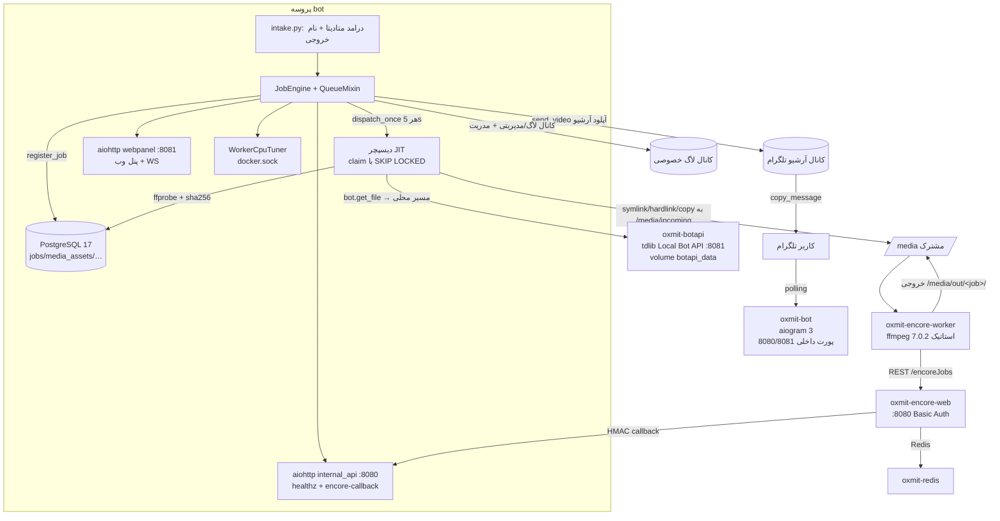
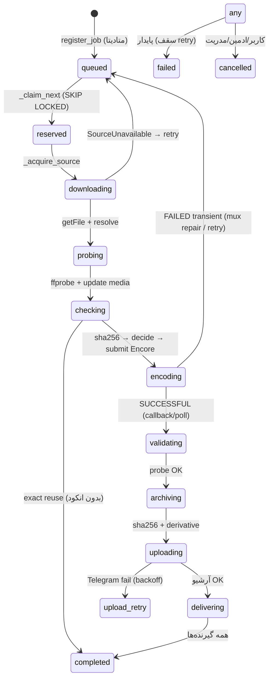

# گزارش مهندسی معکوس کامل پروژه Oxmit (compressor-oxmit)

> **نوع سند:** ممیزی فقط‌خواندنی کدبیس (Reverse Engineering) — بدون هیچ تغییری در پروژه
> **مخزن:** `https://github.com/cyberston2022-blip/compressor-oxmit` — شاخه `main`، آخرین کامیت `1699d98` (2026-11-13)
> **منبع حقیقت:** کد واقعی مخزن + بازرسی فقط‌خواندنی سرور در حال اجرا (`/opt/oxmit` روی همان کامیت)
> **زبان گزارش:** فارسی — نام فایل‌ها، توابع، مسیرها و پارامترهای فنی به شکل اصلی حفظ شده‌اند

---

## ۱. خلاصه مدیریتی پروژه

**Oxmit** یک سرویس فشرده‌سازی ویدیو به‌صورت ربات تلگرام است که در قالب یک سیستم Docker چندسرویسی روی یک سرور AWS (Lightsail/EC2 با IP عمومی `77.113.85.253`) اجرا می‌شود. کاربر ویدیو را برای ربات `@Oxmit_bot` می‌فرستد، ربات **فقط متادیتا** را می‌گیرد، یک نام خروجی از کاربر می‌پرسد، درخواست را در **صف مبتنی بر PostgreSQL** ثبت می‌کند و سپس یک «دیسپچر» داخلی، کار را با الگوریتم Just-in-Time به **SVT Encore** (سامانه انکودینگ Java با REST API) می‌سپارد. خروجی فشرده‌شده ابتدا در یک «کانال آرشیو» خصوصی تلگرام آپلود می‌شود و بعد با `copy_message` (بدون هدر فوروارد) به کاربر تحویل داده می‌شود.

نکات کلیدی:

- **پروفایل فشرده‌سازی فعلی فقط یک است: EDU480** (مهاجرت `015_jit_queue_edu480.sql` تمام پروفایل‌های دیگر را `active = FALSE` کرده است). EDU480 یعنی: کوتاه‌ترین ضلع → 480px با Lanczos (بدون upscale)، سقف FPS 30، `libx264` با CRF 25 و preset `veryfast`، صدای AAC 64k، خروجی MP4 با faststart (`bot/oxmit/edu480.py:8-23` و `deploy/encore/profiles/edu480.yml`).
- سیستم چندلایه **dedup** دارد: تشخیص زودهنگام با `file_unique_id`، تشخیص فایل «خروجی خودمان»، ادغام درخواست هم‌زمان (in-flight join)، تطبیق دقیق SHA-256 بعد از دانلود، و لایه‌های فازی/شباهت ادراکی که **تعریف شده‌اند ولی در مسیر تولید فعلی غیرقابل‌دسترس‌اند** (بخش ۳۲).
- صف واقعی، **جدول `jobs` در PostgreSQL** است؛ نه Redis و نه صف حافظه‌ای. Encore صف Redis خودش را دارد ولی دیسپچر ربات هرگز بیش از `slots` کار را هم‌زمان به Encore نمی‌دهد (`bot/oxmit/jobqueue.py:20-25`).
- سه رابط مدیریتی وجود دارد: پنل تلگرامی ادمین (`/admin`)، پنل تلگرامی مالک (`/owner`)، و پنل وب Super-Admin (aiohttp روی پورت 8090 سرور با HTTPS self-signed).
- سطح خودکارسازی بالاست: تیونر CPU زنده کانتینر ورکرها را با Docker socket تنظیم می‌کند، lease و heartbeat برای ریکاوری از کرش دارد، آپلود ناموفق بدون انکود مجدد retry می‌شود و خروجی‌های بزرگ‌تر از 2000MB به‌صورت چند پارچه (split) ارسال می‌شوند.
- حجم کد: حدود **۲۰٫۱ هزار خط Python** در `bot/oxmit/` به‌علاوه ۲۱۲۱ خط فرانت‌اند HTML/JS/CSS تک‌فایل، ۱۵ مهاجرت SQL، و ~۷۳٫۸ هزار خط مستندات/گزارش‌های قبلی (docs + reports).
- **مهم‌ترین یافته ساختاری:** حداقل سه ماژول کامل (`decision_engine.py` با ۵۳۲ خط، بخش بزرگی از `dedup.py`، `estimate.py`) و چند مسیر تعاملی (پیشنهاد کش، سفارشی‌ساز FFmpeg پنل) **کد مرده یا قطع‌شده از جریان اصلی** هستند (بخش ۳۰ و ۳۲).

---

## ۲. وضعیت کلی پروژه و میزان کامل بودن تحلیل

| محدوده | وضعیت بررسی | عمق |
|---|---|---|
| ساختار مخزن، کانفیگ، وابستگی‌ها، deployment | بررسی کامل | ۱۰۰٪ فایل‌های کانفیگ |
| `config.py`, `bot.py`, `db.py`, مهاجرت‌های SQL 001–015 | خوانده‌شدن کامل | خط‌به‌خط |
| `engine.py` (۲۸۳۲ خط) و `jobqueue.py` (۱۱۳۸ خط) | خوانده‌شدن کامل | خط‌به‌خط |
| `edu480.py`, `media.py`, `encore_client.py`, `archive.py`, `watermark.py`, `merge.py`, `resources.py`, `forcesub.py`, `permissions.py`, `audit.py`, `log.py` | خوانده‌شدن کامل | خط‌به‌خط |
| هندلرهای تلگرام (`intake`, `menu`, `settings`, `moderation`, `admin`, `owner`, `adminpanel`, `support`, `nav`, `merge_flow`, `personal`) | کامل به‌جز `personal.py` و `nav.py` که ساختار و نقطه‌ورودی‌هایشان کامل نقشه‌برداری شد | بالا |
| پنل وب (`webpanel.py`, `dashboard.py`, `panel/*`, `internal_api.py`) | کامل؛ فرانت‌اند `dashboard_page.py` ساختاری بررسی شد | بالا |
| تست‌ها (۳۶ فایل، ~۲۱۵ تابع تست) | شمارش کامل + مطالعه `conftest.py` و نمونه‌ها | متوسط |
| `docs/` و `reports/` | فقط شناسایی؛ محتوایشان ملاک نبود (طبق قواعد وظیفه) | سطحی |
| سرور در حال اجرا | دستورات فقط‌خواندنی SSH: `docker ps`, `healthz`, لاگ‌ها، پورت‌ها، `docker inspect` | کافی برای معماری deployment |
| فایل باینری `deploy/wrapper/ffmpeg` | شناسایی نوع (ELF static ffmpeg 7.0.2) — decompile نشده | شناسایی |
| `scripts/`, `verify_migration.sql` | شناسایی شده، محتوای اجرایی بررسی نشد | کم |

**طبق قاعده ۱٫۳ دستور کار:** هر ادعای مهم در این گزارش با مسیر فایل و شماره خط مستند شده و در صورت نبود شواهد صریحاً «تأییدنشده» علامت خورده است. هیچ فایل پروژه‌ای تغییر نکرد؛ تنها فایل جدید همین گزارش است.

---

## ۳. مشخصات فنی و تکنولوژی‌های استفاده‌شده

| لایه | تکنولوژی | شواهد |
|---|---|---|
| زبان | Python 3.12 ( Dockerfile: `FROM python:3.12-slim`) | `bot/Dockerfile:1` |
| فریم‌ورک ربات | aiogram 3.x (`aiogram>=3.17,<4`) با polling (نه webhook) | `bot/requirements.txt:1`، `bot/oxmit/bot.py:188` |
| API سرور تلگرام | **Local Bot API server** رسمی tdlib با `--local` (پورت 8081 داخل شبکه docker) برای فایل تا 2000MB و مسیرهای محلی `getFile` | `docker-compose.yml` سرویس `telegram-bot-api`، `bot/oxmit/bot.py:32-46` |
| دیتابیس | PostgreSQL 17-alpine + asyncpg (pool 2..10) | `bot/oxmit/db.py:22`، `docker-compose.yml` |
| صف انکود خارجی | **SVT Encore** (`ghcr.io/svt/encore-web:1.0.0` + `encore-worker`) با Redis 8.6 صف داخلی خودش؛ دسترسی با HTTP Basic Auth | `encore_client.py:15`، `deploy/encore/web-config/application.yml` |
| وب‌سرور/پنل | aiohttp (دو Application: داخلی 8080 و پنل 8081)، WebSocket زنده | `internal_api.py:288-332` |
| فرانت‌اند | تک‌فایل HTML/CSS/JS inline (`dashboard_page.PAGE` — ۲۱۲۱ خط، فونت Vazirmatn، آیکون SVG، RTL) | `dashboard_page.py:4` |
| ابزار مدیا | ffmpeg/ffprobe سیستم داخل کانتینر bot (برای probe، fingerprint، thumbnail، remux، split، merge، watermark) و ffmpeg استاتیک 7.0.2 override داخل ورکرها | `bot/Dockerfile:3`، `docker-compose.yml` mount `deploy/wrapper/ffmpeg` |
| کتابخانه‌های کمکی | Pillow (ahash)، psutil (متریک سیستم)، redis-py asyncio (صرفاً healthz/متریک از دید bot)، docker SDK (تیونر CPU و پنل)، httpx (کلاینت Encore با `trust_env=False`) | `requirements.txt` |
| احراز هویت پنل | توکن `.env` + HMAC-signed cookie + CSRF double-submit + لینک یک‌بارمصرف | `webpanel.py:79-101`، `panel/security.py` |
| لاگ | JSON structured روی stdout (`JsonFormatter`) با redaction مسیر Bot API | `log.py`، `media.py:27-34` |
| deployment | docker-compose تک‌هاست با ۶ سرویس + ۳ volume + شبکه bridge داخلی؛ `.env` بیرونی | `docker-compose.yml` |

**دیتابیس فنی محاسبات:** مدل‌سازی صف، admission، dedup، lease و شمارنده‌ها همه بر PostgreSQL استوارند؛ Redis فقط وابستگی Encore است و `redis_client` در کد bot صرفاً برای `healthz` و متریک پنل استفاده می‌شود (`bot.py:107`، `internal_api.py:77-86`).

---

## ۴. ساختار کامل پوشه‌ها و فایل‌ها

```
compressor-oxmit/
├── .env.example               # سند کامل ۶۲ متغیر محیطی با توضیح
├── .gitignore                 # .env، venv، __pycache__، media…
├── README.md                  # ~۳۰KB مستندات عمومی (ملاک نبود)
├── ALGORITHM_ARCHITECTURE_AUDIT.md
├── THIRD-PARTY-NOTICES.md     # نوتیس SVT Encore (Apache-2.0) و Argon watermark (GPL-3.0)
├── pytest.ini                 # asyncio_mode=auto, testpaths=tests
├── verify_migration.sql
├── docker-compose.yml         # ۶ سرویس، logging caps، شبکه internal
├── bot/
│   ├── Dockerfile             # python:3.12-slim + ffmpeg + postgresql-client، USER app، healthcheck
│   ├── requirements.txt       # aiogram, asyncpg, httpx, Pillow, psutil, redis, docker
│   ├── requirements-dev.txt   # pytest, pytest-asyncio
│   └── oxmit/
│       ├── __main__.py        # asyncio.run(main())
│       ├── bot.py             # entry point، سیم‌کشی routerها، لوپ‌های پس‌زمینه، OwnerOnlyMiddleware
│       ├── config.py          # Settings dataclass + اعتبارسنجی fail-fast
│       ├── db.py              # Database (asyncpg) + مهاجرت‌ها + reconcile_counters
│       ├── engine.py          # JobEngine: admission، dedup، completion، delivery، cleanup
│       ├── jobqueue.py        # QueueMixin: register_job، dispatcher، pipeline، Encore، moderation، retry
│       ├── edu480.py          # پروفایل EDU480 + تصمیم remux/encode + ETA
│       ├── media.py           # ffprobe، sha256، fingerprint، split، remux، thumbnail، redact
│       ├── encore_client.py   # کلاینت REST Encore (submit/get/cancel/health/queueCount)
│       ├── archive.py         # آپلود کانال آرشیو + زنجیره delivery (copy→file_id→upload)
│       ├── dedup.py           # کوئری‌های exact/fuzzy/similarity/in-flight
│       ├── estimate.py        # مدل bpp برای تخمین حجم/زمان (در مسیر فعال استفاده نمی‌شود)
│       ├── quality.py         # سلسله‌مراتب کیفیت نسخه‌های کش‌شده (فقط resolution_note مصرف می‌شود)
│       ├── profiles.py        # کاتالوگ پروفایل‌ها (اکثراً legacy) + compute_target_params
│       ├── decision_engine.py # موتور تصمیم «بهینه‌سازی» (کد مرده — فقط تست)
│       ├── resources.py       # WorkerCpuTuner (تنظیم زنده NanoCPUs با docker socket)
│       ├── watermark.py       # فیلتر drawtext/overlay به سبک Argon + apply_watermark
│       ├── merge.py           # استراتژی concat (copy/reencode) + اجرای ffmpeg
│       ├── forcesub.py        # گیت عضویت اجباری کانال
│       ├── permissions.py     # سیستم permission چند-ادمینی (۷ کلید)
│       ├── audit.py           # audit_log append-only
│       ├── texts.py           # ~۷۷۰ کلید رشته دوزبانه fa/en + tr()
│       ├── log.py             # لاگ JSON
│       ├── webpanel.py        # پنل وب v1 + Milestone1/2 + صفحات لاگین (۲۰۴۱ خط)
│       ├── dashboard.py       # APIهای v3 داشبورد + moderation
│       ├── dashboard_page.py  # فرانت‌اند تک‌فایل داشبورد (۲۱۲۱ خط)
│       ├── internal_api.py    # /internal/healthz، encore-callback، test API، راه‌اندازی ۲ app
│       ├── fonts/Roboto-Regular.ttf  # فونت پیش‌فرض واترمارک
│       ├── migrations/001…015.sql
│       └── panel/             # security.py، superadmin.py، bot_manager.py، docker_manager.py، queue_manager.py
├── deploy/
│   ├── encore/profiles/*.yml  # ۱۹ پروفایل Encore (فقط edu480 فعال)
│   ├── encore/web-config/application.yml  # Basic Auth bot:${ENCRE_PASSWORD}
│   ├── telegram-bot-api/Dockerfile        # aiogram/telegram-bot-api + umask 000
│   └── wrapper/ffmpeg        # باینری استاتیک ffmpeg 7.0.2 (ELF ~263k خط) override ورکرها
├── docs/                      # ۱۵ سند معماری/عملیات (ملاک نبود)
├── reports/                   # گزارش‌های مهندسی قبلی (stabilization/performance/optimization)
├── scripts/                   # backup.sh، loadtest.py، SQLهای عملیاتی
└── tests/                     # ۳۶ فایل، ~۲۱۵ تست با FakeDB
```

---

## ۵. معماری کلی سیستم

معماری واقعی (استخراج‌شده از کد و compose — نه فرض):



لایه‌بندی واقعی کد:

1. **لایه تلگرام:** ۱۱ راتر aiogram با ترتیب مشخص ثبت می‌شوند (`bot.py:154-170`): `menu → support → moderation → settings → nav → owner → personal → adminpanel → admin → merge_flow → intake`. دو میل‌ویر خارجی `OwnerOnlyMiddleware` (`bot.py:223-243`) روی message و callback_query می‌نشیند و در `access_mode=private` همه‌چیز را جز مالک/ادمین می‌بندد.
2. **لایه ارکستراسیون:** `JobEngine` (engine.py) + `QueueMixin` (jobqueue.py) — همه حالت‌ها در PostgreSQL، زمان‌بند درون‌پروسه‌ای با دو لوپ پس‌زمینه: `poller_loop` هر ۵ ثانیه (`bot.py:49-66`) و `sweep_loop` هر ۶۰۰ ثانیه (`bot.py:69-79`).
3. **لایه انکود:** جدا در کانتینرهای Encore؛ ارتباط فقط REST + callback HMAC + فایل مشترک `/media`.
4. **لایه وب:** دو aiohttp Application که **یک store مشترک session** دارند (`internal_api.py:292-310`) — داخلی روی 8080 کانتینر (منتشرشده به `127.0.0.1:8091` هاست) و پنل عمومی روی 8081 کانتینر (منتشرشده به `0.0.0.0:8090` هاست با TLS self-signed از `/opt/oxmit/deploy/certs` — تأییدشده روی سرور).
5. **لایه infrastructure:** docker-compose؛ bot با `user: "0:0"` و `group_add: DOCKER_GID` برای دسترسی به docker.sock و فایل‌های botapi.

**هم‌بستگی‌ها:** bot مستقیماً به دیتابیس، docker.sock، کانتینرهای ورکر (برای تیونر CPU) و کانتینر botapi (برای پاک‌سازی منابع) دسترسی دارد — یعنی «bot همه‌کاره است» و Encore صرفاً اجراکننده FFmpeg است.

---

## ۶. نحوه راه‌اندازی و اجرای برنامه

**اجرای محلی/سرور (منبع: compose و Dockerfile):**

1. کلون مخزن در `/opt/oxmit` (روی سرور همین‌طور است — تأییدشده).
2. ساخت `.env` از روی `.env.example` با ۶۲ کلید؛ چند کلید اجباری که بدون آن‌ها boot متوقف می‌شود: `BOT_TOKEN`, `TELEGRAM_API_ID/HASH`, `PG_DSN` (در compose ساخته می‌شود), `ENCRE_PASSWORD`, `INTERNAL_SECRET` (`bot.py:85-99`، `config.py:198-291`). اعتبارسنجی `load_settings()` با خطای معنادار fail می‌کند مگر `OXMIT_SKIP_VALIDATION=1`.
3. `docker compose up -d --build`؛ سرویس bot بعد از healthy شدن postgres/redis/botapi بالا می‌آید (`depends_on`).
4. `python -m oxmit` داخل کانتینر bot (`bot/Dockerfile:23`) → `main()` در `bot.py:82`.

**ترتیب boot واقعی (`bot.py:82-216`):**

1. `setup_logging()` + `load_settings()`.
2. اتصال DB (`Database.connect` → اجرای خودکار مهاجرت‌های مرتب‌شده `001…015.sql` با جدول `schema_migrations` — `db.py:29-49`).
3. `reconcile_counters()` — همگام‌سازی شمارنده‌های lifecycle با وضعیت ردیف‌ها (`db.py:112-123`).
4. اتصال Redis، ساخت `EncoreClient`، ساخت session aiogram با `TelegramAPIServer.from_base(cfg.local_bot_api_base)` و timeout 1800s (`bot.py:32-46`).
5. بارگذاری state از DB: `archive_channel_id`، `paused`، `global_thumb_path`، `access_mode` (`bot.py:114-125`).
6. `bot.get_me()` → fail سریع اگر Local Bot API در دسترس نیست.
7. `start_internal_api(...)` — دو AppRunner: داخلی `0.0.0.0:8080` و پنل `0.0.0.0:8081` (یا `127.0.0.1:8081` بدون TLS — fail-closed؛ `internal_api.py:322-329`).
8. ساخت ۱۰ راتر و ثبت در Dispatcher با ترتیب مهم: support **قبل از** همه مصرف‌کننده‌های پیام، merge **قبل از** intake (`bot.py:154-170`).
9. `engine.recover_on_startup()` (`engine.py:2787`): کارهای pre-encode بدون encore_id → صف؛ کارهای post-encode با خروجی موجود → resume آپلود؛ sessionهای merge نیمه‌کاره → failed؛ `fail_stale_sessions` برای sessionهای ۲۴ساعته.
10. `refresh_admin_commands()` — منوی دستور متفاوت برای کاربر/ادمین/مالک (`engine.py:259-291`).
11. سه task پس‌زمینه: `poller_loop` (dispatch + reconcile + تیونر CPU)، `sweep_loop` (پاک‌سازی + sweep همه راترها)، `fingerprinter.run()`.
12. `dp.start_polling(allowed_updates=["message","callback_query","channel_post"])`.

**توقف/خاموشی:** `finally` در `bot.py:192-217` — لغو لوپ‌ها، لغو `engine._bg_tasks` قبل از بستن session/pool (برای جلوگیری از jobهای stuck)، cleanup رانرها و کلاینت‌ها.

**استارت مجدد:** صف در DB است؛ `recover_on_startup` + `reap_stale_leases` (هر tick) کارهای یتیم را برمی‌گرداند — یعنی restart ایمن طراحی شده است.

---

## ۷. چرخه کامل دریافت تا تحویل ویدیو

این بخش مسیر اجرای واقعی مرحله‌به‌مرحله است.

### مرحله ۱ — دریافت ویدیو (هیچ دانلودی رخ نمی‌دهد)

- هندلر: `@router.message(F.video | F.document)` در `handlers/intake.py:217` (`on_media`). انیمیشن (GIF) و video note هدف این هندلر نیستند؛ document فقط وقتی می‌پذیرفته می‌شود که mime با `video/` شروع شود یا پسوندش در `VIDEO_DOCS` باشد (`intake.py:45-46, 73-91`).
- استخراج متادیتا: `extract_media` (`intake.py:73-91`) — `file_id`, `file_unique_id`, size, filename, mime, duration, width, height. برای document، duration/dimensions None است (بعداً post-probe چک می‌شود).
- ثبت کاربر: `ensure_user` (`handlers/common.py:8-18`) — upsert با `last_seen_at`.
- چک بن: `user["is_blocked"]` → پیام رد (`intake.py:223-225`).
- چک کانال آرشیو: اگر `state.archive_channel_id` خالی است → پیام راهنمای ادمین یا خطای `archive_not_configured` (`intake.py:230-233`).
- گیت عضویت اجباری: `forcesub.gate` (`forcesub.py:47-72`) — ادمین‌ها معاف؛ نتیجه member مثبت ۵ دقیقه کش؛ خطای API **fail-open**.
- چک `state.paused` (`intake.py:240-242`).
- اعتبارسنجی سبک متادیتا برای غیرادمین‌ها: سقف حجم tier (`effective_limits`) و سقف duration اعلامی (`intake.py:244-255`).
- ثبت پیش‌نویس نام‌گذاری: `INSERT INTO intake_drafts … ON CONFLICT (chat_id, source_message_id) DO NOTHING` (`intake.py:257-266`) — فایل متادیتا فقط؛ شناسه یکتای پیام تلگرام از update تکراری جلوگیری می‌کند.
- اگر کاربر یک prompt فعال دارد → پیام «نوبت شما بعد از X» و ورود به صف انتظار drafts (`status='waiting'`؛ ایندکس یکتای جزئی `uq_draft_active_prompt` در مهاجرت 015 فقط یک prompt هم‌زمان می‌گذارد).
- `_prompt_draft` (`intake.py:111-136`) پیام نام‌گذاری با دو دکمه می‌فرستد: «همین نام» (`nm:keep:<draft_id>`) و «لغو» (`nm:cancel:<draft_id>`).

### مرحله ۲ — پاسخ نام و ثبت در صف

- متن پاسخ: فیلتر `_awaiting_name` دقت بالا دارد — یا reply به پیام prompt/ویدیوی مشخص یا متن ساده وقتی فقط یک draft فعال است (`intake.py:282-312`).
- نرمال‌سازی نام: `edu480.normalize_output_name` (`edu480.py:64-105`) — NFC، حذف مسیر (فقط آخرین segment)، حذف کاراکترهای bidi/invisible (به‌جز ZWNJ فارسی)، جایگزین‌سازی `/\:*?"<>|` با فاصله، حذف پسوندهای تایپ‌شده به‌صورت تکراری (فقط پسوندهای شناخته‌شده تا «Lecture v1.2» خراب نشود)، رزروهای ویندوز (`con`, `com1`…)، سقف ۱۰۰ کاراکتر / ۲۰۰ بایت UTF-8.
- مصرف اتمیک draft: `UPDATE intake_drafts SET status='submitted' WHERE status IN ('awaiting_name','waiting') RETURNING id` (`intake.py:151-156`) — double-tap را می‌بندد.
- `engine.register_job` (`jobqueue.py:161-261`):
  - `check_admission` (توضیح در بخش ۸) و `check_duration_limit` (`engine.py:736-746`).
  - **تشخیص زودهنگام:** `find_reusable_by_unique_id` (`jobqueue.py:128-147`) با SQL `_REUSE_SQL` — اگر `file_unique_id` با خروجی آرشیوشده (کیند `known_output`) یا منبع قبلی (`unique_id`) بخورد → همان نسخه آرشیو تحویل می‌شود (`_reuse_archive`, `engine.py:998-1089`) و هیچ انکودی رخ نمی‌دهد؛ شمارنده `dedup_unique_id_reuse`.
  - تراکنش ثبت با **دو قفل advisory**: قفل per-user (`admit:{tg_id}`) برای جلوگیری از عبور هم‌زمان از سقف‌ها (F9 TOCTOU) و قفل `fu:{file_unique_id}` برای dedup in-flight. داخل تراکنش `_recheck_user_admission` (`engine.py:748-791`) چک‌های per-user را دوباره اجرا می‌کند.
  - join درخواست فعال: اگر job دیگری با همین `file_unique_id` در `queued/processing` است → ردیف در `job_requesters` اضافه می‌شود و خروجی بعداً برای هر دو ارسال می‌شود (`jobqueue.py:204-220`).
  - درج `media_assets` فقط‌متادیتا (sha256 NULL تا بعد از دانلود) و `jobs` با `status='queued', stage='queued'`، priority 70 ادمین / 50 عادی / 60 VIP، و `job_requesters` (`jobqueue.py:221-249`).
  - شمارنده‌ها: `requests_total`, `bytes_in`، آپدیت `users.total_requests`.
  - `post_log_record` (`jobqueue.py:1018-1048`): **کپی پیام ویدیوی کاربر** (`copy_message` — بدون دانلود سرور) به کانال لاگ با کپشن هویتی و دکمه مدیریتی «حذف و بن» — `jobs.log_chat_id/log_message_id` ذخیره می‌شود.
  - `kick_dispatch()` و ساخت کارت صف (`queue_card_text` با موقعیت، تعداد جلوتر، ورکرهای مشغول و بازه ETA).

### مرحله ۳ — صف و ادعای کار (dispatcher)

- `poller_loop` هر ۵ ثانیه `engine.poll_once` را صدا می‌زند (`engine.py:1403-1440`): `promote_deferred` → `reap_stale_leases` → `dispatch_once` → reconcile کارهای processing → `refresh_queue_cards` (بودجه ۱۵ کارت در tick، هر کارت حداکثر هر ۶۰ ثانیه — `jobqueue.py:441-487`).
- `dispatch_once` (`jobqueue.py:500-533`): ظرفیت = `slots + prefetch_jobs` (پیش‌فرض slots = WORKER_REPLICAS؛ روی سرور جاری ۱). برای هر کار: نیاز دیسک = `size × ADMISSION_NEED_FACTOR (2.2) + ADMISSION_FLOOR_GB (5GiB)`؛ اگر فضای آزاد منهای رزروها کافی نبود → `_notify_disk_block` (حداکثر یک پیام در ساعت) و توقف.
- ادعای اتمیک `_claim_next` (`jobqueue.py:535-566`): `UPDATE … WHERE id = (SELECT … FOR UPDATE SKIP LOCKED …)` با **انصاف per-user**: کاربرِ دارای job فعال در slot، پشت کاربران بدون job فعال می‌ایستد (`ORDER BY EXISTS(…) , priority DESC, enqueued_at`). lease = `LEASE_MINUTES (20)` + `reserved_bytes` ثبت می‌شود.
- heartbeat هر ۶۰ ثانیه lease را تمدید می‌کند (`jobqueue.py:617-628`)؛ `reap_stale_leases` کارهای pre-encode با lease منقضی را به صف برمی‌گرداند (`jobqueue.py:579-597`).

### مرحله ۴ — دانلود (اولین لحظه تماس فایل با دیسک)

- `_run_pipeline` (`jobqueue.py:630-727`) → stage `downloading` با timestamp `download_started_at`.
- `_acquire_source` (`jobqueue.py:729-754`): اگر `source_path` محلی معتبر باشد استفاده می‌شود (مسیر merge/test)؛ در غیر این صورت `bot.get_file(file_id)` روی Local Bot API → `resolve_local_path` مسیر مطلق داخل `/var/lib/telegram-bot-api/...` را برمی‌گرداند (`engine.py:395-407`). یعنی «دانلود» عملاً توسط کانتینر botapi انجام شده و bot فایل را از volume مشترک `botapi_data` می‌بیند — نه دانلود HTTP در پروسه bot.
- لغو حین دانلود: future با `asyncio.shield` نگه داشته می‌شود و در CancelledError، callback ثبت می‌شود تا وقتی botapi فایل را تمام کرد آن را پاک کند (`jobqueue.py:736-748`).
- حذف منبع: `_delete_botapi_path` (`jobqueue.py:762-792`) فقط داخل درخت `botapi_dir` اجازه حذف دارد و قبل از حذف چک می‌کند هیچ job فعال دیگری به همین مسیر/file_unique_id نیاز ندارد (`DELETE_BOTAPI_SOURCE=true`).

### مرحله ۵ — probe و اعتبارسنجی واقعی

- stage `probing` → `media_mod.probe_video` (`media.py:231-237`) روی فایل واقعی؛ خروجی به `media_assets` نوشته می‌شود (duration, w×h, fps, vcodec, acodec, channels, container, bitrate, probe JSON) (`jobqueue.py:666-675`).
- probe: `ffprobe -print_format json -show_format -show_streams` با timeout 180s؛ «no video stream»، «attached picture»، و duration خالی/بیش از 24h رد می‌شوند (`media.py:138-171, 231-237`).
- چک duration tier بعد از probe واقعی (`jobqueue.py:677-685`) — کاربران غیرادمین با `too_long` fail می‌شوند.
- stage `checking` → `sha256_file` (chunked 4MB در thread) و ذخیره در `media_assets.sha256` (`jobqueue.py:687-690`)؛ اگر sha با آرشیو بخورد → `_complete_from_archive` (`jobqueue.py:794-826`) یعنی تحویل بدون انکود.
- fingerprint ادراکی به‌صورت **پس‌زمینه** صف می‌شود (`Fingerprinter.submit` → ۸ فریم در نقاط ½/۸ مدت، ahash 8×8 با Pillow — `media.py:240-285`) و در `media_assets.phash` ذخیره می‌شود؛ اما مصرف‌کننده‌اش (similarity reuse) در مسیر فعال وجود ندارد (بخش ۳۲).

### مرحله ۶ — تصمیم فشرده‌سازی

- `edu480.decide(probe, size, cfg)` (`edu480.py:201-234`) — تصمیم نهایی: `remux` فقط اگر **همه** شروط برقرار باشد: ابعاد معلوم، ضلع کوتاه ≤ 480، vcodec=h264، pix_fmt ∈ {yuv420p, yuvj420p}، صدا AAC یا نبودِ صدا، fps ≤ cap+0.5، ویدیو kbps ≤ `EDU480_COMPLIANT_KBPS (700)` و ابعاد زوج. در غیر این صورت `encode` با reason مشخص؛ تصمیم در `jobs.decision` ثبت می‌شود (`jobqueue.py:700-704`).

### مرحله ۷ — اجرا

- مسیر remux: `_run_remux` (`jobqueue.py:828-848`) — `ffmpeg -map 0:v:0 -map 0:a:0? -c copy -ignore_unknown -movflags +faststart` در thread؛ سپس مستقیم `complete_job`.
- مسیر encode: `_submit_encode` (`jobqueue.py:850-893`):
  - staging با `_stage_source` (`engine.py:1094-1155`): اگر `WORKERS_READ_BOTAPI=true` → **symlink** (صفر بایت کپی)؛ در غیر آن hardlink؛ در غیر آن کپی chunked با progress live روی کارت کاربر (`_report_copy_progress`, `engine.py:178-205`). پسوند از نام منبع؛ غیر شناخته → `.bin`.
  - threads: `ffmpeg_threads_single (6)` اگر فقط یک encode فعال و slots=1، در غیر آن `ffmpeg_threads_multi (3)` (`jobqueue.py:852-856`).
  - params با `edu480.encode_params` (`edu480.py:165-175`): `crf=25, preset=veryfast, threads, vf=scale=W:H:flags=lanczos یا null, fpsf=fps=30 یا null, audio_bitrate=64k`. اگر retry از نوع mux-error باشد `af=aresample=async=1:first_pts=0` اضافه می‌شود (`jobqueue.py:863-864`).
  - callback URL: `http://bot:8080/internal/encore-callback?job=<job_id>&sig=<HMAC-SHA256(internal_secret, job_id)>` (`jobqueue.py:865-866`، `engine.py:1350-1353`).
  - `encre.submit_job(profile="edu480", output_folder="/media/out/<job>", base_name="out", input_uri=<staged path>, profile_params=params, …)` (`encore_client.py:66-105`).
  - پس از submit، درج اتمیک `encore_job_id`؛ اگر کار بین بررسی و submit لغو شده بود → `cancel_job` در Encore (`jobqueue.py:878-890`).

### مرحله ۸ — پیشرفت و reconciliation

- Encore با callback progress را می‌فرستد؛ `encore_callback` (`internal_api.py:102-130`) با `hmac.compare_digest` امضا را چک می‌کند و `progress = GREATEST(progress, $2)` را می‌نویسد (progress یک‌طرفه صعودی) و روی وضعیت‌های پایانی `poll_job` را spawn می‌کند.
- پارالل، poller هر ۵ ثانیه `reconcile_job` (`engine.py:1458-1497`) را برای همه processing ها اجرا می‌کند: IN_PROGRESS → آپدیت progress + `progress_changed_at`؛ بدون تغییر progress بیش از `STUCK_MINUTES (90)` → cancel در Encore + retry/fail با کتگوری `stuck`. SUCCESSFUL → `complete_job`؛ FAILED → `_retry_or_fail`؛ CANCELLED → `_mark_cancelled`.
- `_retry_or_fail` (`engine.py:1529-1564`) دو مرحله ترمیم منبع خراب دارد: mux-error اول → retry با `input_params={"fflags":"+genpts+discardcorrupt"}`؛ mux-error دوم → `profile_params={"repair":"aresample"}`؛ وگرنه اگر کتگوری transient باشد و retryها ناتمام، requeue با پیام «تلاش مجدد» به کاربر.

### مرحله ۹ — تکمیل، اعتبارسنجی، آرشیو، تحویل

- `complete_job` → claim اتمیک `stage='completing'` با محافظ رقابت callback/poller (`engine.py:1766-1786`)؛ encode slot آزاد می‌شود (`kick_dispatch` بلافاصله).
- stage `validating` → probe خروجی؛ خرابی → fail با کتگوری `validation`. **چک نسبت مدت** خروجی/منبع باید در [0.85, 1.15] باشد وگرنه fail (`engine.py:1829-1838`). چک رزولوشن واقعی نسبت به سقف پروفایل فقط **log** می‌شود نه fail (`engine.py:1840-1848`).
- تغییر نام خروجی به نام انتخابی کاربر + `.mp4` (`engine.py:1791-1802`، `edu480.output_filename`).
- stage `archiving` → `sha256_file` خروجی، درج `media_assets` خروجی با `is_derivative=TRUE` و اتصال به job.
- policy no-gain: اگر `output_size >= source_size × NO_GAIN_THRESHOLD (0.98)` (به‌جز remux) → رکورد آرشیو با `status='no_gain'` و تحویل **منبع اصلی** به کاربر با توضیح؛ اگر پروفایل level باشد → escalation به level265 (HEVC) — این مسیر در فلو فعلی EDU480 بی‌اثر است چون effective_profile همیشه edu480/remux است.
- خروجی > `MAX_UPLOAD_BYTES (2000MB)` و `SPLIT_UPLOAD=true` → `_complete_split` (`engine.py:2093-2206`): `split_by_size` (`media.py:98-135`) با segment muxer روی keyframeها (seg_time = duration × (max/size) × 0.95، تا ۶ تلاش) → آپلود پارتی به پارتی به آرشیو با idempotency (پارت‌های قبلاً آرشیوشده skip) → تحویل ترتیبی پارت‌ها + پیام راهنمای join (`_deliver_parts`, `engine.py:2325-2364`).
- آپلود آرشیو: `_archive_upload` (`engine.py:2208-2263`) — semaphore `MAX_CONCURRENT_UPLOADS (2)`؛ اگر `BOTAPI_READS_MEDIA=true` و مسیر داخل `/media` → آپلود با `file://` (بدون کپی multipart به tmp)؛ retry پشتیبان‌گرفته ۳ تلاش با `TelegramRetryAfter` sleep؛ در BadRequest احتمال تامبنیل مشکل‌ساز → یک تلاش بدون thumbnail.
- درج `archive_records` با `ON CONFLICT … DO NOTHING` روی `(source_media_id, profile, profile_version, part_index)`؛ اگر رکورد از قبل بود، پیام تکراری آرشیو **حذف** می‌شود (`engine.py:2040-2051`).
- آپدیت نهایی job: `status='completed', stage='completed', progress=100, completed_at` + شمارنده‌های `jobs_encoded`, `bytes_out`, `bytes_saved`.
- تحویل به درخواست‌کننده‌ها: `_deliver_to_requesters` (`engine.py:2449-2644`) برای هر ردیف `job_requesters` با `delivered=FALSE`:
  - خلاصه دو‌زبانه (نام فایل، حجم منبع/خروجی، درصد صرفه، مدت، رزولوشن، کدک، زمان، پروفایل، شناسه job).
  - مسیر delivery با `archive_mod.deliver_result` (`archive.py:88-160`): ① `copy_message` از کانال آرشیو (بدون هدر فوروارد — حریم خصوصی کانال) ② `send_video` با `file_id` ذخیره‌شده ③ آپلود محلی `FSInputFile`. هر گام با `flood_safe` (یک retry بعد از flood-wait).
  - برندینگ شخصی per-recipient (`engine.py:2377-2418`): submitter از snapshot زمان ثبت (ستون‌های `personal_*` روی job) می‌گیرد؛ joinerهای دیگر از `admin_settings` خودشان — یعنی برندینگ ادمین A هرگز به کاربر ادمین B نمی‌رسد. واترمارک یک پاس ffmpeg جدا در زمان تحویل است (`watermark.apply_watermark`, `watermark.py:170-208` — ویدیو re-encode با CRF 22، صدا copy) و خروجی کانال آرشیو همیشه تمیز می‌ماند.
  - ثبت `deliveries` + شمارنده `deliveries_ok/failed`؛ کارت وضعیت به خلاصه نهایی edit می‌شود؛ در شکست، دکمه «ارسال مجدد» (`rdl:`) نمایش داده می‌شود.
- پاک‌سازی نهایی: `_finish_delivery` (`engine.py:2078-2091`) — `delivered_at`، پاک‌سازی دایرکتوری‌های `media/incoming/<job>` و `media/out/<job>`، حذف thumbnail موقت، حذف منبع botapi (با گارد اشتراک)، `kick_dispatch`.

### مرحله ۱۰ — شکست و لغو در هر مرحله

- `fail_job` (`engine.py:1606-1641`): transition گاردشده، شمارنده `jobs_failed`، cleanup (خروجی فقط در کتگوری upload نگه داشته می‌شود تا retry فقط آپلود باشد)، اعلان کارت با دکمه‌های retry/جزئیات خطا، آپدیت رکورد کانال لاگ.
- `_mark_cancelled` / `cancel_job` (`engine.py:1643-1690`): لغو لایه‌به‌لایه — DB اول، سپس pipeline task درون‌پروسه‌ای (`stop_pipeline`)، سپس Encore (که FFmpeg را می‌کشد)، سپس فایل‌ها + late sweep بعد از ۳۰ ثانیه.
- retry کاربر: دکمه `rtry:` → `retry_user_job` (`engine.py:1566-1604`) — فقط صاحب job یا ادمین؛ برای خطای upload با خروجی موجود → `resume_upload` (بدون انکود مجدد، `jobqueue.py:1076-1095`)؛ سقف `job_retries + 2`.
- retry ادمین: `/retry <prefix>` (`handlers/admin.py:14-38`).

---

## ۸. الگوریتم صف و مدیریت درخواست‌ها

**نوع صف:** صف واقعی و ماندگار در جدول `jobs` PostgreSQL. هیچ صف حافظه‌ای برای انکود وجود ندارد؛ حافظه فقط برای throttleهای UX است (کش زبان، throttle دکمه‌ها، `_last_edit` …).

**حالت‌ها:** `status` درشت (`queued | processing | completed | failed | cancelled`) و `stage` ریز (`queued, reserved, downloading, probing, checking, copying, encoding, validating, completing, uploading, upload_retry, archiving, delivering, completed, failed, cancelled` — `jobqueue.py:50-54` و مهاجرت 015).

**نکته مهم:** وضعیت `deferred` که در مهاجرت 004 و در `promote_deferred` (`engine.py:1358-1401`) پشتیبانی می‌شود در ثبت فعلی تولید **نمی‌شود** — `register_job` همیشه `queued` می‌سازد و `dispatch_once` به‌جای defer، هنگام کمبود دیسک صرفاً claim را متوقف می‌کند (`jobqueue.py:514-521`). یعنی مسیر defer/re-promote فعلاً فقط برای حالت‌های legacy/مهاجرت‌شده کار می‌کند (تأیید: در `jobqueue.register_job` هیچ INSERT با status='deferred' وجود ندارد).

**اولویت و انصاف:**
- priority: admin=70، VIP=60، عادی=50 (مقدار از `effective_limits()["priority"]` — `jobqueue.py:230`).
- ordering نهایی: `EXISTS(job فعال همین کاربر) ASC → priority DESC → enqueued_at ASC` — یعنی کاربری که از قبل یک کار در slot دارد به نفع بقیه عقب می‌رود ولی وقتی کسی نیست از ظرفیت مازاد استفاده می‌کند (`jobqueue.py:544-566`).
- position/ETA کاربر: `queue_info` (`jobqueue.py:317-337`) + مدل throughput واقعی از ۵۰ job آخر (`throughput_rate`, `jobqueue.py:266-292`)؛ بازه ETA = کار باقی‌مانده‌ی فعال‌ها + هزینه تخمینی همه‌ی جلوترها ÷ slots، با ضریب 0.8..1.3 (`edu480.eta_range`).

**کنترل ظرفیت:**
- `encode_slots` (پیش‌فرض WORKER_REPLICAS) + `prefetch_jobs (0)` برای هم‌پوشانی دانلود/انکود (`config.py:143-150`).
- دیسک: نیاز ۲٫۲× حجم + کف ۵GiB؛ رزروها جمع `reserved_bytes`؛ آستانه‌های `DISK_MIN_FREE_GB (40)`/`DISK_PAUSE_FREE_GB (20)`؛ `_auto_pause` روی آستانه بحرانی کل پذیرش را می‌بندد و `auto_resume_if_ok` بازمی‌گرداند (`engine.py:793-808`).
- سقف صف پذیرش: `MAX_QUEUED_JOBS (5000)` — رد صریح `queue_full` نه پنهان‌کاری (`engine.py:692-695`).

**admission کامل (`check_admission`, `engine.py:673-734`):**
1. کانال آرشیو تنظیم شده باشد (مگر caller اجازه دهد)؛
2. `state.paused` نباشد؛
3. در `access_mode=private` فقط ادمین/مالک؛
4. کاربر بن نشده؛
5. صف < MAX_QUEUED؛
6. (غیرادمین) حجم ≤ tier؛ pending های فعال ≤ `max_pending`؛ ساعتی ≤ `max_per_hour`؛ روزی ≤ `MAX_JOBS_PER_DAY (30)`؛ سهمیه بایتی روزانه (`daily_quota_bytes`).

**crash/restart:** lease + heartbeat + `reap_stale_leases` + `recover_on_startup` + در claim ها `FOR UPDATE SKIP LOCKED` + گارد `worker_id` (`_still_mine`, `jobqueue.py:602-606`) — رفتار چندپروسه‌ای/چندسروری از قبل مدل شده است.

---

## ۹. سیستم دانلود فایل

- دانلود به معنای HTTP-در-Python نیست؛ ربات `getFile` را از Local Bot API می‌گیرد و فایل را از volume مشترک می‌خواند. مسیرهای ممکن برگشتی: symlink (`WORKERS_READ_BOTAPI=true`)، hardlink، یا کپی chunked 8MB با fsync انتهایی و progress live (`engine.py:1094-1155`, `media.py:77-95`).
- تایید کپی: فایل part فقط وقتی به staged تغییر نام می‌کند که size دقیقاً با منبع برابر باشد؛ فایل staged موجود فقط وقتی قابل اعتماد است که size با منبع برابر باشد (محافظ F4 برای کپی نیمه‌کاره — `engine.py:1126-1128`).
- تشخیص دانلود ناقص: probe/hash بعد از دانلود؛ خرابی → `fail_job(invalid_media)` یا retry.
- retry دانلود: کتگوری `download` جزو `TRANSIENT_CATEGORIES` است (`engine.py:36`) → `_requeue`.
- timeout: `getFile` از timeout session aiogram (1800s) ارث می‌برد؛ کپی/پردازش‌های thread با timeoutهای مشخص در خود ffmpeg/subprocess دارند (probe 180s، fingerprint فریم 90s، split 3600s، merge `MERGE_TIMEOUT_S`، watermark `WM_TIMEOUT_S=4h`).
- پاک‌سازی منابع: پس از اتمام هر مرحله‌ای که دیگر به منبع نیاز نیست `_discard_source/_delete_botapi_source` با گارد اشتراک؛ به‌علاوه sweep هر ۱۰ دقیقه فایل‌های قدیمی‌تر از `TMP_RETENTION_HOURS (24)` را از incoming/out/tmp/test/work حذف می‌کند با حفاظت jobهای فعال (`engine.py:2752-2785`).

---

## ۱۰. سیستم استخراج اطلاعات ویدیو

- ابزار: **ffprobe** با خروجی JSON (`media.py:138-228`). استخراج‌ها: container/format_name، duration (با fallback چندگانه: format → video → audio → tags DURATION با پارس `HH:MM:SS`)، size، bitrate کل، width/height، fps از `avg_frame_rate` یا `r_frame_rate` (پارس کسر)، vcodec، pix_fmt، acodec، channels، audio_bitrate، تعداد streams.
- محافظ‌ها: video stream نبودن، attached_pic (کاور آلبوم)، duration > 24h، timeout.
- **چرخش/rotation:** هیچ پردازش صریحی برای side_data rotation/تگ‌های چرخش یافت نشد — `Partially Confirmed: ffprobe ابعاد انبارشده را می‌دهد؛ فشرده‌سازی با scale بر همان ابعاد انجام می‌شود و FFmpeg خودش autorotate پیش‌فرض دارد؛ اثر عملی چرخش عمودی در کد مدل نشده است.
- زیرنویس/استریم‌های اضافه: در remux فقط `0:v:0` و `0:a:0?` نقشه‌برداری می‌شود و بقیه (زیرنویس/attach) حذف می‌شوند (`media.py:343-367`؛ کامنت صریح در کد). در مسیر Encore، پروفایل edu480 فیلتر/نگاشت extra stream ندارد — یعنی خروجی نهایی ویدیو+صدای اصلی است.
- fingerprint ادراکی: ۸ فریم grayscale 8×8، ahash، ذخیره در `phash` — قابل استفاده برای similarity (فعلاً بدون مصرف‌کننده).

---

## ۱۱. الگوریتم تصمیم‌گیری فشرده‌سازی

سه لایه تصمیم در کد وجود دارد و باید از هم تفکیک شوند:

**الف) موتور فعال — `edu480.decide` (`edu480.py:201-234`):** تنها تصمیم‌گیری تولیدی. باینری است: `remux` یا `encode`. شروط remux در بخش ۷/مرحله ۶ آمده است. هیچ انتخاب پروفایل، CRF پویا یا مقیاس پویا وجود ندارد؛ فقط vf/fps از probe محاسبه می‌شود (`target_dims`/`video_filters` — `edu480.py:123-162`).

**ب) موتور غیرفعال — `decision_engine.py`:** ۵۳۲ خط با مفاهیم اعلام‌شده در docstring (adaptive codec، content category با کلیدواژه‌های «lecture/zoom/obs…» و bpp پایین، انتخاب رزولوشن تطبیقی، audio copy، hybrid H.264/H.265). **هیچ importی از این ماژول در کد تولید وجود ندارد** (فقط `tests/test_decision_engine.py`). این ماژول اجرا نمی‌شود.

**ج) مسیرهای legacy — `profiles.py`/`engine._custom_params`:** `compute_target_params` (بیت‌ریت از target size) فقط توسط `_custom_params` مصرف می‌شود که خودش **هیچ caller ندارد**. `handle_submission` (`engine.py:877-904`) پارامترهای legacy (profile/level/target) را می‌پذیرد ولی نادیده می‌گیرد و همه را به EDU480 می‌نگارد — چون مسیر merge و test-API از آن عبور می‌کنند، این سازگاری است نه قابلیت.

**نتیجه:** رفتار واقعی تولید این است: هر ویدیوی غیرِ EDU480-compliant با CRF 25/preset veryfast/480p/fps30/AAC64k انکود می‌شود؛ منبع سازگار remux می‌شود؛ منبعی که انکودش کاهش حجم ندهد به کاربر همان منبع برمی‌گردد (no-gain).

---

## ۱۲. ساختار و تنظیمات FFmpeg و Encoderها

**۱) انکود اصلی — داخل Encore، نه در کد bot.** پروفایل `deploy/encore/profiles/edu480.yml`:
```yaml
scaling: lanczos
encodes:
  - type: X264Encode
    twoPass: false
    filters:
      - "#{profileParams['vf'] ?: 'scale=-2:''min(480,ih)'':flags=lanczos'}"
      - "#{profileParams['fpsf'] ?: 'null'}"
    params:
      crf: "#{profileParams['crf'] ?: '25'}"
      preset: "#{profileParams['preset'] ?: 'veryfast'}"
      threads: "#{profileParams['threads'] ?: '3'}"
      aq-mode: "3"
      rc-lookahead: "40"
      pix_fmt: yuv420p
      movflags: "+faststart"
    audioEncode: { type: AudioEncode, codec: aac, bitrate: "#{profileParams['audio_bitrate'] ?: '64k'}" }
```
Encore این فایل را به‌صورت قالب SpEL per-job می‌سنجد؛ bot مقادیر واقعی vf/fps/crf/preset/threads/audio را از probe می‌فرستد (`jobqueue.py:850-873`). یعنی دستور FFmpeg نهایی را Encore/worker می‌سازد؛ ربات فقط پارامتر می‌دهد.

**۲) FFmpeg مستقیم در کد bot (thread اجرا می‌شود، subprocess با timeout):**

| کار | تابع | آرگومان‌های کلیدی |
|---|---|---|
| probe | `media._probe_sync` | `ffprobe -v error -print_format json -show_format -show_streams` (timeout 180s) |
| fingerprint | `media._fingerprint_sync` | `ffmpeg -ss t -frames:v 1 -vf scale=8:8:flags=area,format=gray` |
| thumbnail عمومی | `media.extract_thumbnail` | `scale=320:320:force_original_aspect_ratio=decrease -q:v 7` |
| نرمال‌سازی عکس تامبنیل | `media.download_thumbnail` | `scale=320:-2 -q:v 7` |
| remux | `media.remux_to_mp4` | `-map 0:v:0 -map 0:a:0? -c copy -ignore_unknown -movflags +faststart` |
| split چندپارچه | `media.split_by_size` | `-c copy -map 0 -f segment -segment_time … -reset_timestamps 1 -movflags +faststart part%03d.mp4` |
| merge copy | `merge.run_copy_merge` | concat demuxer + `-c copy` |
| merge reencode | `merge.run_reencode_merge` | concat **filter**، scale به کوچک‌ترین ابعاد مشترک، fps normalize، AAC 48k stereo، صدا برای ورودی‌های بی‌صدا silent track |
| watermark | `watermark.apply_watermark` | drawtext/overlay + `-c:v libx264 -preset veryfast -crf 22 -c:a copy` |
| test gen | `internal_api.test_gen` | `testsrc2 + sine` برای harness تست |

**۳) ffmpeg override ورکرها:** `deploy/wrapper/ffmpeg` باینری استاتیک 7.0.2 است که به‌جای ffmpeg 8.1 داخل worker سوار می‌شود (mount read-only) — دلیل اعلام‌شده در compose: نسخه 8.1 هنگام منابع خراب با «Error muxing a packet (-22)» abort می‌کند.

**۴) تخصیص CPU:** `WorkerCpuTuner` (`resources.py:46-117`) با docker.sock و API low-level (توضیح کامنت: docker-py 7.x NanoCPUs را در update نمی‌دهد) سهم هر ورکر را زنده تنظیم می‌کند: ۱ کار فعال → `WORKER_CPU_SINGLE (7.0)`، ۲ کار → `WORKER_CPU_MULTI (3.2)`، بیشتر → کف `WORKER_CPU_MIN (2.0)`. سقف compose: `cpus: "1.8"` per worker + memory 2500M. **نکته سرور جاری:** host فقط ۲ vCPU دارد؛ مقدار ۷ صرفاً سقف مجاز است و عملاً توسط host محدود می‌شود (سازگار ولی غیربهینه — بخش ۳۰).

---

## ۱۳. نحوه اجرای عملیات فشرده‌سازی

- اجرا **خارج از پروسه bot** است: Encore web (Spring) صف Redis را به worker می‌دهد؛ worker (Java) FFmpeg را با پارامترهای profile اجرا می‌کند. bot فقط submit/status/cancel می‌زند (`encore_client.py`).
- workerها یک‌بارمصرف طراحی شده‌اند: `ENCORE_SETTINGS_WORKER_DRAIN_QUEUE=true` — وقتی صف خالی شد exit(0) و restart policy دوباره بالا می‌آورد (تأیید روی سرور: وضعیت `Restarting (0)` و `RestartCount=324`؛ لاگ: «Polling queue 0 → Stopping» در کمتر از یک ثانیه).
- progress از دو مسیر موازی می‌آید (callback + poll) و در DB با `GREATEST` ادغام می‌شود؛ تفاوت‌ها را کتگوری‌های retry مدیریت می‌کنند.
- خروجی: `/media/out/<job_id>/out.mp4` (نام base=out) — نام نهایی در مرحله validating به نام کاربر rename می‌شود.
- کنترل هم‌زمانی: `slots` سقف کارِ داخل Encore است؛ `_upload_sem` سقف آپلود هم‌زمان ۲؛ `_dispatch_lock` از dispatch موازی جلوگیری می‌کند؛ claim اتمیک از دو claim جلوگیری می‌کند.

---

## ۱۴. اعتبارسنجی خروجی و Post-processing

اعتبارسنجی‌های واقعی پیش از تحویل (`engine.py:1784-1856`):

1. وجود فایل خروجی (`out*` یا نام نهایی، بزرگ‌ترین فایل) — نبود → fail `ffmpeg` با «no output file produced».
2. probe خروجی — فایل خراب → fail `validation`.
3. نسبت مدت خروجی به منبع در بازه 0.85..1.15 — خارج از آن → fail با گزارش دقیق مدت‌ها (تشخیص انکود ناقص/بریده).
4. note رزولوشن واقعی نسبت به سقف پروفایل — فقط log (سیاست اعلام‌شده: mismatch موضوع پروفایل است نه رد خروجی).
5. rename به نام کاربر (تضمین `.mp4`).
6. sha256 خروجی + درج derivative.
7. policy no-gain (بخش ۷) — «کاهش حجم واقعی نداشت» → تحویل منبع + رکورد no_gain.
8. تصمیم split برای خروجی > 2000MB.

thumbnail نهایی: اولویت تامبنیل شخصی ادمینِ submitter → تامبنیل سراسری ادمین‌پنل → استخراج فریم در ۳۰٪ مدت خروجی (`engine.py:372-393`). captions آرشیو با `archive.build_caption` (نام، پروفایل، ابعاد، کدک، مدت، حجم قبل/بعد با درصد، job id).

metadata نگهداری نمی‌شود (نه `-map_metadata`)؛ عنوان/آلبوم و زیرنویس از بین می‌رود — رفتار طراحی‌شده برای خروجی MP4 آموزشی.

---

## ۱۵. سیستم ارسال فایل به تلگرام

- APIها: `send_video` برای آرشیو و تحویل (با `supports_streaming=True` و `thumbnail`)، `send_document` وقتی `delivery_style='doc'`، `copy_message` برای تحویل از آرشیو (اولویت اول — بدون افشای کانال)، `send_message` برای خلاصه‌ها، `edit_message_text` برای کارت‌های وضعیت.
- خواص ارسال: caption (خلاصه یا برندینگ شخصی ≤ 1024 کاراکتر — `engine._compose_caption`)، thumbnail (FSInputFile)، duration/width/height **صریح داده نمی‌شود** (تلگرام خودش از فایل می‌گیرد؛ البته مسیر `file://` هم فقط مسیر می‌دهد).
- آپلود پیشرفته: مسیر `file://` وقتی botapi می‌تواند `/media` را بخواند (`BOTAPI_READS_MEDIA`)؛ در غیر آن multipart استاندارد با سقف 2000MB (`MAX_UPLOAD_MB`).
- track پیشرفت آپلود به سمت کاربر وجود ندارد (فقط کارت مرحله `uploading`)؛ retry آپلود: `_archive_upload` داخلی ۳ تلاش + `schedule_upload_retry` تا `UPLOAD_RETRIES (5)` با backoff 15→600s، هرگز انکود مجدد نمی‌شود.
- خطاهای تلگرام: `TelegramRetryAfter` → sleep+retry؛ `TelegramBadRequest` با thumbnail → تلاش بدون thumbnail؛ کاربر بلاک کرده → delivery mark failed + دکمه redeliver؛ پیام آرشیو حذف شده → رکورد `status='missing'` + اعلان ادمین‌ها + روش‌های بعدی زنجیره.
- چند گیرنده: جدول `job_requesters` — هر joiner هم خروجی می‌گیرد؛ پیام‌های وضعیت per-recipient با `chat_id/status_message_id` خودش.

---

## ۱۶. تجربه کامل کاربر در ربات

دستورات پایه (ثبت‌شده در `engine.refresh_admin_commands`):

| دستور/دکمه | رفتار واقعی |
|---|---|
| `/start` | خوش‌آمد + دو دکمه «ارتباط با مدیریت» و «کارهای من/منوی امکانات»؛ bootstrap: اگر هیچ ادمینی نباشد و `OWNER_CLAIM=true`، اولین کاربر `/start` زننده ادمین می‌شود (`menu.py:31-56`)؛ گیت forcesub قبل از خوش‌آمد. |
| ارسال ویدیو | ورود به جریان نام‌گذاری (بخش ۷) — بدون هیچ منوی پروفایل؛ اگر ویدیو قبلاً فشرده شده باشد تحویل فوری همان نسخه (دو پیام متفاوت برای `unique_id` و `known_output`). |
| پاسخ نام | کارت صف با موقعیت/ETA + دکمه لغو؛ نام نامعتبر → پیام `name_invalid`. |
| «همین نام» / «لغو» | مصرف draft و ادامه یا لغو draft (نه لغو job). |
| کارت پردازش | ۴ مرحله فارسی (ورود به صف / دانلود / فشرده‌سازی / آپلود) با نوار درصد، سرعت x، ETA از speed واقعی Encore (`engine._progress_text`)؛ دکمه لغو فعال تا پایان. |
| `canc:` | لغو job توسط صاحب یا ادمین (`intake.py:348-368`). |
| شکست | کارت با «تلاش مجدد» (`rtry:`) و «جزئیات خطا» (`errd:` — متن redact شده، فقط صاحب/ادمین). |
| شکست تحویل | دکمه «ارسال مجدد» (`rdl:`). |
| `/menu` + `menu:home` | هاب نقش‌محور (`nav.build_role_menu`): راهنما، کارهای من، ارتباط (کاربر)، برندینگ/ادغام/عملیات (ادمین بر اساس permission واقعی)، پنل Owner (مالک)، تنظیمات/راهنما. |
| `/myjobs` | لیست کارهای اخیر خود کاربر (`nav.py:237-251`). |
| `/settings` | سه toggle واقعی: زبان fa/en، سبک تحویل video/doc، اعلان نتیجه (`settings.py`). |
| `/help`, `menu:guide` | متن راهنما. |
| `/contact` + `sup:open` | session ۱۰ دقیقه‌ای؛ **فقط پیام بعدی** کاربر به مالک کپی می‌شود (header + copy)؛ سقف ۶ پیام/ساعت؛ مالک با دکمه «↩️ Reply» یا reply به پیام کپی‌شده پاسخ می‌دهد (`support.py`). |
| `/panel` | فقط ادمین: لینک یک‌بارمصرف به پنل وب (سقف ۳ لینک/۱۰ دقیقه — `menu.py:59-90`). |
| ادمین‌ها | `/admin` (پنل عملیات — بخش ۱۸)، `/branding`, `/thumb`, `/wm`, `/cap` (برندینگ شخصی — `personal.py`)، `/merge` و `/merge_done`/`/merge_cancel`/`/merge_list` (ادغام — `merge_flow.py`). |
| مالک | `/owner` (پنل مالک — بخش ۱۹) + دکمه مدیریتی داخل کانال لاگ (moderation). |
| محتوای پشتیبانی‌نشده | هندلر intake فقط video/document را می‌گیرد؛ متن‌های بدون draft نادیده گرفته می‌شوند؛ کامندهای ناشناخته پاسخی ندارند (aiogram ساوت می‌گذارد). |

سناریوهای خاص:
- **ارسال ویدیو دوم حین پردازش:** draft دوم می‌سازد و می‌گوید «در نوبت هستید»؛ پس از ثبت نامِ اولی، prompt دومی خودکار ارسال می‌شود (`_promote_next`).
- **ارسال همان ویدیو توسط کاربر دیگر حین پردازش:** join به همان job (`job_requesters`) — پیام `status_joined`.
- **کاربر اجبار-عضویت را نقض کند:** فقط پیام عضویت با دکمه «عضویت» و «بررسی» (`fsub:check`) — پردازش شروع نمی‌شود.
- **حالت private:** همه پیام/کallback غیر ادمین با پیام قفل (`bot.py:237-241`).
- **پردازش هم‌زمان چند ویدیو:** تا `max_pending` (tier) می‌تواند در صف باشد؛ اجرا حداکثر `max_active` (پیش‌فرض tier normal=1).

---

## ۱۷. پنل کاربری و امکانات آن

پنل کاربری عادی همان منوی تلگرامی است: `/start`, `/menu`, `/myjobs`, `/settings`, `/contact`, `/help`. قابلیت‌های واقعی کاربر عادی: ارسال ویدیو، نام‌گذاری خروجی، پیگیری ۴ مرحله‌ای، لغو، retry، redeliver، تغییر زبان/سبک تحویل/اعلان، ارتباط با مالک. هیچ صفحه وب کاربری وجود ندارد (پنل وب فقط مدیریت است). جدول دسترسی در بخش ۲۳.

## ۱۸. پنل مدیریت و امکانات ادمین

دو ورودی: `/admin` (پنل تلگرامی) و `/panel` (لینک وب). کنترل دسترسی پایه: `is_admin` = `users.is_admin` ∪ `ADMIN_TELEGRAM_IDS` (`handlers/common.py:22-25`)؛ هر callback با `_guard` دوباره چک می‌شود.

**پنل تلگرامی ادمین (`handlers/adminpanel.py`) — دکمه‌های منوی اصلی (`panel_keyboard`, خط 234):**

| دکمه | عملکرد واقعی | اثر DB/سیستم |
|---|---|---|
| 📊 آمار `adm:stats` | شمارنده‌ها (requests/encoded/failed/cancelled، dedup ها، bytes، deliveries)، صف، صف Encore، دیسک، uptime، وضعیت pause | فقط‌خواندنی |
| 🩺 سلامت `adm:health` | PostgreSQL / Encore health / BotAPI get_me / دیسک / آرشیو / تامبنیل | فقط‌خواندنی |
| ⏸/▶️ پذیرش `adm:pause` | toggle `state.paused` + persist در `app_config` | audit: `intake.pause/resume` |
| 🔒/🌐 دسترسی `adm:access_mode` | toggle public/private | audit |
| 📋 صف `adm:queue` | شمارش + ۱۰ job اخیر با progress | فقط‌خواندنی |
| 📡 مانیتور `adm:monitor` | پیام زنده هر ۵ ثانیه تا ۵ دقیقه با ۱۰ job فعال (نام، VIP، پروفایل، نوار progress، elapsed) — task در `live_tasks` با دکمه توقف | فقط‌خواندنی |
| ❌ خطاها `adm:errors` | ۵ شکست اخیر با کتگوری و پیام | فقط‌خواندنی |
| 🧹 پاک‌سازی `adm:cleanup` | پیش‌نمایش (تعداد/حجم قابل آزادسازی، محافظت‌شده‌ها) → تأیید → `engine.cleanup_sweep` | audit: `system.cleanup` |
| 🖼 تامبنیل `adm:thumb` | آپلود عکس → نرمال‌سازی با ffmpeg → `/media/thumbs/global.jpg` → `global_thumb_path`؛ دکمه حذف | audit |
| 👥 کاربران `uws:`/`uvw:` | مرور صفحه‌ای ۲۰تایی؛ کارت کاربر با tier/ban/سقف‌ها/تعداد درخواست؛ toggle VIP، بن، ادمین‌کردن (دموتی فقط مالک)، پیام آزاد به کاربر، سقف‌های اختصاصی stepper | audit روی toggle ها |
| 🎚 محدودیت‌ها `lmt:` | stepper دو tier (normal/vip) روی ۶ کلید (max_source_gb، duration، quota روزانه، max_active، max_pending، max_per_hour) با persist در `app_config.limits` + `invalidate_tiers`؛ دکمه بازگشت به پیش‌فرض env | audit: `user.limits` |
| 📢 اطلاع‌رسانی | broadcast با preview + تأیید + progress زنده + دکمه توقف + مدیریت FloodWait (`_broadcast_run`, خط 811) — گیرنده‌ها: `is_blocked=FALSE AND notify_done=TRUE` | audit: broadcast |
| 🚫 بن `adm:ban` | ورود آیدی عددی → کارت کاربر → toggle بن | audit |
| 🚫 لغو همه `adm:cancel_all_ask/confirm` | `engine.cancel_all_jobs` روی queued+processing+deferred با تأیید | audit: `jobs.cancel_all` |
| 🔒 عضویت اجباری `adm:fsub` | فقط با perm `forcesub.manage` (پیش‌فرض فقط مالک)؛ ورود `channel|link`؛ verify ادمین‌بودن bot؛ `app_config.force_sub`؛ «off» برای خاموشی | audit: `admin.fsub` |

کامندهای متنی ادمین: `/retry <job_prefix>` و `/setarchive <chat_id>` (`handlers/admin.py`).

**فرصت‌های رشد پیدا‌شده ولی بدون عملکرد backend در پنل ادمین تلگرامی:** هیچ. همه دکمه‌های نمایش‌داده‌شده handler دارند؛ فقط دکمه‌های شرایطی (fsub) ممکن است برای ادمین بدون perm مخفی باشند.

---

## ۱۹. پنل مالک و اختیارات Owner

**شناسایی مالک — سه منبع (مهم):**
1. `cfg.OWNER_TELEGRAM_ID` از `.env` (`config.py:405`) — مرجع اصلی.
2. fallback در `engine.is_owner` (`engine.py:226-231`): اگر env تنظیم نشده باشد، **اولین ادمین** (کوچک‌ترین tg_id مرتب‌شده) مالک در نظر گرفته می‌شود.
3. هاردکد `OWNER_TELEGRAM_ID = 829999317` در `panel/security.py:15` — فقط برای پنل وب/WS؛ با منبع ۱ override می‌شود ولی وقتی env خالی باشد این آیدی ثابت مالک وب فرض می‌شود. این با روح مهاجرت 008 («هیچ ID شخصی در سورس») ناسازگار است (بخش ۳۰).

**پنل تلگرامی مالک (`handlers/owner.py`, `/owner`):**

| قابلیت | جزئیات |
|---|---|
| نمای کلی | users/admins/vips/blocked، jobهای ۲۴ساعته، صف (`_counts`) |
| 👥 Administrators | لیست با نشان مالک/VIP/بن؛ صفحه هر ادمین با ۷ permission به‌صورت جفت‌دکمه grant/revoke (`ownperm:target:perm:01`) که مستقیم در `admin_permissions` می‌نویسد، کش را invalidate می‌کند و audit می‌گذارد؛ VIP toggle، بن toggle، demote با صفحه تأیید (`owndemoteok`) |
| ➕ افزودن ادمین/VIP | حالت pending متنی (id عددی یا @username) با یافتن کاربر در DB |
| ⭐ VIP list | لیست + ورود به کارت مدیریت همان کاربر |
| 🧾 audit | ۱۲ رکورد آخر تغییرات perm/role/settings از `audit_log` |
| ماتریس permission | نمای فقط‌خواندنی `own:matrix` برای همه ادمین‌ها |

**قیدهای مالک در کد:** demote مالک ممنوع (`engine.demote_admin` → `is_owner`)، آخرین ادمین قابل حذف نیست، بن/VIP مالک در پنل مالک مسدود، `moderate_job` روی هدف مالک `{"why": "is_owner"}` برمی‌گرداند.

**اختیارات انحصاری مالک (بر پایه `permissions.py`):** مالک همه ۷ permission را همیشه دارد (`has_perm` خط اول `is_owner` → True). `forcesub.manage` به‌صورت پیش‌فرض به هیچ ادمینی داده نمی‌شود. پنل وب کاملاً owner-only است (بخش ۲۰).

**مدیریتی از کانال لاگ:** هر job یک رکورد در کانال لاگ دارد با دکمه «🗑 حذف ویدیو و بن کاربر» — فقط مالک، با تأیید دومرحله‌ای (`moderation.py`) → `engine.moderate_job` (`jobqueue.py:903-983`): بن کاربر، لغو همه jobهای فعال او، `archive_records.status='blocked'` + حذف پیام‌های آرشیو، حذف فایل‌ها، حذف رکورد کانال لاگ و جایگزینی با متن audit، اعلان به کاربر. idempotent با `moderation_actions`.

---

## ۲۰. پنل وب و معماری Frontend/Backend

**دو Application در یک پروسه bot (`internal_api.start_internal_api`):**

| App | bind | نقش |
|---|---|---|
| internal | `0.0.0.0:8080` داخل کانتینر → هاست `127.0.0.1:8091` | healthz، encore-callback، test API اختیاری، stats، و **همه روت‌های `/panel/*` هم** (`webpanel.setup` در هر دو صدا زده می‌شود — `internal_api.py:41-53`) |
| panel | `0.0.0.0:8081` داخل کانتینر → هاست `0.0.0.0:8090` با TLS self-signed (در سرور جاری فعال) | فقط پنل؛ بدون TLS به loopback محدود می‌شود (fail-closed) |

هر دو یک `panel_sessions` مشترک دارند تا logout/revocation در هر دو اپ معتبر باشد (`internal_api.py:292-310`).

**احراز هویت:**
- `POST /panel/login` با `ADMIN_PANEL_TOKEN`: throttle per-IP (۵ در ۶۰ ثانیه → قفل ۳۰۰s؛ `webpanel.login_allowed`) + قفل سراسری (۱۰۰ شکست در ۶۰۰ ثانیه → ۹۰۰s؛ `global_lock_remaining`) + `asyncio.sleep(1)` عمدی در شکست؛ موفق → session با role=**owner** (توکن پنل = راز اپراتور).
- لینک یک‌بارمصرف: `/panel/one_time?k=<32 بایت urlsafe>` ساخته‌شده توسط `/panel` در ربات؛ فقط sha256 کلید در RAM؛ سقف ۳ لینک/ادمین/۱۰ دقیقه و ۲۰ لینک زنده؛ استفاده → session با role واقعی minting admin (`webpanel.mint_one_time_link` و `one_time_login`).
- کوکی‌ها: `oxmit_session` (و legacy `oxmit_panel`) = `sid:exp:HMAC(token, sid:exp)` با httponly/samesite=Lax/secure-شرطی (`PANEL_SECURE_COOKIES`); TTL ۱۲ ساعت؛ `oxmit_csrf` خوانا برای JS.
- CSRF: double-submit — header `X-CSRF` باید با کوکی و با `session["csrf"]` مطابق باشد؛ در `require_owner` برای همه POST/PUT/DELETE/PATCH اعمال می‌شود (`panel/security.py:105-160`).
- sessionها **در RAM** هستند و قابل revoke (لیست + حذف از پنل). WS هر بار داده می‌فرستد، session فعلی را دوباره چک می‌کند (`webpanel.ws_handler`).
- `is_owner_session` (`panel/security.py:60-99`): role=owner و tg_id ∈ {829999317, cfg.owner_telegram_id} یا actor == owner:<id>.

**Frontend:** `dashboard_page.PAGE` — یک فایل HTML تک‌جا با فونت Vazirmatn، ~۵۲ آیکون SVG inline، تم تیره، RTL. تب‌ها: overview (KPIها + سرویس‌ها + تسک‌های فعال + رویدادهای audit)، tasks (جدول فیلترپذیر jobs)، docker (کارت کانتینرها + restart + logs)، bot users (جستجو + بن)، broadcast، super-admin (ترمینال/SQL/فایل‌ها/env/ffmpeg)، audit، sessions. به‌روزرسانی زنده با WebSocket `/panel/ws` (owner-only) + polling. لاگین صفحه جدا (`_LOGIN_PAGE` در `webpanel.py`).

**backend → bot:** پنل همان `engine`/`db`/`state` پروسه bot را مصرف می‌کند — یعنی پنل وب و ربات یک state مشترک دارند (pause، access_mode، sessions در RAM هم‌زمان برای هر دو). هیچ API جدا یا IPCای وجود ندارد؛ به همین دلیل پنل نمی‌تواند بدون پروسه bot کار کند.

---

## ۲۱. فهرست کامل صفحات و APIهای پنل وب

**صفحات HTML:** `GET /panel` (لاگین یا داشبورد)، `GET /panel/legacy` (داشبورد نسل قبل)، `GET /panel/one_time` (مصرف لینک → 303 به /panel).

**API نسل ۱ (webpanel.setup):**

| متد/مسیر | عمل |
|---|---|
| GET `/panel/api/summary` | متریک سیستم + شمارش jobs/users + counters |
| GET `/panel/api/trend?h=24|168|720` | binned میله‌ای ok/fail/bytes |
| GET `/panel/api/active` | ۲۰ job فعال با progress |
| GET `/panel/api/users` | ۱۰۰ کاربر با jobs/bytes |
| GET `/panel/api/jobs` (+`/api/v3/jobs` با counts) | فیلتر status/profile/q/hours |
| GET `/panel/api/audit?limit&action` | audit_log |
| GET `/panel/api/sessions` + POST `.../revoke` | مدیریت sessionها |
| GET `/panel/api/services` | سلامت PG/Encore/BotAPI/Redis + دیسک/CPU/RAM |
| POST `/panel/api/job/{id}/{cancel,retry,redeliver}` | اعمال روی job با audit |
| POST `/panel/api/user/{id}/{ban,vip,admin,message,limits}` | مدیریت کاربر؛ admin فقط owner؛ ban مالک 403 |
| POST `/panel/api/system/{pause,resume,cleanup,reconcile,access_mode,cancel_all}` | عملیات سیستم |

**API v3 داشبورد (dashboard.setup):** `me`, `jobs` (با فیلتر view/q/user/date)، `job/{id}` (timeline کامل با همه timestampها)، `users`, `moderation`, `system`، `POST job/{id}/moderate` (owner-only).

**Milestone 1 — Server/Bot/Compression:**

| مسیر | عمل |
|---|---|
| GET `server/metrics`، `server/containers`، POST `server/container/{name}/restart`، GET `server/logs?container&tail`، GET `server/health` | متریک psutil، لیست/restart/لاگ کانتینرها با docker-py (fallback mock وقتی socket نیست)، health ترکیبی |
| GET `bot/users?query&status&page`، POST `bot/user/{id}/ban` | مرور و بن کاربران |
| POST `bot/broadcast` (+`/preview`, GET `/{id}`, POST `/{id}/stop`) | broadcast غیرهم‌زمان با BroadcastManager |
| GET/POST `bot/config` | خواندن/تغییر config قابل‌مشاهده |
| POST `jobs/priority` (batch) و `job/{id}/priority` | تغییر priority 1..100 فقط روی queued + kick_dispatch |
| POST `job/{id}/cancel` | لغو چندلایه |
| GET `compression/presets`، `compression/workers` | کاتالوگ پروفایل‌ها، تلمتری ورکر |

**Milestone 2 — Super-Admin (همه owner-only):**

| مسیر | عمل | ریسک |
|---|---|---|
| POST `/panel/api/super/terminal` | اجرای shell/docker دلخواه با timeout ≤120s و cap خروجی؛ فقط ۴ الگوی ساده مسدود (`_FORBIDDEN_PATTERNS`) | **بسیار بالا** (هر خرابی/نشت session = RCE کامل روی هاست) |
| POST `/panel/api/super/db/query` | اجرای SQL دلخواه با asyncpg (SELECT/WITH → ۵۰۰ ردیف؛ بقیه → execute) | بالا |
| GET `/panel/api/super/db/tables` | لیست جدول‌ها با سایز | کم |
| POST `/panel/api/super/db/backup` | pg_dump (یا docker exec یا fallback gzip خالی) به /tmp | متوسط |
| GET `/panel/api/super/files?path` | لیست فایل فقط داخل `/opt/oxmit`, `/media`, `/app` | متوسط |
| POST `/panel/api/super/files/delete` | حذف فایل (نه دایرکتوری) داخل ریشه‌های مجاز | بالا |
| GET/POST `/panel/api/super/env` | خواندن/نوشتن `.env` (حفظ کامنت‌ها) | بالا (نمایش `raw` کل فایل شامل secretها به مرورگر مالک) |
| GET/POST `/panel/api/super/ffmpeg` | ویرایش پارامترهای انکودر | **بدون اثر واقعی** — فقط حافظه‌ای و هیچ مصرف‌کننده‌ای در pipeline ندارد (بخش ۳۰) |

**WebSocket:** `/panel/ws` — owner-only؛ هر ~۳ ثانیه `{summary, active, events}` می‌فرستد؛ session لغوشده بلافاصله قطع می‌شود.

---

## ۲۲. دیتابیس و ساختار ذخیره‌سازی اطلاعات

**موتور:** PostgreSQL 17؛ اتصال asyncpg pool (min 2, max 10)؛ تراکنش‌ها فقط در register_job و مهاجرت‌ها؛ بدون ORM — SQL خام با پارامترهای positional (بدون concatenation، به‌جز مقایسه size در dedup که فقط اعداد ثابت است).

**جدول‌ها (۱۵ مهاجرت):**

| جدول | محتوا | نویسنده/خواننده اصلی |
|---|---|---|
| `users` | tg_id (PK)، نام/یوزرنیم، is_admin، is_blocked+ban_reason+baned_at، is_vip، سقف‌های اختصاصی (max_source_gb/duration/quota)، تنظیمات کاربر (language, ask_each_time, notify_done, show_meta, delivery_style, thumbnail_file_id)، total_requests | intake، delivery، پنل‌ها |
| `media_assets` | id UUID، sha256، size، filename+name_norm، duration/w/h/fps، vcodec/acodec/channels، container، bitrate، tg_file_id/file_unique_id، probe JSONB، phash JSONB، fingerprinted، is_derivative | pipeline (متادیتا → کامل)، dedup |
| `profiles` | کاتالوگ (فقط edu480 active، version=2) | complete_job (عنوان کپشن)، پنل presets |
| `jobs` | هسته: requester، media_id، profile/version/effective، status+stage، priority، encore_job_id، progress+progress_changed_at، retries، error_category/message، source/output_size، output_media_id، reuse_of، is_no_gain، archived، source_path، chat/status_message_id، output_name/source_filename، **worker_id + lease_expires_at + reserved_bytes + ۸ timestamp مرحله‌ای**، decision، cancel_reason، log_chat_id/message_id، snapshot برندینگ (personal_thumb_path/personal_caption/caption_mode/watermark_json)، job_kind، upload_attempts | dispatch، pipeline، پنل‌ها |
| `job_requesters` | (job_id, tg_id) PK؛ chat/status_message؛ delivered | تحویل چندگرفنده |
| `archive_records` | نتیجه قابل‌استفاده مجدد: source/output_media، profile/version، channel_id+message_id، file_unique_id، permalink، status(active/no_gain/missing/blocked)، sha256، validated، part_index/total/split_of، reuse_count/last_reused_at؛ unique جزئی `(source,profile,version,part_index)` | dedup، تحویل |
| `deliveries` | لاگ هر تحویل (method/status/error) | آمار |
| `app_config` | key→JSONB: archive_channel_id، paused، access_mode، limits، force_sub، global_thumb_path | همه اجزا |
| `counters` | ~۲۴ شمارنده رویدادی | adminpanel/پنل/healthz |
| `audit_log` | append-only: actor/role/action/target/details/source/ip | پنل‌ها + owner audit |
| `admin_settings` | per-user: thumbnail_path، watermark JSONB+enabled، caption+mode | personal.py، delivery |
| `admin_permissions` | (tg_id, perm) → granted/granted_by | permissions.py |
| `merge_sessions`/`merge_items` | session جمع‌آوری ویدیوها با ترتیب seq یکتا | merge_flow |
| `job_artifacts` | ردیف‌های artifact خروجی (نوع/مسیر/سایز) | درجشده نیست؟ — جدول ساخته می‌شود (مهاجرت 013) ولی هیچ INSERT در کد تولید یافت نشد → **متروک** |
| `force_sub_channels` | جدول «کانال‌های اجباری داینامیک» (مهاجرت 014) | **بدون مصرف‌کننده** — gates فعلی فقط از `app_config.force_sub` می‌خواند |
| `intake_drafts` | پیش‌نویس نام‌گذاری با دو unique جزئی | intake |
| `support_messages` | گفتگوهای کاربر↔مالک با نگاشت پیام‌ها | support.py |
| `moderation_actions` | تاریخچه remove_and_ban/unban با قبل/بعد وضعیت | moderation |

**state خارج از DB:** sessionهای پنل و لینک‌های یک‌بارمصرف، throttleها و کش‌ها (`_lang_cache`, `_tiers_cache`, `_rate_cache`, `_last_edit/_last_text`, `_card_edit_at`, pendingهای هر راتر، `sessions/owner_pending` پشتیبانی) — همه RAM و بین‌ریستارت گم می‌شوند (عمداً؛ فقط jobها ماندگارند). فایل‌ها: `/media/{incoming,out,tmp,test,work,thumbs,watermarks}` + volume `botapi_data`.

**ناسازگاری state ممکن:** `state.archive_channel_id`/`paused`/`access_mode` در RAM با نسخه DB فقط در تغییرات پنل همگام می‌شوند؛ یک پروسه دوم آن‌ها را نمی‌بیند (طراحی تک‌پروسه‌ای).

---

## ۲۳. نقش‌ها و جدول کامل سطح دسترسی‌ها

مکانیزم‌های واقعی enforcement: `is_admin` (DB∪env)، `engine.is_owner`، `permissions.has_perm` (admin_permissions + default `compression.use`)، `OwnerOnlyMiddleware` (access_mode)، `forcesub.gate`، `users.is_blocked`، session role پنل وب + `require_owner`.

| قابلیت | کاربر عادی | VIP | ادمین (پیش‌فرض) | ادمین با grant | مالک |
|---|---|---|---|---|---|
| ارسال/فشرده‌سازی ویدیو | Allowed | Allowed (سقف بیشتر) | Allowed | Allowed | Allowed |
| مشاهده کارهای خود | Allowed | Allowed | Allowed | Allowed | Allowed |
| تنظیمات شخصی (زبان/سبک/اعلان) | Allowed | Allowed | Allowed | Allowed | Allowed |
| ارتباط با مدیریت | Allowed (rate-limited) | Allowed | Allowed | Allowed | n/a |
| برندینگ شخصی (تامبنیل/واترمارک/کپشن) | Denied | Denied | Conditional (`thumbnail.use` و غیره — پیش‌فرض Denied) | Conditional | Allowed |
| ادغام (+فشرده‌سازی) | Denied | Denied | Conditional (`merge.use`/`merge_compress.use`) | Conditional | Allowed |
| پنل عملیات `/admin` | Denied | Denied | Allowed | Allowed | Allowed |
| تغییر سقف tier/کاربر، بن، VIP (تلگرام) | Denied | Denied | Allowed (به‌جز demote ادمین) | Allowed | Allowed |
| demote ادمین | Denied | Denied | Denied | Denied | Allowed |
| grant/revoke permission | Denied | Denied | Denied | Denied | Allowed |
| مدیریت عضویت اجباری | Denied | Denied | Denied | Conditional (`forcesub.manage`) | Allowed |
| پنل وب | Denied | Denied | فقط لینک یک‌بارمصرف با role=admin → `require_owner` همه APIها را 403 می‌کند | همان | Allowed کامل |
| Terminal/SQL/Files/Env وب | Denied | Denied | Denied | Denied | Allowed |
| moderation از کانال | Denied | Denied | Denied | Denied | Allowed |
| priority حذف/بازآرایی صف وب | Denied | Denied | Denied | Denied | Allowed |

**تفاوت تلگرام و وب:** پنل وب عملاً owner-only است (`require_owner` روی همه APIها؛ فقط WS هم owner). ادمینِ تلگرامی که از لینک یک‌بارمصرف وارد وب شود session با role=admin می‌گیرد که فقط صفحه را می‌بیند و همه APIها 403 می‌دهند — یعنی در عمل، وب = Super-Admin. توکن ورود مستقیم هم همیشه role=owner می‌سازد (`webpanel.py:510-516`).

---

## ۲۴. معماری پیام‌رسانی و ارتباطات تلگرام

| جریان | مسیر واقعی |
|---|---|
| کاربر → ربات | polling aiogram؛ راترها به ترتیب بخش ۵؛ فیلترهای state-based (support session، pendingها، draft) قبل از intake عمومی |
| ربات → کاربر | کارت status (`_edit_status` با throttle 4s + ديف‌گارد متن) و پیام‌های نهایی؛ edit ها همه از طریق `edit_status_sync` با مدیریت RetryAfter |
| job → گیرنده‌ها | `_deliver_to_requesters` برای همه `job_requesters` با `delivered=FALSE`؛ برندینگ per-recipient (بخش ۷) |
| ربات → کانال آرشیو | خروجی + پارت‌ها با کپشن آماری |
| ربات → کانال لاگ/مدیریتی | کپی پیام منبع + کپشن هویت + دکمه مدیریتی؛ آپدیت status در هر گذار (`post_log_record`/`update_log_record`)؛ پیش‌فرض = کانال آرشیو مگر `LOG_CHANNEL_ID` |
| ادمین‌ها ← سیستم | `notify_admins` (disk-block، archive-missing، auto-pause) |
| کاربر → مالک | فقط از طریق support session (فقط پیام بعدی، ۶/ساعت، DB persist) |
| مالک → کاربر | فقط با دکمه Reply یا reply به پیام کپی‌شده؛ هدف از DB نه متن آزاد — «مالک هرگز کپی پیام خودش را نمی‌گیرد» |
| broadcast ادمین | فقط `notify_done=TRUE` و غیربن‌شده‌ها؛ هویت فرستنده منتقل نمی‌شود |
| اعلان‌های مالک/ادمین برای perm request | دکمه `den:req:<perm>` در nav → فقط audit (اطلاع‌رسانی)، grant نمی‌کند (`nav.py:36-51`) |

**روتینگ مرکزی نشده است:** قواعد در فیلترهای راترها توزیع شده؛ ولی ترتیب راترها در bot.py مسیر را قطعی می‌کند (support قبل از بقیه، merge قبل از intake).

---

## ۲۵. سیستم Progress و وضعیت مراحل پردازش

- **وضعیت‌ها:** به‌روزرسانی در `jobs.stage` (۱۴ مقدار) و `status` درشت. گذارهای واقعی:



- **محاسبه درصد:** progress از Encore (callback `int(float(...))` محافظت‌شده)؛ ETA کارت انکود = `(مدت منبع × (100-p)/100)/speed` با speed واقعی Encore. ETA صف = مدل throughput (بخش ۸).
- **نرخ به‌روزرسانی:** throttle `PROGRESS_EDIT_SECONDS (4s)` + guard متن تکراری؛ کارت صف ۱۵ عدد/tick و هر کارت ۶۰s.
- **مراحل جدا download/compress/upload:** بله — کارت ۴ مرحله‌ای فارسی (`_progress_text` و `stage_card_text`)؛ waiting-time صف در کارت صف، نه در progress.
- **شکست/لغو:** کارت نهایی با دکمه‌ها؛ رکورد کانال لاگ هم status عوض می‌کند.
- **stuck:** بدون progress به مدت ۹۰ دقیقه → cancel+retry؛ jobهای completion با heartbeat lease تمدید می‌کنند (`_touch_completion_lease` — fencing واقعی با شرط stage).

---

## ۲۶. مدیریت خطاها و سناریوهای شکست

| سناریو | تشخیص | واکنش کد | وضعیت job | فایل‌ها |
|---|---|---|---|---|
|.getFile fail | TelegramAPIError | SourceUnavailable → retry (transient) | queued (retries+1) | منبع وجود ندارد |
| منبع evicted بین ثبت و claim | probe/MediaError «source unreadable» | fail | failed | تمیز |
| probe fail (فایل خراب/بدون ویدیو/کاور) | MediaError | fail `invalid_media` | failed | `_discard_source` |
| duration خارج tier | AdmissionError پس از probe | fail `too_long` | failed | discard |
| Encore submit fail | EncoreError | retry/fail `encore_api` | queued/failed | staged نگه داشته می‌شود در retry |
| Encore record missing | EncoreNotFound در poll | `_retry_or_fail(encore_api)` | … | … |
| FFmpeg ناکام | FAILED از Encore با message | mux-error → دو مرحله ترمیم؛ transient → retry؛ در غیر آن fail `ffmpeg` | … | cleanup (keep_output=false) |
| خروجی غایب | candidates خالی | fail «no output file produced» | failed | … |
| خروجی خراب/مدت غلط | probe/duration-ratio | fail `validation` | failed | cleanup |
| خروجی بزرگ | size > 2000MB | split یا blocked (notify admin) | completed | پارت‌ها/خروجی با retention |
| آپلود آرشیو fail | TelegramAPIError | ۳ تلاش داخلی → `schedule_upload_retry` تا ۵ → fail `upload` با keep_output | processing→upload_retry→failed | خروجی نگه داشته می‌شود |
| تحویل fail | zنجیره delivery هم‌ه‌گام نه | deliveries failed + دکمه redeliver | completed | خروجی تا retention |
| کاربر بلاک کرده | Forbidden در ارسال | delivery failed + archive missing اگر پیام آرشیو هم نبود | completed | … |
| پیام آرشیو حذف شده | not-found markers | status='missing' + شمارنده + اعلان ادمین؛ زنجیره file_id/upload ادامه | — | — |
| دیسک پر | `dispatch_once` نیاز>آزاد | توقف claim + notify (ساعتی ۱ بار)؛ آستانه بحرانی → auto-pause | queued می‌ماند | — |
| کرش پروسه bot | — | restart policy + `recover_on_startup`/`reap_stale_leases` | pre-encode → queued؛ post-encode → resume upload | منابع حفظ |
| DB غایب | exception در fetchها | لاگ + در boot خروج با خطا؛ در حین کار → exception در task (job stuck تا reaper) | — | — |
| worker container exit | Restart policy | بازگشت به صف (طراحی drain) | — | — |
| cleanup fail | OSError silent | `ignore_errors=True`؛ فایل‌های یتیم تا sweep ۲۴s نگه | — | retention sweep |

**پوشش‌نشدته:** بدون handling خاص برای: قطعی حین مراحل بین claim و download (فقط lease)، OOM ورکر (فقط از دید exit)، محدودیت فایل سیستم (بدون چک). `fail_job` روی DB-down کار نمی‌کند (خودش DB می‌خواهد) — عدم دسترسی DB = stuck تا restart.

---

## ۲۷. امنیت و کنترل دسترسی

**نقاط قوت (تأییدشده):**
- HMAC روی callback Encore (`internal_api.py:102-115`) با `compare_digest`.
- Redaction مسیر توکن‌دار Bot API در همه errorها/لاگ‌ها (`media.redact`, `media.py:27-34`) و خودداری از لاگ مسیر خام (`engine.resolve_local_path`).
- تسکین نام خروجی: traversal، bidi spoofing، رزروهای ویندوز (`edu480.normalize_output_name`).
- SQL کاملاً پارامتری؛ تنها f-stringها روی نام ستون از allowlist ثابت هستند (`webpanel.user_action` column از {is_blocked,is_vip}).
- CSRF double-submit روی همه POSTهای پنل (شامل superadmin) + session HMAC-signed + قفل‌های per-IP/global لاگین + لینک یک‌بارمصرف با ذخیره sha256.
- Test API دومرحله‌ای (ENABLE_TEST_API + CONFIRM literal) با محدودسازی مسیر به media_test و نرخ‌سنجی (`internal_api.py:31-34, 196-201`).
- `_delete_botapi_path` فقط داخل درخت botapi حذف می‌کند؛ `superadmin._is_safe_path` فقط ریشه‌های مجاز.
- admission recheck داخل تراکنش با advisory lock (ضد TOCTOU).
- audit_log append-only برای همه اعمال mutating پنل‌ها.
- watermarks آرشیو را آلوده نمی‌کنند (تحویل-زمانی) → نشتی برندینگ بین ادمین‌ها بسته است.

**یافته‌ها (فقط گزارش، بدون exploit):**

| شدت | یافته | شواهد |
|---|---|---|
| High | `POST /panel/api/super/terminal` = shell execution با الگوی بلاک چهارگانه ساده‌الگوریتمی؛ هر نشت session/کوکی یا XSS در مرورگر مالک = RCE کامل هاست. CSRF هست ولی سطح خطر ذاتی است | `panel/superadmin.py:27-56` |
| High | هاردکد `OWNER_TELEGRAM_ID = 829999317` در سورس؛ با env خالی، این آیدی مالک وب می‌شود و در `is_owner_session` استثنا می‌گیرد | `panel/security.py:15, 60-99` |
| Medium | GET `/panel/api/super/env` کل `.env` (شامل BOT_TOKEN و پسوردها) را به مرورگر برمی‌گرداند | `superadmin.read_env_file` |
| Medium | fallback مالک «اولین ادمین» (`engine.py:230-231`) — مرز مالکیت با demote آخرین ادمین قابل جابجایی است | `engine.py:226-231` |
| Medium | sessionها/لینک‌های یک‌بارمصرف فقط RAM؛ ری‌استارت همه را می‌کشد (قابل قبول ولی برای audit حساس) | `webpanel.py:101` |
| Low | ban/vip toggle با f-string نام ستون — allowlist شده؛ امن ولی الگوی شکننده | `webpanel.user_action` |
| Low | `forcesub` fail-open روی خطای API (طراحی آگاهانه) | `forcesub.py:63-66` |
| Info | پنل وب روی 0.0.0.0:8090 با TLS self-signed در معرض اینترنت است (تأیید سرور)؛ لاگین توکن + lockout دارد | compose + سرور |
| Info | `_auto_pause` پیام ادمین شامل رشته خراب «??????» (encoding) | `engine.py:799,808` |
| Info | broadcast به کاربران `notify_done=FALSE` نمی‌رسد — سکوت سیستماتیک، نه حفره | `adminpanel._broadcast_run` |

**Rate limiting:** فقط روی لاگین پنل و لینک‌ها؛ هیچ rate-limit عمومی HTTP دیگری (callback Encore با HMAC محافظت می‌شود ولی مسیر داخلی شبکه است).

---

## ۲۸. تست‌ها و میزان پوشش قسمت‌های مختلف

- **۴۰ فایل تست در `tests/` (۳۶ فایل + conftest + __init__)، ~۲۱۵ تابع `test_*`**؛ فریم‌ورک pytest + pytest-asyncio (`asyncio_mode=auto`).
- `conftest.py`: `FakeDB` — stub predicate-based برای pool asyncpg که هر تماس را ثبت می‌کند؛ `JobEngine` روی tmp_path واقعی — یعنی تست‌ها **unit با fake DB و فایل‌سیستم واقعی** هستند؛ هیچ تست اتصال واقعی PG/تلگرام/Encore وجود ندارد.
- پوشش موضوعی (از نام فایل‌ها): admission، admin system، archive delivery، audit، cache offer، decision engine، dedup fuzzy، edu480، encore client، engine fixes/robustness، estimate، forcesub، integration handlers PG (ساختار ولی fake)، media cleanup/utils، merge، multiadmin features، nav، panel security/superadmin، permissions، profiles، quality، regression cleanup/redeliver، resources، router registration، sec1 redaction، staging، watermark.
- **تمایز مهم:** تست‌ها اثبات رفتار ماژول‌ها در انزواست؛ چرخه e2e واقعی (تلگرام→Encore→تحویل) تست نشده. اجرا نکردم (طبق قواعد وظیفه — static inspection فقط).

---

## ۲۹. وابستگی‌ها و سرویس‌های خارجی

| وابستگی | نقش | ضرورت | fallback |
|---|---|---|---|
| aiogram 3 | ربات + Local Bot API session | essential | — |
| asyncpg | DB + صف | essential | — |
| httpx | کلاینت Encore (`trust_env=False` برای دورزدن proxy سیستم) | essential | — |
| aiohttp | internal API + پنل + WS | essential | — |
| Pillow | ahash fingerprint | فقط similarity (فعلاً بی‌مصرف) | import کامل در media.py — essential در بوت |
| psutil | متریک پنل/healthz | optional (`try import`) | None → متریک حذف |
| redis (async) | healthz + متریک؛ **صف واقعی نیست** | optional در عمل | healthz فقط degraded |
| docker SDK | تیونر CPU + پنل کانتینرها | optional | tuner خودش را disable می‌کند؛ پنل mock |
| SVT Encore web/worker | انکودر اصلی | essential | بدون آن همه jobها در `_submit_encode` fail می‌شوند |
| tdlib telegram-bot-api (local) | آپلود 2GB + مسیر محلی | essential | با API رسمی تلگرام کار نمی‌کند (سقف 50MB/20MB) |
| ffmpeg/ffprobe | probe/fingerprint/remux/split/merge/watermark/thumbnail | essential | — |
| PostgreSQL 17، Redis 8.6 | ذخیره/صف Encore | essential | — |

سرویس خارجی دیگر: فقط Telegram (Bot API) و کانال‌های آرشیو/لاگ. هیچ S3/Cloudinary/analytics بیرونی وجود ندارد.

---

## ۳۰. مشکلات ساختاری و معماری مشاهده‌شده

۱. **کد مرده با حجم بالا (Confirmed):** `decision_engine.py` (۵۳۲ خط) هیچ import تولیدی ندارد؛ `engine._estimate_text`, `_offer_result`, `deliver_cached_offer`, `_cancel_markup` و `_custom_params` بدون caller؛ `dedup.find_fuzzy_*`, `find_similar_archive`, `find_cached_versions`, `find_inflight_job` unreachable؛ `estimate.py` فقط توسط `_estimate_text` مرده import می‌شود؛ بخش عظیم `quality.py` غیر فعال. نتیجه: هزینه نگهداشت + گمراهی خواننده (سه «موتور تصمیم» ظاهری، یکی واقعی).

۲. **قابلیت‌های نیمه‌وصل (Confirmed):** جدول `job_artifacts` ساخته می‌شود ولی هیچ INSERTای ندارد؛ `force_sub_channels` بدون مصرف‌کننده (گیت فعلی single-channel از app_config)؛ سفارشی‌ساز FFmpeg پنل (`update_ffmpeg_params`) فقط حافظه‌ای و بدون مصرف‌کننده در pipeline؛ پیام‌ها/کلیدهای texts مربوط به cache-offer تعاملی موجودند ولی مسیر تعاملی قطع است (رفتار فعلی: تحویل silent نسخه کش‌شده).

۳. **سه منبع حقیقت برای مالک** (env، first-admin fallback، هاردکد 829999317) — ناسازگاری مرز اختیار بین تلگرام و وب.

۴. **تکثیر نسل‌های پنل وب:** v1 (`/panel/api/*`) + v3 (`/panel/api/v3/*`) + Milestone-1 (`/panel/api/server|bot|job|compression/*`) + Milestone-2 (`/panel/api/super/*`) هم‌زمان ثبت‌اند با overlap عملکردی (مثلاً دو مسیر cancel برای job؛ دو broadcast متمایز تلگرامی/وبی). فرانت‌اند جدید از ترکیبی از همه نسخه‌ها استفاده می‌کند.

۵. **دو پیاده‌سازی broadcast موازی** (تلگرامی `adminpanel._broadcast_run` و وبی `BroadcastManager`) — منطق flood-wait/stop دوبار نوشته شده.

۶. **دیسپچر داخل پروسه bot** است نه worker جدا؛ اگر پروسه bot بمیرد، claimهای درون‌حافظه‌ای با lease بازیابی می‌شوند ولی طراحی چندسروری هنوز تک‌نقطه bot را دارد (کد claims چندپروسه‌ای را پشتیبانی می‌کند، عملیات فعلی نه).

۷. **flagهای config بدون مصرف:** `cache_offer`, `segment_enabled/segment_min_duration/segment_length`, `target_min_mb/target_max_gb/min_video_kbps/target_accuracy_tolerance_pct` (دو مورد آخر فقط در مسیرهای مرده) — سطح نویز پیکربندی.

۸. **ناهماهنگی ظرفیت سرور جاری:** `WORKER_CPU_SINGLE=7` روی host دو هسته‌ای (بخش ۱۲)؛ بی‌ضرر ولی گمراه‌کننده در متریک.

۹. **درهم‌تنیدگی لایه وب و هسته:** پنل وب مستقیماً جدول‌ها را UPDATE می‌کند (`user_action`) به‌موازات مسیر engine؛ مثلاً ban از وب `notify_admins`/لغو jobها را اجرا نمی‌کند ولی ban از مودریشن کانال همه را می‌کند — دو معنای متفاوت برای «بن».

۱۰. **حافظه‌محوری UX state** (pendingها، throttleها، کش‌ها) با ریست کامل روی deploy — رفتار قابل‌قبول ولی برای توسعه باید مستند بماند.

۱۱. **متن خراب در کد** (`??????` در `_auto_pause`) نشانه مدیریت encoding ضعیف در رشته‌های سیستمی.

۱۲. **قفل درون‌پروسه‌ای dispatch** (`_dispatch_lock`) از dispatch موازی همان پروسه جلوگیری می‌کند ولی `poller_loop` و `kick_dispatch`های بی‌شمار در واحد زمان رقابت pool اتصالات DB را بالا می‌برند (max 10 اتصال) — در ترافیک بالا گلوگاه احتمالی (**Suspected** — شواهد فقط معماری، benchmark ندارم).

---

## ۳۱. مسیرهای اجرای اصلی و نمودارهای جریان

**۱) boot:** `__main__ → main (bot.py:82) → load_settings → Database.connect/migrate → recover_on_startup → start_polling` (بخش ۶).

**۲) چرخه ویدیو (خلاصه ترتیب فراخوانی):**

```
Message(video) → OwnerOnlyMiddleware → intake.on_media (intake.py:217)
  → ensure_user → forcesub.gate → check limits → INSERT intake_drafts → _prompt_draft
(text) → _awaiting_name filter → on_name_text (intake.py:305) → _submit_draft (145)
  → engine.register_job (jobqueue.py:161) → check_admission → find_reusable_by_unique_id
  → [تراکنش: advisory locks → recheck → join/dedup → INSERT media_assets+jobs+job_requesters]
  → post_log_record → kick_dispatch → queue_info → کارت صف

poller_loop → poll_once (engine.py:1403) → dispatch_once (jobqueue.py:500)
  → _claim_next → _run_pipeline (jobqueue.py:630)
      → _acquire_source → probe_video → sha256 → find_reusable_by_sha → edu480.decide
      → _run_remux | _stage_source → _submit_encode → Encore
Encore → encore_callback (internal_api.py:102) → progress/COMPLETION → poll_job
  → reconcile_job (engine.py:1458) → complete_job → _complete_job_inner
      → validating → archiving → uploading (_archive_upload) → archive_records
      → _deliver_to_requesters (copy/file_id/upload + watermark/caption/thumb)
      → _finish_delivery → cleanup → kick_dispatch
```

**۳) احراز هویت وب:** `/panel` → login (token) یا one_time → session cookie+CSRF → require_owner → handler.

**۴) اعمال ادمین تلگرامی:** `/admin` → panel_keyboard → callback `adm:*` → `_guard` → اقدام + audit.

**۵) مودریشن:** رکورد کانال → `mod:ask` → `mod:ok` (فقط مالک) → `engine.moderate_job` (بن+لغو+پاک‌سازی+حذف آرشیو+audit).

---

## ۳۲. قابلیت‌های کامل، ناقص، غیرفعال و پیاده‌سازی‌نشده

**کامل و فعال (Confirmed):** چرخه EDU480 کامل، remux مسیر سازگار، dedup سه‌گانه فعال (unique_id/in-flight/sha)، صف JIT با lease/fairness، split چندپارچه، retry آپلود بدون انکود، لغو چندلایه، مودریشن مالک، پنل ادمین تلگرامی کامل، پنل مالک تلگرامی کامل، پنل وب با احراز هویت کامل + superadmin، پشتیبانی دوزبانه، forcesub تک‌کاناله، برندینگ per-recipient، تیونر CPU، آپلود file://، recover_on_startup، audit trail.

**ناقص/قطع (Confirmed):**
- cache-offer تعاملی (متادیتا/متن/تایید آماده؛ مسیر صدا زده نمی‌شود — رفتار silent).
- fuzzy/similarity dedup (کوئری‌ها آماده، fingerprinter می‌سازد ولی هیچ کوئری مصرفی نیست).
- defer/پروموت دیسک‌محور (کد هست، تولید status='deferred' نیست).
- FFmpeg customizer پنل (UI هست، اثر صفر).
- `job_artifacts` و `force_sub_channels` (جدول‌های بی‌مصرف).
- پروفایل‌های legacy در `profiles.py` (کاتالوگ هست؛ ثبت job فقط edu480).

**غیرفعال با کانفیگ:** test API (دردوگیت)، `WORKERS_READ_BOTAPI`/`BOTAPI_READS_MEDIA` (روی سرور: نام کلیدها در env هست؛ مقدار را بررسی نکردم — Unverified برای وضعیت فعال بودن)، segment (پیش‌فرض خاموش و بی‌مصرف).

**پیاده‌سازی‌نشده (هیچ کدی):** پرداخت/اشتراک، multi-tenant، webhook، i18n کامل en (فقط رشته‌های اصلی en دارند)، پنل وب کاربر عادی، rotation-aware processing، وراثت زیرنویس.

---

## ۳۳. مواردی که به دلیل نبود شواهد قابل تأیید نیستند

- **رفتار دقیق Encore داخلی** (صف Redis، اولویت، template rendering SpEL): فقط از قرارداد API و yml — سورس Encore بسته (image رسمی). Partially Confirmed.
- **اثر عملی `WORKERS_READ_BOTAPI`/`BOTAPI_READS_MEDIA` روی سرور جاری:** کلیدها در env هستند؛ مقدارشان را (عمداً) نخواندم — Unverified.
- **عملکرد واقعی زیر بار** (گلوگاه pool/edits): Suspected — بدون benchmark.
- **چرخش ویدیو (rotation)**: Partially Confirmed (تکیه بر autorotate پیش‌فرض FFmpeg).
- **محتوای کامل `dashboard_page.py` (۲۱۲۱ خط JS)**: ساختار/نقاط اتصال بررسی شد؛ منطق تک‌تک handlerهای JS خط‌به‌خط بررسی نشد.
- **سیر تاریخچه قبل از ۲۰۲۶-۱۱-۰۳:** مخزن فقط ۲۰ کامیت دارد (شروع تاریخ: 2026-11-03) — تاریخچه‌ی پیش‌ازاین در دسترس نیست.
- **`deploy/wrapper/ffmpeg`:** فقط شناسایی نسخه/نوع؛ رفتار دقیق بیلد (فلگ‌ها) تأیید نشد.

---

## ۳۴. واژه‌نامه اصطلاحات فنی پروژه

| اصطلاح | معنا در این پروژه |
|---|---|
| **EDU480** | تنها پروفایل فعال فشرده‌سازی: 480p ضلع کوتاه، x264 CRF25 veryfast، fps≤30، AAC 64k |
| **Encore** | سامانه ترنسکدینگ متن‌باز SVT (Java/Spring) با REST API و workerهای FFmpeg |
| **Local Bot API / botapi** | سرور رسمی tdlib telegram-bot-api با `--local`: فایل تا 2000MB و `file_path` محلی |
| **stage / status** | وضعیت ریز چرخه (downloading…) / وضعیت درشت (queued…) در جدول jobs |
| **encode slot** | مجوز هم‌زمانی دانلود+انکود؛ از claim تا پایان انکود نگه داشته می‌شود |
| **lease / heartbeat** | مالکیت زمان‌دار کار توسط دیسپچر + تمدید هر 60s |
| **JIT queue** | دانلود فقط هنگام claim، نه هنگام ثبت درخواست |
| **no-gain** | خروجی ≥ 98٪ حجم منبع → تحویل منبع اصلی |
| **known_output** | فایلی که خودش خروجی قبلی ربات است (تشخیص با file_unique_id) |
| **staging** | در معرض گذاشتن منبع برای ورکر با symlink/hardlink/copy بدون افشای مسیر توکن‌دار |
| **archive channel** | کانال خصوصی ذخیره همه خروجی‌ها؛ منبع copy برای تحویل |
| **log channel** | کانال مدیریتی رکورد کارها + دکمه مودریشن |
| **cache offer** | مسیر تعاملی «نسخه موجود را بگیر/کم‌تر فشرده/لغو» (فعلاً قطع) |
| **fuzzy dedup** | تطبیق (حجم ±2٪ + نام نرمال + مدت ±2s) |
| **similarity dedup** | تطبیق ادراکی phash ۸ فریمه |
| **require_owner** | دکوراتور پنل وب: session+owner+CSRF |
| **one-time link** | لینک لاگین یک‌بارمصرف ۱۰ دقیقه‌ای ساخته‌شده توسط `/panel` |
| **WorkerCpuTuner** | تنظیم زنده NanoCPUs ورکرها بر اساس تعداد کار فعال |
| **moderation** | «حذف ویدیو + بن کاربر» از رکورد کانال لاگ توسط مالک |
| **access_mode** | public/private ربات (private = فقط ادمین‌ها/مالک) |
| **forcesub** | گیت عضویت اجباری کانال قبل از پذیرش |

---

## ۳۵. جمع‌بندی نهایی از وضعیت واقعی پروژه

پروژه Oxmit یک **سیستم تولیدی بالغ** است، نه پروتوتایپ: چرخه ویدیو از متادیتا تا تحویل با مدیریت دقیق خطا، ریکاوری از کرش، کنترل دیسک/CPU، dedup چندلایه و audit کامل پیاده شده و روی سرور واقعی در حال کار است (healthz سالم، آرشیو تنظیم، همه اجزا جز worker در حال اجرا). هسته معماری — «PostgreSQL به‌عنوان صف حقیقت + Encore به‌عنوان اکسیکیوتر + Local Bot API برای فایل بزرگ + کانال آرشیو به‌عنوان storage» — منسجم و قابل دفاع است.

ضعف اصلی پروژه **عملکردی نیست، انسجام است**: یک نسل نرم‌افزار قبلی (پروفایل‌های چندگانه، موتور تصمیم بهینه‌ساز، cache-offer تعاملی، fuzzy dedup، defer) در کد و دیتابیس باقی مانده بدون اینکه به جریان فعلی وصل باشد؛ پنل وب چهار نسل API دارد؛ و مرز «مالک» بین سه منبع تقسیم شده. برای هر توسعه آینده، تصمیم اول باید **تکلیف این لایه legacy** باشد: حذف یا وصل‌کردن — چون خواندن کد فعلی بدون این شناخت گمراه‌کننده است (مثلاً فرض اشتباه «پروفایل انتخابی کاربر» از `profiles.py` یا «بهینه‌ساز هوشمند» از `decision_engine.py`).

نقاط توجه عملی که بدون تغییر کد قابل رصد/اصلاح‌اند: هاردکد آیدی مالک وب، افشای `.env` در پنل، مقادیر CPU tuner نسبت به هسته‌های host، و ترافیک restart ورکرهای drain-queue در لاگ‌ها.

**پروژه تغییر نکرده است:** هیچ فایل سورس/کانفیگ/دیتابیسی در این بررسی نوشته، حذف یا اجرا نشد؛ تنها دستورات فقط‌خواندنی (SSH/clone) اجرا شد و این گزارش تنها فایل جدید است.
