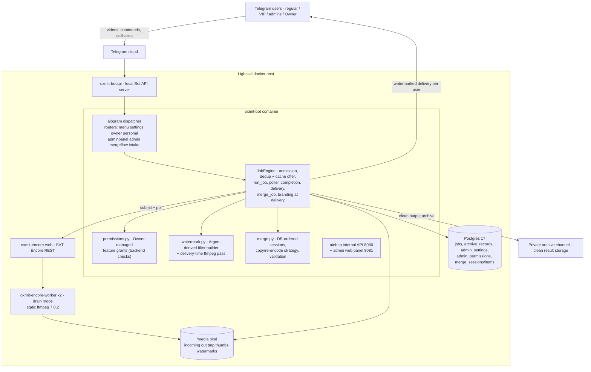
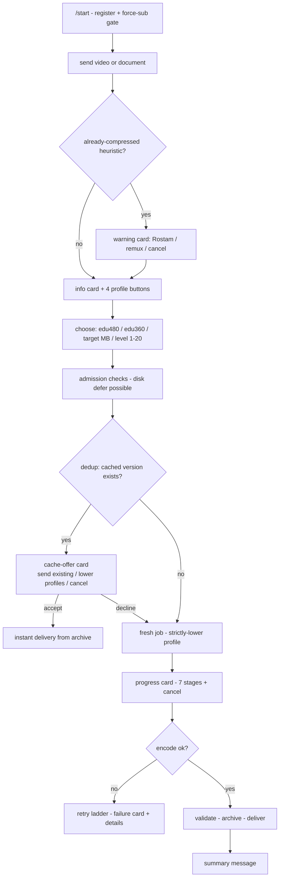
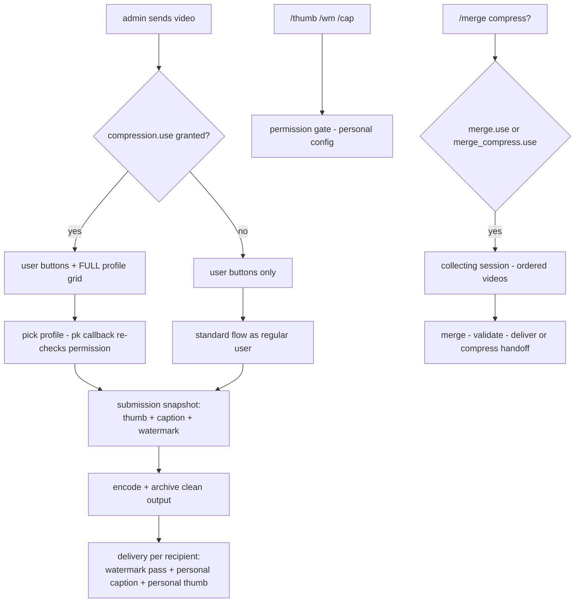
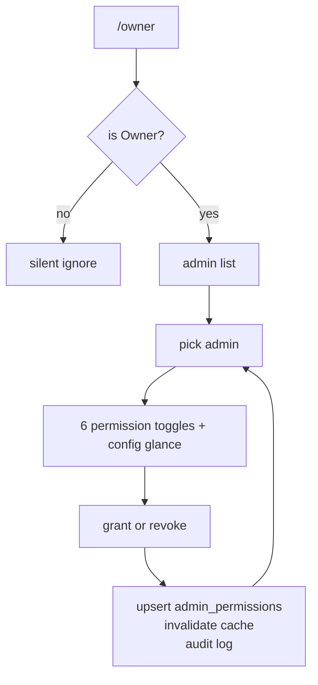
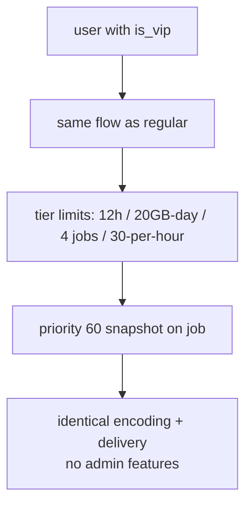
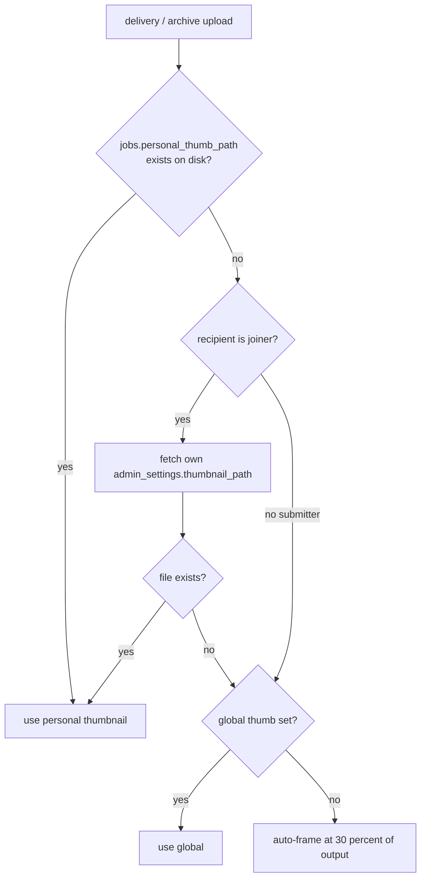
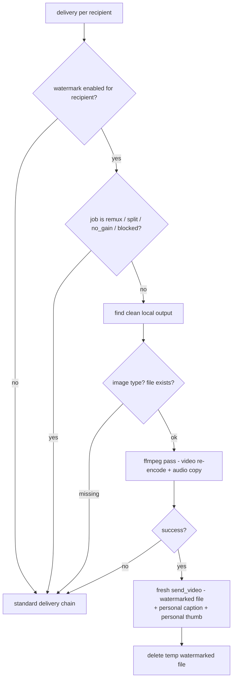
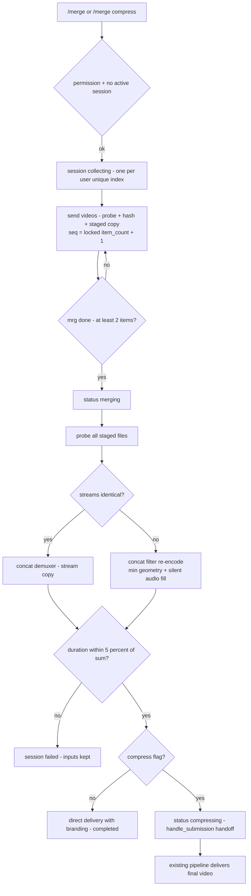
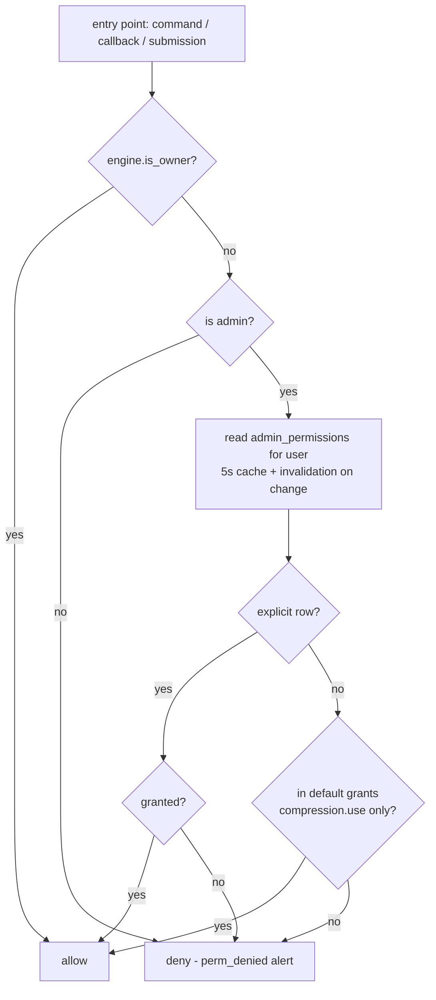

# Oxmit — Argon Feature Integration, Multi-Admin Architecture & Complete UX Flow Audit

**Date:** 2026-11-06 · **Base commit:** `ec16406` (branch `performance/size-speed-optimization`) + prior uncommitted tuning work · **Code state:** deployed to `/opt/oxmit`, **production container NOT yet rebuilt/restarted** (awaiting owner approval)
**Purpose:** self-contained handoff document. A second AI will use it to redesign the UX/UI without re-reading the codebase. Everything below is grounded in real source files; every claim carries `file:line`.

---

## 1. Executive Summary

**What the system was.** Oxmit is a single-process Telegram video-compression bot (Python 3.12, aiogram 3, asyncpg, aiohttp) backed by Docker services: `oxmit-bot`, SVT Encore web+workers (Redis queue), Postgres 17, Redis, a self-hosted Local Bot API server, and a private Telegram archive channel used as result storage. Users send videos (≤4 GB via Local Bot API), the bot probes/hashes them in place, deduplicates against the archive (SHA-256 → fuzzy → perceptual, with an interactive cache-offer), encodes via Encore, validates/archives/delivers results.

**What was added in this integration round.**

1. **Multi-admin permission architecture** — `Owner > Admin > VIP > User`; Owner manages per-admin feature permissions from Telegram (`/owner`), enforced at the backend on every entry point (never by hiding buttons).
2. **Per-admin personal thumbnail** — replaces the old single shared thumbnail; precedence: job-level snapshot > personal > global > auto-frame.
3. **Per-admin watermark** — the full verified Argon Encoder option set (text/image, 4 corners, per-side margins, opacity, box opacity, font size, custom font upload, image scale, time windows, preview). Applied as a delivery-time pass so the archive stays clean and one admin's watermark can never leak into another admin's cache reuse.
4. **Per-admin caption** — Telegram-side caption on delivered videos, replace/append modes (Argon has no such feature; this is new).
5. **Video merge and merge+compress** — DB-backed sessions with atomic sequence assignment, compatibility-driven strategy (stream-copy concat vs concat-filter re-encode), duration validation gate, and re-use of the entire existing compression pipeline for the compress step.

**Key architectural decisions.**
- Permissions are a data table (`admin_permissions`) + one pure module (`bot/oxmit/permissions.py`); adding a future feature = add a key, no checker rewrites.
- Branding is captured as a **submission-time snapshot on the job row** for the submitter; joined requesters get **their own** settings fetched at delivery — nobody receives someone else's branding.
- The archive always stores the **clean** output; watermarking happens per-recipient at delivery (remux jobs and split-part deliveries are excluded — documented limitation).
- Merge ordering lives in Postgres (`merge_items.seq` under a row-locked counter), never in filenames or filesystem order.

**Remaining limitations.** Production not yet activated (pending approval). Watermark pass costs one extra video encode per watermarked delivery. Split-part (>2 GB) deliveries skip branding. No VIP expiry mechanism. See §18.

---

## 2. Project Architecture

### 2.1 Main bot (oxmit)

- **Location:** `/opt/oxmit` on the Lightsail host; local mirror: `bot/`, `tests/`, `deploy/`, `docs/`, `migrations/` inside `bot/oxmit/migrations/`.
- **Stack:** Python 3.12, aiogram 3 (long polling, `handle_as_tasks=True` — each update is its own task), asyncpg (pool 2–10), httpx (Encore REST), aiohttp (internal API + admin web panel), Pillow (fingerprints), `docker` SDK (CPU tuner).
- **Entry point:** `python -m oxmit` → `bot/oxmit/bot.py:main()`; dispatcher wires routers in order: `menu → settings → owner → personal → adminpanel → admin → merge_flow → intake` (`bot.py:110-126`). `merge_flow` sits **before** `intake` so its DB-filtered video handler sees uploads belonging to an active merge session; everything else falls through.
- **Database:** Postgres — tables `users, media_assets, profiles, jobs, job_requesters, archive_records, deliveries, app_config, counters, audit_log` (001–010) + `admin_settings, admin_permissions, merge_sessions, merge_items` + job snapshot columns (012).
- **Encode path:** `JobEngine` (`bot/oxmit/engine.py`) → `EncoreClient` (`encore_client.py`) → encore-web → Redis → drain-mode workers with a static ffmpeg 7.0.2. The bot itself also runs ffmpeg/ffprobe directly for probing, hashing, thumbnails, splitting, remux, watermarking, and merging.
- **Storage:** bot-api volume (sources, token-named dirs — redacted everywhere via `media.redact`), `/media` bind (incoming/out/tmp/thumbs/watermarks), private Telegram channel (archive; `archive_records` is the index).

### 2.2 Argon Encoder (reference project)

- **Location:** `/opt/argonsencoder`; containers `argons-bot` (Pyrofork/Pyrogram) + `argons-mongo` (mongo:7). Git: `Itzmepromgitman/ArgonsEncoder` @ `7650558`.
- **License:** **GPL-3.0** (`/opt/argonsencoder/LICENSE`). Both projects belong to the same owner; module headers credit `@REACTIVEARGON`. Reuse verdict: absorbing logic into oxmit is fine for this owner-operated deployment; if oxmit is ever *distributed*, keep GPL-3.0 + the attribution headers (retained in `bot/oxmit/watermark.py` and `bot/oxmit/fonts/NOTICE.txt`).
- **What was reused:** the watermark filter construction (`ffmpeg_utils.py:230-349` → `bot/oxmit/watermark.py`), escaping (`:219-227`), clamp ranges (`bot/utils/settings.py:213-265`), the 320×320/<200 KB thumbnail normalizer ladder (`bot/func/media.py`), the preview-renderer pattern (`bot/func/preview.py`), and the per-user asset layout (`watermarks/{uid}.png`, `watermarks/fonts/{uid}.ttf`).
- **What Argon does NOT have (not invented here):** custom captions/branding (its `render_caption` is a fixed template — `encode.py:2116-2157`), configurable text color/shadow/fade, box disable, center/tile positions, resolution-scaled fonts, watermarked thumbnails, merge, permissions.

### 2.3 System diagram (as-built today)

**Trust boundaries:** public panel port 8090 (TLS, token+CSRF), docker.sock in bot container (CPU tuner), token-bearing bot-api paths (redaction mandatory).

---

## 3. Existing System Behavior (before this round)

- **Roles:** Owner = `OWNER_TELEGRAM_ID` env or first-admin fallback (`engine.py:220-225`); Admin = `users.is_admin` ∪ `ADMIN_TELEGRAM_IDS` (`engine.py:216-218`); VIP = `users.is_vip` boolean (no expiry) with tier limits (12 h vs 6 h duration, 20 GB vs 5 GB daily, priority 60 vs 50 — `engine.py:574-604`); every admin callback re-verified backend-side (`_guard` adminpanel.py:262-266, ownership checks in intake).
- **Thumbnail:** ONE global image (`app_config.global_thumb_path` → `state.global_thumb` → `_delivery_thumbnail` engine.py:350-367), else auto-frame at 30% of the output. `users.thumbnail_file_id` was a dormant column. Per-admin thumbnails DID NOT exist.
- **Captions:** fixed archive caption (`archive.py:37-60`), fixed delivery texts. No user/admin-configurable caption existed.
- **Watermark / merge:** did not exist.
- **User flow:** video → info card → 4 profile buttons (edu480/edu360/custom/level) → submission → admission → dedup (exact/fuzzy/perceptual) → **interactive cache-offer** (reuse / strictly-lower profiles / cancel) → encode → validate → archive (split >2 GB) → delivery chain (forward→copy→file_id→upload) → summary. Progress card with 7-stage tracker; cancel/retry/error-details/redeliver buttons.
- **Admin extras:** full profile grid (`pk:`), `/admin` panel (stats, health, pause, queue, monitor, errors, cleanup, global thumbnail, users browser, tier limits stepper, broadcast, ban, force-sub), `/panel` web link, `/retry`, `/setarchive`.
- **No `/menu` command existed** (users navigate by sending media; `texts.py` "menu_stats" was dead).

---

## 4. New Features (this round)

### 4.1 Owner-managed permissions

- **Storage:** `admin_permissions(tg_id, perm, granted, granted_by, timestamps)` — migration `012_multiadmin_features.sql`.
- **Keys (`bot/oxmit/permissions.py:31-38`):** `compression.use`, `thumbnail.use`, `watermark.use`, `caption.use`, `merge.use`, `merge_compress.use`.
- **Defaults:** every admin gets `compression.use`; all other features OFF until granted (secure default, spec 3.3). **Owner bypasses everything** (`has_perm` → `engine.is_owner` first check). VIP/regular users are outside the system — their normal compression is unchanged.
- **Enforcement points (backend, every call):** admin profile grid render + `pk:` callback (`intake.py` on_media admin branch + `on_profile_pick`), `/thumb` `/wm` `/cap` (`personal.py:_require`), `/merge` + `mrg:done` (`merge_flow.py`), Owner UI itself (`owner.py` re-checks `engine.is_owner` on every callback).
- **UI:** `/owner` → list admins → per-admin screen: 6 toggle buttons (grant/revoke), personal-config glance (🖼/💧/📝), audit `admin.perm_grant|revoke` with actor `owner:{id}`, cache invalidated immediately (`permissions.invalidate_cache`).

### 4.2 Personal thumbnails

- `/thumb` (perm `thumbnail.use`) → send photo → normalized to 320×320 JPEG via an ffmpeg quality-ladder until <200 KB (Argon behavior) → `media/thumbs/personal/{tg_id}.jpg` → `admin_settings.thumbnail_path`. Delete/preview included.
- **Precedence at use:** job snapshot (`jobs.personal_thumb_path`, captured at submission with an existence check) → personal (joiners) → legacy global → auto-frame (`engine._delivery_thumbnail` engine.py:350-367, `complete_job` call site engine.py:2140-2145, delivery path `_deliver_to_requesters`).
- Counter `personal_thumb_jobs`.

### 4.3 Personal watermarks (Argon-verified options)

**Config (`/wm`, perm `watermark.use`) — every option verified in Argon code, nothing invented:**

| Option | Values (default) | Clamp/notes |
|---|---|---|
| type | text \| image (`text`) | toggle |
| position | top-left/top-right/bottom-left/bottom-right (`top-right`) | 4 corners only, as Argon |
| text | ≤200 chars, `\n`→space (`Oxmit`) | Argon escaping ported exactly |
| font_size | 10..100 px, FIXED (24) | not resolution-scaled (as Argon) |
| opacity | 0.1..1.0 (0.5) | text alpha / overlay alpha |
| border_opacity | 0.0..1.0 (0.5) | box always on, boxborderw=5 (as Argon) |
| margins | per side top/bottom/left/right 0..500 (10) | output-resolution px |
| image_scale | 0.1..1.0 relative to the IMAGE width (0.1) | as Argon `scale=iw*S:-1` |
| timing | always \| range(start,end) \| interval(duration,period) (`always`) | degenerate range auto→always (Argon production bug fixed) |
| font | bundled Roboto-Regular.ttf OR uploaded TTF/OTF ≤5 MB | `media/watermarks/fonts/{tg_id}.ttf` |
| image | PNG/JPG/WebP → normalized PNG ≤5 MB | `media/watermarks/{tg_id}.png` |
| preview | white 1280×720 canvas + current filter → photo | Argon preview pattern |
| enable | master on/off | separate from config |

**Pipeline integration (`watermark.py` + `engine._deliver_to_requesters`):**
- Submission snapshot stores the submitter's watermark JSON on the job (`handle_submission`).
- At delivery, per recipient: if watermark enabled and the job is **not remux** and not split/no_gain/blocked → ffmpeg pass on the local clean output → fresh `send_video` upload of the watermarked file (audio stream-copied, `crf 22 veryfast`, faststart) → temp file removed. Counter `watermark_jobs`.
- **The archive copy is always clean** — cache reuse therefore never ships admin A's watermark to admin B.
- If the pass fails (missing image, ffmpeg error), the clean version is delivered instead — branding never breaks delivery.

### 4.4 Personal captions

- `/cap` (perm `caption.use`): set text (≤1000 chars), mode toggle **replace** (default) / **append** (personal appended after the standard caption), delete. Stored in `admin_settings.caption/caption_mode`.
- Applied at delivery on the video message (`engine._compose_caption`, 1024-char Telegram clamp); the informative summary remains a separate message. The Argon-side verdict: this feature does not exist in Argon — implemented new, using oxmit's delivery architecture.
- Counter `personal_caption_jobs`.

### 4.5 Video merge (`/merge`) and merge+compress (`/merge compress [mb]`)

- **Session model:** `merge_sessions` (status `collecting→merging→compressing→completed|failed|cancelled`, compress flag, profile, target_mb, item_count, result_path) + `merge_items(session_id, seq UNIQUE, media_id, staged_path)`. **One active session per user** — partial unique index `uq_merge_active_user` (verified on real Postgres: second insert → duplicate-key error).
- **Ordering:** `/merge` opens the session; each video is probed+hashed (`engine.register_media` — same in-place probing as compression), then staged to `media/incoming/merge-<sid>/NNN-name.ext` and inserted with **seq = item_count+1 assigned by a row-locked UPDATE** (`merge.add_item`). The merge reads `ORDER BY seq`. Filename/filesystem order is never consulted. Counter per item display shows "#1, #2, …" to the admin live.
- **Strategy (`merge.decide_strategy`):** identical vcodec/acodec/width/height/pix_fmt/sample-rate/channels/fps(±0.01) across all items → **concat demuxer + `-c copy`** (fast, lossless); ANY difference (including audio-presence mismatch) → **concat FILTER re-encode**: every input scaled to the smallest common geometry (never upscaled), fps-normalized to the minimum, yuv420p, audio → 48 kHz stereo AAC; inputs lacking audio get silence sized from their probe. Real-server smoke test caught a duration-drift bug in the first demuxer-based implementation (4.3 s vs 5.0 s) — the shipped version uses the concat filter for the re-encode path (5.03 s ✓).
- **Validation gate:** merged duration must be within ±5% of the summed input durations (`validate_output`) — truncated output fails the session instead of being delivered.
- **Merge+compress:** after validation, `engine.merge_job` calls **the standard `handle_submission(local_path=merged)`** — profiles, target-size policy, admission, queue, progress, cache-offer, archive and delivery are the existing ones; session → `compressing`, then completed with a pointer to the compression job. No second compression engine exists.
- **Recovery:** on boot, sessions stuck in `merging/compressing` are marked failed ("interrupted by restart") and collecting sessions idle >24 h are cancelled (`engine.recover_on_startup`, `merge.fail_stale_sessions`). Merge-only output >Telegram limit → explicit failure advising merge+compress.
- Commands: `/merge`, `/merge compress [mb]`, `/merge_done`, `/merge_cancel`, `/merge_list` + inline buttons `mrg:list|done|cancel`. Max 50 items. Permission re-checked at finish time.

---

## 5. Roles and Permission Matrix

| Capability | Owner | Admin (default) | Admin (after grant) | VIP | Regular |
|---|---|---|---|---|---|
| Standard compression (user flow, cache offers) | ✅ | ✅ (`compression.use`) | ✅ | ✅ (tier limits) | ✅ (tier limits) |
| Admin profile grid (`pk:`) | ✅ | ✅ default / revocable | per grant | ❌ | ❌ |
| Personal thumbnail (`/thumb`) | ✅ | ❌ | `thumbnail.use` | ❌ | ❌ |
| Watermark (`/wm`) | ✅ | ❌ | `watermark.use` | ❌ | ❌ |
| Personal caption (`/cap`) | ✅ | ❌ | `caption.use` | ❌ | ❌ |
| Merge (`/merge`) | ✅ | ❌ | `merge.use` | ❌ | ❌ |
| Merge+compress (`/merge compress`) | ✅ | ❌ | `merge_compress.use` | ❌ | ❌ |
| `/admin` ops panel, broadcast, tiers, bans | ✅ | ✅ (unchanged ops surface) | ✅ | ❌ | ❌ |
| `/owner` permission management | ✅ only | ❌ | ❌ | ❌ | ❌ |
| VIP: 12 h duration, 20 GB/day, priority 60, 4 concurrent | ✅ n/a | priority 70 | priority 70 | ✅ | ❌ (6 h, 5 GB, p50) |

Notes: VIP never implies admin/owner (no code path grants it). Admin priority 70 is unchanged. Revocation is immediate (cache TTL 5 s + explicit invalidation on change). The old global thumbnail remains as a fallback layer under personal thumbnails.

---

## 6. Regular User Journey (existing, unchanged by this round)

1. `/start` (menu.py:22-54) → ensure_user → force-sub gate (if enabled) → welcome text (no buttons). Admins additionally get the archive-setup hint.
2. Send video/document (intake.py:349-477 `on_media`) → blocked/bounce checks → info card: name, size, duration, resolution, codec, kind.
3. Pre-check `is_already_compressed` → warning card with ⚔️ Rostam / 📥 send-original (remux) / ❌ cancel; otherwise the panel: 🟢 edu480 (~cut%, ~MB) · 🟡 edu360 · 🎯 manual target · 🎬 level 1-20.
4. Manual target → quick-size buttons + numeric input (Persian digits accepted). Level → numeric prompt.
5. On choose → `submit_now` → `handle_submission`: admission (tier caps, per-user caps, daily byte quota, queue cap, disk defer) → in-place probe + SHA-256 → dedup layers → **cache offer** (♻️ card: detected resolution/duration/size/codecs/profile + N more versions; 📩 send existing / 🎛 strictly-lower profiles / ❌) or in-flight join or fresh job.
6. Progress card (7-stage tracker 🧾→🧾→📋→⚙️→🔍→🗂→📬, percent, ETA, 20-char bar, cancel button; edits throttled to 4 s).
7. Completion → archive (split >2 GB into keyframe parts) → delivery (forward→copy→file_id→upload; doc-style per user setting) → summary text (file, sizes, saved %, duration, res, codec, time, job id, new/reused).
8. Failure → retry ladder (genpts → repair profile → bounded retries) → failure card with 🔄 retry (≤JOB_RETRIES+2) and ℹ️ error details (redacted ≤400 chars). Delivery failure → 📥 redeliver button.

## 7. Administrator Journey

- Everything in §6 **plus**: the full profile grid on the card (gated by `compression.use` since this round), admin admission bypasses (size/duration/quota/queue, priority 70), `/admin` ops panel (see §12 for the full button map), `/panel` one-time web link, `/retry <id>`, `/setarchive`.
- **New personal layer:** `/thumb`, `/wm`, `/cap`, `/merge` — each opens only with its permission; denial is a clear backend-side alert (`perm_denied`), not a hidden button.
- **New isolation semantics:** the thumbnail/caption/watermark an admin configures applies ONLY to their own submissions (submission snapshot) and their own deliveries; joiners of someone else's job receive their own branding.

## 8. Owner Journey

- `/owner` (owner-only; silently ignored for others) → admin list (👑 marks the owner) → pick admin → screen shows personal-config glance + the six permission toggles (grant/revoke per feature; hidden for the owner target itself) → every change: upsert `admin_permissions`, invalidate cache, audit log.
- The Owner processes videos like an admin with every permission implicitly granted. VIP management remains in the existing adminpanel user card (`uvip:`).

## 9. VIP Journey

- Identified solely by `users.is_vip` (adminpanel user-card toggle). Differences today: duration cap 12 h (vs 6), daily quota 20 GB (vs 5), 4 concurrent (vs 2), 30/hour (vs 10), queue priority 60 (vs 50), ⭐/💎 badges in admin views. Max file size identical (4 GB default).
- **No expiry mechanism exists** (no `vip_until`, no scheduler) — revocation takes effect at the next admission check; already-queued jobs keep their snapshotted priority.
- VIP grants NO admin/owner powers; the new personal features are permission-gated and therefore closed to VIP unless the Owner explicitly makes them admins.

## 10. Feature-Specific Flows (concise)

- **Thumbnail:** job creation → snapshot path check → completion → personal file? → global? → auto-frame → archive upload + fresh-upload deliveries.
- **Watermark:** submission snapshot → delivery per recipient → remux/split/no_gain excluded → ffmpeg pass → fresh upload → temp cleanup; failure ⇒ clean delivery.
- **Caption:** delivery per recipient → compose (replace/append) → 1024 clamp → video message caption.
- **Merge:** `/merge` → ordered video capture (async filter routes only session owners) → `mrg:done` → strategy decision → concat → duration gate → deliver (merge) or `handle_submission` handoff (merge+compress).
- **Standard compression:** unchanged end-to-end; only the admin grid became permission-gated.

---

## 11. Mermaid Flowcharts

### 11.1 Overall system flow
See §2.3 diagram.

### 11.2 Regular user flow

### 11.3 Administrator flow

### 11.4 Owner flow

### 11.5 VIP flow

### 11.6 Thumbnail decision

### 11.7 Watermark flow

### 11.8 Merge flow

### 11.9 Merge + compress sequence
Included in 11.8 (right branch O→P): the merged file enters `handle_submission` with `local_path`, then admission → (cache offer) → queue → Encore → archive → delivery — exactly the standard compression journey.

### 11.10 Permission validation

---

## 12. UI/UX Inventory

Format: Screen/Menu | Buttons (callback) | Input | Next state | Handler | Permission

**Telegram commands (registered):** `/start`, `/settings` (everyone); `+ /admin`, `/panel` per admin chat (`engine.refresh_admin_commands`). Typed-only: `/thumb`, `/wm`, `/cap`, `/merge*`, `/owner`, `/retry`, `/setarchive`. **No `/menu` exists.**

| Screen | Buttons | Input | Next | Handler | Perm |
|---|---|---|---|---|---|
| Welcome (`/start`) | — | video/doc | info card | menu.on_start | — |
| Info card (intake) | 🟢edu480 `cmp:edu480` · 🟡edu360 `cmp:edu360` · 🎯custom `cmp:cust_prompt` · 🎬level `cmp:go`; admins + grid `pk:{key}:{profile}` | — | prompts / submission | intake._CMP_PROFILE_BTNS / on_custom_prompt_btn / on_compress_btn / on_profile_pick | grid: `compression.use` |
| Already-compressed card | ⚔️rostam · 📥remux · ❌ | — | submission | intake.on_compress_profile_btn | — |
| Level prompt | ❌`cmp:stop` | 1..20 (fa digits) | job | intake.on_percent_text | — |
| Target prompt | 50/100/200/400 `cset:mb` · ❌ | MB/GB text | job | intake.on_custom_quick_set / on_custom_size | — |
| Cache-offer card | 📩`reuse:k` · 🎛`cprof:k` · ❌ | — | delivery / restricted grid `cq:k:profile` | intake.on_use_cached / on_choose_other_profile / on_restricted_pick | — |
| Restricted grid | profiles < cached | — | job (allow_reuse=False) | intake.on_restricted_pick | — |
| Progress card | ❌`canc:job` | — | cancelled/continue | engine + intake.on_cancel_btn | requester/admin |
| Failure card | 🔄`rtry:job` · ℹ️`errd:job` | — | retry/details | intake.on_retry / on_error_details | requester/admin |
| Delivery-failure card | 📥`rdl:job` | — | redeliver | intake.on_redeliver | requester/admin |
| `/settings` | 🌐`set:lang` · 📬`set:style` · 🔔`set:notify` | — | toggles | settings.on_toggle | — |
| `/admin` panel | 📊`adm:stats` · 🩺`adm:health` · ⏸`adm:pause` · 📋`adm:queue` · 📡`adm:monitor` · ❌`adm:errors` · 🧹`adm:cleanup` · 🖼`adm:thumb` · 👥`uws:0` · 🎚`adm:limits` · 📢`adm:broadcast` · 🚫`adm:ban` · 🔒`adm:fsub` | — | sub-screens | adminpanel.* | admin |
| Tier limits stepper | `lmt:{tier}:{key}:{p|m}` · reset `lmd:{tier}` | — | persisted tiers | adminpanel | admin |
| User card (`uvw:{uid}`) | ⭐`uvip` · 🚫`uban` · 👑`uadm` (owner-gated demote) · 🎚`ulm:{uid}:menu` · ✉️`umsg:{uid}` · ↩️ | — | user ops | adminpanel | admin (demote: owner) |
| Broadcast | ✅`bgo` · ⏹`bstop` · ❌`bno` | ≤3800 chars | broadcast run | adminpanel | admin |
| **`/thumb` (NEW)** | 🗑`pthumb:del` · ❌`pthumb:no` | photo | personal thumb saved | personal.on_thumb_cmd/photo | `thumbnail.use` |
| **`/wm` (NEW)** | 🔤/🖼`wm:type` · 📍`wm:pos`→`wmpos:p` · ✏️`wm:text` · 🔢`wm:size` · 👓`wm:opacity` · ⬛️`wm:border` · 📐`wm:margins`→`wmm:side` · ⏱`wm:timing`→`wmt:mode` · 🖼`wm:img` · 🔤`wm:font` · 👁`wm:preview` · 🔁`wm:toggle` · ♻️`wm:reset` | text/numbers/photo/font doc | config JSONB saved | personal.on_wm_* | `watermark.use` |
| **`/cap` (NEW)** | 🔁`cap:mode` · 🗑`cap:del` · ❌`cap:no` | ≤1000 chars | personal caption | personal.on_cap_* | `caption.use` |
| **`/merge` (NEW)** | 📋`mrg:list` · ✅`mrg:done` · ❌`mrg:cancel` | videos in order | session states | merge_flow.* | `merge.use` / `merge_compress.use` |
| **`/owner` (NEW)** | `ownadm:{uid}` · `ownperm:{uid}:{perm}:{0|1}` · ↩️`own:back` | — | grant/revoke | owner.* | owner only |
| Conversation states | intake: `video_pending`, `percent_pending`, `pending`, `pending_custom`, `pending_offers`, `pending_archive_chat`; adminpanel: `pending_mode`(user/umsg/broadcast/fsub/thumb), `pending_target`, `bcast_text`; personal: `pending` (wm/thumb/cap inputs) — all in-memory with 600s–1h TTL sweeps; **lost on restart** | | | | |

## 13. User Pattern Analysis (observed behavior)

- **Choice architecture:** users choose by sending media first, then get 2–4 big buttons with predicted savings — decisions are made against concrete numbers, not abstract profile names.
- **State is per-user in-memory dicts** keyed by `tg_id` — one user in two chats can have stale-button races (documented in the audit round); restarts drop all pending states.
- **Progress is a single editable message** — users watch one card evolve; there is no command to query status.
- **Errors recover through buttons** (retry/details/redeliver) attached directly to the failure card — recovery is one tap away.
- **The cache-offer is a fork in the road**: users either take the instant file or consciously pick a lower tier — the bot never silently decides.
- **Admins configure branding by conversation** (send photo/text/numbers) rather than forms; every input has a 600 s window and a cancel button.

## 14. UX/UI Problems and Opportunities (observed, not redesigned)

**Critical**
1. None known to be broken at the interaction layer after the earlier audit fixes (level flow, double-answer, sweep crashes fixed and regression-pinned). Watch the merge/watermark flows in production once activated.

**High-priority**
1. No navigation root: users cannot list their abilities (`/menu` does not exist) — after this round there are SIX commands an admin must remember (`/thumb /wm /cap /merge /admin /settings`). Opportunity: one `/menu` root with a role-aware button grid.
2. Merge results carry no progress detail between "started" and "done" — long merges are silent (opportunity: stage-based edits like the compression card).
3. Permission denial alerts show the feature name but not WHO can grant it (opportunity: append "درخواست از Owner").

**Medium**
4. `/wm` menu is one long 7-row keyboard — grouping (basic/advanced) would reduce scanning; the summary line is dense.
5. Merge session and compression pending states can coexist confusingly (a user inside a merge session who sends a video adds it to the merge — intentional, but the info card is not re-explained each time).
6. The already-compressed warning precedes the cache-offer — a user can see two "this video is already small" messages in sequence.
7. Split-part (>2 GB) outputs silently skip branding (documented) — admins may assume the watermark failed.

**Minor**
8. Persian-digit support is inconsistent between parsers (level/custom accept them; margin/opacity inputs translate via a smaller table).
9. Command descriptions in `set_my_commands` contain mojibake `?` characters (cosmetic).
10. Dead texts (`menu_stats`, `nothing_to_cancel`, etc. — full list in the audit round) and hardcoded panel strings.

## 15. Backend and Database Changes

- **Migration `012_multiadmin_features.sql`:** `admin_settings(tg_id PK→users, thumbnail_path, watermark JSONB, watermark_enabled, caption, caption_mode, updated_at)`; `admin_permissions(tg_id, perm PK, granted, granted_by, timestamps)` + index; `merge_sessions` (status flow + `uq_merge_active_user` partial unique index); `merge_items(session_id, seq UNIQUE, media_id→media_assets, staged_path, size_bytes)` + ordered index; `jobs.personal_thumb_path/personal_caption/caption_mode/watermark_json/job_kind`; 5 counters. All `IF NOT EXISTS` — idempotent, verified fresh (001→012 on real Postgres) and designed to layer onto the production DB.
- **Submission snapshot:** `handle_submission` reads `admin_settings` once, validates the thumb file exists, normalizes nothing else (watermark normalization happens at use), writes the four columns on both INSERT sites (main + level265 escalation).
- **Delivery:** `_delivery_personal` (submitter= snapshot / joiner= live fetch), `_compose_caption`, `_personal_thumb_file`, `_wm_asset_paths`, `_job_output_file` (engine.py). `archive.deliver_result` already accepted `caption`/`thumbnail`.
- **Merge service:** `merge.py` (sessions/items/strategy/ffmpeg/validate/cleanup) + `engine.merge_job` + `handlers/merge_flow.py` + recovery hooks in `engine.recover_on_startup`.
- **Watermark service:** `watermark.py` (normalize/clamps/escape/build filter/apply pass) + delivery wiring in `_deliver_to_requesters`.
- **Permission module:** `permissions.py` (PERMS, defaults, `has_perm`, `effective_perms`, cache) — imported by intake, personal, merge_flow; Owner UI in `handlers/owner.py`.

## 16. Testing and Verification

**Automated (185/185 passing on Windows venv AND on the server venv):**
- `test_permissions.py` (8): owner bypass, secure defaults, grant/revoke immediate effect, non-admin denial, unknown key, cache isolation.
- `test_merge.py` (11): strategy decision (copy vs re-encode triggers incl. audio-presence and fps tolerance), normalization target, stale-session sweep.
- `test_watermark.py` (11): clamps, degenerate-range fix (the Argon production bug), escaping, positions, timing expressions, image/movie filter, missing-image behavior.
- `test_multiadmin_features.py` (8): atomic seq ordering (1→2 under the locked counter), inactive-session rejection, router registration, submitter-snapshot vs joiner-fetch isolation, caption modes/clamp.
- `test_router_registration.py` (4): pins all critical handlers (incl. new routers).

**Manual/real-environment verification (executed on the server):**
- Migration 012 applied fresh over 001–012 on a disposable postgres:17 — all 14 tables + 5 job snapshot columns + the unique index verified; atomic-seq UPDATE returned 1 then 2; a second active session for the same user was rejected by `uq_merge_active_user`.
- **Real-ffmpeg merge smoke** on the server: two compatible clips → stream-copy merge, duration 6.02 s (=3+3) ✓; mismatched-res clip forced the re-encode path → 5.03 s (=3+2) ✓ (this test caught and fixed a duration-drift bug in the first implementation); truncated output correctly rejected by the validation gate.
- Watermark filter construction is unit-tested against the exact Argon templates; a real-encode watermark pass was not run over a full video (small-lavfi preview pattern only) — see §18.

**NOT executed (honest):** live end-to-end Telegram interaction (production container not rebuilt/restarted — owner approval pending); a full-size (>2 GB) merge; mixed-audio merge with silent-fill on real footage; watermark on real footage quality review; UI flows in a real chat.

## 17. Performance and Resource Considerations

- **Watermark pass:** one extra video encode per watermarked delivery on the (compressed) output — x264 `veryfast crf22`, audio copied. Rough cost: proportional to output duration; on the 8-vCPU box a 1 h 480 p output ≈ minutes. Alternative (injecting filters into Encore profiles) rejected for now: Encore profile params map to encoder options, not libav filters — documented as a possible future optimization.
- **Merge:** stream-copy path is I/O-bound (concat demuxer). Re-encode path runs on the bot container with `ffmpeg_threads_single`; inputs are staged copies (disk cost = sum of inputs until cleanup). Merge+compress temporarily holds merged file + compression working set — disk reservation from the existing admission system covers the compression stage, not the merge stage (merge outputs are bounded by delivered sizes; the 589 GB-free host makes this theoretical today).
- **DB:** all permission/merge queries are indexed PK/unique lookups (sub-millisecond at current scale; same class as the benchmarked dedup queries).

## 18. Remaining Issues

1. **Production not activated** — code is on the server; the image must be rebuilt and the container recreated (owner approval pending). Until then nothing in this document is live.
2. **Split-part (>2 GB) deliveries skip watermark/caption/thumb branding** — the per-part path uses the archive-chain delivery; adding per-part branding means N extra encodes (deliberately deferred, documented in code).
3. **No VIP expiry** — VIP remains a boolean; the Owner UI manages features for admins, not VIP feature flags (VIP feature policy was left "according to existing policy" per spec).
4. **In-memory pending states** for personal settings/merge UI are lost on restart (sessions themselves are DB-backed; only the "waiting for input" states reset).
5. **`jobs.source_path` still stores token-bearing paths** (pre-existing debt).
6. **Concurrent-edit note:** during this round, third-party patches appeared on the server (quality.py `created_at` normalization + `test_audit_patches.py`, extra encore profile YAML tuning). They were detected, adopted, and the suite is green with them; future rounds should diff server state before deploying.
7. Merge re-encode path does not yet propagate HDR/rotation metadata (inputs are normalized to yuv420p SDR — matching the bot's SDR pipeline).

## 19. Source Code Reference Map

| Area | File | Key symbols |
|---|---|---|
| Permissions | `bot/oxmit/permissions.py` | `PERMS`, `DEFAULT_ADMIN_GRANTS`, `has_perm`, `effective_perms`, `invalidate_cache` |
| Owner UI | `bot/oxmit/handlers/owner.py` | `on_owner`, `on_owner_admin`, `on_owner_perm` |
| Personal settings | `bot/oxmit/handlers/personal.py` | `on_thumb_cmd/photo`, `on_wm_cmd/_button/_text/_img/_font`, `_render_preview`, `on_cap_cmd/text` |
| Watermark engine | `bot/oxmit/watermark.py` | `normalize_wm`, `escape_drawtext`, `build_video_filter`, `apply_watermark` |
| Merge service | `bot/oxmit/merge.py` | `create_session/add_item/list_items`, `decide_strategy`, `normalize_target`, `run_copy_merge`, `run_reencode_merge`, `validate_output`, `fail_stale_sessions`, `cleanup_session_files` |
| Merge flow | `bot/oxmit/handlers/merge_flow.py` | `on_merge_cmd`, `on_merge_video` (async filter `_has_collecting`), `on_merge_btn`, `_do_finish/_do_cancel` |
| Merge job | `bot/oxmit/engine.py` | `JobEngine.merge_job`, `_delivery_personal`, `_compose_caption`, `_personal_thumb_file`, `_wm_asset_paths`, `_job_output_file` |
| Snapshot capture | `bot/oxmit/engine.py` | `handle_submission` (snapshot fetch + both INSERTs), `_delivery_thumbnail` precedence |
| Intake gating | `bot/oxmit/handlers/intake.py` | admin-branch grid gate, `on_profile_pick` re-check |
| Wiring | `bot/oxmit/bot.py` | router order, sweep loop, recover hooks |
| Schema | `bot/oxmit/migrations/012_multiadmin_features.sql` | all new tables/columns/indexes |
| Tests | `tests/test_permissions.py`, `test_merge.py`, `test_watermark.py`, `test_multiadmin_features.py` | — |
| Baseline docs | `docs/architecture-current.md`, `reports/engineering-report-2026-11-05.md` | as-built diagrams, prior fixes |

## 20. Recommendations for the Next AI (UX/UI handoff)

1. **Design one root navigation** (`/menu`) that is role-aware: regular users see compress options; admins additionally see personal branding (thumb/wm/cap), merge, and a link to `/admin`; the Owner sees the permission manager. Today's six commands are discoverable only by memory — this is the single highest-value UX change. Do NOT remove the direct commands; layer the menu on top.
2. **Unify "what will happen to my video" messaging:** the pipeline now has up to three post-encode layers (watermark → caption → thumbnail). A single "برندینگ من" preview screen (composite of the user's current watermark/caption/thumb state) would answer a question users currently cannot see.
3. **Give merge its own progress card** mirroring the compression 7-stage tracker (collecting → staged N/M → merging → validating → compressing → delivering), reusing `edit_status_sync` throttling.
4. **Make permission denials actionable** (show the Owner a "request access" hint; give the Owner a one-tap grant from the denial flow log).
5. **Persona map to design for:** (a) regular user — one video, one tap, wants the file; (b) power/VIP user — many videos, watches queue position, uses doc-style delivery; (c) admin — brands content (thumb/wm/cap), merges episodes, cares about order and naming; (d) Owner — manages people and permissions, audits changes; (e) operator — health, queue, broadcast. The backend contracts for all of these already exist and are permission-gated; the UX work must not bypass `permissions.has_perm`.
6. **Constraints to respect:** backend checks are the security boundary (never move auth into UI); the archive must keep receiving CLEAN outputs; submission-time snapshots must keep winning for submitters; the 0.6 s throttle, pending-state sweeps, and TelegramAPIError guards are load-bearing patterns — follow them in any new screen.

*End of document — generated from source inspection on 2026-11-06; file:line references point at the working tree state of that date.*
