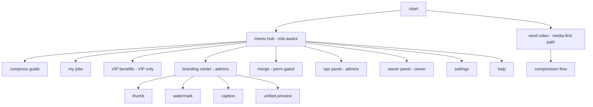
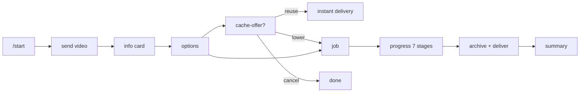
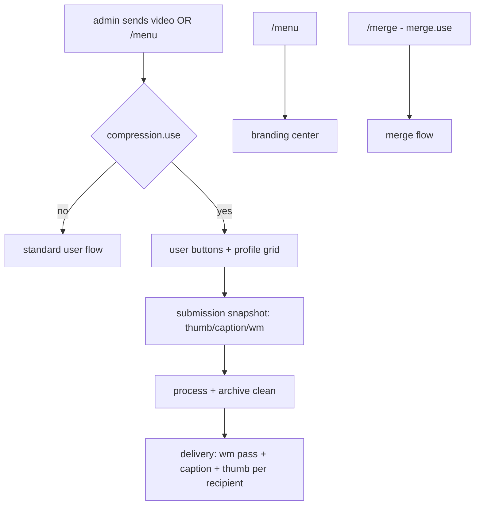
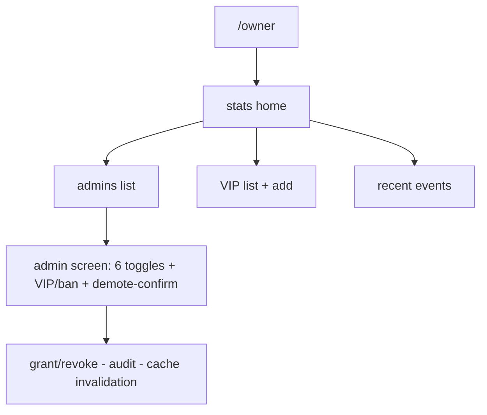
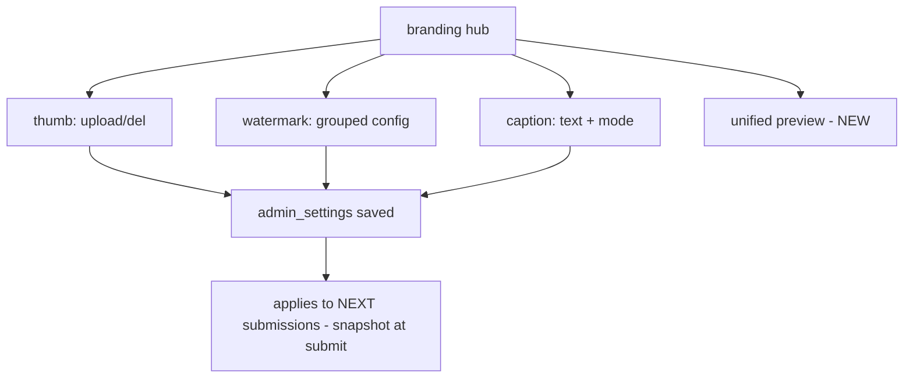
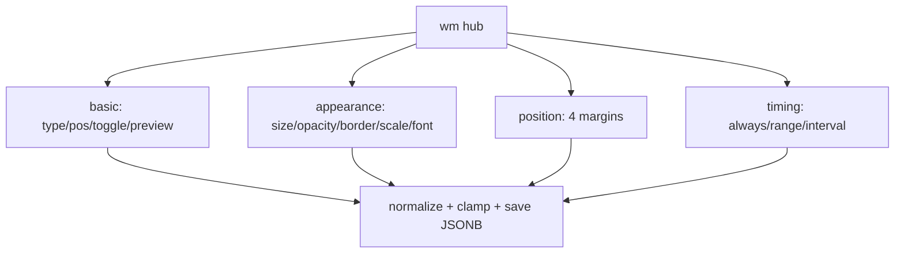
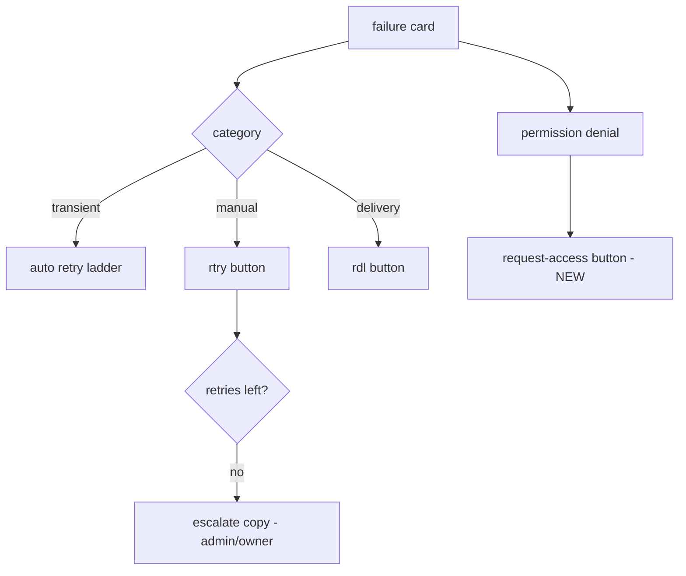
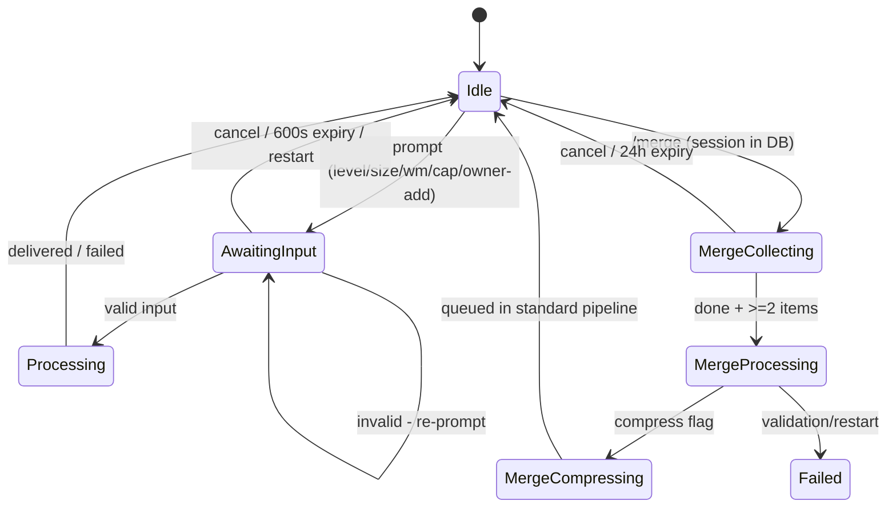

# OXMIT — UX/UI Redesign Specification
**Date:** 2026-11-06 · **Primary source:** `docs/ARGON_INTEGRATION_AND_UX_FLOW_AUDIT.md` (handoff) · **Scope:** design & documentation ONLY — no production code/migrations/services were modified (per §20 of the design brief)
**Verification:** router order, command handlers and the interaction contracts cited below were spot-checked against the working tree on 2026-11-06; test suite 186/186 passing. Discrepancies with the handoff doc: **none found**.

---

# PART 1 — PRODUCT UNDERSTANDING

## 1. Executive Summary

**The product.** Oxmit is a Telegram video-processing platform: users send videos (≤4 GB via Local Bot API), the bot probes/hashes in place, deduplicates against a private archive channel, encodes via SVT Encore, validates, archives, and delivers — with per-admin branding (thumbnail/watermark/caption), permission-gated merge features, an Owner permission manager, and an ops panel.

**Main UX problems (from the audit, still valid):**
1. **No navigation root** — `/menu` does not exist; admins must memorize 6+ commands; regular users discover nothing beyond the upload flow.
2. **Silent permission walls** — a denied admin gets a bare alert with no path forward.
3. **Merge is invisible** — no entry in any menu; progress feedback between "started" and "done" is a black box.
4. **Branding is scattered** — `/thumb`, `/wm`, `/cap` are three separate command silos; the user cannot see their branding as one picture.
5. **Double-warning for pre-compressed videos** (heuristic warning then cache-offer read as two warnings for the same issue).
6. **No help surface**; error taxonomy is implicit; Persian copy is inconsistent across new/old screens.

**Design objectives.** One coherent product: media-first for the impatient, menu-first for discovery, role-aware everywhere, branding as one unified center, merge as a first-class guided flow, permission denial that leads somewhere, and an error language users can act on — all without touching the backend's security or processing contracts.

**Proposed direction (one sentence).** Add a role-aware `/menu` hub + a unified **Branding Center** + a guided **merge journey** on top of the existing media-first flow, and wrap every denial/error in an actionable next step — everything else (dedup, cache-offer, profiles, snapshots, archive) stays exactly as built.

## 2. Existing Experience Audit

See the handoff doc §6–§14 for the full as-built inventory. Verified highlights that this design builds on:
- Media flow: info card → 4 buttons (edu480/edu360/custom/level) → admission → dedup → **interactive cache-offer** (reuse / strictly-lower / cancel) → progress card (7 stages) → delivery (forward→copy→file_id→upload) → summary. Retry ladder + failure card with 🔄/ℹ️ buttons.
- Branding: `/thumb` `/wm` `/cap` with per-admin isolation; submission-time snapshot for the submitter; joiners get their own settings at delivery; archive stays clean; watermark applied per-recipient at delivery (remux/split/no_gain excluded).
- Merge: `/merge [compress [mb]]`, DB-ordered sessions (atomic seq, one active per user), copy/re-encode strategy, ±5% duration gate, handoff to the standard compression pipeline.
- Owner: `/owner` v2 — stats home, admin list (👑/⭐/🚫 marks), per-admin screen (6 explicit permission toggles, VIP/ban toggles, demote-with-confirm), VIP list + add, add-admin by ID/@username, recent audit events.
- Ops: `/admin` panel (stats, health, pause, queue, monitor, errors, cleanup, global thumb, users browser, tier steppers, broadcast, ban, force-sub), `/panel` web link, `/retry`, `/setarchive`.
- Commands that exist today: `/start` `/settings` (all), `/admin` `/panel` (admins), `/retry` `/setarchive` (admins), `/thumb` `/wm` `/cap` `/merge*` (permission-gated), `/owner` (owner). **No `/menu`, no `/help`.**

**UX debts confirmed:** dead `/menu_stats` strings, mojibake in command descriptions, Persian-digit support inconsistent across numeric inputs, merge progress silence, branding split across three silos, no unified preview (watermark-only preview exists).

## 3. Product Constraints (design must respect all of these)

**Backend contracts.**
- `permissions.has_perm` is the only authorization gate; UI visibility is never the boundary.
- Submission-time snapshot (`jobs.personal_thumb_path/caption/caption_mode/watermark_json`) wins for the submitter; joiners get live per-recipient settings at delivery.
- Archive stores CLEAN outputs; watermark = delivery-time pass; remux/split/no_gain deliveries skip branding.
- Cache-offer must remain interactive (reuse / strictly-lower / cancel) — never auto-deliver when `cache_offer` is on; `allow_reuse=False` after a decline.
- Admission, disk-defer, tiers, quotas and the `uq_active_media_profile` in-flight dedup are untouched.
- Merge: DB seq ordering, one active session per user (unique index), 50-item cap, ±5% duration validation, restart → `merging/compressing` sessions marked failed.

**Telegram limits.** Button labels short (mobile, RTL); callback_data ≤64 bytes; captions ≤1024; messages ≤4096; edits throttled (`progress_edit_seconds`); inline keyboards preferred; ~3–4 buttons per row max readable.

**Persistence.** Merge sessions + permissions + branding = DB (survive restart). Pending conversational inputs (level, custom size, wm fields, cap text, owner add-* prompts, adminpanel pending_mode) = in-memory, 600s–1h TTL, lost on restart — the design must promise recovery, not persistence.

**Known processing realities to surface honestly:** watermark adds an encode pass; split-part (>2 GB) deliveries skip branding; merge re-encode normalizes to SDR min-geometry; VIP has no expiry.

---

# PART 2 — USER PERSONAS

## 4. Persona Definitions

| Persona | Who | Frequency | Core need |
|---|---|---|---|
| **P-U Regular** | Any Telegram user | Occasional | "Send video → get smaller file" with zero learning |
| **P-V VIP** | `is_vip` user | Regular/heavy | Same as P-U + awareness of their bigger limits |
| **P-A Admin** | Permission-carrying operator of their own channel content | Daily | Reliable processing + their branding applied + merge episodes |
| **P-O Owner** | The bot's owner | Constant | Control: who can do what; visibility; zero DB/tooling work |
| **P-S Operator** | Often the same human as P-O, different hat | Constant | System health, queue, users, broadcast |

## 5. User Goals and Behavioral Patterns

| Persona | Most frequent task | Expected info | Common confusion (observed/inferred) | Best shortcut |
|---|---|---|---|---|
| P-U | Compress one video | "How small will it get? How long?" | edu480 vs edu360 difference; level 1–20 meaning | Just send the video |
| P-V | Compress large/long videos | Their remaining limits | Whether VIP gives admin features (it must not) | Same as P-U |
| P-A | Brand + compress series | "Is MY watermark on it?" | Which thumbnail will be used (personal vs global) | Send video → grid |
| P-A(merge) | Merge episode parts | Exact order + progress | Merge vs normal upload confusion (filter already routes it) | `/merge` |
| P-O | Grant/revoke; onboard an admin | Who has what; recent changes | Remembering that VIP ≠ admin | `/owner` |
| P-S | Health & queue | Errors, disk, stuck jobs | — | `/admin` |

**Likely mistakes to design for:** sending the next episode into a merge session unintentionally (→ persistent context banner); pressing "level" expecting percent size (→ copy explains direction); trying watermark on remux (→ copy states exclusion); double-tapping toggles (→ explicit-value buttons + throttle, already built).

## 6. Role and Capability Visibility — Proposed Menu Matrix

| Menu item | P-U | P-V | P-A (perm-gated items) | P-O |
|---|---|---|---|---|
| 🎬 فشرده‌سازی (guide) | ✅ | ✅ | ✅ | ✅ |
| 📋 کارهای من (status) | ✅ | ✅ | ✅ | ✅ |
| 💎 مزایای VIP | — | ✅ | — | — |
| 🎨 برندینگ من | — | — | ✅ if any of thumb/wm/cap granted (sub-items per grant) | ✅ |
| 🔗 ادغام ویدیوها | — | — | ✅ `merge.use` | ✅ |
| 🎞 ادغام + فشرده‌سازی | — | — | ✅ `merge_compress.use` | ✅ |
| 🛠 پنل عملیات | — | — | ✅ | ✅ |
| 👑 مدیریت Owner | — | — | — | ✅ |
| ⚙️ تنظیمات / ❓ راهنما | ✅ | ✅ | ✅ | ✅ |

Rule: **a menu item is rendered only if `permissions.has_perm` says yes** — and the handler re-checks. Visibility is a courtesy, authorization is the wall.

---

# PART 3 — INFORMATION ARCHITECTURE

## 7. Global Navigation Architecture

**Decision: media-first with a menu hub — both entries coexist.**
- Sending a video remains the primary flow (no forced menu detour).
- `/menu` (NEW) becomes the discovery + status + help hub, role-aware.
- Every generated screen carries consistent **bottom row: [🏠 خانه] [❓ راهنما]** where useful, and every flow keeps its existing cancel.

Rationale (Q1): forcing a menu before upload punishes the 90% case; hiding a menu hides the product. A hub that also answers "what can I do / what's happening" serves both patterns without adding clicks to the hot path.

## 8. Menu Hierarchy (complete tree, NEW = to be built)

```
/menu (SCR-M0, role-aware)
├─ 🎬 راهنمای فشرده‌سازی        → SCR-H1 (copy: just send the video + options explained)
├─ 📋 کارهای من                → SCR-S1 (last 5 of my jobs w/ status + [🔄 تازه‌سازی])   NEW (backend: simple SELECT)
├─ 💎 مزایای VIP               → SCR-V1 (VIP-only: limits + usage note)                NEW (backend: reads tiers + counters)
├─ 🎨 برندینگ من               → SCR-B0 (admin; per-permission sub-items)              NEW wrapper over /thumb /wm /cap
│   ├─ 🖼 تامبنیل              → existing /thumb flow
│   ├─ 💧 واترمارک             → existing /wm flow (progressive disclosure, §19)
│   ├─ 📝 کپشن                 → existing /cap flow
│   └─ 👁 نمای کلی برندینگ     → SCR-B1 (unified overview)                             NEW (read-only compose)
├─ 🔗 ادغام ویدیوها            → /merge entry (perm merge.use)                         existing flow
├─ 🎞 ادغام + فشرده‌سازی       → /merge compress entry (perm merge_compress.use)       existing flow
├─ 🛠 پنل عملیات               → /admin panel (admins)                                 existing
├─ 👑 مدیریت Owner             → /owner panel (owner)                                  existing
├─ ⚙️ تنظیمات                  → /settings (existing)
└─ ❓ راهنما                   → SCR-H2 (help: FAQ-style copy)                         NEW (static text)
```

## 9. Command and Shortcut Strategy

- **Keep all existing commands** (`/thumb /wm /cap /merge* /admin /owner /settings /retry /setarchive`) — power users and the audit doc's callback contracts stay intact.
- `/menu`, `/help`, `/myjobs` are **NEW** aliases/entries; `/help` == SCR-H2, `/menu` == SCR-M0.
- Register in `set_my_commands`: default scope gets `menu`, `settings`, `help`; admin scope adds `admin`, `branding` (alias→menu B0); owner scope adds `owner`. Fix the mojibake descriptions while touching this (cosmetic, listed in roadmap).
- Callback naming for new screens: prefix `menu:` (e.g. `menu:home`, `menu:jobs`, `menu:help`, `menu:vip`, `menu:branding`) — **all NEW**, no collision with existing namespaces (`cmp:`, `pk:`, `mrg:`, `own*`, `wm*`, `cap:`, `pthumb:`, `set:`, `adm:`…).

## 10. Navigation Rules

- **Home:** `[🏠 خانه]` bottom-right on every hub screen → `/menu` re-render (edit in place when possible).
- **Back:** bottom-left, returns one level (parent screen), never jumps context.
- **Cancel:** inside any input/flow — top-right or the existing `cmp:stop`-style button; cancels only that flow, prints what was cancelled.
- **Help:** `❓` on hub screens only (keeps cards clean); inline `ℹ️` for per-field explanations in watermark advanced screens.
- **Message discipline:** hubs and cards EDIT in place; results/uploads are new messages (files must persist); never edit a message that carries delivered media.
- **Safe transitions:** starting a flow that conflicts with an active one (e.g. `/wm` while a merge session is collecting) is allowed — contexts are independent — but every merge upload echo repeats the active-session banner so media never lands in the wrong place silently (Q13: priority = merge session captures media; text-input pendings do NOT capture media).

---

# PART 4 — COMPLETE USER JOURNEYS

## 11. Regular User Journey (proposed deltas in **bold**)

`/start` → welcome (unchanged copy) → **[🎬 بفرست ویدیو رو] hint + [/menu]** → send video → info card (unchanged fields) → options → admission → **cache-offer (unchanged)** → progress card → delivery → summary → **[📋 کارهای من] reachable anytime via /menu**.

Deltas: help entry (SCR-H2) explains the 4 options in plain Persian; the already-compressed warning is **merged into the cache-offer card** (§17) so the user sees ONE decision, not two warnings.

## 12. VIP User Journey

Same as P-U plus: `/menu` shows **💎 مزایای VIP** → SCR-V1 lists their real limits (12h, 20GB/day, 4 concurrent, 30/h, priority) with a line "وقتی به سقفی برسی، دقیقاً بهت می‌گیم و کارت معلق نمی‌مونه" — and the existing admission rejections already carry localized reasons (keep). **No admin items appear.** No expiry promises (feature does not exist).

## 13. Administrator Journey (permission combinations)

- **A0 (compression only):** menu shows hub + settings + ops panel. No branding/merge rows. Identical processing flow to P-U but with the profile grid (existing `compression.use` gate).
- **A1 (+branding):** adds 🎨 برندینگ من (sub-items per individual grant). Branding Center is the daily surface; commands still work.
- **A2 (+merge):** adds 🔗 ادغام; full guided flow (§20).
- **A3 (+merge+compress):** adds 🎞 ادغام + فشرده‌سازی with upfront profile choice (§21).
- Consistency rule: **the same screen set, progressively revealed** — an A0 admin who later gets branding sees the same menu with new rows; nothing else moves.

## 14. Owner Journey

`/owner` v2 (already built) is the management core. Proposed deltas only:
- **Owner dashboard = /menu home for the owner** already includes stats; add a **[👥])** shortcut row linking to `/owner`.
- **Compact permission matrix** (SCR-O2, NEW, read-only): one text screen listing every admin × 6 permissions as ✅/❌ table for at-a-glance audit (answer to Q8: per-admin screens stay primary for changes; the matrix is the report view — mobile keyboards make a 6×N interactive matrix clumsy).
- Everything else unchanged (grant/revoke explicit buttons, VIP/ban toggles throttled, demote confirmed, audit events list).

## 15. Operator Journey

Unchanged `/admin` panel; two proposed touches only: (a) merge sessions get a line in `adm:queue` (count of active sessions — NEW tiny query), (b) permission-change audit events already flow into `own:audit` and the web panel's audit page.

---

# PART 5 — FEATURE UX SPECIFICATIONS

## 16. Compression Experience

**SCR-C1 Info card (edit of existing):** keep fields; group as 2 lines + collapsible "ℹ️ جزئیات" callback showing codec/container/bitrate (Q: essential vs optional). Persian:
```
🎬 {name}
📦 {size} | ⏱ {duration} | 📐 {WxH}
```
**SCR-C2 Options (existing 4 buttons, copy improved):**
```
🟢 سبک — حجم خیلی کم، کیفیت خوب        (~{cut}٪ | ~{mb}MB)
🟡 متعادل — کیفیت بالاتر               (~{cut}٪ | ~{mb}MB)
🎯 حجم دلخواه — خودت تعیین می‌کنی
🎚 درجه ۱–۲۰ — کنترل دستی
```
Edu480→"سبک", edu360→"متعادل" relabel is **proposed copy only**; profile keys unchanged. Estimates stay ranges, never guarantees (existing estimate module).

**SCR-C3 Progress (visual hierarchy edit):** keep the 7-stage tracker but rename stages to user language: دریافت → آماده‌سازی → صف → انکود → اعتبارسنجی → آرشیو → ارسال. Percent only for انکود (real data); others = status labels (no fabricated %, per brief).

## 17. Cache Offer Experience

**Merge the pre-warning into the offer (Q4/Q5 decision):** when `is_already_compressed` fires AND a cache version exists → ONE card:
```
♻️ این ویدیو قبلاً فشرده شده و نسخهٔ آماده داریم

[داده‌های نسخه: کیفیت/مدت/حجم/کدک/پروفایل — همان کارت فعلی]

⚠️ فشرده‌سازی دوباره احتمالاً حجم را کم نمی‌کند.
📩 همان نسخهٔ آماده را بفرست   |   🎛 پروفایل پایین‌تر   |   ❌ انصراف
```
When the heuristic fires but NO cache exists → keep a single short warning card (existing rostam/remux buttons). Backend untouched; this is pure presentation logic in intake (proposed, marked NEW-COPY).

## 18. Personal Branding Center (SCR-B0/B1, NEW wrapper)

```
🎨 برندینگ من
━━━━━━━━━
🖼 تامبنیل: ✅ (شخصی)
💧 واترمارک: ✅ فعال — متن «@MyChannel»، بالا-راست
📝 کپشن: ✅ — حالت: جایگزینی

ℹ️ این تنظیمات فقط روی خروجی‌های خودت اعمال می‌شن. کارهایی که قبلاً ثبت
شدن با تنظیمات لحظهٔ ثبت خودشون ارسال می‌شن؛ آرشیو همیشه نسخهٔ تمیز نگه
می‌داره و واترمارک موقع ارسال اضافه می‌شه.
⚠️ خروجی‌های بزرگ‌تر از سقف تلگرام (تقسیم به چند پارت) فعلاً برندینگ نمی‌گیرند.

[🖼 تامبنیل] [💧 واترمارک] [📝 کپشن]
[👁 پیش‌نمایش یکجا*]                ← NEW backend (see below)
[🏠 خانه]
```
- The overview reads `admin_settings` only — no mutation here (Q10 answered in copy).
- **Unified preview** is proposed NEW backend work: render watermark over a frame + show the chosen thumbnail + caption text in one message (currently only the watermark-on-white-canvas preview exists — honestly labeled).

## 19. Watermark Configuration (progressive disclosure)

`/wm` becomes SCR-W0 with grouped submenus (existing fields unchanged, none removed):

```
💧 واترمارک — {✅ فعال / ❌ غیرفعال}
[🧩 پایه]  → type (متن/تصویر)، position (۴ گوشه)، enable toggle، preview
[🎨 ظاهر]  → font size، opacity، border opacity، image scale، font upload
[📐 موقعیت] → ۴ حاشیه (top/bottom/left/right)
[⏱ زمان‌بندی] → always / range / interval (inputs as today)
[♻️ بازنشانی]  [🏠 خانه]
```
Same summary card as today, reached via any group's back. All existing callbacks (`wm:*`, `wmpos:`, `wmm:`, `wmt:`) preserved; grouping is keyboard re-organization + two new routing callbacks (`wm:group:basic|look|pos|timing` — NEW). Persian numerals accepted everywhere (align with the level parser's translate table — roadmap item).

## 20. Merge Experience

**SCR-MG1 Entry (menu or `/merge`):**
```
🔗 ادغام ویدیوها
ویدیوها را به ترتیب بفرست؛ دقیقاً به همان ترتیب به هم می‌چسبند.
حداقل ۲ و حداکثر ۵۰ ویدیو.
[✅ پایان و ادغام]  [📋 فهرست]  [❌ انصراف از جلسه]
```
**Collection feedback (per upload, extends existing `mrg_added`):**
```
➕ قسمت ۳ ثبت شد — «EP03.mp4»
📊 مجموع: ۳ ویدیو | ۱.۲GB
🔗 ترتیب: EP01 → EP02 → EP03
⏳ منتظر ویدیوی بعدی… («اتمام و ادغام» هر وقت آماده بودی)
```
The **active-session banner** rule: while a session is collecting, every upload echo includes `🔗 جلسهٔ ادغام فعال — این ویدیو به جلسه اضافه شد` (answers Q4/Q13; the routing filter already exists).

**SCR-MG2 Session overview** (`mrg:list` extended): numbered lines + total duration + readiness state ("آمادهٔ ادغام ✓" at ≥2).

**SCR-MG3 Processing (NEW backend touch):** replace today's silence with staged edits mirroring the compression card:
`آماده‌سازی فایل‌ها → تحلیل سازگاری → ادغام (استراتژی: کپی سریع/بازانکود) → اعتبارسنجی → ارسال`
Percentages only where real (none in merge today — labels only, honest per brief). Implementation: status-message edits inside `engine.merge_job` at each stage (small, listed in §46).

**SCR-MG4 Completion:**
```
✅ ادغام کامل شد
🎬 ۳ قسمت | ⏱ {merged duration} | 📦 {size}
استراتژی: کپی سریع (بدون افت کیفیت)
[🎬 فشرده‌سازی همین خروجی*]  ← only if merge_compress.use; NEW (submit merged file to pipeline)
```
(The "compress later" button is NEW backend-light: calls the existing handoff with the stored result path.)

## 21. Merge + Compress Experience

**One decision upfront, one coherent progress:** `/merge compress` → SCR-MG1 with a profile row (default 🟢 edu480 recommended + estimate; optional target-MB quick row reusing `cset:` pattern). Then: collecting → merge card (§20) → **bridge message**: `✅ ادغام کامل شد — فشرده‌سازی شروع شد` → the standard compression progress card takes over (same visual language; Q7 answered: unify by reusing the same card anatomy, not by inventing a second system). Admission/dedup/cache-offer for the merged file behave exactly like any submission (existing architecture — unchanged).

## 22. Owner Permission Management

Keep `/owner` v2 as built (it already satisfies the brief). Two proposed additions:
- **SCR-O1 Matrix report** (NEW, read-only): `👥 ادمین‌ها × 🧩 دسترسی‌ها` text table ✅/❌ — quick audit; button `[مدیریت]` per admin jumps to their screen.
- **Denial → request flow** (see §25/P-5).

## 23. Settings and Help

- `/settings` unchanged (3 toggles) + **[ℹ️ توضیح هر گزینه]** inline hints (doc-style delivery, notifications, language).
- **SCR-H2 Help (NEW, static):** 5 short sections — شروع سریع / گزینه‌های فشرده‌سازی / وضعیت و خطاها / برندینگ (ادمین‌ها) / سقف‌ها و VIP. No invented features; links to `/menu` rows.

---

# PART 6 — ERROR AND RECOVERY DESIGN

## 24. Error-State Inventory

| # | Situation | User needs to know | Retry? | Files kept? | Next action (button/command) | Escalation |
|---|---|---|---|---|---|---|
| E1 | Invalid/unsupported upload | فایل ویدیوی معتبر نیست | — | — | resend | — |
| E2 | Failed download | دریافت از تلگرام ناموفق بود | ✅ | ✅ (source on botapi) | دوباره بفرست | — |
| E3 | Too large / too long | سقف حساب تو | — | — | بایین بیار یا VIP شو | — |
| E4 | Quota/hourly/day | سقف مصرف امروز/ساعت | later | ✅ | صبر | — |
| E5 | Queue full | صف پر است | later | ✅ | بعداً تلاش کن | — |
| E6 | Disk pressure (deferred) | کارت ثبت شد، خودکار شروع می‌شود | auto | ✅ | هیچ (نمایش وضعیت) | — |
| E7 | Processing failure (after retries) | خطای پردازش؛ دستهٔ خطا | ✅ (rtry) | partial | 🔄 تلاش مجدد / ℹ️ جزئیات | admin sees in /admin errors |
| E8 | Validation failure (duration) | خروجی سالم نبود؛ خودکار تلاش/ری‌پروفایل | auto→manual | — | like E7 | — |
| E9 | Merge incompatible (re-encode path chosen) | استراتژی بازانکود (کمی طول می‌کشد) | ✅ | ✅ staged | صبر | — |
| E10 | Merge validation failure | ادغام ناقص؛ جلسه fail شد | new session | ✅ staged (kept) | /merge مجدد | admin may inspect |
| E11 | Watermark asset missing | (silent) clean delivery | — | — | note in branding overview | admin fixes asset |
| E12 | Watermark pass failed | clean version delivered | — | — | ℹ️ note | — |
| E13 | Delivery failure | ارسال ناموفق | ✅ | ✅ archived | 📥 دریافت مجدد | — |
| E14 | Session/permission timeout | پیشنهاد منقضی شد | ✅ | ✅ | دوباره شروع کن | — |
| E15 | Permission denial | این قابلیت برایت فعال نیست | — | — | 📨 درخواست از Owner (NEW) | owner grants |
| E16 | Duplicate submission | joined to running job (existing) | — | — | wait | — |
| E17 | Worker interruption | recovery at boot; job re-runs | auto | ✅ | — | — |

All copy stays in Persian, redacted (`media.redact`), no FFmpeg jargon (E7/E8 show category + one human sentence).

## 25. Retry and Recovery Journeys
- Processing failure → failure card (existing) → `rtry` → if limit reached, card says "سقف تلاش پر شده — از /admin یا Owner کمک بگیر" (copy NEW).
- Permission denial (E15) → alert shows feature name + `📨 درخواست دسترسی` (NEW): sends the Owner a pre-formatted request (user, feature) — NEW backend = one `notify_owner()` call reusing `engine.notify_admins` filtered to owner. No self-grant path exists or will exist.
- Merge failure (E10) → session `failed` + copy "فایل‌های فرستاده‌شده حفظ شدند؛ با /merge دوباره جمعشون کن" — matches actual cleanup behavior (staged files kept for inspection).

## 26. Session and Navigation Recovery

- **Unexpected message during an input pending:** media during text-input → hint "اول ورودی فعلی رو کامل/لغو کن" (media is NOT consumed) ; text during merge-session → treated as unknown, hint /merge_list.
- **Restart:** DB-backed (sessions, permissions, branding, jobs) survive; in-memory prompts die → on next press the user sees the existing `cancel_expired` pattern + a "شروع مجدد" hint. The spec never promises otherwise.
- **Duplicate inputs:** same video twice into a merge → two items (allowed — order matters); duplicate submission of the same job → in-flight join (existing).
- **Multiple contexts:** merge session + branding config are independent (documented); only ONE pending input per user per router (already true by dict-key design).

---

# PART 7 — TELEGRAM UI INVENTORY

## 27. Complete Screen Inventory (proposed state; existing callbacks kept, NEW marked)

| ID | Persona | Screen | Purpose | Content | Buttons | Input | Next |
|---|---|---|---|---|---|---|---|
| SCR-M0 | all | /menu hub | discovery + status | role-aware rows | menu:* | — | various |
| SCR-H1 | all | compress guide | explain options | static | [🏠][❓] | — | — |
| SCR-H2 | all | help | FAQ | static sections | [🏠] | — | — |
| SCR-S1 | all | my jobs | last 5 w/ status | list | [🔄][🏠] | — | — |
| SCR-V1 | VIP | benefits | real limits + usage | text | [🏠] | — | — |
| SCR-B0 | admin | branding hub | overview + entries | status lines | [🖼][💧][📝][👁*][🏠] | — | existing editors |
| SCR-B1 | admin | unified preview | see branding together | photo + caption text | [🏠] | — | — |
| SCR-C1..C3 | all | compression | existing | edited copy | existing | existing | existing |
| SCR-W0..W4 | admin | watermark | grouped config | existing summary | grouped NEW routing | existing | existing |
| SCR-MG1..4 | admin | merge | guided flow | extended echoes | existing + [🎬 فشرده‌سازی*] | videos | session states |
| SCR-O1/O2 | owner | owner v2 + matrix | manage + report | existing + table | existing | id/@username | existing |
| SCR-E* | all | error cards | taxonomy copy | per E1..E17 | per table §24 | — | — |

(* = requires new backend work; everything else reuses live handlers.)

## 28. Persian Copywriting Specification (key screens; final wording ready for implementation)

- Welcome addition: `هر وقت ویدیو فرستادی همین‌جا شروع می‌کنیم. منوی کامل: /menu`
- Menu hint: `چیزی که لازم داری همین‌جاست؛ هر بخش فقط چیزهایی را نشون می‌ده که برای تو فعاله.`
- Branding isolation (fixed copy, see §18).
- Cache-offer merged card (§17 exact copy).
- Merge echo/banner (§20 exact copy).
- Denial: `⛔️ «{feature}» برای حساب تو فعال نیست. این قابلیت را فقط Owner می‌تواند فعال کند.` + button `📨 درخواست دسترسی`
- Deferred: existing `status_deferred` (keep).
- Merge completion (§20 SCR-MG4).
- Numbers: Persian digits in display copy (existing helpers), Latin digits accepted in all inputs (normalize like `_parse_level` everywhere — roadmap).

## 29. Keyboard Layout Specification (rules)
- Max 2 columns for toggles/lists, 3 for short actions; bottom row reserved: `[↩️ بازگشت] [🏠 خانه]` (or `[❌ انصراف]` inside flows).
- Toggles show state first (`✅`/`❌` prefix) — already the pattern in owner/wm screens.
- Destructive actions get their own row + confirmation screen (demote/ban/delete/broadcast-send).
- Never rely on emoji alone: every icon pairs with a Persian label.

## 30. Callback and State Mapping
- Existing namespaces kept verbatim: `cmp:` `pk:` `cprof:` `cq:` `reuse:` `canc:` `rtry:` `errd:` `rdl:` `mrg:` `pthumb:` `wm*` `cap:` `set:` `adm:` `lmt:` `lmd:` `uws:` `uvw:` `uvip:` `uadm:` `uban:` `ulm:` `ulc:` `umsg:` `bgo/bstop/bno` `thdel` `mon:` `pcx` `own*` `setarch:`.
- NEW (proposed): `menu:home|jobs|help|vip|branding`, `wm:group:*`, `mg:compress:{session}`, `own:matrix`, `den:req:{feature}`, `me:refresh`.
- State names for the conversation-state diagram: see §42.

---

# PART 8 — DIAGRAMS

## 31. Overall Navigation

## 32. Regular user journey

## 33. VIP journey — same as 32 with menu showing 💎 benefits (limits list); diagram identical after menu node.
## 34. Administrator journey

## 35. Owner journey

## 36. Compression flowchart — identical to handoff §11.2 (unchanged backend).
## 37. Branding flowchart

## 38. Watermark configuration flowchart

## 39. Merge flowchart — identical to handoff §11.8 (backend unchanged).
## 40. Merge+compress flowchart — handoff §11.8 right branch + bridge to the standard compression card (one visual system).
## 41. Error recovery

## 42. Conversation states


---

# PART 9 — EVALUATION AND RECOMMENDATIONS

## 43. Current vs Proposed UX Comparison
| Aspect | Today | Proposed |
|---|---|---|
| Discovery | memorize commands | role-aware `/menu` hub + guide/help |
| Branding | 3 command silos | one center + overview + (proposed) unified preview |
| Merge | invisible, silent progress | menu entry, context banner, staged progress, completion summary, compress-later button |
| Pre-compressed | 2 consecutive warnings | 1 merged decision card |
| Denials | bare alert | alert + request-to-owner action |
| Errors | implicit | 17-state taxonomy with copy |
| Status | only via progress cards | + `my jobs` list |

## 44. Interaction Complexity Analysis (design estimates, not measurements)
- Compress a video: unchanged (send → 1 tap → delivery).
- Find your settings: from "remember 3 commands" → 2 taps from /menu.
- Configure watermark first time: similar taps, but discoverable and grouped (fewer misfires into advanced fields).
- Merge 3 episodes: today `/merge`+3 uploads+`/merge_done` (memorized) → same taps, zero memorization + visible order/progress.
- Owner grant: unchanged (already 2 taps), plus matrix view for audits.

## 45. Prioritized UX Improvements
- **P0:** `/menu` hub + role gating; branding center wrapper; merged pre-compressed/cache-offer card; merge context banner + staged progress.
- **P1:** my-jobs list; help + guide screens; denial→request flow; watermark grouping; unified preview (new backend).
- **P2:** owner matrix view; completion summary for merge with compress-later button; settings hints; Persian-digit normalization sweep; command-description mojibake fix.
- **P3:** VIP usage dashboard; per-part branding (needs backend); merge reorder (needs backend).

## 46. Backend Changes Required
**Pure UX (no backend):** menu hub routing, copy edits, keyboard regrouping, merged warning card (presentation logic in intake), merge echo/banner enrichment, error-card copy.
**Existing backend, thin new interface:** `menu:jobs` (SELECT last jobs by requester), `own:matrix` (SELECT admins+perms), merge staged-progress edits inside `engine.merge_job` (edit status message at stage boundaries), owner-request notification (`notify_owner` = filtered `notify_admins`).
**New persistence:** none required for P0/P1. (Unified preview = new small ffmpeg compose step; per-part branding and merge reorder = explicitly deferred backend projects.)
**New handlers/commands:** `/menu`, `/help`, `/myjobs`, callbacks listed in §30 marked NEW; `set_my_commands` update.

## 47. Acceptance Criteria (per major journey)
- **Menu:** for every role/permission combination, /menu shows exactly the permitted rows and zero forbidden ones (test matrix over perm maps); all menu callbacks respond <1 s (local stubs).
- **Compression:** P-U completes send→delivery in the same number of taps as today (no regression); cache-offer merged card still offers all three actions.
- **Branding:** two admins' configs never cross (existing snapshot tests must keep passing unchanged); overview shows DB state verbatim.
- **Merge:** order shown to the user equals `merge_items.seq` order in every case; banner appears on every upload during a session; restart mid-flow shows failed-session copy (matches actual recovery).
- **Permissions:** denial alert + request button for every gated entry; zero new self-grant paths.
- **Errors:** every E-state has Persian copy and a defined button; no traceback text reachable from any card.

## 48. Implementation Roadmap (staged, reviewable)
1. **Stage 1 (P0):** `/menu` hub + role gating + branding-center wrapper + merged warning card + merge banner/echo. No DB changes.
2. **Stage 2 (P1):** my-jobs, help, denial→request (`notify_owner`), watermark grouping, merge staged progress (edits inside merge_job).
3. **Stage 3 (P2):** unified preview, owner matrix, merge completion + compress-later, copy sweeps (digits, mojibake, dead texts).
4. **Stage 4 (P3):** VIP dashboard; per-part branding; merge reorder (design separately before building).

## 49. Final Product Recommendation
Ship the **menu hub + branding center + guided merge** trio, keep media-first as the default motion, and treat every future feature as "one permission key + one menu row + one denial action" so the product scales without new navigation debt. The backend that exists today is sufficient for P0/P1; nothing in this redesign weakens the security or processing contracts.

---

## Appendix A — Answers to the 15 Critical Design Questions (condensed)
1. Media-first + menu hub (both, no forced detour). 2. Role-aware rows per §8. 3. Yes — one Branding Center. 4. Persistent session banner on every upload echo + dedicated collector screen. 5. Numbered list + seq-based echo (DB order). 6. Profile chosen upfront with recommended default + estimate. 7. Same card anatomy, stage-specific rows; one bridge message. 8. Per-admin screens primary; matrix as read-only report. 9. Alert + request-to-owner action (NEW). 10. Fixed copy in branding overview (snapshot semantics). 11. Progressive disclosure (Basic/Appearance/Positioning/Timing). 12. Branding overview note + split-path exclusion already documented; surfaced at oversized submissions. 13. Context priority: merge captures media; one pending input per router; conflicts get hints. 14. Honest expiry/restart copy + DB-backed sessions; never promise persistence. 15. One-tap: profile pick, perm set, settings toggles; Confirm: demote, ban, delete branding, broadcast, revoke-all.

## Appendix B — Unresolved Questions (need owner confirmation)
1. Relabel edu480/edu360 → سبک/متعادل in user-facing copy? (keys unchanged; pure copy decision.)
2. Should `my jobs` expose job IDs (today they're semi-internal)? Recommended: show 8-char prefix only.
3. Request-access spam control: rate-limit `den:req` per user/day (proposed: 3/day).
4. Unified preview fidelity: real frame vs canvas (proposed: real 1-frame grab at 30% + watermark overlay + caption text below — small backend).
