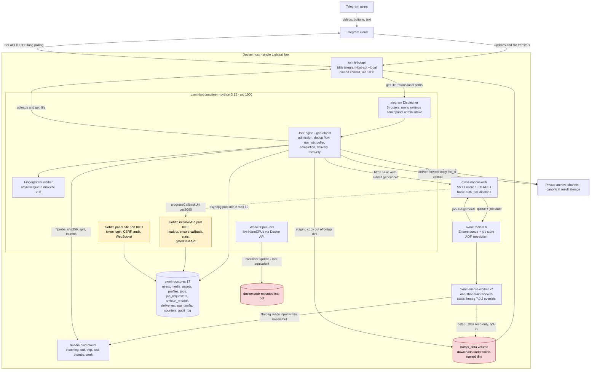
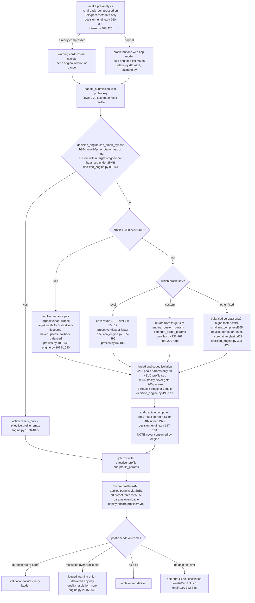
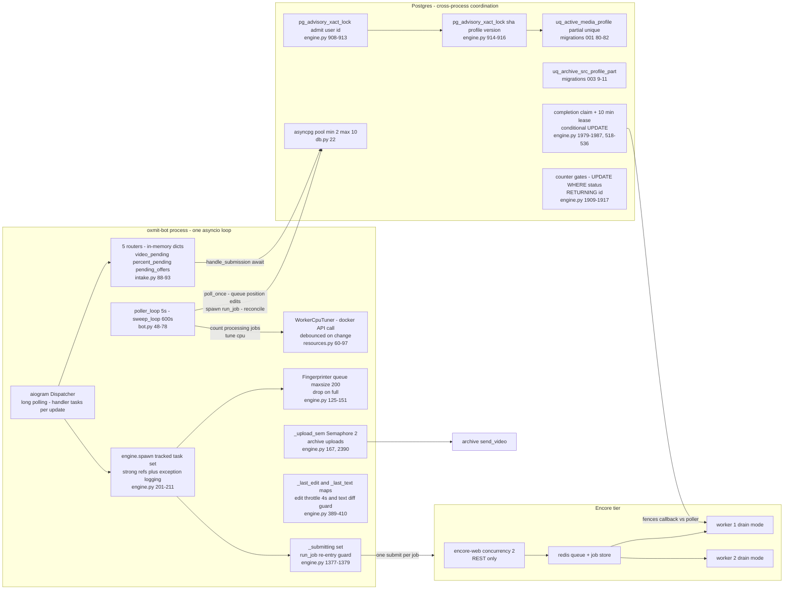
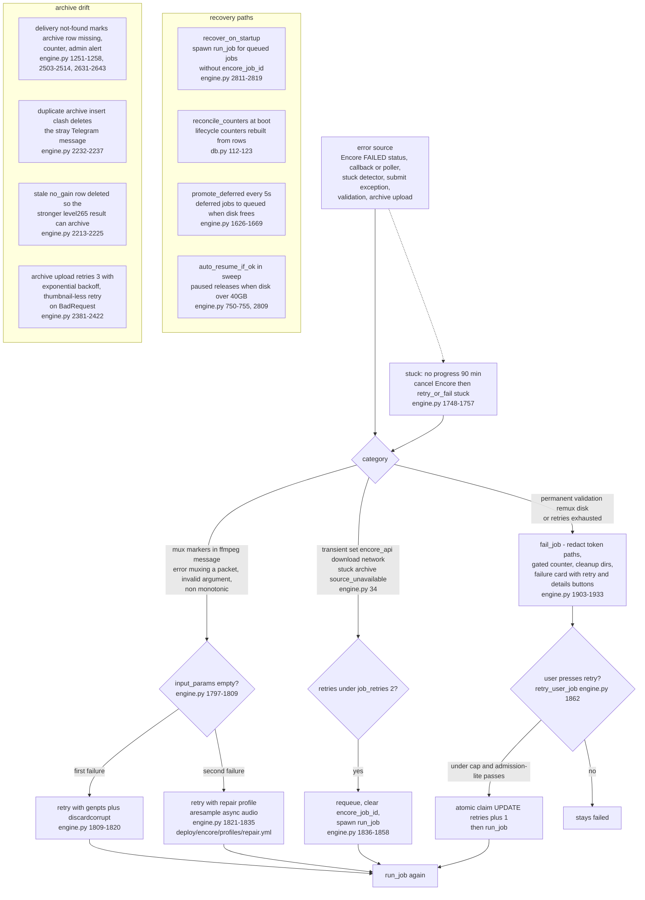

# Oxmit — Actual Architecture (as-built, reconstructed from source)

**Scope.** This document describes what the code *actually does* today, not what the docs claim.
It was reconstructed by reading `bot/oxmit/*.py` (including all 2,837 lines of `engine.py`), the
SQL migrations, `docker-compose.yml`, the Encore profile YAMLs and the deploy Dockerfiles.
All claims carry `file:line` citations into the working tree. Where `README.md` contradicts the
code, the contradiction is called out explicitly in §8.

**One-line summary.** A single-process Python (aiogram 3) Telegram bot that accepts video uploads,
probes/hashes them in place on the Local Bot API volume, deduplicates against an archive of past
results stored in a private Telegram channel, submits encodes to an SVT Encore REST API backed by
drain-mode workers on Redis, then validates, archives, and delivers results back through a
forward → copy → file_id → upload chain — all state is authoritative in PostgreSQL.

---

## 1. System architecture

**Trust boundaries actually present in the code and compose file:**

- **Public port 8090 is a real public boundary.** `docker-compose.yml:188` maps `"8090:8081"`
  with no `127.0.0.1` prefix (unlike `127.0.0.1:8091:8080` on the next line), and the panel site
  binds `0.0.0.0:8081` inside the container (`bot/oxmit/internal_api.py:292`). `.env.example:123`
  confirms intent: `PANEL_PUBLIC_URL=https://YOUR-SERVER-IP:8090/panel`. The panel is protected by
  a shared-token login with per-IP and global lockouts, HMAC-signed session cookies, CSRF on POSTs,
  and an audit log (`bot/oxmit/webpanel.py:415-459, 396-406, 792-808`), but **TLS is optional**: the
  self-signed cert is loaded only if `panel.crt`/`panel.key` exist under `PANEL_CERT_DIR`
  (`internal_api.py:283-291`). Without certs it serves plain HTTP on a public port.
- **docker.sock is mounted into the bot container** (`docker-compose.yml:185`) and used exclusively
  by `WorkerCpuTuner` to post `NanoCPUs` updates to worker containers
  (`bot/oxmit/resources.py:60-97`). Docker socket access is root-equivalent on the host; the bot
  process owning a public-facing Telegram parser holding this socket is the single largest trust
  escalation path in the system.
- **botapi_data volume holds bot-token-bearing paths.** The Local Bot API stores downloads under a
  directory named after the bot token; the code knows this and redacts aggressively
  (`bot/oxmit/media.py:23-34`, `engine.py:369-381`), and `_stage_source` exists specifically so the
  token-bearing path is never handed to Encore, which logs full ffmpeg commands at INFO
  (`engine.py:1441-1445`). Access: bot rw (`docker-compose.yml:183`), workers ro when opted in
  (`docker-compose.yml:115-118`), botapi rw (`docker-compose.yml:154`).
- **Internal API is localhost + docker-network only** (host `127.0.0.1:8091`). The Encore callback
  route is HMAC-SHA256 signed per job with `INTERNAL_SECRET` (`engine.py:1618-1621`,
  `internal_api.py:97-104`); test routes are double-gated behind `ENABLE_TEST_API` plus a literal
  sentinel `ENABLE_TEST_API_CONFIRM=I-UNDERSTAND-THIS-IS-PROD` (`config.py:324-328`,
  `internal_api.py:250-261`).
- **Encore-web is basic-auth protected, API-only** (`ENCORE_SETTINGS_POLL_DISABLED`,
  `ENCORE_SETTINGS_SECURITY_ENABLED`), bound to the internal network plus `127.0.0.1:8080` on the
  host (`docker-compose.yml:63-92`).
- **Postgres is the single source of truth.** Redis is *not* used by the bot for anything except
  health/memory display (`internal_api.py:72-81`, `webpanel.py:755-762`); Redis belongs to Encore
  only. All orchestration state (jobs, dedup, leases, admission, config, counters) lives in
  Postgres via asyncpg (`bot/oxmit/db.py:16-49`).

**Key architectural decisions (§1):**

- Single-process, single-node design: one bot process owns all orchestration; horizontal scaling is
  only in the worker tier (`deploy.replicas`, `docker-compose.yml:124`). Cross-process safety is
  delegated to Postgres (advisory locks, partial unique indexes, conditional `UPDATE ... RETURNING`
  claims) rather than to Redis or an external queue — e.g. `engine.py:908-916`,
  `migrations/001_init.sql:80-82`.
- The Local Bot API server is used as both an API endpoint *and* a filesystem: sources are hashed
  and probed **in place** on `botapi_data` to avoid a duplicate 4GB copy; the code documents the
  measured win (13s vs 33s for 4GB) at `engine.py:760-772`.
- The archive channel is treated as object storage with a DB index over it (`archive_records` with
  `message_id`, `file_unique_id`, permalinks; `migrations/001_init.sql:98-117`). Delivery is a
  degradation chain — forward from archive, copy from archive, resend by `file_id`, fresh local
  upload (`bot/oxmit/archive.py:68-153`).
- Storage reconciliation is handled by *demotion*: when the archive message behind a record
  disappears, the row is demoted to `status='missing'`, a counter is bumped and admins are notified
  (`engine.py:1251-1258`, `2503-2514`, `2631-2643`) rather than any eager re-upload.
- The CPU tuner is a *safety-degrading optimization*: it disables itself silently if the socket or
  SDK is unavailable and falls back to Docker fair-share (`resources.py:39-58`).

---

## 2. Execution lifecycle of one video

```mermaid
flowchart TB
    upd["Telegram update<br/>video or document"] --> gate{"intake gates<br/>blocked? force-sub? tier size and duration?"}
    gate -->|"reject"| rej["localized rejection text"]
    gate -->|"pass"| card["info card from Telegram metadata<br/>plus is_already_compressed pre-check<br/>intake.py 389-426"]
    card -->|"user picks profile<br/>or level 1-20"| hs["engine.handle_submission<br/>engine.py 824"]

    hs --> adm{"check_admission<br/>engine.py 609-681<br/>tier caps, hourly, daily, quota,<br/>queue cap, disk reservation"}
    adm -->|"AdmissionDeferred"| dfrow["job row status deferred<br/>engine.py 1102-1125"]
    adm -->|"reject"| arej["AdmissionError code"]
    adm -->|"pass"| probe["register_media<br/>probe ffprobe + sha256 IN PLACE<br/>engine.py 760-805"]
    dfrow --> promote["poller promote_deferred every 5s<br/>engine.py 1626-1669"]
    promote --> rj

    probe --> dedup{"dedup ladder inside one tx<br/>under advisory locks<br/>engine.py 903-1064"}
    dedup -->|"exact sha + profile parts"| offer1{"cache_offer enabled<br/>and allow_reuse?"}
    dedup -->|"fuzzy size 2pct name duration 2s<br/>custom and level only"| offer1
    dedup -->|"similar 8-frame ahash<br/>against archived sources"| offer1
    offer1 -->|"yes"| offer["outcome offer card<br/>use cached / other profile / cancel<br/>engine.py 1180-1195"]
    offer -->|"accept"| reuse["deliver_cached_offer<br/>re-queries archive<br/>engine.py 1197-1220"]
    offer -->|"decline"| fresh["resubmit allow_reuse False<br/>intake.py 800"]
    offer1 -->|"no cached result"| noresult{"any other profile has<br/>a cached version?"}
    noresult -->|"yes"| offer
    noresult -->|"no"| inflight{"in-flight job for same<br/>source profile version?"}
    inflight -->|"yes"| join["join job - insert job_requesters<br/>engine.py 1020-1038"]
    inflight -->|"no"| nogain{"prior no_gain archived<br/>for this source and profile?"}
    nogain -->|"yes"| esc265["insert job as level265 directly<br/>CRF plus 5<br/>engine.py 952-993"]
    nogain -->|"no"| decision["decision_engine.make_decision<br/>engine.py 1067-1088<br/>bypass, variant, params"]
    decision --> insert["INSERT jobs queued<br/>priority 70 admin else tier<br/>engine.py 1090-1109"]
    insert --> rj["spawn run_job<br/>engine.py 1376"]

    rj --> srcok{"source still on disk?<br/>engine.py 1397-1408"}
    srcok -->|"gone"| refetch["_refetch_source via get_file<br/>engine.py 1536-1562"]
    refetch -->|"gone"| deg["_derivative_fallback<br/>encode from best archived derivative,<br/>source_degraded flagged<br/>engine.py 1564-1616"]
    deg -->|"none"| fail["fail_job source_unavailable"]
    srcok -->|"ok"| disk{"disk reservation recheck<br/>engine.py 1410-1439"}
    disk -->|"short"| defer2["status deferred again"]
    disk -->|"ok"| stage["_stage_source<br/>hardlink or chunked copy with progress<br/>token-free /media path<br/>engine.py 1321-1374"]
    stage --> isremux{"effective_profile remux?"}
    isremux -->|"yes"| remux["ffmpeg -c copy in bot<br/>no Encore job<br/>engine.py 1459-1482"]
    isremux -->|"no"| submit["Encore submit<br/>segmentLength only if enabled and<br/>900s and profile not repair custom level<br/>engine.py 1493-1510"]
    submit --> claim["claim encore_job_id<br/>conditional UPDATE engine.py 1514-1521"]
    remux --> complete
    claim --> progress["callback edits progress in DB<br/>poller reconciles every 5s<br/>reconcile_job engine.py 1729-1768"]
    progress -->|"SUCCESSFUL"| complete["complete_job engine.py 1971<br/>atomic claim stage completing<br/>plus 10 min lease renewal"]
    progress -->|"FAILED"| ladder["_retry_or_fail ladder<br/>engine.py 1795"]
    progress -->|"no progress 90 min"| stuck["cancel Encore job then ladder<br/>engine.py 1748-1757"]
    stuck --> ladder
    complete --> oprobe["probe output, duration ratio<br/>0.85-1.15 else validation failure<br/>engine.py 2026-2039"]
    oprobe --> nogain2{"output >= source x 0.98<br/>and profile not remux?"}
    nogain2 -->|"yes and level"| esc["escalate to level265 once<br/>engine.py 322-348, 2085-2090"]
    nogain2 -->|"yes other profile"| ng["archive row status no_gain<br/>deliver the original source<br/>engine.py 2118-2170"]
    nogain2 -->|"no"| size{"output over 2000MB?"}
    size -->|"yes"| split["_complete_split<br/>keyframe segment into parts,<br/>idempotent per part_index<br/>engine.py 2264-2379"]
    size -->|"no"| arc["upload to archive channel<br/>semaphore 2, backoff retries 3<br/>engine.py 2381-2422"]
    esc --> rj2["requeue and run_job again"]
    arc --> insrow["archive_records row + output media_assets<br/>dedupe clash deletes stray upload<br/>engine.py 2198-2239"]
    split --> deliver
    insrow --> deliver["deliver to every job_requester<br/>forward - copy - file_id - upload<br/>archive.py 68-153<br/>summary card per user"]
    reuse --> done["deliveries row + counters"]
    deliver --> cleanup["cleanup job dirs<br/>keep output only if blocked<br/>engine.py 2763-2774"]
    ng --> deliver
    done --> cleanup
    fail --> fmark["status failed, counter gated on<br/>state transition, cleanup, retry button<br/>engine.py 1903-1933"]
```

**Key decisions (§2):**

- **Admission runs twice by design.** A cheap UX-only pass outside any lock (`check_admission`,
  `engine.py:609-681`), then an in-transaction recheck under a per-user advisory lock against the
  same transaction that inserts the job row (`_recheck_user_admission`, `engine.py:695-738`,
  locks at `engine.py:908-913`) to close the TOCTOU the comment openly admits (F9).
- **Disk admission is reservation-based, not just free-space based**: need = `source × 2.2 + 5GiB`
  floor, minus bytes already reserved by queued/processing jobs (`engine.py:666-681`,
  `config.py:118`). Jobs that cannot fit are **deferred**, not rejected (`AdmissionDeferred`,
  `engine.py:56-63, 675-676`), and the 5s poller promotes them FIFO with per-user cap re-checks
  (`promote_deferred`, `engine.py:1626-1669`).
- **Dedup is a four-layer ladder inside one transaction** under two advisory locks
  (`engine.py:903-1064`): exact sha+profile (`dedup.py:16-46`), fuzzy (size ±2% + normalized name +
  duration ±2s, only for `custom`/`level`, `dedup.py:96-138`, gated at `engine.py:922`), perceptual
  similarity (8×8 ahash × 8 frames, conservative thresholds, audio-stream identity must match,
  `dedup.py:205-272`, `media.py:234-280`), then in-flight join backed by the partial unique index
  `uq_active_media_profile` (`migrations/001_init.sql:80-82`).
- **The cache-offer flow (newest layer) replaces silent reuse**: when any cached version exists the
  user gets an interactive card (use cached / pick a strictly-lower profile / cancel) instead of an
  automatic delivery; declining resubmits with `allow_reuse=False` and the code explicitly refuses
  to silently reuse after an explicit no (`engine.py:994-1019`, `intake.py:680-800`); acceptance
  re-queries the archive parts because they may have been invalidated between offer and click
  (`deliver_cached_offer`, `engine.py:1197-1220`).
- **Sources live on the botapi volume and are staged, not trusted**: `_stage_source` hardlinks, and
  on cross-device failure copies to a `.part` sibling, verifies size and `os.replace`s
  (`engine.py:1321-1374`); a truncated stale file is re-copied (F4 fix, `engine.py:1336-1341`).
- **The remux fastpath never touches Encore** — ffmpeg `-c copy` into MP4 faststart runs inside the
  bot container, then reuses the normal completion pipeline (`engine.py:1459-1482`,
  `media.py:325-349`). Eligibility is codec/container checked at submission
  (`media.py:307-322`, `engine.py:889-890`).
- **Completion is claimed, fenced, and proven**: an atomic `UPDATE ... WHERE stage <> 'completing'
  OR updated_at older than 10 minutes` claim prevents the callback/poller double-run that used to
  delete part files under each other (`engine.py:1975-1987`); a lease heartbeat is re-proven before
  every long await including each split-part upload (`engine.py:518-536`, `2021`, `2060`, `2175`,
  `2281`, `2323`); the output is ffprobe-validated and its duration must be within ±15% of the
  source (`engine.py:2025-2039`).
- **No-gain is a delivery policy, not an error**: output ≥ `source × 0.98` (threshold
  `config.py:115`) marks the archive row `no_gain`, stores the *source* as the output asset and
  delivers the original back with an explanation — skipping the futile upload when the source
  itself exceeds the 2000MB delivery limit (`engine.py:2082-2084, 2118-2170, 2586-2607`).
- **Oversized outputs are split at keyframes into independently playable parts** with idempotent
  per-part archive rows (`part_index`/`part_total`/`split_of`, `migrations/003_split_parts.sql`,
  `engine.py:2264-2379`), and each part upload renews the completion lease first.
- **Delivery is per-requester fan-out** (`job_requesters` table — in-flight joiners also get the
  result), written to `deliveries` with method + status, plus a redeliver button on failure
  (`engine.py:2525-2670`, `2662-2666`).

---

## 3. Video processing pipeline — decision points

**Key decisions (§3):**

- **There are two independent "already compressed" detectors with different data quality.** The
  intake card runs `is_already_compressed` on *Telegram metadata only* (bitrate approximated from
  size/duration, `intake.py:407-414`) and routes to the rostam/remux warning card; the real
  post-probe decision happens later in `make_decision`. The two can disagree.
- **The smart-bypass fastpath is the only route to `remux` for normal users**, decided by
  `can_smart_bypass` (h264, yuv420p, no rotation, AAC/MP3 audio, and either a custom target already
  met or tgcompat/balanced with ≤25MB source, `decision_engine.py:88-144`). `remux_compatible`
  separately gates remux eligibility at submission (`media.py:307-322`).
- **Never-upscale is enforced in three separate places** that must stay consistent:
  `resolve_variant` (requires *both* target width and short side to fit, `profiles.py:108-130`),
  `quality.effective_short_side`/`allowed_profiles` (offer grid after a declined cache,
  `quality.py:114-155`), and the degraded-source fallback which recomputes the effective profile
  from the derivative's real dims (`engine.py:1601-1609`).
- **Profile params reach Encore through SpEL**: the YAML profiles reference
  `#{profileParams['crf'] ?: '22'}` so the bot's `profileParams` (crf, preset, threads,
  x265-params, bv) override the defaults (`deploy/encore/profiles/balanced.yml:11-13`,
  `small.yml:11-14`, `level.yml:11-12`). Scaling profiles (r1080/r720/r480) ignore profileParams
  entirely — resolution comes from the fixed `width` in YAML (`r720.yml:7`).
- **Codec isolation is explicit**: HEVC profiles get `x265-params` pool tuning sized by
  `active_jobs`; the code pops `x265-params` from anything outside `HEVC_PROFILES` with the comment
  "x264 MUST NEVER receive x265 parameters" (`decision_engine.py:28-35, 493-511`).
- **Level→CRF mapping is duplicated with drifting constants**: `profiles.preset_for_level` switches
  presets at level ≤6 (`profiles.py:97-105`) while `decision_engine.make_decision` switches at
  level ≤8 (`decision_engine.py:390`); since `make_decision` runs second and overwrites
  `profile_params` (`engine.py:1085-1088`), its ladder wins, and the estimate text shown to the
  user can be computed with the other preset (`engine.py:1153-1159`).

---

## 4. Async and concurrency model

**Concurrency inventory (load-bearing mechanisms):**

| Mechanism | Scope | Where | Protects |
|---|---|---|---|
| `pg_advisory_xact_lock(hashtext("admit:{tg_id}"))` | tx, per-user | `engine.py:908-913` | serializes a user's concurrent submissions so the in-tx cap recheck cannot race (F9) |
| `pg_advisory_xact_lock(hashtext("{sha}:{profile}:v{version}"))` | tx, per dedup key | `engine.py:902, 914-916` | two identical submissions cannot both pass the in-flight SELECT then insert |
| `uq_active_media_profile` partial unique index | DB, cross-process | `migrations/001_init.sql:80-82` | last-resort guard: one active encode per (media, profile, version) |
| `uq_archive_src_profile_part` partial unique index | DB | `migrations/003_split_parts.sql:9-11` | one reusable result per (source, profile, version, part) |
| Completion claim + 10-min stale lease | row state | `engine.py:1979-1987`; renewal `engine.py:518-536` | callback vs poller double-completion (observed FileNotFoundError on part files) |
| Conditional `UPDATE ... WHERE status IN (...) RETURNING id` | row state | `engine.py:1909-1917`, `1936-1943`, `2154-2160`, `2240-2247` | lifecycle counters and terminal-state transitions are gated on actually winning the transition |
| Atomic retry claim | row state | `engine.py:1891-1899` | concurrent retry-button presses cannot bypass the retry cap |
| `_upload_sem = Semaphore(max_concurrent_uploads=2)` | process-local | `engine.py:167`, `2390` | bounds concurrent archive uploads (flood protection) |
| `_submitting` set | process-local | `engine.py:162, 1377-1379` | poller and callback do not double-submit the same job to Encore |
| Fingerprinter `asyncio.Queue(maxsize=200)` + drop-on-full | process-local | `engine.py:125-131` | perceptual hashing (8 ffmpeg seeks per file) cannot back up submission |
| Edit throttle (4s per card + text-diff guard) | process-local, dicts capped at 5000 | `engine.py:389-410` | collapses duplicate queued/progress edits from overlapping poll/callback paths; guards Telegram 429s |
| `asyncpg` pool min 2 max 10 | process | `db.py:22` | single pool shared by dispatcher, loops, panel, internal API |

**Key decisions (§4):**

- **Everything async is single-process; everything cross-process is a Postgres row update.** There
  is no message queue between bot and Encore submissions beyond Encore's own Redis queue; the bot's
  poller (`bot.py:48-65`, 5s interval) both drives submissions (`spawn(run_job)` for any queued job
  without `encore_job_id`, `engine.py:1682-1703`) and reconciles progress, so a lost callback never
  loses a job.
- **The poller is also the UI updater**: for queued jobs it computes a live queue position and edits
  the status card every cycle (throttled to 4s), for processing jobs it broadcasts progress to *all*
  requesters (`engine.py:1684-1700`, `_broadcast_progress` `1776-1793`). With 50 queued jobs this
  is a steady ~10 edit calls/s toward Telegram.
- **Encore workers are one-shot drain containers**: they process the Redis queue until empty and
  exit; Docker's restart policy relaunches them (`docker-compose.yml:94-130`). Scaling = replicas.
  The bot tunes their CPU quota live (1 job → 7 cores, 2 jobs → 3.2 each, floor 2.0,
  `config.py:88-91`, `resources.py:23-29`).
- **In-process handler state is in-memory dicts** (`intake.py:88-93`): pending media picks, level
  prompts and cache offers live only in RAM, capped at ~5000 entries with ad-hoc pruning
  (`intake.py:246-250`). A bot restart loses them (acceptable: the user just re-taps).
- **Startup reconciliation closes the crash window**: `recover_on_startup` re-spawns `run_job` for
  jobs without an Encore id; jobs *with* an Encore id are deliberately left to the poller to
  reconcile (`engine.py:2811-2819`), and lifecycle counters are rebuilt from row state at boot
  (`db.py:112-123`, called at `bot.py:102-105`).

---

## 5. Error handling and recovery

**Key decisions (§5):**

- **Exception categories are a closed set** (`TRANSIENT_CATEGORIES`, `engine.py:34`) plus the mux
  markers (`engine.py:35`). Transient classes retry up to `JOB_RETRIES=2`; everything else fails on
  first occurrence. The mux-error ladder is deliberately a *two-stage repair*, not a retry: first
  `genpts+discardcorrupt` input params, then the `repair` profile with async audio resampling —
  and "Nothing was encoded" failures are explicitly excluded from the ladder because genpts cannot
  fix an empty stream (`engine.py:1797-1806`).
- **User-facing retry is a separate, more generous path**: `retry_user_job` allows up to
  `job_retries + 2`, re-checks fairness caps (admission-lite), and uses a single conditional UPDATE
  as the claim so concurrent button presses cannot race (`engine.py:1862-1901`). Admin `/retry`
  (`handlers/admin.py:24-48`) and panel retry (`webpanel.py:609-619`) reset retries to 0 outright.
- **Stuck-job detection is progress-based, not time-based on the whole job**: the cancel triggers
  when `progress_changed_at` goes stale for 90 minutes *while IN_PROGRESS*; the tuner's activity
  counting uses the same column (`bot.py:53-62`), so only real encoder progress refreshes it.
- **Recovery is idempotent by construction**: startup re-runs `run_job` only for jobs that never
  reached Encore (id protected by `_submitting` and the `encore_job_id IS NULL` claim,
  `engine.py:1394-1395, 1514-1521`); everything else is reconciled by polling Encore's own state.
- **Token hygiene in the error path**: `fail_job` runs `media_mod.redact` over the detail before
  persisting (`engine.py:1906`, `media.py:27-34`), and a manual SQL scrub exists for historic rows
  (`scripts/scrub_token.sql` — but see §7: it does not cover `jobs.source_path`).
- **Counter integrity**: event counters are bumped only inside a *won* state transition, and the
  two classes of counters (row-state reconstructible vs event counters) are explicitly separated in
  `db.py:96-110` and `scripts/reconcile_counters.sql`.

---

## 6. Unnecessary complexity found

1. **`engine.py` is a 2,837-line god object.** `JobEngine` holds admission, dedup flow, staging,
   Encore submission, polling, completion, splitting, archiving, delivery, redelivery, retry policy,
   progress rendering, thumbnailing, admin management and recovery. Roughly 320 lines of that
   (delivery: `_summary_text`/`_deliver_parts`/`_deliver_to_requesters`/`_deliver_archive_to`/
   `redeliver`, `engine.py:2441-2758`) have a clean interface already (rows in → Telegram sends out)
   and could be a separate module with no behavior change.
2. **`decision_engine` computes results the engine never consumes.** `make_decision` returns
   `scale_filter`, `target_width`, `target_height`, `audio_action`, `content_category`
   (`decision_engine.py:513-524`), but `handle_submission` reads only `action`, `effective_profile`,
   `profile_params`, `two_pass` (`engine.py:1076-1088`). The advertised "adaptive resolution
   downscaling" (4K→1080p etc., `decision_engine.py:167-207`) and audio stream-copy decisions are
   **never applied** — `encore_client.submit_job` has no field to carry a scale filter
   (`encore_client.py:48-77`). This is dead code wearing a feature flag (`ADAPTIVE_RESOLUTION_ENABLED`,
   `config.py:122`).
3. **The `custom_2pass` path is unreachable.** `make_decision` hard-codes `two_pass = False`
   (`decision_engine.py:371-372`, "Owner mandate: SPEED IS VERY IMPORTANT"), and the only branch
   that produces `custom_2pass` requires `dec.two_pass` (`engine.py:1081-1084`). The profile, its
   YAML (`deploy/encore/profiles/custom_2pass.yml`) and `ESTIMATE_PARAMS` entries are dead weight.
4. **Custom-target bitrate is computed twice with different rules**: `engine._custom_params` via
   `compute_target_params` (floor 200 kbps, audio 96 kbps, bad_target rejection, `profiles.py:133-161`,
   `engine.py:807-822`) vs the decision-engine custom branch (floor 150, audio 48/64 kbps,
   educational downscale, `decision_engine.py:348-382`). Only the first survives (the second needs
   `two_pass`), yet both run on every custom submission.
5. **Level preset ladder inconsistency** (see §3): preset switch at level ≤6 vs ≤8 in two modules;
   the user-visible estimate can be computed with a different preset than the one encoded with
   (`engine.py:1153-1159` vs `decision_engine.py:390`).
6. **The web panel is mounted on both HTTP sites.** `webpanel.setup()` is registered on the internal
   app *and* the public panel app (`internal_api.py:48` and `internal_api.py:280`), so the full
   panel is also reachable on the localhost-only 8091 port. Harmless (same token gate) but two
   copies of session stores, lockouts and routes.
7. **Poller-driven UI updates put chat editing in the hot loop.** Queue-position edits for every
   queued job on every 5s tick (`engine.py:1684-1700`) plus progress broadcasts are Telegram API
   load driven by the DB poller rather than by events; the edit throttle mitigates but does not
   remove it.
8. **Source mojibake**: several user-visible strings were corrupted at some point — e.g. admin
   command descriptions are literally `"????????"` in `engine.py:257-262` and the auto-pause admin
   alert in `engine.py:745-748` begins with `??????`.
9. **`workers_read_botapi` config flag is defined but never read by Python** (`config.py:114, 305`;
   no other reference) — the actual behavior is decided purely by the compose mount
   (`docker-compose.yml:115-118`).
10. **`estimate.py` bpp heuristics are implemented twice**: the module itself, and the inline
    estimate math re-derived in `intake.on_media` (`intake.py:428-447`) for the button labels.

## 7. Dangerous dependencies and one-way trusts

- **docker.sock in the bot container** (`docker-compose.yml:185` → `resources.py:52, 74-91`).
  Any code-execution bug in the bot (which parses untrusted Telegram input and serves a public
  panel) becomes host root. The tuner is a nice-to-have; it already degrades gracefully without the
  socket. This is the highest-value boundary to remove.
- **Bot token embedded in filesystem paths.** Local Bot API downloads live under
  `/var/lib/telegram-bot-api/bot<token>/...`. The code knows and redacts for *logs and error text*
  (`media.py:23-34`, `engine.py:369-381`), but **`jobs.source_path` persists the raw resolved path**
  for fresh botapi submissions (`engine.py:857-869` resolves it, `engine.py:1090-1103` stores it)
  and `scripts/scrub_token.sql` scrubs only `jobs.error_message` and `deliveries.error` — not
  `jobs.source_path`. Anyone with DB read access (backups included, `scripts/backup.sh`) gets the
  bot token.
- **Public panel port 8090 with optional TLS.** Token + rate-limit + CSRF is a reasonable gate, but
  without certs it is plain HTTP on the internet (`internal_api.py:283-295`,
  `docker-compose.yml:188`, `.env.example:123`). Session cookies carry `Secure=SECURE_COOKIES`
  default-on (`.env.example:105-108`), which mitigates but does not encrypt the token POST itself.
- **One-way trust: bot → archive channel.** The archive channel is the canonical store; its messages
  are treated as permanent, with only passive detection of loss (demotion to `missing`,
  `engine.py:2503-2514`). There is no backup of the archive, and no re-upload of missing records —
  channel deletion or admin error is silent data loss modulo the `archive_missing_detected` counter.
- **One-way trust: Encore → bot callback.** The callback carries only `job` + HMAC sig
  (`engine.py:1618-1621`, `internal_api.py:102-104`) — good — but it is mounted on the same server
  as the *unauthenticated* `healthz` and the panel; a leaked `INTERNAL_SECRET` allows forging
  SUCCESSFUL completions. Acceptable within the internal network, but the surface grows if 8090/8091
  routes ever merge.
- **`botapi_data` shared three ways** (botapi rw, bot rw, worker ro opt-in, `docker-compose.yml:115-118,
  154, 183`). The worker mount in particular means any worker-side ffmpeg path traversal or config
  injection reads the token directory tree.
- **Static ffmpeg override mounted into workers** (`deploy/wrapper/ffmpeg`, 79MB binary,
  `docker-compose.yml:111-114`): a pinned binary chosen to tolerate damaged sources; it silently
  replaces the worker image's ffmpeg on every worker start.

## 8. README vs code — contradictions and verifications

**Contradictions (docs wrong or stale):**

1. **"Read-only dashboard"** (`README.md:129`) — false. The panel mutates state: cancel/retry/
   redeliver jobs (`webpanel.py:594-633`), ban/VIP/admin promote/message/limits per user
   (`webpanel.py:635-707`), pause/resume/cleanup system actions (`webpanel.py:709-735`). The panel's
   own route table calls itself "manage+audit" (`webpanel.py:809`).
2. **"`http://127.0.0.1:8090/panel` (localhost-only like the rest of the stack)"** (`README.md:116`)
   — false. Port 8090 is bound on all interfaces (`docker-compose.yml:188`), the site binds
   `0.0.0.0:8081` (`internal_api.py:292`), and `.env.example:123` hands out a public URL. The bot
   code's own log line "localhost only" (`webpanel.py:809`) is equally stale.
3. **"Runs as root so downloaded files stay world-readable"** (`docker-compose.yml:144` comment about
   the botapi container) — false. The Dockerfile creates uid 1000 and sets `USER 1000` with
   `umask 022` (`deploy/telegram-bot-api/Dockerfile:21-30`); the bot container also runs as uid 1000
   (`bot/Dockerfile:9-10`). The files are owner/uid-1000 readable, not root-owned world-readable.

**Verified as accurate (sample):**

- Delivery chain "forward → copy → file_id" (`README.md:21`) = `archive.deliver_result`
  (`archive.py:91-152`).
- Dedup layers 1-4 incl. fuzzy "±2s ... only for level and custom" and similarity "8×8 ahash, 8
  frames" (`README.md:143-152`) = `engine.py:917-1038`, `dedup.py:96-192`, `media.py:234-280`.
- In-flight "advisory lock + partial unique index, cross-process safe" (`README.md:149-150`) =
  `engine.py:902-916` + `migrations/001_init.sql:80-82`.
- Tier seed values (`README.md:137-139`) and VIP queue priority 60 vs 50 (`README.md:103`) =
  `engine.py:596-604`, `config.py:140-158`.
- Limits: 2000MB delivery cap, 50 queued jobs, disk guards 40GB/20GB (`README.md:135-141`) =
  `config.py:66, 79-81` + `engine.py:663-681`.
- Level 1-20 → CRF 18-28 (`README.md:86`) = `profiles.py:86-94` and `level.yml`.
- First `/start` claims admin when `ADMIN_TELEGRAM_IDS` empty (`README.md:51`) = `menu.py:29-35`.
- Panel token gate "`empty = panel disabled`" (`README.md:117-118`) = `webpanel.py:352-355`.
- Force-sub 5-minute cache (`README.md:112`) = `forcesub.py:21`.
- WebSocket push ~3s (`README.md:130`) = `ws_handler` 3s receive timeout loop (`webpanel.py:773-787`).

## 9. Proposed target architecture (incremental, no rewrite)

Ordered by risk-reduction per unit of effort. All are additive refactors of the running system.

1. **Tighten the panel boundary: make TLS mandatory, and align the docs on 8090 being public**
   — **Effort: S.** Refuse to start the panel site without certs when the port is published
   publicly (or fall back to binding `127.0.0.1:8081` in that case), matching the README instead of
   the other way around. Files: `internal_api.py:273-296`, `docker-compose.yml:186-188`.
2. **Stop persisting the token-bearing path; scrub what is already stored** — **Effort: S.** Store
   the *staged* `/media` path (or just `media_id` + a boolean "on botapi volume") in
   `jobs.source_path`; extend `scripts/scrub_token.sql` to rewrite `jobs.source_path` rows. The
   staging logic (`engine.py:1321-1374`) already produces the token-free path a few lines later —
   this only removes the leak window.
3. **Split delivery out of `JobEngine`** — **Effort: M.** Move
   `_deliver_parts`, `_deliver_to_requesters`, `_deliver_archive_to`, `redeliver`, `_summary_text`
   (~320 lines, `engine.py:2441-2758`) into `delivery.py` taking `(db, bot, state, cfg)`. Zero
   behavior change; it is the cleanest seam in the file and shrinks the god object by ~12%.
4. **Delete or wire the dead decision-engine outputs** — **Effort: S.** Either remove
   `scale_filter`/`target_w/h`/`audio_action`/`content_category` and the `ADAPTIVE_*` flags, or
   actually pass scale/filter through a new Encore profile param. Keeping both the code and the
   illusion of the feature is the worst option (`decision_engine.py:167-207, 513-524`,
   `config.py:121-127`).
5. **Unify the level→CRF/preset ladder and the custom bitrate math** — **Effort: S.** Make
   `profiles.py` the single source (it is already pure and unit-tested) and have
   `decision_engine.make_decision` call it instead of re-deriving constants
   (`profiles.py:86-105` vs `decision_engine.py:348-396`).
6. **Replace docker.sock tuning with a sidecar or drop it** — **Effort: M.** Move `WorkerCpuTuner`
   into a tiny dedicated container with its *own* socket access (or a Docker API proxy scoped to
   `containers/update`), so the bot no longer holds root-equivalent access; or simply delete the
   tuner and keep the static 7.0/3.2 compose caps, which the compose file already sets
   (`docker-compose.yml:125-130`, `resources.py:32-97`). Given the tuner debounces on change and
   only ever touches two named containers, a scoped proxy is an afternoon of work.
7. **Extract a completion/pipeline module** — **Effort: M.** `complete_job`, `_complete_split`,
   `_archive_upload`, `_touch_completion_lease` (~450 lines) into `completion.py` with the lease
   handling as an explicit context manager (renew on entry of every await). This is where the
   subtlest bugs live (the double-completion and part-file races, `engine.py:1975-1987`), and it
   deserves its own tests rather than sharing a 2,800-line test surface.
8. **Make the panel a separate deployment unit** — **Effort: L.** Long-term, run the panel as its
   own small service (read-only DB user + a narrow command queue in Postgres) so the public internet
   surface no longer shares a process, a logger, and in-memory session state with the Telegram
   parser. This also lets the bot drop the second aiohttp site entirely. Postgres-backed command
   rows already match the existing pattern (`audit_log`, `app_config`) so no new infrastructure is
   needed.
9. **Move delivery failure handling off the critical path** — **Effort: M.** Delivery currently
   happens inline inside `complete_job`; a crash mid-delivery is absorbed by `redeliver` buttons,
   which works, but moving fan-out delivery into a spawned task with a `deliveries`-driven retry
   sweep (the 600s sweep already exists, `bot.py:68-78`) would bound completion latency by upload
   time and make retries automatic instead of user-driven.

**Explicitly not recommended:** introducing Redis as bot state (Postgres rows + advisory locks are
working and well-tested here), containerizing the bot into multiple replicas (single-writer is what
makes the partial unique index and lease design sound), or replacing the archive channel with S3
(the forward/copy/file_id delivery chain and `reuse_count` economics are built around it).

---

### Appendix A — load-bearing claims index (file:line)

| # | Claim | Evidence |
|---|---|---|
| 1 | Poller interval 5s; sweep 600s; fingerprinter task | `bot/oxmit/bot.py:48-78, 151-155` |
| 2 | Fingerprint queue maxsize 200, drop on full | `bot/oxmit/engine.py:125-131` |
| 3 | In-place probe + SHA-256 of botapi source | `bot/oxmit/engine.py:760-805` |
| 4 | Per-user + dedup-key advisory locks | `bot/oxmit/engine.py:902-916` |
| 5 | Four dedup layers incl. cache offer + in-flight join | `bot/oxmit/engine.py:917-1064` |
| 6 | Job insert (deferred vs queued, admin priority 70) | `bot/oxmit/engine.py:1090-1109` |
| 7 | Token-free staging with hardlink/copy fallback | `bot/oxmit/engine.py:1321-1374` |
| 8 | Remux fastpath bypasses Encore | `bot/oxmit/engine.py:1459-1482` |
| 9 | Segment option gate (off by default) | `bot/oxmit/engine.py:1493-1498`, `config.py:111-113` |
| 10 | Mux-error two-stage repair ladder | `bot/oxmit/engine.py:1797-1835` |
| 11 | Completion claim + 10-min lease + per-await renewal | `bot/oxmit/engine.py:518-536, 1979-1987` |
| 12 | Duration-ratio validation ±15% | `bot/oxmit/engine.py:2025-2039` |
| 13 | no_gain threshold 0.98 and original-redelivery | `config.py:115`, `engine.py:2082-2084, 2586-2607` |
| 14 | Split parts idempotent via part_index unique index | `migrations/003_split_parts.sql:9-11`, `engine.py:2264-2379` |
| 15 | Upload semaphore 2 + 3-attempt backoff | `engine.py:167, 2381-2422` |
| 16 | Archive-missing demotion + admin alert | `engine.py:1251-1258, 2503-2514` |
| 17 | Counter reconciliation at boot | `bot/oxmit/db.py:112-123`, `bot.py:102-105` |
| 18 | Panel is public on 8090, TLS optional | `docker-compose.yml:186-188`, `internal_api.py:273-296` |
| 19 | docker.sock used only by CPU tuner | `docker-compose.yml:185`, `resources.py:60-97` |
| 20 | Callback HMAC + double-gated test API | `engine.py:1618-1621`, `internal_api.py:97-104, 250-261`, `config.py:324-328` |
| 21 | profilesParams reach Encore via SpEL | `deploy/encore/profiles/balanced.yml:11-13`, `encore_client.py:62-77` |
| 22 | Decision-engine scale/audio outputs never consumed | `engine.py:1076-1088` vs `decision_engine.py:513-524` |
| 23 | `jobs.source_path` may hold token-bearing path | `engine.py:857-869, 1090-1103`, `media.py:23-34`, `scripts/scrub_token.sql` |
| 24 | Startup recovery + deferral promotion | `engine.py:2811-2819, 1626-1669` |
