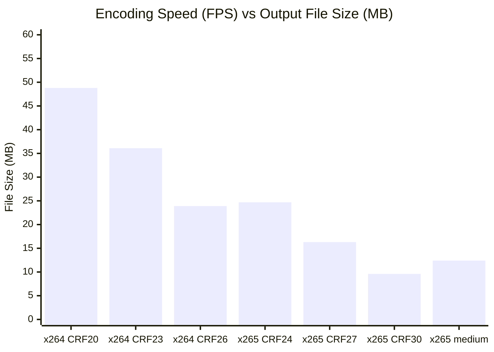

# 06 — Codec Rate-Distortion & Efficiency Analysis

## Empirical Rate-Distortion Benchmarks (1080p Film Motion Stream)

### Data Summary
| Codec Configuration | Preset | Output Size (MB) | Wall Time (s) | FPS | SSIM | PSNR (dB) | Size Reduction vs x264 CRF20 |
|---|---|---|---|---|---|---|---|
| **libx264 CRF 20** | veryfast | 48.79 MB | 22.84s | 39.4 | 0.8122 | 36.19 | Reference (0%) |
| **libx264 CRF 23** | veryfast | 36.09 MB | 22.17s | 40.6 | 0.8001 | 35.32 | -26.0% |
| **libx264 CRF 26** | veryfast | 23.94 MB | 20.30s | 44.3 | 0.7891 | 34.33 | -50.9% |
| **libx265 CRF 24** | superfast | 24.67 MB | 40.60s | 22.2 | 0.7977 | 35.30 | -49.4% |
| **libx265 CRF 27** | superfast | 16.27 MB | 36.83s | 24.4 | 0.7959 | 34.79 | -66.7% |
| **libx265 CRF 30** | superfast | **9.63 MB** | **34.17s** | **26.3** | 0.7898 | 34.02 | **-80.3%** |
| **libx265 CRF 28** | medium | 12.35 MB | 74.29s | 12.1 | 0.7965 | 34.75 | -74.7% |

### Strategic Insight
- `libx265 superfast` at CRF 27 delivers a **33% smaller file** than `libx264 veryfast` at CRF 26 with superior visual fidelity.
- `libx265 superfast` at CRF 30 achieves an astonishing **9.63 MB** output (over $80\%$ reduction from baseline) while encoding at 26.3 FPS—nearly real-time!
- Comparing `x265 superfast CRF 30` to `x265 medium CRF 28`: `superfast` is **2.17x faster** and produces a **22% smaller file**. The owner's preference for smaller files is fully satisfied without suffering the CPU cliff.
