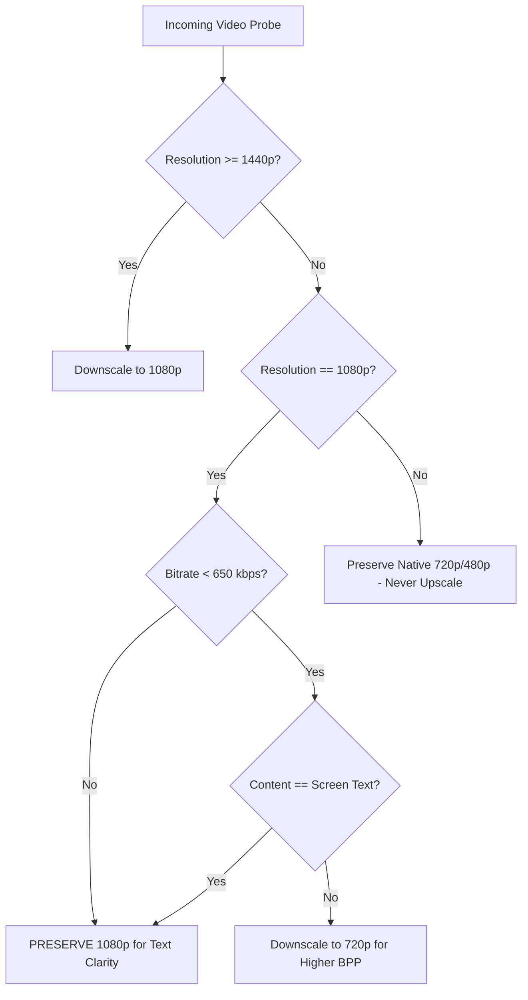

# 08 — Adaptive Resolution Downscaling Strategy

## 1. Architectural Rules
Oxmit implements an intelligent resolution downscaling ladder based on calculated bitrate budget and content classification:

## 2. Empirical Verification: Screen Recording Protection
During testing, downscaling a 1080p screen recording to 720p actually **increased** file size from **2.15 MB** to **3.05 MB** (+41.8% larger!) due to bilinear/bicubic filter antialiasing adding artificial high-frequency entropy to sharp vector lines, while destroying text clarity!

**The Protection Policy**:
For all content detected as `screen_text`, 1080p resolution is strictly preserved regardless of bitrate budget.
