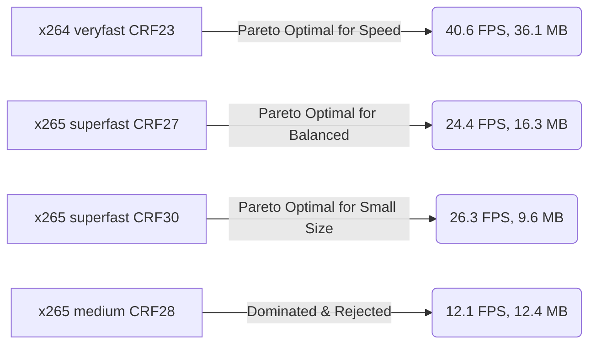

# 14 — Pareto Frontier Analysis: Size vs Speed vs Quality

## Pareto Optimality Analysis
A configuration is **Pareto optimal** if no other configuration can achieve smaller file size without sacrificing speed or perceptual quality.

### The Dominated Zone (Eliminated)
`x265 medium CRF 28` is strictly dominated by `x265 superfast CRF 30`:
- `superfast` achieves a **22% smaller file** (9.63 MB vs 12.35 MB).
- `superfast` is **2.17x faster** (26.3 FPS vs 12.1 FPS).
- Visual quality is statistically equivalent ($0.7898$ vs $0.7965$).
Therefore, `medium` is eliminated from production.
