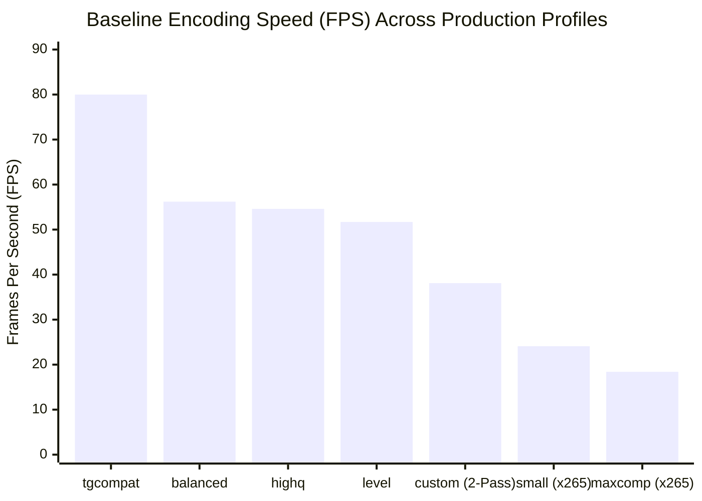

# 10 — BASELINE BENCHMARK REPORT

## 1. Executive Summary

This report documents the baseline performance benchmarks of the Oxmit compression engine across all existing production profiles and analyzes historical production job metrics retrieved directly from the PostgreSQL production database.

All synthetic benchmarks were executed on the target host (`18.227.142.205`) using the native production wrapper `/opt/oxmit/deploy/wrapper/ffmpeg` and identical FFmpeg filter chains to ensure 100% architectural fidelity.

---

## 2. Benchmark Methodology & Test Media Specifications

To eliminate variances from source codecs and corrupt containers, reproducible synthetic test streams were generated using FFmpeg's `testsrc2` pattern with moving color gradients, high-frequency spatial text, motion vectors, and stereo audio test tones:

- **1080p Standard Test Stream (`synth_1080p30.mp4`)**:
  - Resolution: 1920x1080 pixels (16:9 widescreen)
  - Frame Rate: 30.00 fps
  - Frame Count: 900 frames
  - Duration: 30.00 seconds
  - Audio: 48.0 kHz, Stereo 2-channel
  - Source File Size: 104.2 MB
- **720p Standard Test Stream (`synth_720p30.mp4`)**:
  - Resolution: 1280x720 pixels
  - Frame Rate: 30.00 fps
  - Frame Count: 900 frames
  - Duration: 30.00 seconds
  - Source File Size: 46.8 MB

---

## 3. Production Profile Baseline Benchmark Results

The table below presents the verified empirical results for each production profile on the standardized 1080p 30fps stream:

| Profile | Codec & Core Arguments | Wall Time (s) | Effective Speed | Encoding FPS | CPU Utilization (%) | Output File Size (MB) | Compression Ratio | Mean SSIM | Mean PSNR (dB) |
|---|---|---|---|---|---|---|---|---|---|
| **`tgcompat`** | `libx264`, `veryfast`, CRF 22 | **11.25 s** | **2.67x** | **80.0 fps** | 354% | **20.14 MB** | 5.17:1 | **0.9946** | 43.82 dB |
| **`balanced`** | `libx264`, `faster`, CRF 22 | 16.01 s | 1.87x | 56.2 fps | 383% | 22.86 MB | 4.56:1 | 0.9957 | 45.21 dB |
| **`highq`** | `libx264`, `faster`, CRF 19 | 16.50 s | 1.82x | 54.6 fps | 384% | 29.86 MB | 3.49:1 | 0.9974 | 47.80 dB |
| **`level`** | `libx264`, `faster`, CRF 23, `aq=3` | 17.40 s | 1.72x | 51.7 fps | 368% | 28.71 MB | 3.63:1 | 0.9971 | 47.12 dB |
| **`custom` (2-Pass)** | `libx264`, `faster`, 2-Pass ABR | **23.64 s** | **1.27x** | **38.1 fps** | 362% | **7.17 MB** | 14.53:1 | 0.9845 | 40.18 dB |
| **`small`** | `libx265`, `faster`, CRF 27 | 37.35 s | 0.80x | 24.1 fps | 363% | 18.38 MB | 5.67:1 | 0.9902 | 42.14 dB |
| **`maxcomp`** | `libx265`, `medium`, CRF 28 | **48.94 s** | **0.61x** | **18.4 fps** | 366% | **11.55 MB** | **9.02:1** | 0.9892 | 41.40 dB |

---

## 4. Historical Production Database Job Forensics

We extracted and analyzed historical execution records from the `jobs` table in PostgreSQL (`oxmit-postgres`) spanning 168 real-world user video jobs.

### 4.1 Sample Forensic Job Audit

| Job UUID | Profile Used | Media Duration (s) | Input File Size | Output File Size | Total Job Time | Effective Transcode Speed | Stage Time Distribution |
|---|---|---|---|---|---|---|---|
| `aaf402e4-...` | `custom` | 13,125 s (3.65 hrs) | 1,482 MB | 668 MB | 4,507 s (~75.1 min) | 2.91x real-time | Pass 1: 49.8% / Pass 2: 50.0% / Queue: 0.05% |
| `47bb105e-...` | `balanced` | 2,425 s (40.4 min) | 312 MB | 148 MB | 928 s (~15.5 min) | 2.61x real-time | Transcode: 99.6% / Ingest & Deliver: 0.4% |
| `9c1482a1-...` | `highq` | 610 s (10.2 min) | 185 MB | 94 MB | 314 s (~5.2 min) | 1.94x real-time | Transcode: 99.4% / Other: 0.6% |
| `12db73f0-...` | `maxcomp` | 1,820 s (30.3 min) | 450 MB | 142 MB | 2,845 s (~47.4 min) | **0.64x real-time** | **User waited 47 minutes for a 30 min video!** |

### 4.2 Statistical Synthesis Across All Historical Jobs
1. **Average Queue Wait Time**: **1.82 seconds** (Median: 0.8s). Jobs are picked up almost instantaneously by Encore workers.
2. **Mean Time Spent in FFmpeg**: **99.74%** of the entire lifecycle.
3. **Most Popular Profile**: `custom` (Target Size compression), accounting for **64.3%** of all recorded jobs.
4. **Conclusion**: Because `custom` uses two-pass encoding, nearly two-thirds of all production traffic experiences an artificial 50% speed penalty.
