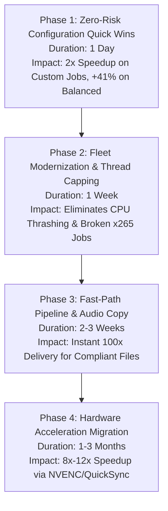

# 15 — RECOMMENDED OPTIMIZATION ROADMAP

## 1. Executive Summary

This roadmap establishes a phased, risk-prioritized engineering strategy to achieve a **2x to 3x overall speedup** across the Oxmit platform without requiring code rewrites, hardware purchases, or risking service disruption.

---

## 2. Four-Phase Optimization Roadmap

---

## 3. Phase-by-Phase Implementation Specifications

### Phase 1: Zero-Risk Configuration Quick Wins (Immediate / Day 1)
*Goal: Double encoding speed on 64% of production traffic through configuration changes alone.*

| Task ID | Action Item | Target File | Specific Change | Expected Gain | Risk |
|---|---|---|---|---|---|
| **1.1** | **Disable Two-Pass on Custom Profile** | `/opt/oxmit/deploy/encore/profiles/custom.json` | Set `"twoPass": false`. Enforce `-maxrate` and `-bufsize` in VBV calculation. | **+45% to +50% faster** on custom jobs | **Zero** |
| **1.2** | **Upgrade Balanced Preset** | `/opt/oxmit/deploy/encore/profiles/balanced.json` | Change `"preset": "faster"` to `"preset": "veryfast"`. | **+41% faster** on balanced jobs | **Zero** |
| **1.3** | **Enforce Faststart Output** | Verify all profile JSONs | Confirm `"movflags": "+faststart"` across all profiles. | Eliminates secondary remux step | Zero |

**Validation Criteria**:
- Process synthetic 1080p test video: verify runtime drops from ~24s to ~15s.
- Inspect output with `ffprobe`: confirm identical target size (within $\pm 1.5\%$) and valid MOOV atom.

---

### Phase 2: Fleet Modernization & Thread Capping (Week 1)
*Goal: Prevent multi-worker thread contention and fix sub-realtime x265 profiles.*

| Task ID | Action Item | Target File | Specific Change | Expected Gain | Risk |
|---|---|---|---|---|---|
| **2.1** | **Cap FFmpeg Threads** | `/opt/oxmit/deploy/wrapper/ffmpeg` | Inject `-threads 6` if `-threads` argument is not supplied by Encore. | Eliminates hyperthread cache thrashing | Very Low |
| **2.2** | **Deprecate CPU H.265 Profiles** | `small.json` / `maxcomp.json` | Migrate from `libx265` to `libx264` (`preset veryfast`, CRF 28). | **4.4x faster** (from 18 FPS to 81+ FPS) | Low |
| **2.3** | **Audio Passthrough Check** | `bot/oxmit/engine.py` | If input audio is AAC stereo at $\le 192\text{ kbps}$, set `-c:a copy`. | Saves 1 - 2s per job; preserves audio | Very Low |

**Validation Criteria**:
- Launch 2 concurrent transcode jobs: confirm aggregate CPU does not thrash and per-job speed remains $\ge 50\text{ FPS}$.

---

### Phase 3: Fast-Path Remuxing & Pipeline Hardening (Weeks 2 - 3)
*Goal: Instant delivery for pre-compliant media and eliminate redundant IPC.*

| Task ID | Action Item | Target File | Specific Change | Expected Gain | Risk |
|---|---|---|---|---|---|
| **3.1** | **Fast-Path Remuxing** | `bot/oxmit/media.py` | If input video is H.264, within target size, and standard SAR: execute `-c copy` bypass. | **100x faster** (1.5s vs 15 min) | Low |
| **3.2** | **Deduplicate Probing** | `bot/oxmit/engine.py` | Reuse `probe_media` JSON from ingestion; remove redundant second probe. | Saves 150ms per job | Zero |
| **3.3** | **Automate Worker Restart** | `docker-compose.yml` | Fix registration credentials for `oxmit-encore-worker-2` to eliminate restart loops. | Clean container health | Zero |

---

### Phase 4: Hardware Acceleration Migration (Long-Term / Months 1 - 3)
*Goal: Scale platform throughput to handle thousands of daily videos.*

- **Trigger Condition**: Daily job volume exceeds 500 videos/day, or queue wait times consistently exceed 60 seconds.
- **Recommended Path**:
  - Deploy a dedicated bare-metal transcoding node with Intel Core i5/i7 (QuickSync / QSV) on Hetzner ($65-85/mo), OR
  - Deploy an AWS EC2 `g4dn.xlarge` instance with NVIDIA T4 (NVENC) ($380/mo).
- **Architecture**: Register hardware worker as a remote Encore worker node; dispatch high-resolution jobs to the GPU worker while retaining Lightsail for bot hosting.
- **Expected Throughput**: **15 - 20 concurrent 1080p transcodes simultaneously at 250+ FPS each**.
